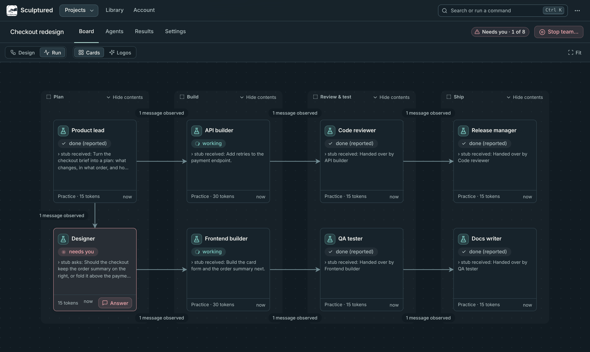
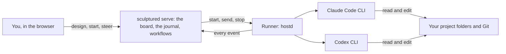

<p align="center"></p>

<p align="center">
  <a href="LICENSE"></a>
  <a href="https://docs.usesculptured.com"></a>
  
  
  
</p>

# Sculptured

Sculptured is a visual workspace for teams of agents performing complex tasks. Give each agent a job and a folder, connect their handoffs, and follow the work from one board. Open any agent to read its conversation, answer questions or send guidance.

Agents run on your own computer through your installed [Claude Code](https://docs.anthropic.com/en/docs/claude-code) or [Codex](https://github.com/openai/codex) CLI, with your existing sign-in. Use the hosted app with a connected computer, or build and run the app locally using the steps below.



## Work with a team of agents

When several agents plan, build and review the same project, you need to see who owns each task and what has actually happened. Sculptured provides:

- **A shared board.** Arrange agents and groups, define handoffs and follow their progress. Open a card to inspect its conversation, files and evidence.
- **Traceable results.** Agent reports, captured tool results and verified checks have distinct labels. A passing check supports only the properties it tests.
- **Local execution.** Agents use your installed CLIs and work in the folders you choose. In local mode, Sculptured stores its own data, including run history, in `~/.sculptured/`.
- **Usage you control.** Run budgets keep a run within a share of your plan. Protections keep each agent's context small: no whole reads of large files, capped shell output, and a fresh conversation from the agent's notes once its context grows large.
- **Agents that know the project.** Each start maps the project's folders, so agents see what exists before building it. They can search what the team already did and record lessons for each other.
- **Workflows for more involved tasks.** Add stages, review panels, checks and revision limits when the work needs them. Advanced settings include merges, schedules and a decision log.

## Quick start

To build locally, you need [Rust](https://rustup.rs/) 1.95 or newer, [Node.js](https://nodejs.org/) 24 and Git. Install Claude Code or Codex and sign in before running real agents.

```bash
git clone https://github.com/Sculptured/Sculptured.git
cd Sculptured
npm --prefix web ci
npm --prefix web run build
cargo run --release -p sculptured -- serve
```

Open http://127.0.0.1:4410 and choose **New project**. Select Claude or Codex, pick **Builder → Reviewer**, then choose a project folder and write each agent's **Job**. When the board shows **Ready**, choose **Start team** and review the confirmation. Agents use your provider account and may incur charges or consume plan usage.

The [quickstart](https://docs.usesculptured.com/quickstart) walks through setup, the first run and reviewing the result. It also covers the hosted beta.

## How it works



`sculptured serve` stores captured events in an append-only journal and uses them to build the app's views. The runner starts each CLI, captures its output and delivers messages. You can also connect a runner on another computer.

## Documentation

- **Using Sculptured:** [docs site](https://docs.usesculptured.com) (sources in [`docs-site/`](docs-site/)): designing teams, the board, controlling live agents, Git, workflows.
- **How it is built:** [`docs/internals/`](docs/internals/README.md), starting with the [overview](docs/internals/overview.md): architecture, the event journal, drivers, workflows, protections, knowledge, the host protocol, testing.
- **Example teams:** [`examples/teams/`](examples/teams/) and [`docs/showcase/`](docs/showcase/).

## Project layout

| Path | What it is |
|---|---|
| `crates/sculptured` | The `sculptured` binary: `serve`, `hostd`, `connect` |
| `crates/controld` | The server: HTTP API, event journal, teams, workflows |
| `crates/hostd`, `crates/drivers` | The runner and the Claude Code and Codex drivers |
| `crates/localops` | Folders, Git, agents' own copies, checks |
| `crates/model`, `crates/rigspec` | Shared types and the team design format |
| `web/` | The React and TypeScript app |
| `desktop/` | The desktop app |
| `docs-site/` | The user documentation |

## Contributing

Contributions are welcome: read [CONTRIBUTING.md](CONTRIBUTING.md) to set up and run the tests, and follow the [Code of Conduct](CODE_OF_CONDUCT.md). Report security problems privately as described in [SECURITY.md](SECURITY.md).

## License

Sculptured is licensed under the [Apache License 2.0](LICENSE).
