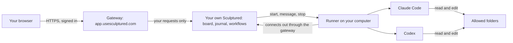
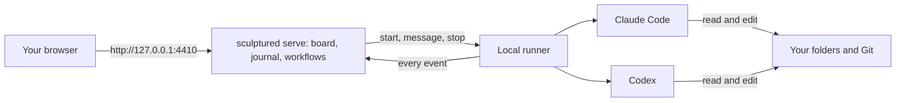

A **project** holds a team's design and run history. Its **agents** work in folders you choose and pass results along the connections you draw. This page explains those parts and the labels you will see as the team runs.

## Designing

| Word | What it is |
| --- | --- |
| **Project** | One team's design and its history. The Projects page, and the **Projects** menu in the top bar, list your projects. |
| **Team** | The agents of a project and the connections between them, started and stopped together. |
| **Agent** | One worker with a name, a **Job** and a **Folder**. It runs on **Claude** (Claude Code), **Codex** or **OpenCode** (open models, see [Open models with OpenCode](/guides/open-models)). |
| **Job** | The agent's assignment, delivered when its work begins. An agent waiting for a handoff receives its Job with that handoff. See [Designing teams](/guides/agent-design). |
| **Folder** | Where the agent works. Agents use the project folder unless you give one its own. On a connected computer it must be inside a folder that computer allows. |
| **Group** | A box of agents inside a team, with its own color. Save a group to your **Library** to reuse it in other projects: see [Reusable groups](/guides/groups). |
| **Input** | Shared goals, links, notes and constraints. In an ordinary team, selected agents receive it; in a workflow, the dispatcher reads it when the team starts. |

### Connections

Arrows on the board say how agents relate.

| Arrow | Effect |
| --- | --- |
| **hands work to** | When the source agent finishes a work turn, Sculptured passes its final reply to the receiving agent. The source starts first. |
| **reports to** | Design intent only. It documents the hierarchy; nothing is enforced. |
| **watches** | Design intent only. Nothing is enforced. |

A **handoff** is one piece of work passed along a "hands work to" arrow, recorded with its message. An arrow on the design does not prove a message was sent: the Run view shows the handoffs that actually happened.

### Workflows (Advanced)

A **workflow** replaces ordinary arrows with stages. A **dispatcher** agent reads Input and splits the work into **items**. Each item moves through **stages**, and routes can branch on the outcome or loop back for another round, up to a round limit. A stage is run by one of:

| Stage | Settled by |
| --- | --- |
| **Agent** | An agent, which reports the outcome. |
| **Review panel** | Several reviewers, whose verdicts are combined. |
| **Check** | A command Sculptured runs, such as `npm test`. Its result is verified evidence. |
| **Person decides** | You, with approve or rework and an optional note. |
| **Merge** | Sculptured, merging the item's branch back. A conflict sends it back. |

An **assembly** agent finishes once every item is done. See [Workflows](/guides/workflows).

## Running

| Word | What it is |
| --- | --- |
| **Start team** | Checks the design, then starts each agent in order. The project's status, next to **Start team**, reads **Draft · N to fix** until the design can start, then **Draft · ready to start**. |
| **Design** and **Run** | The two views of a project. **Design** is the editable board. **Run** shows the agents that are running now, what each is doing, and the handoffs between them. |
| **Run** | One start-to-stop of a team. Each run's history is kept. |
| **Question** | An agent asking you for a decision. It shows as **needs you** until you answer, or until it times out and the agent decides for itself. See [Questions and approvals](/guides/questions). |
| **Managed subagent** | An agent another agent started with Sculptured's tools while the team runs. It shows in Run under its parent. |
| **Own copy** | An agent's own Git working copy of the project, so agents working at once don't overwrite each other. |
| **Token use** | The tokens each agent's CLI reports, shown live. Limits and estimates are on [Limits and usage](/reference/limits). |

Agent states such as *running*, *stopping* or *needs attention* are listed on [Agent states](/reference/states).

## Computers

| Word | What it is |
| --- | --- |
| **Computer** | One of your machines, connected to your account. The **Computers** page lists them. |
| **Runner** | The background program on a computer that starts the agents, captures what they do and passes messages. Installed by the [connect command](/connect-a-computer). |
| **Allowed folders** | The folders a computer lets agents start in, decided on that computer. By default, your home folder. Add more with `sculptured allow <folder>`. |
| **Access** | How much agents may do once started. **Full access** (the default) lets them act as you do. **Sandboxed** makes Claude ask before risky actions and keeps Codex writing only inside its folder. |
| **Run on** | Which computer runs a team. With one connected computer, **Automatic** uses it. |

The server can ask a computer to do something, but the computer has the last word. It refuses agents outside its allowed folders, and the server can lower access but never raise it.

## Evidence and provenance

Progress labels describe where the work stands: **Planned**, **In progress** or **Blocked**, for example. Evidence labels describe how Sculptured obtained a fact. Read them together: an agent can finish a task without its result having been checked.

| Word | Meaning |
| --- | --- |
| **Agent-reported** | The agent said so, for example "done" or "tests pass". A claim, not proof. |
| **Captured** | Sculptured recorded it directly, such as a tool call and its result. |
| **Observed** | Seen on disk or in Git, such as a changed file. |
| **Estimated** | Worked out by a rule of thumb, such as a token count from text length. |
| **Verified** | A check Sculptured ran passed; the result covers what that check tests. |
| **Unknown** | No supporting information is available. |

<Note>A file existing, a tool succeeding or an agent saying "done" does not show that the work is correct. Only a check that ran counts as verified.</Note>

## Sharing

| Word | What it is |
| --- | --- |
| **Library** | Your private collection of reusable groups. |
| **Community** | The shared catalog. A published group is a **block**: a definition only, which never starts agents by itself. |
| **Team file** | A project exported as a [MADL](/guides/madl) document (`.madl.yaml`), an open format other tools can read. |

## How the parts connect

<Tabs>
  <Tab title="Hosted beta">

The hosted service signs you in and provides a separate Sculptured instance for your account's projects and run history. Your computer's **runner** opens an outbound connection to the service, so you do not need to open an inbound port. Agents run on your computer using its CLI sign-ins and folder permissions.

  </Tab>
  <Tab title="Self-hosted">

`sculptured serve` starts the app server and a runner on the same machine. Team designs and run history are stored locally. Claude Code and Codex still communicate with their providers; see [Privacy](/privacy) for the data flow.

  </Tab>
</Tabs>

## Next steps

<CardGroup cols={2}>
  <Card title="Connect a computer" icon="desktop" href="/connect-a-computer">Install the runner and choose folders.</Card>
  <Card title="Compose on the board" icon="pen-ruler" href="/guides/board">Put these pieces together.</Card>
  <Card title="Run a team" icon="play" href="/guides/running">What happens when you press Start team.</Card>
  <Card title="Agent states" icon="list" href="/reference/states">Every state an agent can be in.</Card>
</CardGroup>
