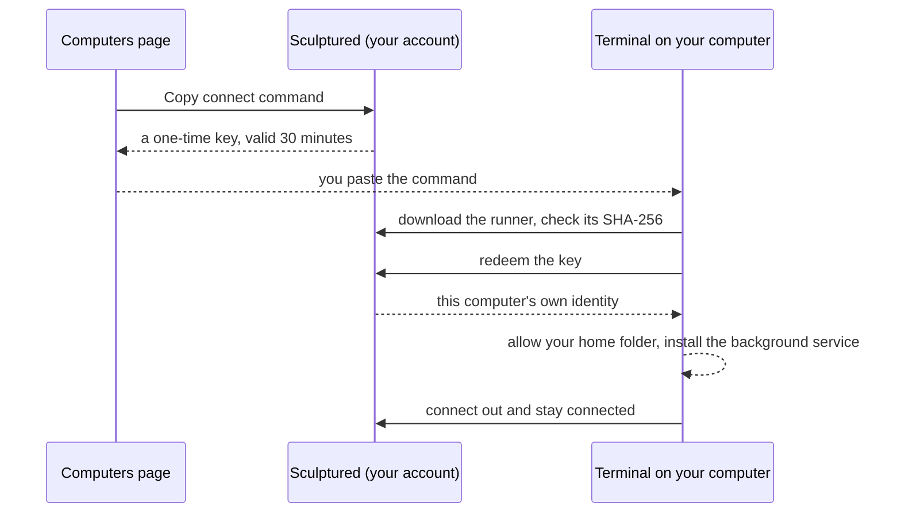

In the hosted beta, your agents run on **your own computer**, never on Sculptured's servers. A small program, the **runner**, starts Claude Code or Codex there, captures what they do and sends it to your account. You install and connect it with one command from the **Computers** page.



## Connect

<Steps>
  <Step title="Open Computers">
    Sign in at **app.usesculptured.com** and open **Computers** from the **⋯** menu at the top right.
  </Step>
  <Step title="Pick the system">
    Under **Connect a computer**, the tab for the system you're browsing from is already selected. Choose another tab if you're connecting a different machine.
  </Step>
  <Step title="Copy the command">
    Choose **Copy connect command**. It contains a one-time key, so the computer connects without a code to approve. If your browser won't copy it, the command appears on the page for you to select.
  </Step>
  <Step title="Paste it on that computer">
    Open a terminal on the computer, paste the command and press Enter. When it finishes, it prints `Connected to https://app.usesculptured.com.` and the folders agents may work in.
  </Step>
  <Step title="Check it">
    Back on the Computers page, the computer shows **Connected**, with its access level, its allowed folders and whether Claude Code and Codex are installed and signed in.
  </Step>
</Steps>

<Tabs>
  <Tab title="Windows">
    Open **PowerShell** (Start menu, type *PowerShell*, press Enter). Paste with right-click or Ctrl+V, then press Enter. The command looks like this:

    ```powershell
    $env:SCULPTURED_KEY="<one-time key>"; irm https://app.usesculptured.com/install.ps1 | iex
    ```

    | | |
    | --- | --- |
    | Supported | 64-bit Intel or AMD (x64). Windows on Arm is not supported yet. |
    | Installs to | `%LOCALAPPDATA%\Programs\Sculptured` (`sculptured.exe` and `sculptured-background.exe`), added to your user PATH. No admin rights needed. |
    | Keeps running with | A logon task named **Sculptured runner** in Task Scheduler. It starts when you sign in to Windows and restarts if it fails. It runs without a window. |
    | Runner data | `%USERPROFILE%\.sculptured\runner` |

    Agents run natively on Windows, through the Windows versions of Claude Code and Codex. Folder paths are full Windows paths, such as `C:\Users\you\project`.
  </Tab>
  <Tab title="Linux">
    Open a terminal. Paste with Ctrl+Shift+V, then press Enter. The command looks like this:

    ```bash
    curl -fsSL https://app.usesculptured.com/install.sh | sh -s -- --key <one-time key>
    ```

    | | |
    | --- | --- |
    | Supported | The processors the Computers page offers a build for. |
    | Installs to | `~/.local/bin/sculptured`. No `sudo` needed. If `~/.local/bin` isn't on your PATH, the installer says so. |
    | Keeps running with | A systemd user service, `sculptured-runner`, in `~/.config/systemd/user/`. It starts when you log in and restarts five seconds after a failure. |
    | Runner data | `~/.sculptured/runner` (owner-only) |
  </Tab>
  <Tab title="macOS">
    Apple silicon and Intel Macs, with macOS 11 or later. There are two ways to connect a Mac:

    - **The app:** download it and sign in there. Agents run while the app is open. See [Install the Mac app](#install-the-mac-app) below.
    - **Terminal:** copy the connect command, as on Linux, and paste it into Terminal. The runner keeps itself running in the background with a LaunchAgent, `~/Library/LaunchAgents/dev.sculptured.runner.plist`, even when no window is open.

    macOS keeps Desktop, Documents and Downloads from background programs until you allow them. If a project is in one of those, allow Sculptured in *System Settings → Privacy & Security*, under **Files and Folders** or **Full Disk Access**. Folders elsewhere in your home folder need nothing.

    Self-hosted Sculptured already runs on Apple silicon Macs: see [Run it yourself](/operations).
  </Tab>
</Tabs>

## Install the Mac app

On a Mac, the sign-in page and the Computers page both offer **Download Sculptured for Mac**. One download works on Apple silicon and Intel Macs.

<Steps>
  <Step title="Move it to Applications">
    Open the download (`Sculptured-mac.dmg`) and drag **Sculptured** onto **Applications**. Then open it from your Applications folder, not from the download window.
  </Step>
  <Step title="Allow it once">
    The first time, macOS says **“Sculptured” Not Opened**: *Apple could not verify “Sculptured” is free of malware…*. This is because the app isn't signed with an Apple Developer ID yet. Click **Done**, not Move to Trash.

    Open *System Settings → Privacy & Security* and scroll down to **Security**. Next to *“Sculptured” was blocked to protect your Mac*, click **Open Anyway**, enter your Mac password, then click **Open**. You only do this once; after that it opens normally.
  </Step>
  <Step title="Sign in and approve">
    In the app, under **Sculptured account**, the address is already filled in. Choose **Sign in to my account**, sign in, and approve this computer. It appears on the Computers page, and agents run on it while the app is open.
  </Step>
</Steps>

<Note>
If Google sign-in is refused inside the app, sign in with GitHub or with your email and password instead.
</Note>

## What the command does

1. Downloads the runner for this system and checks its SHA-256 checksum. If it doesn't match, nothing is installed.
2. Installs it for your user only, with no admin rights.
3. Redeems the one-time key, which gives this computer its own identity in your account. The key works once, for 30 minutes.
4. If no folders are allowed yet, allows your **home folder**.
5. Installs the background service and starts it, finding Claude Code and Codex on this computer so the service can launch them.

Running the command again is safe. It updates the runner in place, stops the old one first, and reuses the computer's identity while it is still connected, so the computer is not added twice.

### What stays on the computer

The runner keeps its settings in its own owner-only folder:

| File | Holds |
| --- | --- |
| `device.json` | This computer's identity: its id and key for your account. The server keeps only a hash of the key. |
| `runner.json` | Your rules: allowed folders, access level and what else the account may do here. Only you change it, on this computer. |
| `hostd/` | The runner's working state. |

## Choose where agents may work

The runner refuses to start an agent outside its **allowed folders**, whatever the server asks. By default that's your home folder. To allow another folder:

```bash
sculptured allow /path/to/folder
```

Then restart the runner so running agents see it: run the connect command again, or restart the service (`systemctl --user restart sculptured-runner` on Linux).

When you design a project, set **Folder on your computer** to a full path inside an allowed folder, or leave it empty to use the computer's first allowed folder.

### Access level

Allowed folders decide where an agent *starts*. The access level decides what it may do once running.

| Access | What agents may do |
| --- | --- |
| **Full access** (default) | Act as you do on this computer, using the CLIs' full-access modes. |
| **Sandboxed** | Claude asks before risky actions; Codex writes only inside its folder. |

To change it, connect with `--sandboxed` or `--full-access`. The server can lower access for a team but never raise it above this.

### Other things the account may do here

Besides running agents, your account may ask this computer for a few local operations. All are on by default (checks are off when sandboxed):

| Capability | Lets the account |
| --- | --- |
| `git` | Show and commit Git changes in project folders. |
| `copies` | Give agents their own Git working copies. |
| `checks` | Run a workflow's check commands, such as the tests. |
| `cli-sign-in` | Start Claude Code or Codex sign-in from the browser. |
| `plan-usage` | Read your Claude or Codex plan usage. |
| `generate` | Draft a team with **Describe it**, using one tool-less call to your own CLI. |

Turn one off with `--disable <capability>` (or on with `--enable`) when you run `sculptured connect`.

## Sign in Claude Code and Codex

Agents use the Claude Code and Codex sign-ins **on the computer that runs them**. Install them there first. Sculptured finds them on your PATH and in the usual install places, including when you install one after connecting. When one is missing, Sculptured shows its official install command for each system:

| | Mac or Linux (Terminal) | Windows (PowerShell) |
|---|---|---|
| Claude Code | `curl -fsSL https://claude.ai/install.sh \| bash` | `irm https://claude.ai/install.ps1 \| iex` |
| Codex | `curl -fsSL https://chatgpt.com/codex/install.sh \| sh` | `irm https://chatgpt.com/codex/install.ps1 \| iex` |

If one isn't signed in, sign it in once, from any browser (it doesn't have to be on that computer):

- **Codex** shows a one-time code. Open its sign-in page on any phone or computer, sign in, and enter the code.
- **Claude Code** opens its sign-in page. If the page ends on a code, paste it into the box under **Sign in** and choose **Send code**.

You can start a sign-in from:

- **Start team**: before a team starts, Sculptured checks that its computer has the Claude Code or Codex its agents use, signed in. If not, it says which and lets you sign in right there, then **Start team** again;
- the **Computers** page (or **Account** when Sculptured runs on your own computer): **Sign in** next to it;
- an agent that stopped because it isn't signed in: **Sign in to Claude Code** (or Codex), then **Hand over again**; or
- a terminal on that computer: run `claude` or `codex login`.

Every agent on that computer can then use it.

## Run agents on more than one computer

A team runs on the computer chosen under **Run on** in its Design panel. One agent can run somewhere else: open the agent, then **Advanced** → **Runs on**, and choose another connected computer, such as a desktop with a GPU or a cluster's login node. The rest of the team stays where it was.

- **Messages and handoffs** reach the agent on its computer, and its questions come to you as usual.
- **Files stay where they were made.** An agent on another computer works in folders on that computer, and what it hands on is its reply: text and file paths. Put shared work in a git remote both computers can reach.
- **Start needs every computer it uses.** If one is not connected, Start says which, and which agent runs there.
- **Agents an agent starts** run on the same computer as the agent that started them.

<Note>Run Sculptured only where the computer's owner allows long-running programs. Many clusters forbid them on login nodes: ask your cluster's support first.</Note>

### Add a cluster from the web app

On the hosted service you can connect a cluster without installing anything yourself: Sculptured's server signs in to the login node over SSH, sets up the runner there and keeps it running.

1. **Check your site's rules first.** Many clusters limit long-running programs, or AI tools, on login nodes. The runner is small and mostly waits, but some sites want it under `scrontab` or on a service node instead.
2. On **Computers**, choose **Add a cluster**. Give the login node's host name, the port (22 unless your site says otherwise), your user name there and, if you reach it through a jump host (bastion), that host too.
3. Choose how Sculptured signs in:
   - **A key Sculptured makes** (recommended). Sculptured makes a key pair just for this cluster and shows its public half, with the exact line to add to `~/.ssh/authorized_keys` on the login node (and the line for the jump host, which allows a connection to the login node only). Add it, then choose **Connect**. The private half never leaves the server.
   - **A private key you paste**, with its passphrase if it has one. The passphrase is used once to read the key and is not kept.
   - **A certificate your site issued**: a private key and its `-cert.pub` file, from NERSC's `sshproxy`, Smallstep's `step ssh`, or a Teleport-style CA. The card shows whom the certificate names and when it ends; from 2 hours before then it asks you to paste a new one (**Paste a new certificate**), and Sculptured never tries one that has ended.
   - **A password.**

   Sculptured tries what the login node offers in this order: the key or certificate, then questions (keyboard-interactive), then the password, and goes on through a chain such as a password followed by a code.

   Saved keys and passwords are encrypted with a server key kept outside the database, are never shown again, and are deleted when you remove the cluster.
4. If the cluster asks for a code when anyone signs in (Duo, an OTP), the card shows its question; type the answer there. It is used once and never stored. The card shows every question the site asks at once, hides answers the site asks to hide, turns a sign-in link (a web or device-code sign-in) into a link, and counts down the time left to answer. For a Duo push, type `1` (or `push`) and approve on your phone: Sculptured waits up to 2 minutes for the approval. If a site asks for your password and a code in one field, type both as the site says.
5. Choose how long Sculptured stays signed in (**Keep signed in for**, 12 hours unless you change it, at most 7 days; 0 keeps nothing). After you answer a code once, Sculptured keeps that SSH connection open and restarts the runner over it without asking again. The card says **Signed in until …**; **Sign out** closes the connection, and so does removing the cluster. Many sites end sessions sooner, and a restart of Sculptured's server closes it too: the next restart then asks for your code.

**What can't work from a web app.** Hardware security keys (FIDO keys such as `sk-ed25519`), Kerberos (GSSAPI) tickets and SSH agent forwarding all need your own computer, so Sculptured's server cannot use them. If your site requires one of them, [set up the cluster yourself](#set-up-a-cluster-yourself).

Sculptured then copies the runner to `~/.sculptured/bin` on the login node, writes its own key to `~/.sculptured/runner/device.json` (readable only by you), starts it in a tmux session named `sculptured-runner` (with `nohup` where there is no tmux), runs `sculptured doctor` there and shows the report. From then on the cluster is one of your computers: agents can run on it, and messages and handoffs reach them as on any other computer.

**Keeping it running.** If the cluster's runner loses its link for more than a few minutes, for example after the login node restarts, Sculptured signs in again and restarts it. While the connection is still signed in, this needs no code. Otherwise a cluster that asks for a code at sign-in can't be reconnected without you: its card says **Reconnect needs your code** until you choose **Reconnect** and answer.

**What Sculptured did.** Each cluster's card lists every SSH action with its time: connected, signed in, installed, paired, started or restarted, and anything that failed, with the reason. It also shows the login node's host key fingerprint. Sculptured saves that key the first time it connects and refuses to sign in if it ever changes.

**Remove** deletes the saved key or password and revokes the runner's key; the runner on the cluster stops by itself. Remove the line you added to `~/.ssh/authorized_keys`, and `~/.sculptured` if you like.

### Set up a cluster yourself

1. Install Sculptured on the login node and run `sculptured doctor`. Under **This computer** it says whether the runner keeps running after you log out, whether the node reaches your Sculptured account, Anthropic and OpenAI, and which proxy settings are set (names only).
2. If user services don't run there (common on clusters), keep the runner in tmux, where your site allows it: `tmux new -d -s sculptured 'sculptured connect <your Sculptured address>'`. Some sites offer scheduled jobs for this instead, such as NERSC's `scrontab`.
3. Give the agent that runs there what it needs to know about the scheduler: add Slurm or PBS skills with **Add from a catalog** (an HPC centre's catalog, or any GitHub repository of skills), or an existing Slurm or PBS MCP server with **From the MCP Registry**. The agent then submits and watches jobs itself (`sbatch`, `squeue`, `sacct`, or `qsub`, `qstat`), and every call shows in its timeline.

Compute nodes often have no internet; an agent can run only where the node reaches Anthropic or OpenAI.

## Use one computer with several accounts

A computer can run agents for more than one account, for example your own and a test account. Copy the connect command from the other account's **Computers** page and run it on the same computer. Sculptured sees that the computer is already connected to a different account and adds this one beside it: each account gets its own runner, its own folder (`~/.sculptured/runners/<id>`) and its own background service, so both run at once. Running an account's command again reconnects its existing runner instead of adding the computer twice.

The new runner starts with the same allowed folders and access as the computer's first one; change them with `sculptured allow … --data-dir ~/.sculptured/runners/<id>`.

## Stop agents when something stops responding

**Stop** and **Stop everything now** always finish in Sculptured, even when the computer running the agents is offline. Its agents are marked stopped at once. If one is still running on that computer, the computer ends it as soon as it reconnects.

To end them on the computer itself, without Sculptured, run this there. It works while the computer is offline:

```bash
sculptured stop
```

It ends, like Ctrl+C, every agent this computer's runner started, together with the commands they started, and lists them. It only touches processes the runner started for agents. Pass `--data-dir` if you connected with one. It works when the runner itself has stopped responding, and covers every account's runner on the computer.

## Disconnect or remove

To disconnect a computer, choose **Disconnect** next to it on the Computers page. Its identity stops working at once. To connect it again later, copy a new command and run it. The runner on that computer stops and turns its own login service off, so it is not started again at every login. Connecting again turns the service back on.

There is no uninstall command yet. To remove the runner by hand after disconnecting:

<Tabs>
  <Tab title="Windows">
    ```powershell
    Unregister-ScheduledTask -TaskName 'Sculptured runner' -Confirm:$false
    $bin = Join-Path $env:LOCALAPPDATA 'Programs\Sculptured'
    Get-Process sculptured, sculptured-background -ErrorAction SilentlyContinue | Where-Object { $_.Path -like "$bin*" } | Stop-Process
    Remove-Item -Recurse $bin, "$env:USERPROFILE\.sculptured\runner"
    ```
  </Tab>
  <Tab title="Linux">
    ```bash
    systemctl --user disable --now sculptured-runner
    rm ~/.config/systemd/user/sculptured-runner.service ~/.local/bin/sculptured
    rm -r ~/.sculptured/runner
    ```
  </Tab>
</Tabs>

## Connect without a key

You can also run `sculptured connect https://app.usesculptured.com` yourself. It prints a link and a code such as `WXYZ-2345` and opens your browser. Check that the code matches, then choose **Allow**. Add `--install-service` to keep it running in the background, `--allow <folder>` to choose folders up front, and `--name` to set how it appears on the Computers page. All options are on the [CLI reference](/reference/cli).

<Warning>Only approve a code you just saw on your own computer. Approving a code someone sent you would connect *their* machine to your account.</Warning>

## Troubleshooting

<AccordionGroup>
  <Accordion title="“There's no Sculptured build for … yet”">
    The Computers page offers a command only for systems with a published build: today, Windows on x64, Linux and macOS. The installers also stop, without installing anything, on Windows on Arm or on an unsupported Linux processor.
  </Accordion>
  <Accordion title="“This connect command was already used or has expired”">
    Each command works once, for 30 minutes. Choose **Copy connect command** again and paste the new one.
  </Accordion>
  <Accordion title="The command finished, but the computer doesn't show Connected">
    Wait ten seconds; the page refreshes itself. If it still doesn't connect, run the command again. It stops any old runner before replacing it. On Linux, `systemctl --user status sculptured-runner` shows whether the service is running. If the command printed "Wrote …, but could not start it", start the service yourself, or run `sculptured connect https://app.usesculptured.com` to stay connected while the terminal is open.
  </Accordion>
  <Accordion title="An agent says Claude Code or Codex isn't signed in">
    The CLI is installed but has no sign-in on that computer. Choose **Sign in to Claude Code** (or Codex) on the agent, finish signing in, then choose **Hand over again**. See [Sign in Claude Code and Codex](#sign-in-claude-code-and-codex).
  </Accordion>
  <Accordion title="Sculptured says Claude Code or Codex isn't installed">
    Install it on the computer that runs the team, then start the agent again. You don't need to reconnect: the runner looks for the CLI each time an agent starts.
  </Accordion>
  <Accordion title="“… is not in a folder this computer allows”">
    The project's folder is outside the computer's allowed folders. Choose a folder inside one of them, or allow it with `sculptured allow <folder>` and restart the runner. The message lists the allowed folders.
  </Accordion>
  <Accordion title="“… does not exist on this computer” or the folder is rejected">
    Folder paths must be full paths on the computer that runs the team, such as `/home/you/project` or `C:\Users\you\project`. Check the spelling, or choose **Browse…**.
  </Accordion>
  <Accordion title="“Live updates for … aren't arriving”">
    The browser lost its live connection to your account. Your agents are not affected and keep working. Sculptured keeps trying; choose **Try again** to reload. This usually means a dropped network connection, or a network that blocks live connections.
  </Accordion>
  <Accordion title="My computer went to sleep or lost Wi-Fi during a run">
    Nothing is lost. Agents' calls wait for the connection to return, questions stay open, and a **Stop team** you press meanwhile happens as soon as the computer is back. See [When a computer goes offline](/guides/offline).
  </Accordion>
</AccordionGroup>

More problems and fixes are on [Troubleshooting](/troubleshooting).

## Next steps

<CardGroup cols={2}>
  <Card title="Quickstart" icon="rocket" href="/quickstart">Run a first team on your computer.</Card>
  <Card title="Security" icon="shield" href="/security">What the server can and cannot do on your computer.</Card>
</CardGroup>
