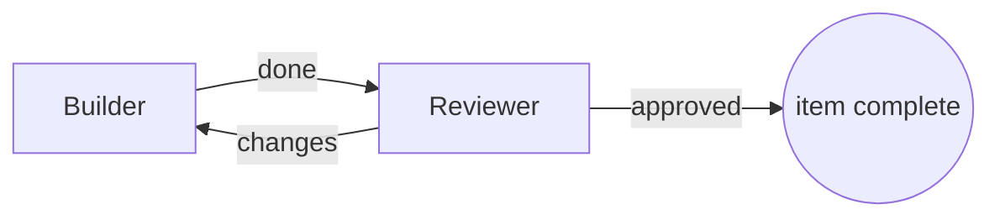

Start with **one agent** and a clear task. Add agents when separate roles, independent work or a second review will help. For each agent, define what it owns, what it passes on and how you will check the result. More agents also mean more coordination and token use.

<CardGroup cols={3}>
  <Card title="Pick a pattern" icon="diagram-project" href="#pick-a-pattern">Four shapes that cover most work.</Card>
  <Card title="Set up each agent" icon="sliders" href="#set-up-each-agent">Runs on, model, permissions, token limit, check.</Card>
  <Card title="Write the Job" icon="file-lines" href="#write-each-job-like-a-task-spec">A template you can copy.</Card>
</CardGroup>

## When to split work

These four reasons can help you decide whether to split the work:

| Reason | Example |
| --- | --- |
| **Specialization** | A researcher, a writer and a reviewer with different instructions or models. |
| **Isolation** | A reviewer with separate instructions and restricted permissions. See the permission limits below. |
| **Parallelism** | Independent chapters or components built at the same time. |
| **Context** | Each agent keeps a small context instead of one agent carrying everything. |

If none applies, refine the single agent's Job before expanding the team.

## Pick a pattern

| Pattern | Shape on the board | Use for | Watch |
| --- | --- | --- | --- |
| Pipeline with a review loop | Builder → Reviewer ↺ | Work that needs implementation and review | Bound the revision rounds |
| Supervisor and workers | Lead → Workers → Lead | Separable parts that one agent integrates | Keep the lead's context manageable |
| Independent reviewers | Draft → Reviewer A + B → Editor | Quality over cost | Reviewers must not see each other's verdicts |
| Dynamic dispatch | Coordinator → spawned specialists → Assembly | The number of pieces is known only at run time | Set spawn, depth and token limits first |

The built-in templates cover several of these: **Builder → Reviewer**, **Planner → 2 Builders**, **Independent reviewers**, **Design and revise** and **Adaptive support team**. The [CS2680 pattern catalog](/guides/pattern-catalog) has a ready-made block for each slide.



Plain arrows can loop, for example a reviewer handing work back to a builder, as long as an agent outside the loop hands work into it. Each piece of work goes round such a loop at most 3 times before it stops and says so. A review loop with named outcomes and a round limit you set, like the one above, is a [workflow](/guides/workflows).

## Set up each agent

Select an agent on the [board](/guides/board) to open its details. These settings decide what it costs and what it can touch.

### Runs on: Claude or Codex

| Choice | What runs | Model selection |
| --- | --- | --- |
| **Claude** | Claude Code, with your own sign-in | Choose from the model menu or use Claude's default. |
| **Codex** | Codex, with your own sign-in | Use the default, select a listed model or enter a model ID. |

You can also set models for the whole team (**Team models**) or for a group (**Group models**). An agent's own choice wins, then its group's, then the team's. **All agents run on** switches every agent at once, and Ctrl+Z undoes it.

<Tip>You can use different providers for the builder and reviewer. Open each agent and set **Runs on** individually.</Tip>

### Permissions

Under **Advanced** in the agent's details:

| Setting | Claude Code | Codex |
| --- | --- | --- |
| **unrestricted** (the default) | Runs without permission prompts | Approvals off, no sandbox |
| **restricted** | Permission prompts come to you as approvals | Asks before untrusted actions |

Sculptured's own tools, including questions, reports and workflow calls, do not raise permission prompts. **Restricted** adds the CLI's approval controls; it does not make an agent read-only. Claude tool approvals are allowed automatically if their timeout expires. Read [Questions and approvals](/guides/questions) before relying on those controls.

### Token limit

**Token limit** caps the tokens an agent uses in one run. Choose which tokens count (**all tokens**, **all except cache reads**, or **output only**) and whether the limit should **include agents it spawns**. When the agent reaches the limit, Sculptured asks it to wrap up with a summary, then stops it.

<Warning>Usage is reported after each turn, so an agent can go over its limit by up to one turn. Leave that margin when you set it.</Warning>

### Check

**Check** is a command Sculptured runs in the agent's folder after each turn the agent finishes, for example `npm test`. Exit code 0 shows "check passed"; anything else shows "check failed", with its output. A check result is verified by Sculptured; the agent's own "done" is only agent-reported. The command runs as you, with your permissions.

### Skills

Instructions the agent loads only when it needs them, such as your house style or how to run a release. Until then only their names and descriptions are in its context. See [Skills and tools](/guides/skills).

### Contract and tools on its computer

Under **Advanced**, an agent's **Contract** says what it reads, writes and decides, and the values it shares with others; see [Contracts](/guides/budgets#contracts-what-each-agent-reads-writes-and-decides). **Kindex memory** and **Signet-Eval policy checks** give it tools installed on its computer; see [Skills and tools](/guides/skills#tools-on-the-agents-computer-kindex).

### When it restarts

Under **Advanced**, **When it restarts** sets what happens when the agent's session has to start again: **resume if possible**, **start fresh**, or **wait for me to choose**.

## Write each Job like a task spec

An agent's **Job** defines its assignment. An agent that starts immediately receives the Job as its first message. An agent waiting for upstream work receives it with its first handoff; you can still edit the Job while it waits. Use this template:

```text
Objective: <what to achieve, in one or two sentences>
Output: <the exact file, format or message you hand on>
Done when: <a check anyone can run, e.g. "npm test passes" or "REPORT.md has these sections">
Boundaries: <what you must not touch or decide>
Budget: <rounds or time; the token limit itself is set on the agent>
Hand on: <who receives your result, and what they need from it>
```

The next agent receives the final reply from the completed work turn. Ask for a concise handoff that includes the result, relevant file paths, checks run and unresolved issues. Keep longer outputs in files.

When completion can be tested by a command, put that command in the agent's **Check** field. Set the actual **Token limit** in the agent's settings; a budget written in the Job is an instruction, not an enforced limit.

An agent with no Job waits: your first message to it becomes its work, and when it finishes, its result is handed on.

## Let an agent draft the team

On a new project, **Describe it** sends your description to your own Claude Code or Codex, which drafts the team. It can ask you questions first. You choose the team size, the agent kinds and a shape, then keep or drop agents and arrows before anything is created. The team panel shows "Generated by Claude Code from a description" (or Codex) and "not run yet" until it runs. Review every Job: a drafted team is a starting point, not a checked design.

## What goes wrong

| Failure | What it looks like | Prevention |
| --- | --- | --- |
| Overlap | Two agents edit the same file | Give each agent its own files in its Job |
| Gaps | Nobody owns integration or tests | Name one owner for the final check |
| Hidden dependencies | "Parallel" pieces wait on each other | Make it an arrow, or a dependent workflow item |
| Unmergeable outputs | Results arrive in different formats | Specify the Output format exactly |
| Lost context at aggregation | The lead summarises away details | Write results to files and pass paths |
| Loops | Agents message each other without end | Use workflow routes with **Most rounds per item** |

Finish with an agent **Check** or a workflow check stage where appropriate. Read the result alongside the agent's report to see what was tested and what still needs review.

<Note>The patterns and task-design guidance draw on Juncheng Yang's [CS2680 Agent Design II](https://cs2680.com/slides/5_agent_design_2.pdf), especially slides 6, 9–16, 21, 24–25 and 36. This guide is not endorsed by the course.</Note>

## Next steps

<CardGroup cols={2}>
  <Card title="Compose on the board" icon="diagram-project" href="/guides/board">Add agents, draw arrows and clear what blocks Start.</Card>
  <Card title="Workflows" icon="route" href="/guides/workflows">Stages, review loops, checks and people in the loop.</Card>
  <Card title="Examples" icon="flask" href="/guides/examples">Complete teams to start from.</Card>
  <Card title="Limits" icon="gauge" href="/reference/limits">Team size, spawn depth and token limits.</Card>
</CardGroup>
