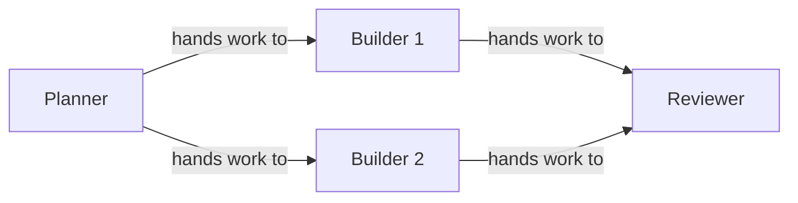

Use the **Design** board to build a team: choose its working folder, add agents, write their jobs and connect their handoffs. The **Run** tab opens after the team starts and shows its activity.

<CardGroup cols={3}>
  <Card title="Add agents" icon="plus" href="#add-agents">Drag, click or right-click to add Claude or Codex.</Card>
  <Card title="Connect work" icon="arrow-right" href="#connect-work">Arrows decide who starts after whom; the Input says what it's all for.</Card>
  <Card title="Get to Ready" icon="check" href="#needs-setup-and-things-to-fix">What Needs setup means and how to clear it.</Card>
</CardGroup>

## Start a project

Press **New project** on the Projects page or in the **Projects** menu of the top bar, or press <kbd>n</kbd> anywhere except the Design board (there, <kbd>n</kbd> adds an agent). The **New project** page offers:

- **Agents run on:** Claude or Codex, for every agent in the template.
- **name:** the project's name. Leave it empty to use the template's.
- **Describe it:** your own Claude Code or Codex drafts a team from a description. See [designing teams](/guides/agent-design#let-an-agent-draft-the-team).
- **Templates:** Solo agent, Builder → Reviewer, Planner → 2 Builders, Blank canvas, Textbook creator, Adaptive support team, Independent reviewers, and Design and revise. See [examples](/guides/examples).
- **Advanced:** import a team file (`.sculptured-team.json`, or an OpenRig YAML file), or import a past run (`.sculptured-session.jsonl`), which opens read-only in Results › History. See [team files](/guides/team-files).

<Warning>Claude and Codex agents use your own CLI logins and may cost money once started.</Warning>

## Rename the project

Double-click the project name next to the **Design** and **Run** tabs, or focus it and press <kbd>Enter</kbd> or <kbd>F2</kbd>. Type the new name and press <kbd>Enter</kbd>. <kbd>Esc</kbd> puts the old name back. You can also edit **Team name** in the team details.

## Choose folders

Every agent needs a folder to work in. Set one folder for the whole project and every agent inherits it, unless you give an agent its own.

<Tabs>
  <Tab title="Hosted (connected computer)">
    In the team details, **Folder on your computer** takes a full path on the computer that runs the team, for example `/home/you/project` or `C:\Users\you\project`. **Browse…** lists the folders that computer allows. The folder must be inside one of them (`sculptured allow <folder>` adds more). Leave it empty to use the computer's first allowed folder.

    **Run on** picks the computer. **Automatic** uses your only connected computer. With none connected, follow **Connect one**. See [connect a computer](/connect-a-computer).
  </Tab>
  <Tab title="Local">
    In the team details, **Project folder** → **Choose project folder…** opens a folder picker. **Clear project folder** removes it. If some agents use their own folders, **Use project folder for all agents** resets them.
  </Tab>
</Tabs>

## Add agents

The Design toolbar above the board has **Add agent**, which adds the kind most of the team runs on (Claude in a new team). **More tools** next to it shows the other kind, **Codex**. Drag either onto the board, or click it to add the agent in the next free spot. You can also right-click the board and choose **Add a Claude agent here**. A new agent opens its details so you can name it and write its Job.

Cards go exactly where you drop them. A card dragged close to another lines up with it: the same row or column, or the usual spacing beside it.

Each card shows the agent's name, what it runs on, its model, and its Job. A card with no Job says "No job yet. Select the agent to write one."

| In the agent's details | What it sets |
| --- | --- |
| **Name** | What the team and you call it. Two agents can't share a name. |
| **Job** | Its first message when the team starts. See [writing a Job](/guides/agent-design#write-each-job-like-a-task-spec). |
| **Folder** | Its own folder, or **Use project folder**. |
| **Runs on** and model | Claude or Codex, and which model. |
| **Hands work to** | Who receives its finished work (**Connect to…**). |
| **Group** | Which group it sits in. |
| **Token limit**, **Check** | A token cap and an after-turn command. |
| **Advanced** | **When it restarts** and **Permissions**. |

The other buttons on the bar:

- **Group** adds an empty group box. **Saved groups** opens your [Library](/guides/groups) to drag a saved group in.
- The folder button sets the folder for every agent.
- **Full text** shows every card's full Job instead of a preview.
- **Undo** (<kbd>Ctrl+Z</kbd>) and **Redo** (<kbd>Ctrl+Shift+Z</kbd>).

## Connect work

Drag from an agent's ● handle to another agent, or use **Connect to…** under **Hands work to** in its details. Click an arrow to open it: you can change its **Source agent**, **Destination agent** and **Kind**, or drag either end of a selected arrow to another agent.

| Arrow | Drawn | What happens when the team runs |
| --- | --- | --- |
| **hands work to** | solid | The receiver starts after the giver. When the giver finishes a turn of work, its last reply is delivered to the receiver as a message. |
| **reports to** | dashed | Nothing automatic. It describes intent, shown on the board and to the agents. |
| **watches** | dashed | Nothing automatic. It describes intent. |

An agent with two incoming arrows, like Reviewer above, waits until both givers have a result; its first message then carries its Job and both results.

Arrows can form a loop, such as Builder → Reviewer → Builder, if an agent outside the loop provides the initial handoff. Agents do not wait for the returning arrow before starting; work returning along it arrives as **More work**.

Each piece of work can go around an ordinary loop at most three times. At that point the loop stops and shows a notice. **Hand over again** starts another pass. Use a [workflow](/guides/workflows) for named review outcomes and configurable round limits.

<Note>A planned arrow is design intent. It does not prove a message was sent. The Run view shows what was actually handed over.</Note>

## The Input

The **Input** holds what the project is about: the goal, links and notes. Open **More tools** in the Design toolbar and drag **Input** onto the board, click it, or right-click the board and choose **Add the Input here**. It starts out pointing to the agents where the work starts (those nobody hands work to), and its editor opens so you can write it.

- **Give it to more agents:** drag from the Input's ● to an agent, or tick the agent under **Goes to** in its editor.
- **Edit or remove it:** click it, or right-click it. **Remove the Input** (or <kbd>Delete</kbd> on it) takes it off the board.

When the team starts, each agent the Input goes to gets it after its own Job. An agent with no Job gets the Input as its first message. A project has one Input. Workflow projects keep their own Input, which the dispatcher reads.

## Groups

A group organizes agents that share a purpose. Open **More tools** in the Design toolbar and choose **Group**, or right-click empty board and choose **New group here**, to add an empty group. You can also select several agents and choose **Group** in the bar that appears over the board. Add agents to it using the steps below.

- **Put an agent in:** drag its card into the box, or choose its group under **Group** in its details.
- **Take it out:** drag the card onto empty board, or right-click it and choose **Take out of its group**.
- **Remove the box but keep the agents:** right-click the group and choose **Ungroup**. **Delete group and its agents** removes both.

The group's name means something to the agents. Every agent in the group is told the group's name and its other members, and an agent with an arrow to or from the group is told it is connected to that group. Name a group for what its agents do together, such as *Quality checks*.

While the team runs, agents can't change group.

## Copy, paste and right-click

Select an agent or a group, then:

| Do | Keyboard (Command on a Mac) | Menu |
| --- | --- | --- |
| Copy | <kbd>Ctrl+C</kbd> | Right-click → **Copy** |
| Paste | <kbd>Ctrl+V</kbd> | Right-click the board → **Paste here** |
| Duplicate | <kbd>Ctrl+D</kbd> | Right-click → **Duplicate** |

A pasted agent keeps its Job, what it runs on, its folder and its settings, gets the next free name (*Builder 2*) and has no arrows. A pasted group brings its agents and the arrows between them. With a group selected, <kbd>Ctrl+V</kbd> pastes a copied agent into it. You can paste into another project open in the same browser.

Right-click also works on the board (add an agent or group there, paste, fit), on a group (rename, copy, add an agent, ungroup) and on an agent (open, copy, duplicate, what it runs on, delete).

## Move around

| Do | Mouse | Keyboard |
| --- | --- | --- |
| Add an agent | Drag **+ Claude** onto the board | <kbd>n</kbd> then <kbd>Enter</kbd> |
| Move a card or group | Drag it | Select it, then the arrow keys (<kbd>Shift</kbd> for bigger steps) |
| Select an agent, group or arrow | Click it | <kbd>Tab</kbd> |
| Open an agent's details | Click it | <kbd>Enter</kbd> on it |
| Delete the selection | Right-click → **Delete** | <kbd>Delete</kbd> or <kbd>Backspace</kbd> |
| Copy, paste, duplicate | Right-click | <kbd>Ctrl+C</kbd>, <kbd>Ctrl+V</kbd>, <kbd>Ctrl+D</kbd> |
| Leave the selection | Click empty board | <kbd>Esc</kbd> |
| Zoom | The **−** **+** buttons | <kbd>-</kbd> and <kbd>+</kbd> |
| Fit everything | **Fit** | <kbd>f</kbd> |

Press <kbd>?</kbd> for the full keymap. On a narrow screen the board becomes a form with one section per agent and the same edits.

## Needs setup and Things to fix

Next to **Start team**, a status button reads **Ready**, **Needs setup** or **Running**. Open it to see why. While anything is wrong, **Things to fix** lists each problem; click one to select the agent, group or arrow it belongs to.

Common setup problems and their fixes:

| Message | Fix |
| --- | --- |
| Add at least one agent to start the team | Add an agent. |
| *Name* needs a folder to work in | Set a project folder, or one for that agent. |
| *Name*'s folder must be a full path, such as /home/you/project or C:\Users\you\project | Use a full path, not `~/project` or a relative one. |
| Two agents are called *Name*; give each its own name | Rename one. |
| *A* → *B* is part of a loop (…) that no other agent hands work into, so the work has no starting point | Connect an agent outside the loop to one in it, or remove one arrow. |
| A group needs a name | Name the group. |

When nothing is left, the status reads "Ready to start. Each agent gets its job as its first message."

## Start the team

**Start team** saves the design and asks you to confirm what starts, for example "Start 2 Claude agents?", with the folders they run in and which accounts they use. Agents with no incoming arrow start first.

While the team runs, you can rename agents, edit their Jobs and move cards. To add, remove or reconnect agents, stop the team first. See [running a team](/guides/running).

<Info>Your edits save as you make them. If a save fails, the bar shows "not saved" with **Retry**. If someone else saved the project first, choose **Reload** or **Keep mine**.</Info>

## Next steps

<CardGroup cols={2}>
  <Card title="Workflows" icon="route" href="/guides/workflows">Stages, review loops and people in the loop.</Card>
  <Card title="Reusable groups" icon="layer-group" href="/guides/groups">Save a group once and add it to any project.</Card>
  <Card title="Run a team" icon="play" href="/guides/running">What happens after Start.</Card>
  <Card title="Designing teams" icon="lightbulb" href="/guides/agent-design">Choosing a shape and writing Jobs.</Card>
</CardGroup>
