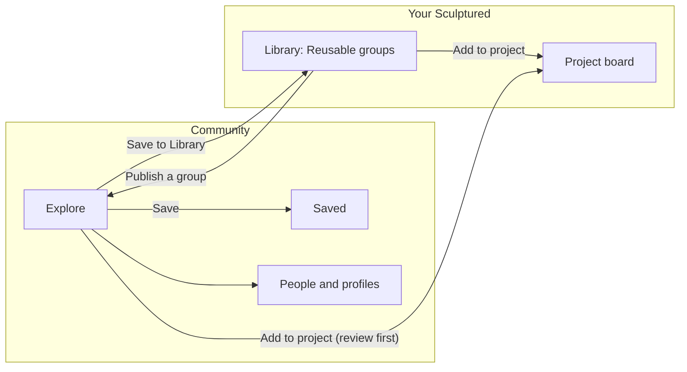

Community is a shared catalog of **blocks**, and the people who publish them. A block is one group of agents: their names, Jobs, arrows and, if it has one, a workflow. Community is a section of Sculptured, under **Community** in the top bar, and you use it with your Sculptured account: there is no second sign-in. You can browse it without signing in. Sign in to save blocks, publish your own and edit your profile.

Adding a block to a project never starts an agent. You always review it first, choose a folder, and start the team yourself.

<Note>On Sculptured you run yourself (`sculptured serve`), Community still opens its own page for now. Signing it in with a Sculptured account comes in a later version.</Note>

## The tabs

| Tab | What it shows |
| --- | --- |
| **Explore** | Every published block, newest first, 24 to a page. Search matches titles, descriptions, tags, and the author's name or handle (`@ana` works too). |
| **People** | Everyone who chose a handle, most published first. Search by name or handle. |
| **Saved** | The blocks you saved. **Remove save** takes one out. |
| **Yours** | The blocks you published, with **Unpublish** and **Publish a group**. |
| **Moderation** | Open reports, for Community moderators only. |

**Learn** (`/community/learn`) has the same advice as [Designing teams of agents](/guides/agent-design).

## Use a block

<Steps>
  <Step title="Open it">Choose a block's title. Its page shows the board, who published it (their picture and name link to their profile), the description, what it does, and under **Inspect this block** its exact definition.</Step>
  <Step title="Add it to a project">Choose **Add to project**, pick a project or a new one, and choose **Add & open project**. The copy has no folders or model choices, and its agents start **Restricted** with fresh sessions.</Step>
  <Step title="Or keep it in your Library">Choose **Save to Library**. The Library copy remembers where it came from (**From Community · v1**); when the block gets a newer version, the button says **Update to v2** and updates the same copy.</Step>
  <Step title="Start the team yourself">Set the folder, fix anything the board lists, and start the team.</Step>
</Steps>

**Save** keeps a block in **Saved** (sign in first). **Download group** saves its file instead.

<Warning>Community supplied instructions. Publishing is not verification. Read every Job before starting agents, especially agents that can edit files or run commands.</Warning>

A block of a kind this version cannot open yet (such as a component) says **Opens in a later version.**

## Sculptured's examples

Community includes blocks published by **Sculptured examples**, under the Apache-2.0 license:

| Block | What it does |
| --- | --- |
| **gstack-style product team** | Eight Claude agents take a feature through a small product team's sprint: product review, design, architecture, build, code review, QA, release and a retro. Inspired by gstack by Garry Tan; the Jobs are Sculptured's own words, and the example is not made or endorsed by the gstack author. |
| **Coding hospital** | A pipeline that treats a repository's issues like patients. A Triage Nurse dispatches one item per issue in `ISSUES.md`, Fellows work each one up and fix it, a Review Attending and two parallel reviewers check it, and a Discharge Nurse lands it. A Charge Nurse runs board rounds every 30 minutes. |

Each one is a whole example team gathered into one group. See [Examples](/guides/examples) for how to run them, and the [pattern catalog](/guides/pattern-catalog) for smaller teaching blocks.

## Your profile

Open **Your Community profile** from the app menu (or **Ctrl K**). Everything on it is public:

| Field | Rules |
| --- | --- |
| **Display name** | 1 to 80 characters. |
| **Handle** | 3 to 30 lowercase letters, digits or dashes, starting and ending with a letter or digit. Your profile is at `/community/u/<handle>`. You can change it once every 30 days; the old handle keeps leading to you for 90 days, and nobody else can take it in that time. A few names are reserved, such as `admin`, `support` and `sculptured`. |
| **Bio** | Up to 280 characters of plain text. |
| **Links** | Up to 3 `https://` links of at most 200 characters, shown as their site names. |
| **Picture** | A PNG, JPEG or WebP. It is cropped to a square and must come to 256 KB or less. Without one, your initials show. |

Your profile also shows when you joined, your published blocks, how many you published and how many times others saved them. Empty fields are not shown. **Compact block cards** makes the grids denser.

Members who used the old Community site with Google get their old account, blocks and saves back the first time they sign in to Sculptured with the same Google account.

## Publish a group

You publish one group from your Library.

<Steps>
  <Step title="Choose a handle">If you have none yet, **Choose your handle** comes first: your blocks and profile appear under it.</Step>
  <Step title="Choose the group">In **Yours**, choose **Publish a group**, then pick a group from your Library. An empty Library links to it.</Step>
  <Step title="Review exactly what will be published">The board and the full definition are shown as they will be stored. Read every Job.</Step>
  <Step title="Describe it">Add a **Title** (up to 150 characters), a **Description** (up to 3000), **Tags** separated by commas, and a **License**: **MIT**, **Apache-2.0** or **CC0-1.0**.</Step>
  <Step title="Confirm and publish">Tick the box confirming that you reviewed every prompt for private information, own the rights to share the group, and choose this license. Then choose **Publish publicly**.</Step>
</Steps>

A new account can publish 5 blocks in its first day. To take a block down, choose **Unpublish** on it in **Yours**. People who already added or saved it keep their copy.

### What publishing removes

Before a block is stored, Community removes anything tied to one computer or one person's setup:

- the team's and every agent's folder;
- the team's, groups' and agents' model choices;
- the workflow's Input text;
- notes about outside connections.

It also sets every agent to **Restricted** and to start a fresh session. Your Library exports and imports apply the same cleaning.

<Warning>Jobs are published word for word. A Job can still contain a private path, a customer's name or a secret. Read them all before you publish.</Warning>

### What a block may contain

| Rule | Limit |
| --- | --- |
| Groups | exactly one |
| Agents | 1 to 64, all inside the group |
| Arrows | up to 256, both ends inside the group, never from an agent to itself |
| One Job | up to 32,000 characters |
| Workflow | up to 100 stages; a workflow block has no ordinary arrows |
| Whole block | under 500 KB |
| Ids | letters, digits, `-` and `_`, up to 100 characters |
| Tags | up to 8, each up to 30 characters |

## Report a concern

When you are signed in, open a block or a profile and use **Report this block** or **Report this profile**: describe the problem in 5 to 1000 characters, then choose **Send report**. Moderators can hide a block, reset a profile's bio, picture or handle, or disable an account.

Community never receives your projects, your agents' transcripts, your files, your Git history, or your Claude Code or Codex sign-in. Only what you publish and put on your profile is shared. See [Security boundaries](/security) and [Privacy](/privacy).

## Next steps

<CardGroup cols={2}>
  <Card title="Reusable groups" icon="boxes" href="/guides/groups">Build, save and insert groups in your Library.</Card>
  <Card title="Pattern catalog" icon="layout-grid" href="/guides/pattern-catalog">Eight small blocks that teach team shapes.</Card>
  <Card title="Team files" icon="file-json" href="/guides/team-files">Share a team or group as a file instead.</Card>
  <Card title="Designing teams" icon="pencil-ruler" href="/guides/agent-design">When to split work across agents.</Card>
</CardGroup>
