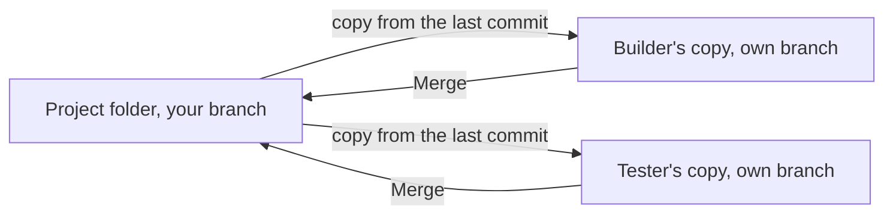

Agents edit files in the project folder on your computer. Sculptured never commits or pushes on its own. The **Git** page lets you see what changed and commit it yourself, without leaving Sculptured. It also merges each agent's own copy when agents work in parallel.

## Open the Git page

With a project open, press **Git changes** in the workspace header. The page opens on that project's folder. **Back to board** returns to the Design board.

The project needs a folder, inside your home folder, on the computer that runs it. Otherwise the page says "Choose a project folder first" or "Project folder must be inside your home folder".

## Review before committing

<Steps>
  <Step title="Initialize Git if needed">If the folder is not a repository yet, the page says "No repository in this project folder". Press **Initialize repository**.</Step>
  <Step title="Read the changes">Each changed file shows its status code and path. Press **Diff** for unstaged changes, or **Staged diff** for what is staged. New files show no diff until you stage them.</Step>
  <Step title="Stage">Tick files and press **Stage selected**, or **Unstage selected** to take them back out. Up to 100 files at a time.</Step>
  <Step title="Commit">Under **Commit staged changes**, write a commit message and press **Commit staged changes**.</Step>
  <Step title="Branch, if you want">Under **Create a branch**, enter a name. Git creates it and switches to it.</Step>
</Steps>

The page shows the current branch and its latest commit, or "No commits yet". **Index** means staged changes, and **worktree** means unstaged changes.

<Warning>A commit includes everything staged, including files staged in a terminal or by an agent. Read the staged diff first.</Warning>

## Safe by design

| Behavior | Why |
| --- | --- |
| **Status refreshes on request.** Press **Refresh status** for the latest. | Agents and other Git tools can change files at any time. |
| **A changed repository is refused.** If the repository changed since you looked, the action is refused with "Repository changed; review the new status". | You only commit what you reviewed. |
| **One Git action at a time.** A second gets "Another Git operation is running". | Two actions never interleave. |
| **Hooks and signing are off** for commits made here. | Use your terminal if your project needs hooks or signed commits. |
| **Nothing is pushed.** | Fetch, pull, push and merges with remotes stay in your terminal. |

## Agents' own copies

When agents run at the same time in one folder, they can overwrite each other's files. To avoid that, give each agent its own copy:

1. On the Design board, open **Project folder** and tick **Each agent works in its own git copy**.
2. The project folder must be a git repository. Commit first: each copy starts from the last commit.
3. The setting applies when agents next start.

Each Claude Code or Codex agent then works in its own copy, a git worktree, on its own branch, `sculptured/<team>/…`. Copies live in `~/.sculptured/copies` on the computer unless you chose another copies folder. Agents see each other's work only after you merge it.

**Copies that take no extra space.** When the copies folder is on the same drive as the project and that drive can clone files (APFS on a Mac, btrfs or XFS on Linux, a Dev Drive on Windows), a new copy shares the project's disk: only the files an agent changes take space, and build output such as `node_modules` or `target` comes along already built. On other drives (ext4, NTFS, exFAT) each copy is an ordinary checkout, as before. Either way a copy starts exactly at its branch, without your uncommitted changes.

The Git page lists them under **Agent copies**. Each shows its branch, the commits to merge, and its uncommitted files.

| Button | What it does | When it's off |
| --- | --- | --- |
| **Merge** | Brings the agent's work into the project's current branch. Its uncommitted changes are committed on its branch first. | While the agent runs ("Stop this agent first"), or when there is nothing to merge |
| **Remove copy** | Deletes the copy's folder. The branch is kept. | While the agent runs, or while it has uncommitted work ("Merge first: it has uncommitted work") |

<Tip>Work an agent has not merged yet exists only in its copy. Merge it, or copy it out, before you delete the copies folder.</Tip>

## Next steps

<CardGroup cols={2}>
  <Card title="Run a team" icon="play" href="/guides/running">Start, watch and stop a team.</Card>
  <Card title="Workflows" icon="diagram-project" href="/guides/workflows">Give each workflow item its own copy and branch.</Card>
  <Card title="Context and communication" icon="eye" href="/guides/context">See which files an agent changed.</Card>
  <Card title="Run it yourself" icon="server" href="/operations">Back up `~/.sculptured`, including copies.</Card>
</CardGroup>
