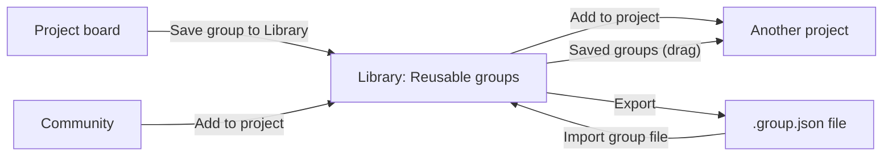

A **group** is a box of agents on the board, with a name and its own model defaults. Save a group to your **Library** and it becomes a reusable block: add a copy to any project, export it as a file, or share it through [Community](/guides/community).

<CardGroup cols={3}>
  <Card title="Save a group" icon="floppy-disk" href="#save-a-group-from-a-project">From any project's board.</Card>
  <Card title="Add it to a project" icon="plus" href="#add-a-group-to-a-project">From the Library, or drag it in.</Card>
  <Card title="Export and import" icon="file-export" href="#export-and-import">Move a group between computers.</Card>
</CardGroup>

## Groups on the board

- **Add a group:** **Group** under **More tools** in the Design toolbar adds an empty group box. Drag agents into it, or use **Group** in an agent's details to move it there.
- **Name and models:** select the group to rename it and set **Agents in this group run on** and **Group models**. An agent's own model wins over its group's, and the group's over the team's.
- **Show or hide contents:** **Hide contents** collapses the group to a single box. Its internal agents and arrows are hidden, and arrows to the outside are drawn once from the group's edge. **Show contents** opens it again. This choice is remembered in your browser and doesn't change the design.

## Save a group from a project

<Steps>
  <Step title="Select the group">Click the group's name on the board to open its details.</Step>
  <Step title="Save it">Press **Save group to Library**. Sculptured saves an independent copy; editing the project later doesn't change it.</Step>
  <Step title="Open the Library">Follow **Open Library**, or open the app menu and choose **Library**.</Step>
</Steps>

## The Library

**Library** (in the top bar) opens **Reusable groups**: every group you have saved, each with a small drawing of its agents and arrows.

| Action | What it does |
| --- | --- |
| **Create group block** | Start a new group without a project. |
| **Import group file** | Load a `.json` group file, review it, then save it. |
| **Add to project** | Add a copy to a project you choose. |
| **Inspect** | Read every agent's instructions, each arrow and each stage. |
| **Edit** | Change the saved group in the group editor. |
| **Export** | Download it as a `.group.json` file. |

<Info>In hosted Sculptured, the Library belongs to your account's Sculptured. Run locally, it is stored on your computer.</Info>

### The group editor

**Create group block** and **Edit** open the group editor, a board for one group. Set the **Group name**, add agents and arrows, or **Add workflow stage** to make it a set of [workflow stages](/guides/workflows) (only when the group has agents and no ordinary arrows). The status reads **Unsaved changes** until you press **Save group**, then **Saved in Library**. **Back to groups** asks before discarding unsaved edits.

Editing a saved group creates no project and starts no agents. Agents in a group inherit the folder of the project they are added to.

## Add a group to a project

<Tabs>
  <Tab title="From the Library">
    Press **Add to project** on the group. Choose the **Destination project**, or **Create a new project** and give it a **Project name**. Press **Add & open project**. The copy is added and its board opens.

    The destination must be stopped: "Stop this project before adding agents, or choose a new project."
  </Tab>
  <Tab title="From the board">
    On the Design board, open **More tools** in the toolbar and press **Saved groups**, then drag a group onto the board, or click it to add it. **Create or edit saved groups** opens the Library.
  </Tab>
</Tabs>

Each insertion is an independent copy with its own agents. If a name is already taken, the copy gets a number ("Reviewer 2"), so every agent keeps its own name.

A group with workflow stages can't join a project that uses ordinary arrows, and a group with ordinary arrows can't join a workflow project. Sculptured says which and adds nothing.

<Warning>Review a group before you start it. Check every Job, the folder, permissions, which agent starts first, and how its work finishes. If the group had arrows to agents outside it, they are listed under **Connections to reconnect**; draw them again in the new project.</Warning>

## Export and import

**Export** downloads `<id>.group.json`. Export makes the group portable by removing what belongs to one computer or one person:

| Removed or reset on export | Why |
| --- | --- |
| Folders, on the group and on every agent | They are paths on your computer. |
| Model choices for the team, group and agents | The receiver picks their own. |
| Workflow Input | It may hold your own notes and links. |
| Permissions set to **restricted** | Imported agents use the CLI's approval controls. See [Questions and approvals](/guides/questions) for timeout behavior. |
| **When it restarts** set to **start fresh** | No session carries over. |

Jobs are kept as written, so read them before sharing: a Job can still contain private details.

**Import group file** reads an exported file of up to 500 KB with one group of at most 64 agents, and opens it in the group editor. Nothing is saved until you press **Save group**.

## From Community

**Add to project** on a Community block sends it to your Library's import, where you review and save it like a file. **Download group** saves the file instead. See [Community](/guides/community).

## Next steps

<CardGroup cols={2}>
  <Card title="Community" icon="users" href="/guides/community">Publish a group or save someone else's.</Card>
  <Card title="Pattern catalog" icon="shapes" href="/guides/pattern-catalog">Ready-made groups for each team pattern.</Card>
  <Card title="Team files" icon="file-code" href="/guides/team-files">Export and import a whole team.</Card>
  <Card title="Compose on the board" icon="diagram-project" href="/guides/board">Agents, arrows and folders.</Card>
</CardGroup>
