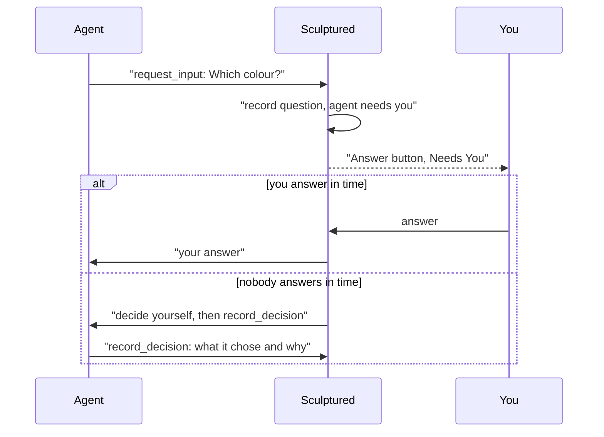

When an agent needs a decision, Sculptured shows **needs you** and opens a question card. A restricted Claude agent can also request permission to run a tool. Answer on the card before its deadline; if the deadline passes first, the timeout behavior applies.

## Where questions come from

| Source | What it is |
| --- | --- |
| **Agent question** (`request_input`) | The agent asks a question and may offer choices and a short header. The card shows whether it accepts a choice, free text or both. |
| **The CLI's own question** | A question Claude Code or Codex raises through its own prompt. |
| **Tool approval** (`approve`) | Only for a Claude agent set to **Restricted**: "Allow Bash to run?", with the tool's input. |

The tools agents use are listed in [Agent tools](/reference/agent-tools).

## Where you see them

- **The agent's card** turns to ◉ **needs you** and shows an **Answer** button.
- **Results › Team conversation** has a **Needs You** row with an **Answer** button per agent. Pick **Questions** in its filter to see every question the team raised.
- **The project's status** in its tab row reads "Needs you · N of M". The Projects page and the **Projects** menu in the top bar show each project's status.
- A toast appears when an agent you are not looking at starts needing you. It stays until you click it.

**Answer** opens the agent. Its questions show at the top of its conversation, and the first one takes the focus.

An agent can say how urgent its question is. Urgent ones come first in Needs you, marked *Urgent, says the agent*; ones it calls low come last. This is the agent's own word, not Sculptured's judgment. A question nobody answers still times out, and the agent decides for itself.

## Answer in the app

Each question is a card above the agent's conversation. It shows what the agent asked, word for word, and when it stops waiting.

<Frame caption="What to look for: the choices as buttons, **Send answer** for your own words, and the time the agent decides on its own.">
  
</Frame>

| The agent asked | What the card offers |
| --- | --- |
| A question with choices | One button per choice. If it also takes your own words, a box and **Send answer**. |
| A question in its own words | A box for your answer and **Send answer**. |
| To run a tool (**Restricted** agents) | The tool, its input under **Tool input**, and Sculptured's reading of what it would do, such as "deletes files". Then **Allow** or **Deny**. |

- **Deny with a reason.** Type a reason before you choose **Deny**, and the agent is told it. Without one, it is told "The person running this team did not allow this."
- **Send again.** If your answer may not have reached the agent, the card says why, in the computer's words, and offers **Send again**.
- **After the timeout.** The card stays until you dismiss it with **OK**. For a question, it shows what the agent decided, and you can send a late answer. For a tool approval, it says it was allowed automatically, and **Deny now** tells the agent it should not have been allowed and to undo what it did if it can.

<Tip>A message you type in the agent's own message box is not an answer. It waits for the agent's current turn to end, and a turn that waits on a question ends only when the question is answered or times out. Answer on the card instead.</Tip>

## How answers are delivered

Your answer is recorded first and then sent to the agent. The log reads question raised, then answered, then the agent's reply.

- **One answer wins.** If two answers race, or an answer races the timeout, exactly one resolves the question. A second try gets "This question was already answered or withdrawn, so your answer was not sent."
- **Choices.** An answer must fit the question: one of its choices, or your own words. Otherwise you get "That answer does not fit this question."
- **Delivery in doubt.** If Sculptured could not confirm that the answer reached the agent, the answer stays recorded and is marked as unconfirmed, and the agent stays in Needs you until that is settled. An answer that certainly did not arrive opens the question again while the agent can still take it.

## When nobody answers

Each question waits **10 minutes** by default. A team can set a timeout from 1 to 1440 minutes. An unanswered question lets the agent decide; an unanswered tool approval is allowed automatically.

<AccordionGroup>
  <Accordion title="An agent question times out">The agent is told: "No operator answer within 10m. Proceed with your best judgment and state the decision you made." It is asked to call `record_decision` with what it chose and why. That decision is recorded as agent-reported. If the agent says nothing, the decision's source stays unknown.</Accordion>
  <Accordion title="A tool approval times out">An approval nobody answers in time is **allowed**, and the decision is recorded. You can still choose **Deny now** on its card afterwards. Approvals are a way to watch a restricted agent, not a guarantee that a tool never runs. Keep work you must not risk away from agents nobody is watching.</Accordion>
  <Accordion title="You answer after the timeout">A late answer is not lost. It reaches the agent once, as an instruction that overrides the decision it made on its own.</Accordion>
</AccordionGroup>

## When a question is withdrawn

A question is marked **withdrawn** when its waiting call can no longer receive an answer. The card records the reason:

- the agent's turn was interrupted, or its process ended;
- Sculptured itself restarted while the agent waited.

After a Sculptured restart, the agent's computer sends the waiting call again when it reconnects, so the question can appear again as a new one.

## When the computer is offline

Sculptured can record your answer while the agent's computer is offline. Delivery waits for the connection to return:

1. The question **stays open**. You can still answer it.
2. Your answer is kept.
3. When the computer reconnects, the agent's waiting call is sent again and gets your answer. It is answered once, not asked twice.

Answers are kept for six hours for a computer that comes back. See [When the computer drops off](/guides/offline).

## Workflow decisions

Teams with a workflow can include a stage where a person decides. Those items wait under **Work evidence** on the Run board, in **Waiting for you**. Each shows the stage's prompt, the latest evidence and one button per outcome. You can add an optional note. Each step in an item's history is labelled agent-reported, verified check, person's decision or Sculptured. See [Workflows](/guides/workflows).

## Next steps

<CardGroup cols={2}>
  <Card title="Control live agents" icon="sliders" href="/guides/control">Inform, Instruct, Interrupt and the stop controls.</Card>
  <Card title="Agent tools" icon="wrench" href="/reference/agent-tools">request_input, record_decision, approve and the rest.</Card>
  <Card title="When the computer drops off" icon="wifi" href="/guides/offline">What waits, and what happens on reconnect.</Card>
  <Card title="Security" icon="shield" href="/security">Restricted agents and what approvals cover.</Card>
</CardGroup>
