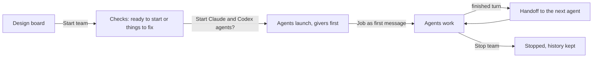

Start a team from the **Design** board, then follow its work in **Run**. Agents with no incoming handoffs begin with their Jobs. Other agents wait for upstream results before starting their assignments. This guide covers ordinary handoffs; [Workflows](/guides/workflows) explains teams that use stages.

## Before you start

The project's status, next to **Start team** at the right of the tab row, reads **Draft · ready to start**, **Draft · N to fix** or **Running**.

- **Draft · N to fix** opens the Design board, where **Things to fix** lists the problems, such as an agent with no name, a missing folder or a loop of arrows with no starting point. Start team stays off until they are fixed, and says why. Warnings do not block a start.
- **Draft · ready to start** means each agent gets its job as its first message. In a team with a workflow, the dispatcher reads Input first and the workers wait for assignments.
- In the hosted app the team runs on a connected computer. If none is connected, Start says "This needs your computer: your folders and agents run there, not on the server." See [Connect a computer](/connect-a-computer).

## Start the team

<Steps>
  <Step title="Press Start team">It sits at the right of the project's tab row, on every page of the project.</Step>
  <Step title="Confirm real agents">If the team has Claude or Codex agents, Sculptured first asks "Start …?". It names where they run, whose accounts they use and which agent starts first.</Step>
  <Step title="Watch the launch">Agents launch in order, givers before the agents they hand work to. Each one shows <em>launching</em>, then <em>running</em>.</Step>
  <Step title="Open the Run board">The board switches to **Run** once the team has started. Before then **Run** is off and says "Run opens once the team has started".</Step>
</Steps>

If something goes wrong, the board says "Could not start:" and lists the issues, with a link back to the Design board. While a team runs you can still rename agents, edit their Jobs and move cards. To add, remove or reconnect agents, stop the team first.

## The Run board

The Run board draws the running agents and their connections. Open the **Agents** tab, or press <kbd>l</kbd>, to see every agent, including stopped and planned agents. **Cards** and **Logos** switch how agents are drawn.

<Frame caption="What to look for: each card's status in words, what it last said, its tokens, and the messages observed between agents.">
  
</Frame>

| Part | What it shows |
| --- | --- |
| **Agent card** | Name, state, its latest reply ("› …"), tokens, and the time since its last activity. A card that needs you has an **Answer** button. |
| **Status** (tab row) | For example "Running · 2 of 3 working" or "Needs you · 1 of 3". Notices such as "history has a gap" show on the board. |
| **Results › Team conversation** | One timeline of updates, messages, handoffs, questions and reported results, with a **Needs You** row. |
| **Results › Usage** | Tokens each agent has used over time: output, cached input read, and context now. |
| **Results › Communications** | Who talks to whom, message traffic, delivery and read state, and captured payload sizes. See [Context and communication](/guides/context). |
| **Results › History** | Earlier runs of this team, with **Download run**. |
| **Work evidence** (Run board) | For a team with a workflow: each item, its stage, its history, and decisions waiting for you. |

Click an agent to open its page: **Conversation** to read it and send it messages, **Setup** for its design, and **Activity** for its progress and events. See [Control live agents](/guides/control).

## What the states mean

Each card shows its state as a symbol and a word, so nothing relies on color alone.

| State | Meaning |
| --- | --- |
| ⚙ working | A turn is in progress. |
| ◉ needs you | It is waiting for your answer, or it needs attention. |
| ▲ stuck | Its handoffs cannot go on by themselves. The reason says why. |
| ✓ done | A turn finished since you last looked. |
| ○ idle | Its session is open but it is doing nothing. |
| ∅ unknown | Sculptured cannot see it right now, for example while its computer is offline. |

"No active work; sessions are open. Stop team closes them." means every agent is idle. An open session is not working. The full list of states and what moves an agent between them is in [Agent states](/reference/states).

## How work moves along

Only **hands work to** arrows move work. **Reports to** and **watches** describe intent and send nothing.

- **The first handoff waits for everyone upstream.** An agent that receives from two agents starts when both have a result. Its card shows "starts when they have all finished; their results are passed along".
- **The final reply is the handoff.** After an agent completes its assigned work turn, Sculptured sends its final reply to the next agent. Interrupted or failed turns produce no handoff; the agent remains stuck until a later turn completes.
- **More work moves in waves.** After the first round, each finished work turn sends one message to every agent downstream. Each of them runs once per wave.
- **A reply to you is not a handoff.** If you chat with an agent, its answer to you stays with you.

<Note>An agent that says "done" has reported that it finished. That is not proof that the work is correct. End a team with a step that runs your tests, and read the [evidence](/guides/context).</Note>

## Pass work along again

The agent's page shows handoff actions when they apply:

| Button | When it shows | What it does |
| --- | --- | --- |
| **Hand over again** | A running agent with agents downstream | Sends its latest finished turn to the agents it hands work to. Each agent downstream runs once. |
| **Resend handoff** | A handoff or Job never reached a running agent | Sends what it is owed again. |
| **Restart this agent** | The agent needs attention, failed or stopped while the team runs | Relaunches only this agent. It then gets what it is owed. |

If the downstream agents are real Claude or Codex agents, **Hand over again** first asks "Re-run N agents downstream of …?". Each one runs once and uses your account.

<Tip>When Claude Code or Codex is not signed in on the computer, the agent's page says so and offers **Sign in to Claude Code** or **Sign in to Codex**. After you sign in, press **Hand over again** or **Restart this agent** so the agent tries again.</Tip>

## Cost and limits

- Each card and agent page shows tokens in and out. "tokens unknown" means the CLI has not reported usage yet.
- If agents have a **token limit**, the Run board shows "Token limits · N reached" once one is hit. An agent at its limit is asked to wrap up and stop.
- Usage is reported after turns, so an agent can exceed its limit by up to one turn.

See [Limits and usage](/reference/limits) for token accounting, budgets and plan usage holds.

## Finish or start again

<Frame caption="What to look for: **Results › History**, the run to show under **Deployment**, and **Download run** to save it as a file. Click an agent's box for its recorded events; **List** shows the same agents as a list.">
  
</Frame>

- **Stop team…** asks you to confirm, then stops every running agent. "Their history is kept."
- An agent that could not be stopped is listed with its computer's reason. The others still stop.
- When no agent runs, **Start team** appears in the project's tab row. Every agent gets its Job again as its first message.
- If Sculptured restarted while the team ran, the board asks "N agents stopped mid-work. Resume them where they left off?" Choose **Resume**, **Start fresh** or **Leave stopped**. Nothing relaunches until you answer.

## Next steps

<CardGroup cols={2}>
  <Card title="Answer questions" icon="circle-question" href="/guides/questions">What happens when an agent asks you something.</Card>
  <Card title="Control live agents" icon="sliders" href="/guides/control">Send guidance, interrupt, wrap up or stop.</Card>
  <Card title="When the computer drops off" icon="wifi" href="/guides/offline">What survives a lost connection mid-run.</Card>
  <Card title="Agent states" icon="list" href="/reference/states">Every state and what moves an agent between them.</Card>
</CardGroup>
