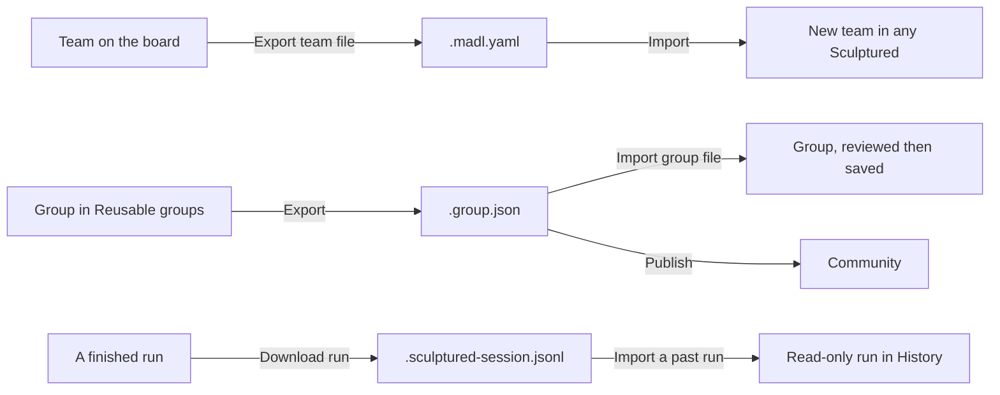

A team file is a whole team in one [MADL](/guides/madl) file: its agents and their Jobs, groups, arrows, workflow and settings. MADL is an open format, so other tools can read the same file. Use it to keep a copy, send a team to a colleague, move it to another Sculptured, or keep it in a Git repository next to the code it works on.

There are three kinds of file:

| File | Holds | Made with | Opened with |
| --- | --- | --- | --- |
| Team file, `.madl.yaml` | A whole team | **Export team file** under **Export** in the team's **Settings** | **New project** → **Advanced: import a team file or a past run** → **Import** |
| Group file, `.group.json` | One reusable group | **Export** on a group in **Reusable groups** | **Import group file** in **Reusable groups** |
| Run file, `.sculptured-session.jsonl` | One past run: the team as it started, then every event | **Download run** in **Results › History** | **New project** → **Advanced: import a team file or a past run** → **Import a past run** |



## Export a team

<Steps>
  <Step title="Open the team">Open the project.</Step>
  <Step title="Open Settings">Open its **Settings** tab and find **Export**.</Step>
  <Step title="Choose about folders">Leave **Include folders (paths on this computer)** off to share the file. Folders are paths on one computer, so they rarely make sense anywhere else. Turn it on to keep a backup for the same computer.</Step>
  <Step title="Export">Choose **Export team file**. The file goes to your downloads as `<team>.madl.yaml`.</Step>
</Steps>

The same section has **View as spec**, which shows the team as text without saving a file.

## Import a team

<Steps>
  <Step title="Start a new project">Open **New project**.</Step>
  <Step title="Open Advanced">Open **Advanced: import a team file or a past run** at the bottom of the page.</Step>
  <Step title="Choose the file">Choose the file, or paste its contents into the box. A MADL file (`.madl.yaml` or `.madl.json`), an older `.sculptured-team.json` file and an OpenRig YAML file are all accepted.</Step>
  <Step title="Import">Choose **Import**. A new team is created, with a new id made from its name.</Step>
  <Step title="Fix what the board lists">Set a folder and fix anything listed under things to fix before you start the team.</Step>
</Steps>

What import does with a file:

- **Refused** only when the file does not hold together: not valid MADL, or broken ids and arrows. The message names the field and the problem, and nothing is created.
- **Imported with warnings** for anything the board would also flag, such as a Claude agent without a folder. Those only stop the team from starting, so you can fix them on the board.
- **Kept:** agent, group and arrow ids; Jobs; positions; the workflow; and the team's settings (permissions, own copies, question timeout). A file written by another tool may hold things Sculptured can't use; they are listed under **Not imported**. See [MADL files](/guides/madl#importing-a-madl-file-from-elsewhere).
- **Not kept:** which computer runs the team. You choose that after import.

Importing the same file twice makes two teams. Retrying a request that did not answer does not.

## Export and import a group

A group is a reusable part of a team, such as a builder and a reviewer. Groups live in **Library → Reusable groups**.

- **Export:** choose **Export** on the group's card. The file is named `<group>.group.json`.
- **Import:** choose **Import group file** and pick the file. The group opens for review before it is saved. Files over 500 KB are refused.

Group files are cleaned on export and on import, the same way Community cleans a block before publishing. Folders, model choices and the workflow's Input are removed. Every agent is set to **Restricted** and to start a fresh session. See [Community](/guides/community#what-publishing-removes).

<Warning>Jobs are kept word for word. Read every Job before you send a file to someone: it can contain a private path, a name or a secret you typed.</Warning>

## Edit a team file by hand

A team file is YAML you can read and edit. Its JSON form (`.madl.json`) starts with a `$schema` line naming [MADL's JSON Schema](https://github.com/Sculptured/Multi-Agent-Descriptor-Language/blob/main/schema/draft/schema.json), so editors that understand JSON Schema check the file and complete field names as you type; VS Code does this with no setup. For YAML, the [YAML extension](https://marketplace.visualstudio.com/items?itemName=redhat.vscode-yaml) reads the same schema.

The `madl` command checks a file before you import it:

```sh
cargo install --git https://github.com/Sculptured/Multi-Agent-Descriptor-Language madl-cli
madl validate my-team.madl.yaml
```

Every field is described in [MADL's specification](https://github.com/Sculptured/Multi-Agent-Descriptor-Language/tree/main/spec/draft); [MADL files](/guides/madl) lists where each part of a Sculptured team goes.

## Keep a team in Git

A team file without folders is the same on every computer, so it fits in a repository:

1. Export the team without folders.
2. Commit the file, for example as `team/review-loop.madl.yaml`.
3. Review changes to Jobs in pull requests like any other text.
4. To use a new version, import it as a new project. Import never overwrites a team you already have.

## Share a past run

A run file lets someone see exactly what happened in a run without running anything. It holds the team as it started and every recorded event in order.

1. Open the run in History and choose **Download run**.
2. Send the `.sculptured-session.jsonl` file.
3. The other person imports it with **Import a past run**. It opens in History, read-only, labelled as imported from a file.

<Note>A run file contains your agents' transcripts: their messages, tool calls and results. Read it before you share it.</Note>

## Next steps

<CardGroup cols={2}>
  <Card title="MADL files" icon="file-json" href="/guides/madl">Where each part of a team goes in the file.</Card>
  <Card title="Community" icon="users" href="/guides/community">Publish a group for everyone, or add someone else's.</Card>
  <Card title="Reusable groups" icon="boxes" href="/guides/groups">Build groups once and use them in many teams.</Card>
  <Card title="Security boundaries" icon="shield" href="/security">What stays on your computer.</Card>
</CardGroup>
