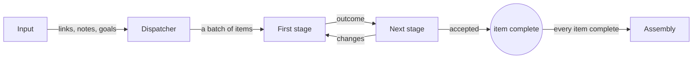
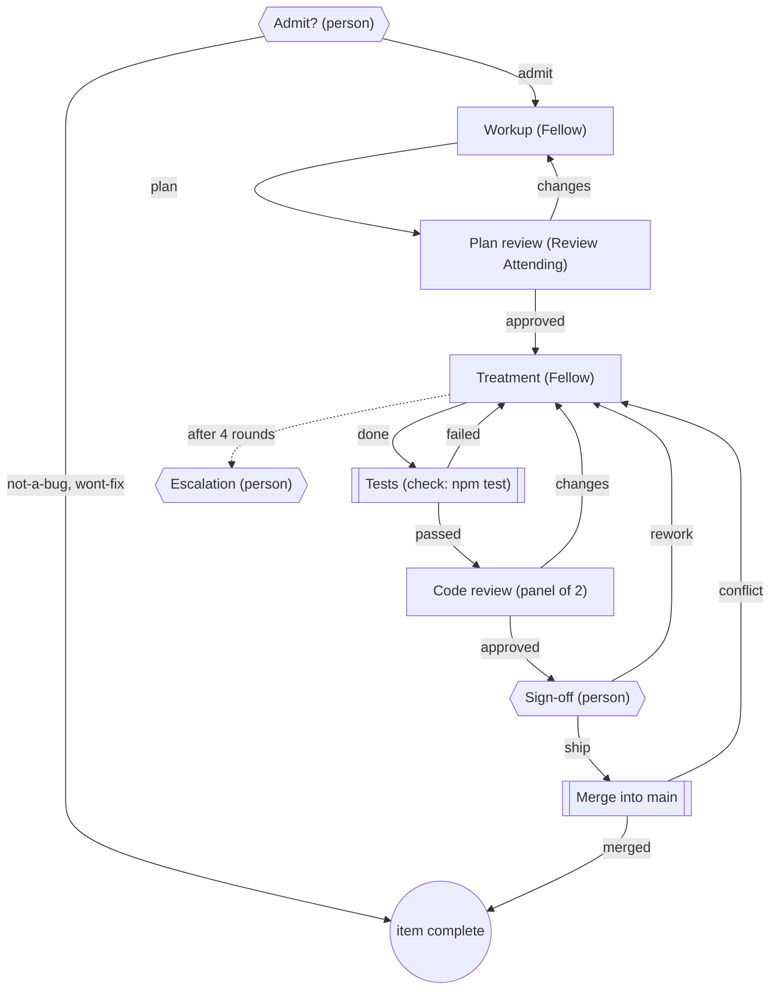

A **workflow** tracks individual pieces of work through explicit stages. A dispatcher breaks the goal into **items**. Each item then moves through agent work, reviews, checks, human decisions or merges. The **outcome** of each stage determines where the item goes next, including whether it returns for revision.

<CardGroup cols={3}>
  <Card title="The parts" icon="diagram-project" href="#how-a-workflow-runs">Input, dispatcher, stages, assembly.</Card>
  <Card title="Stage types" icon="layer-group" href="#stage-types">Agent, panel, check, person, merge.</Card>
  <Card title="Bound the loops" icon="rotate" href="#bound-the-loops">Round limits, hand-over, step limits.</Card>
</CardGroup>

## When to use one

| Use a plain team when | Use a workflow when |
| --- | --- |
| The work is one piece, or a fixed set of roles in order | The number of pieces is known only once an agent reads the goal |
| Handoffs and their built-in loop limit are sufficient | Reviews need named outcomes and configurable revision limits |
| An agent's "done" is enough to move on | A command, a person or several reviewers must decide |

Ordinary teams can also loop; see [Connect work](/guides/board#connect-work). Choose a workflow when you need to track items and control their routes. A project uses either ordinary handoff arrows or workflow stage routes, so remove ordinary connections before adding a workflow.

## Where workflows come from

- The **Textbook creator** template is a workflow. See [the textbook example](/guides/textbook).
- Importing a team file that has one, such as the **Coding hospital**. See [examples](/guides/examples).
- Adding a saved group with stages from your [Library](/guides/groups). In the group editor, **Add workflow stage** adds a stage to a group that has agents and no ordinary arrows.

## How a workflow runs



1. **Input.** Drop links, notes, questions and goals into the Input box on the board. It is saved with the project, up to 64 KB. Nothing runs until you start the team.
2. **Dispatcher.** When the team starts, only the dispatcher gets a start message, with the Input. It creates one batch of items (1 to the **Maximum items** you set, at most 64). Items may be independent or depend on other items. A dependent item waits for its prerequisites to complete. When some items depend on others, the Run view's item board shows them as **waves**: wave 1 needs nothing, each later wave needs an earlier one, and each wave says whether it is done, in progress or waiting, with how many of its items are done.
3. **Stages.** Each item enters the **First stage**. An idle agent gets one item at a time. It reports an outcome with Sculptured's `complete_work` tool; a plain chat reply never moves an item.
4. **Assembly.** Once every item is complete, the **Assembly** agent gets one last assignment to put the results together.

## Dispatch with a command instead of an agent

When splitting the work is mechanical (one item per file, per chapter, per failing test), you don't need an agent for it. Under **Workflow settings & composition › Advanced**, set a **Dispatch command**. When the team starts, Sculptured runs it once in the project folder, on the computer that runs the team, and what it prints becomes the batch. The board then shows a **Dispatch command** box where the dispatcher agent would be, and no agent gets a start message.

The command must print JSON, the same shape the dispatcher agent would send:

```json
{
  "summary": "What every item shares: goals, sources, file layout",
  "tasks": [
    { "id": "ch-1", "title": "Chapter 1", "context": "Sections 1.1–1.4 of notes.pdf; write into chapters/ch-1/" },
    { "id": "ch-2", "title": "Chapter 2", "context": "Sections 2.1–2.3", "mode": "dependent", "depends_on": ["ch-1"] }
  ]
}
```

`batch_id` is optional. The items get the same checks as an agent's batch: 1 to **Maximum items** tasks, simple unique ids, a title and context for each, and prerequisites without cycles. Set **Dispatch command time limit in seconds** if it needs more than 600 (at most 3600).

If the command fails, runs past its limit, or prints something that is not a valid batch, **nothing is dispatched**. The Run view shows **Blocked: the dispatch command made no work** with the reason (the exit code, or what is wrong with the output) and the command's evidence. Fix the command, then press **Run the dispatch command again**, or start the team again. When it works, the Run view says **Work made by the dispatch command**: Sculptured ran it and the items are what it printed.

<Note>A team running on a connected computer needs Sculptured updated on that computer to run a dispatch command. An older one is not able to, and the Run view says to update it.</Note>

Open **Workflow settings & composition** on the board to choose the **Dispatcher** (or a dispatch command, below), the **Assembly**, the **First stage**, **Maximum items** and **Maximum steps per item**, and to **Add reusable stage** (up to 16). **Workflow list** in the board's bar lists everything as text.

## Stage types

Select a stage on the board to edit it. The **Stage type** sits under **Advanced**.

| Stage type | Who decides | Outcomes | Labelled in the run |
| --- | --- | --- | --- |
| **Agent** | The **Responsible agent**, or any idle one of its parallel workers | Any you add, up to 8 | agent-reported |
| **Review panel** | 2–6 reviewers, all on the same item | `approved`, `changes`, and any you add | agent-reported, with each vote |
| **Check (Sculptured runs a command)** | Sculptured runs the **Command**, with a **Time limit in seconds** (600 by default, at most 3600) | exactly `passed`, `failed` | verified check |
| **Person decides** | A person, from a decision card | `approve`, `rework`, and any you add (2–6) | person's decision |
| **Merge the item's branch** | Sculptured merges the item's branch, **Merge into branch** (the current branch by default) | exactly `merged`, `conflict` | Sculptured |

- **Review panel.** **Decide when** is **every reviewer approves** (the default: the worst vote wins once all have voted) or **the first reviewer approves**. Give each reviewer an angle so the panel covers what one reviewer would miss: red team (ways to break it), adversary (why it is wrong), simplifier, user, domain expert, honest friend, or ownership (who owns each fact). When their votes split, the panel's result starts with who voted what, so the author reads why before acting. Ideas from Advocate.
- **Check.** The command runs in the item's folder, or in the project folder, on the computer that runs the team. A check that could not run at all blocks the item; it is never recorded as a failed check.
- **Person decides.** Write the **Question for the person**. Items waiting here appear as decision cards; see [questions and approvals](/guides/questions).
- **Merge.** Needs **Give each item its own copy and branch** (below). A conflict routes `conflict` and the item keeps its copy. Sculptured never undoes a merge or rebase you have in progress.
- **Parallel workers.** On an agent stage, tick other agents, or **Create parallel worker**, so independent items can be worked at the same time. Each worker takes one item at a time.

## Routes and outcomes

Each outcome has a route: **When** *outcome* **→** a stage, or **Accept this item**. Type a name in **New outcome** and press **Add branch** to add one (lower-case letters, digits and dashes). Every stage can also report `blocked`, which stops the item with the agent's reason.

When you turn a stage into a check, person, merge or panel stage, its "go back" outcome (`failed`, `rework`, `conflict` or `changes`) points to the previous stage, never to **Accept this item**, so a failure can't accept work by accident.

## Bound the loops

Set limits so repeated revisions eventually pause for review.

| Setting | Where | What it does |
| --- | --- | --- |
| **Most rounds per item** (1–20) | Stage, Advanced | After this many rounds at the stage, the item goes to **After the last round, go to** instead. With nowhere to go, it is blocked with "Round limit (N) reached". |
| **Hand over after this many rounds** and **Hand over to** | Agent stage, Advanced | From that round on, only the chosen agent works the item, for example a stronger model. |
| **Maximum steps per item** (1–32) | Workflow settings | A backstop on every loop. An item that reaches it is blocked with "Step limit reached; needs operator review." |

A blocked item waits for you. In the Run view, read its problem and evidence, then press **Retry this stage after inspecting the issue**. A retry after a round limit grants one more round.

## Long-running teams

Under **Advanced** in the workflow settings:

| Setting | What it does |
| --- | --- |
| **Dispatch command** | Instead of a dispatcher agent, a command Sculptured runs at start; what it prints is the batch. See [Dispatch with a command](#dispatch-with-a-command-instead-of-an-agent). |
| **Give each item its own copy and branch** | Each item gets its own git branch and folder in the project's repository, used by its agents, checks and merge stage. Needs a project folder with git. |
| **Guard command** | A command (for example `npm test`) run in the project folder every 5–1440 minutes. While it fails, no new work goes out; work under way finishes. It resumes when the guard passes, or when a person presses **Resume anyway**. |
| **Keep a decision log** | Precedents people write and agents read with `read_decisions`. Agents can't write to it. |
| **Schedules** | Up to 8 messages sent to an agent every 5–1440 minutes, for example a status round. A busy or stopped agent's turn is skipped and recorded, never queued. |

## Review progress and evidence

In the Run view, each item lists its steps, newest first. Every step says who settled it: **agent-reported**, **verified check**, **person's decision** or **Sculptured**. An agent's "approved" is a report; a check's "passed" is verified. The item board also shows items waiting for a person, blocked items, tokens per done item as the CLIs reported them, and an estimated cost.

<Note>Assembly reported complete means the assembly agent said so. Inspect its evidence, and add a check stage or a guard when you need proof.</Note>

## Worked example: the coding hospital

The **Coding hospital** example uses every stage type. A person admits each issue, a Fellow plans and fixes it, `npm test` checks it, a two-reviewer panel reviews it, a person signs off, and Sculptured merges it.



## Next steps

<CardGroup cols={2}>
  <Card title="Examples" icon="flask" href="/guides/examples">The coding hospital and other complete teams.</Card>
  <Card title="Questions and approvals" icon="circle-question" href="/guides/questions">Decision cards and what agents ask you.</Card>
  <Card title="Agent tools" icon="wrench" href="/reference/agent-tools">dispatch_work, complete_work and the rest.</Card>
  <Card title="Item states" icon="list-check" href="/reference/states">Queued, assigned, waiting, blocked, complete.</Card>
</CardGroup>
