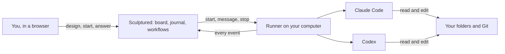

Sculptured brings your coding agents into one workspace. Give each agent a job and a folder, then connect the agents to decide how they pass work along. While the team runs, you can follow its progress, read individual conversations and guide the work.

Agents run on **your own computer**, using your installed Claude Code or Codex and your existing sign-in. You can use the hosted app or run Sculptured locally.

<CardGroup cols={2}>
  <Card title="Quickstart" icon="rocket" href="/quickstart">Set up Sculptured and run your first team.</Card>
  <Card title="Concepts" icon="book" href="/concepts">Understand projects, agents, handoffs and evidence.</Card>
</CardGroup>

## Choose how to run Sculptured

<Tabs>
  <Tab title="Hosted beta">
    Sign in at **app.usesculptured.com** and connect a computer from the **Computers** page. The app stores your team designs and run history in your account. A background program called the *runner* starts agents on your computer, in the folders you allow.

    The hosted beta is invite-only. You need a personal invite link to create an account.
  </Tab>
  <Tab title="Self-hosted">
    Run `sculptured serve` and open `http://127.0.0.1:4410`. The app and runner run locally, and Sculptured stores its data in `~/.sculptured/`. Agents work in the project folders you choose. No Sculptured account is required.

    See [Run it yourself](/operations) to build, back up and upgrade it.
  </Tab>
</Tabs>

Both modes use the same board and [team file format](/guides/team-files). The app and runner are open source under the Apache 2.0 license.

## How it fits together

The runner starts each CLI and sends its captured events to Sculptured. The app uses those events to show conversations, progress and handoffs. [Concepts](/concepts) explains the parts in more detail.

## Follow the work from design to review

1. **Design the team.** [Choose roles and write jobs](/guides/agent-design), then [arrange agents and handoffs on the board](/guides/board).
2. **Run and guide it.** [Start the team](/guides/running), [answer questions](/guides/questions) and [send guidance to individual agents](/guides/control).
3. **Review the results.** [Inspect conversations, tool calls and checks](/guides/context) to understand what happened and what still needs verification.
4. **Reuse what works.** [Save a group](/guides/groups), [export a team](/guides/team-files) or [share it through Community](/guides/community).

For work that needs explicit stages, review decisions and bounded revision loops, use a [workflow](/guides/workflows).

## Understand what a result proves

Sculptured distinguishes progress from evidence:

| What you see | What it means |
| --- | --- |
| **Planned** | On the design. Nothing has started. |
| **In progress** | The agent is working on it. |
| **Reported done** | The agent *said* it finished. That is a claim, not proof. |
| **Verified** | A check ran and passed. The result supports only what that check tests. |
| **Blocked** | It cannot go on without something: an answer, a sign-in, a missing file. |

<Note>An agent saying "done" is a report. Add a check, such as your project's test command, to verify the properties that matter to you.</Note>

Each fact also shows where it came from: reported by the agent, captured from a tool, observed on disk, estimated, or checked. Anything Sculptured does not know stays marked as unknown.

## Use these docs with a coding agent

These docs are also published as plain text for AI tools:

- [`/llms.txt`](/llms.txt) is an index of every page with a one-line summary.
- [`/llms-full.txt`](/llms-full.txt) is the full text of every page in one file.
- Any page is available as Markdown: add `.md` to its address, for example [`/quickstart.md`](/quickstart.md).

Point Claude Code or Codex at `https://docs.usesculptured.com/llms-full.txt` when you want help designing a team or writing a [team file](/guides/team-files).
