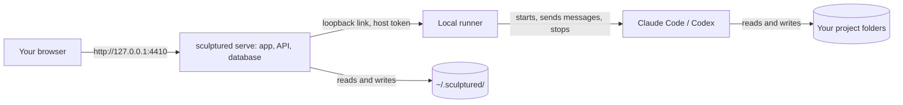

Run Sculptured locally to keep the app, runner and run history on your computer without a Sculptured account. The `sculptured serve` command serves the app on port 4410 and starts the runner. Sculptured stores its data in `~/.sculptured/`; agents work in the project folders you choose. The app and runner are open source under Apache 2.0.

<Tabs>
  <Tab title="On your own computer">
    The app, database and agents run on your machine. Team designs and run history are stored locally, with no usage analytics. Claude Code and Codex still send context to their providers.
  </Tab>
  <Tab title="With a Sculptured account">
    The hosted beta runs your Sculptured for you, and your agents run on the computers you connect. See [Connect a computer](/connect-a-computer). You don't need anything on this page.
  </Tab>
</Tabs>



## Before you start

| You need | Why |
| --- | --- |
| Linux or macOS | `sculptured serve` runs on Linux and macOS. On Windows, Sculptured runs only as a connected computer for a Sculptured account. |
| Rust 1.95 or newer and Node.js 24 | To build the program and the web app. |
| Claude Code or Codex, signed in as your own user | Sculptured uses their existing sign-in and never stores provider credentials. |
| Git | For agents' own copies of a repository and the Git panel. |


## Build and start

Clone the repository, then run the build steps from its root:

```bash
git clone https://github.com/Sculptured/Sculptured.git
cd Sculptured
```

<Steps>
  <Step title="Build the web app">
    ```bash
    cd web
    npm ci
    npm run build
    cd ..
    ```
  </Step>
  <Step title="Build the program">
    ```bash
    cargo build --locked --release -p sculptured
    ```
  </Step>
  <Step title="Start it">
    ```bash
    ./target/release/sculptured serve --port 4410 --web-dir web/dist
    ```
    Open http://127.0.0.1:4410. If Sculptured is already running, open that address instead of starting a second copy.
  </Step>
</Steps>

### `serve` options

| Option | Default | Meaning |
| --- | --- | --- |
| `--port` | `4410` | Port on `127.0.0.1`. |
| `--data-dir` | `~/.sculptured` | Where Sculptured stores its data. Also read from `SCULPTURED_DATA_DIR`. |
| `--web-dir` | `web/dist` | The built web app. |
| `--claude-program` | found on `PATH` | Full path to Claude Code, if it is not on `PATH`. |
| `--codex-program` | found on `PATH` | Full path to Codex, if it is not on `PATH`. |

Sculptured logs to the terminal. Set `RUST_LOG=debug` for more detail. See the [CLI reference](/reference/cli) for every command.

<Warning>Do not expose port 4410 to the Internet or put it behind a public reverse proxy. The local app controls your agents and reads your project files. It accepts only requests addressed to `127.0.0.1` or `localhost`, so a public proxy would either fail or defeat that protection.</Warning>

## What's in `~/.sculptured/`

| Path | What it holds |
| --- | --- |
| `controld.sqlite` (with `-wal` and `-shm`) | Your teams, runs, messages, questions, transcripts and the event history. |
| `host-token` | The secret the local runner uses to connect to the app. Private to your user. |
| `host-local/` | The local runner's own state: its journal, its lock, the address of the running app, and each agent's skills (`skills/`) and Signet-Eval rules (`signet/`). |
| `copies/` | Agents' own copies of your repositories, when a team uses them. They can hold work not yet merged. |
| `runner/` | Only on a computer connected to a Sculptured account: its identity and the folders it allows. |

The runner can outlive the app. If you restart `serve`, the running runner finds the new app on its own, and running agents keep going.

## Back up

The database uses SQLite's write-ahead log, so copying only `controld.sqlite` while Sculptured runs is not a reliable backup. Pick one:

<Tabs>
  <Tab title="While it runs">
    ```bash
    sqlite3 ~/.sculptured/controld.sqlite ".backup '/path/to/backup/controld.sqlite'"
    ```
  </Tab>
  <Tab title="Stopped">
    Stop Sculptured, then copy the whole `~/.sculptured/` folder.
  </Tab>
</Tabs>

Agents' copies in `~/.sculptured/copies/` are separate Git working folders. Merge or copy out their work before you delete them.

You can also keep a team outside the database: **Export team file** saves it as a `.madl.yaml` file, and **Import** loads one. See [Team files](/guides/team-files).

## Upgrade

<Steps>
  <Step title="Stop running teams">Stop every team in the app, so no agent is left working unwatched.</Step>
  <Step title="Back up">Take a backup as above.</Step>
  <Step title="Replace the program and web app">Build or copy the new `sculptured` and the new web folder. Keep the old program until you have checked the new one.</Step>
  <Step title="Start again">Run `sculptured serve`. It upgrades its database when it starts.</Step>
</Steps>

## Roll back

Database upgrades are not reversed automatically. To go back to an older version, stop Sculptured, restore the backup you took before upgrading, and start the older program.

## After a restart

Sculptured keeps teams, runs, messages and questions in its database. After a restart:

- Agents whose process is still alive return to **running**.
- Agents whose process ended show **needs attention** with a reason, and the team offers **Resume** (the agent's own session, when it can be resumed), **Start fresh** or **Leave stopped**. Nothing relaunches until you choose.
- Questions that were waiting inside an agent's tool call are withdrawn, because the call ended with the restart. The agent can ask again.

See [States and evidence](/reference/states).

## Other computers

A self-hosted Sculptured runs agents on the computer it runs on. To run agents on other computers, such as a Windows PC or a second laptop, connect them to a Sculptured account. See [Connect a computer](/connect-a-computer).

## Next steps

<CardGroup cols={2}>
  <Card title="Quickstart" icon="rocket" href="/quickstart">Create and start your first team.</Card>
  <Card title="Security" icon="lock" href="/security">What the app and the runner can and cannot do.</Card>
  <Card title="CLI reference" icon="terminal" href="/reference/cli">Every command and option.</Card>
  <Card title="Troubleshooting" icon="life-ring" href="/troubleshooting">Fixes for common problems.</Card>
</CardGroup>
