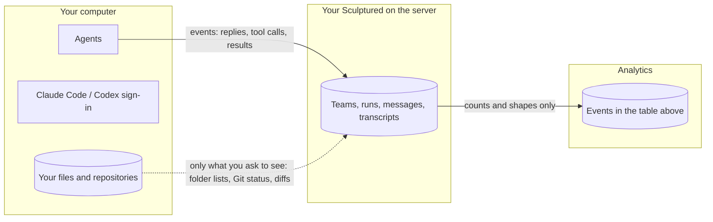

Sculptured stores team designs and run history so you can run agents and review their work. In the hosted beta, that operational data is stored in your account's Sculptured instance. In local mode, it is stored on your computer.

The hosted beta also collects **usage analytics**: feature use, team structure, run statistics, token totals and errors. Analytics exclude prompts, messages, jobs, agent output, file names and file contents. Self-hosted Sculptured does not collect usage analytics.

<Check>The same list is in the app: open **What we record** from your account. Every event is checked against that list before it is stored; anything else is refused.</Check>

## Excluded from analytics

- Prompts, messages and jobs
- Agent output and transcripts (for analytics)
- Team names and agent names
- Folder names and paths
- File contents
- Check commands and their output

## Analytics events

| Event | From | What it says |
| --- | --- | --- |
| `auth.signin` | Sculptured site | You signed in, and how (password, Google or GitHub) |
| `invite.used` | Sculptured site | An invite was used to join |
| `device.paired` | Sculptured site | A computer was connected, and its operating system |
| `device.revoked` | Sculptured site | A computer was disconnected |
| `api` | Sculptured site | A request: its kind, the page or action with names removed (for example `/api/teams/:id/git`), its status and how long it took |
| `session.start` | Your browser | You opened Sculptured |
| `session.end` | Your browser | You left |
| `page.active` | Your browser | Every 15 seconds while the tab is in front: which kind of page (names removed) |
| `ui.action` | Your browser | You used a feature such as Describe it, Token use or Download run (its name only) |
| `team.created` | Your Sculptured | A team was made, and from what (a template, a file, a description) |
| `team.saved` | Your Sculptured | A team's shape (counts only: agents by kind, groups, arrows; whether checks, limits, copies or a workflow are used), at most every 10 minutes |
| `team.started` | Your Sculptured | A team started: how many agents, which programs, how many models, its shape |
| `team.stopped` | Your Sculptured | A team stopped |
| `run.summary` | Your Sculptured | A finished run: duration, tokens in and out, agents, spawned agents, failed agents |
| `check.ran` | Your Sculptured | A check ran, and whether it passed (never the command or its output) |
| `copies.enabled` | Your Sculptured | Agents' own copies were turned on |
| `plan.held` | Your Sculptured | A start waited because a plan was near its limit |

Analytics events are kept for **180 days**. After that, only daily totals remain.

## Data stored to run your teams

Analytics are separate from the data Sculptured needs to run your teams. With an account:

| Data | Where | Why |
| --- | --- | --- |
| Your teams' designs, including jobs | Your own Sculptured on the server | To show and run your teams. |
| Messages, agent replies, tool calls and results, questions and answers | Your own Sculptured on the server | So you can watch a run, inspect its evidence and come back to its history. |
| Your files and repositories | On your computer | Agents work there. Requested folder listings, Git status and diffs can reach the server. File content may also appear in captured tool results and agent replies. |
| Claude Code and Codex sign-in | Only on your computer | Sculptured never reads or stores them. |
| Your name, email, sign-in methods, and a password hash if you use a password | The account database | To sign you in. |
| Your computers: name, operating system, last seen | The account database | For the Computers page. |

The server's data is backed up every night. Admins can see account details, computers and analytics. They cannot open your teams, runs or files.

## What your agents send

Claude Code and Codex send your agents' prompts and the files they read to Anthropic or OpenAI, as they do when you use them directly. That traffic goes from your computer to the provider, under your own Claude or ChatGPT plan or API key. Sculptured is not a party to it.

## Traces you choose to send

If you turn on [Send traces](/guides/send-traces) for a team, its runs go to the address you chose: timings, token counts, costs, agent and tool names, and, only if you choose it, prompts and outputs (each cut to 4 KB). The API key you give is kept on the server and sent only to that address.

## Community

Community uses your Sculptured account. Publishing a block makes its definition public: its agents' roles and jobs, its connections, and the title and license you choose. Machine-specific folders, model overrides and workflow input are removed first, but review the jobs for private details before you publish.

Your profile is public too: your name, handle, bio, links, picture, when you joined, your published blocks and their counts. Empty fields are not shown. Reports can be about a block or a profile. See [Community](/guides/community#your-profile).

## Your choices

- **Run it yourself** to keep everything on one computer with no analytics. See [Run it yourself](/operations).
- **Export** a team as a file at any time. See [Team files](/guides/team-files).
- **Disconnect** a computer from the Computers page. Its key stops working at once.

## Next steps

<CardGroup cols={2}>
  <Card title="Security" icon="lock" href="/security">What the server can and cannot do on your computer.</Card>
  <Card title="Connect a computer" icon="plug" href="/connect-a-computer">Choose which folders agents may use.</Card>
  <Card title="Run it yourself" icon="server" href="/operations">Local storage, no usage analytics.</Card>
  <Card title="FAQ" icon="circle-question" href="/faq">Common questions.</Card>
</CardGroup>
