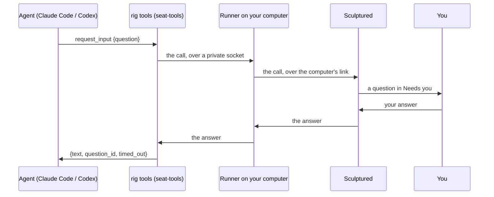

Every agent Sculptured starts gets a small set of extra tools, next to the CLI's own. Agents use them to ask you questions, report findings, work with teammates and move work through a workflow. You do not call these tools yourself. This page explains what each one does, so you can write [Jobs](/guides/agent-design) that use them and read what you see on the agent's page.

## How agents get the tools

When the runner starts Claude Code or Codex, it adds one MCP server named `rig`. The CLI starts `sculptured seat-tools` for it, and each call travels over a private connection to the runner and then to your Sculptured.

In Claude Code the tools appear as `mcp__rig__request_input` and so on; in Codex as `rig` tools.

If the computer's connection drops while a call is waiting, the runner keeps the call and sends it again when the computer reconnects. Sculptured answers each call once, so a resent question is not asked twice. See [When a computer goes offline](/guides/offline).

## Summary

| Tool | Who may call it | What it does |
| --- | --- | --- |
| [`request_input`](#request_input) | any agent | Asks you a question and waits for the answer. |
| [`record_decision`](#record_decision) | any agent | Says what it decided after a question timed out. |
| [`report`](#report) | any agent | Reports findings about the work it was handed. |
| [`approve`](#approve) | restricted Claude Code agents only | Asks you whether a tool may run. |
| [`spawn_agent`](#spawn_agent) | any agent | Creates a managed child agent. |
| [`send_agent_message`](#send_agent_message) | any agent | Messages another agent in the project. |
| [`team_status`](#team_status) | any agent | Reads the project's agents and their state. |
| [`dispatch_work`](#dispatch_work) | the workflow's dispatcher only | Creates the batch of work items for a workflow. |
| [`complete_work`](#complete_work) | the agent holding an assignment | Finishes a workflow assignment with an outcome. |
| [`workflow_status`](#workflow_status) | any agent | Reads the workflow's batch, assignments and reviews. |
| [`read_decisions`](#read_decisions) | any agent | Reads the team's decision log. |
| [`search_history`](#search_history) | any agent | Searches what the team's agents already wrote, ran and were told. |
| [`record_lesson`](#record_lesson) | any agent | Records a lesson every agent of the team is told. |
| [`read_pdf`](#read_pdf) | any agent | Reads a PDF's text, page by page. |
| [`read_skill`](#read_skill) | Codex agents with skills | Loads one of the agent's skills. |

The three workflow tools are offered only to teams that have a [workflow](/guides/workflows).

## Questions and reports

### `request_input`

Asks the person running the team a question and waits for the answer. The question appears in **Needs you** and on the agent. While it waits, the agent shows as waiting for input.

| Parameter | Type | Required | Meaning |
| --- | --- | --- | --- |
| `question` | string | yes | The question. |
| `options` | list of strings, or `{label, description}` objects | no | Choices to offer. You can always type another answer. |
| `header` | string | no | A short label shown above the question. |
| `urgency` | `low`, `normal` or `high` | no | How much the question holds up the work, in the agent's own words: `high` when it cannot go on or others wait on the answer, `low` for a preference it could decide itself. Urgent questions come first in **Needs you** and are marked *Urgent, says the agent*; low ones come last. |

The agent receives `{ text, question_id, timed_out }`.

- **Answered:** `text` is your answer and `timed_out` is `false`.
- **Not answered in time:** `timed_out` is `true`, and `text` tells the agent to decide for itself and then call `record_decision` with the `question_id`. The time limit is the team's question timeout: 10 minutes unless you change it in team settings (1 to 1440 minutes).
- **Withdrawn:** if the agent's turn is interrupted or its process ends, the question is withdrawn and the call fails.

You can answer while the agent's computer is offline. The answer reaches the agent when the computer reconnects.

### `record_decision`

After a question timed out, the agent says what it decided and why. The decision is recorded on the question, so you can see what the agent chose in your absence.

| Parameter | Type | Required | Meaning |
| --- | --- | --- | --- |
| `question_id` | string | yes | One of this agent's own questions. |
| `choice` | string | yes | What it decided. |
| `rationale` | string | no | Why. |

### `report`

Reports findings about the work the agent was handed, for example the problems a review or a check found. It is shown to you labelled as reported by the agent. A report is the agent's claim, not a verified result.

| Parameter | Type | Required | Meaning |
| --- | --- | --- | --- |
| `summary` | string | yes | The short version. |
| `findings` | list | no | Each item is a string, or `{text, location}` where `location` names a file or place. |
| `verdict` | `no-problems`, `problems-found` or `unsure` | no | The agent's overall verdict. |

### `approve`

Claude Code's permission prompt, routed to you. It is given only to Claude Code agents whose permission is **Restricted**. When such an agent wants to run a tool that needs permission, you see "Allow *tool* to run?" with the tool's input, and choose Allow or Deny.

| Parameter | Type | Required | Meaning |
| --- | --- | --- | --- |
| `tool_name` | string | yes | The tool the agent wants to run. |
| `input` | object | yes | The tool's input, shown to you. |
| `tool_use_id` | string | no | Claude Code's id for the call. |

<Note>A permission prompt that nobody answers within the question timeout is **allowed**, and the decision is recorded. Set a longer timeout, or keep agents unrestricted only where that is acceptable.</Note>

Codex agents do not get `approve`. A restricted Codex agent asks through Codex's own approval requests, and Sculptured shows those to you as questions in the same way.

## Working with teammates

### `spawn_agent`

Creates a managed child agent. The child appears on the **Run** board under its parent, and it stops when its parent stops. It inherits its parent's model, folder and permissions.

| Parameter | Type | Required | Meaning |
| --- | --- | --- | --- |
| `request_id` | string | yes | Reuse the same id when retrying, so a retry does not create a second child. |
| `name` | string | yes | The child's name on the board. |
| `task` | string | yes | The child's job, sent as its first message. |

There are no fixed limits on children. A team can set its own (**Most agents, children included** and **Most levels of children**), and a refusal names the setting. A token limit set to include subagents counts the children's tokens toward the parent's limit. See [Limits](/reference/limits).

Use it for bounded, independent help. It does not replace the teammates you designed on the board.

### `send_agent_message`

Sends a message to another agent in the project. If the recipient is busy, the message is queued; it does not interrupt the recipient's turn. You can read these messages in the team's communications.

| Parameter | Type | Required | Meaning |
| --- | --- | --- | --- |
| `request_id` | string | yes | Reuse the same id when retrying. |
| `to` | string | yes | The recipient's exact id, from `team_status`. |
| `text` | string | yes | The message. Agents are told to include context, the artifact's revision, the response they want and their own id. |

### `team_status`

Reads the project's current agents: their parent relationships, activity, lifecycle and stop controls. It takes no parameters. An open, idle session is reported as idle; it is not active work.

## Workflows

These tools run a team that has a [workflow](/guides/workflows): a dispatcher splits the work into items, and each item moves through stages.

### `dispatch_work`

Only the workflow's dispatcher may call it. It creates one batch of work items for this run. A workflow with a [dispatch command](/guides/workflows#dispatch-with-a-command-instead-of-an-agent) refuses it: the command's output, in this same shape, is the batch. It does not create agents; the stages' agents take the items.

| Parameter | Type | Required | Meaning |
| --- | --- | --- | --- |
| `batch_id` | string | yes | The batch's id. Repeating the identical batch is safe and does nothing. |
| `summary` | string | yes | Shared goals, source map, and file and interface contracts. |
| `tasks` | list | yes | 1 to the workflow's task limit (at most 64). |

Each task has:

| Field | Type | Required | Meaning |
| --- | --- | --- | --- |
| `id` | string | yes | The item's id. |
| `title` | string | yes | Its title. |
| `context` | string | yes | Self-contained sources, prerequisites, goals, where to put results and constraints. |
| `mode` | `independent` or `dependent` | no | Independent items may run at the same time. |
| `depends_on` | list of task ids | no | Items that must be accepted before this one starts. Cycles are refused. |

A team makes one batch per start. A different batch is refused until the team is stopped and started again.

### `complete_work`

Finishes the agent's current workflow assignment with one of the stage's outcomes. The outcome chooses what happens next: the next stage, another review round, or completion. `blocked` is always available when the agent cannot safely continue.

| Parameter | Type | Required | Meaning |
| --- | --- | --- | --- |
| `assignment` | string | yes | The assignment being finished. |
| `outcome` | string | yes | One of the stage's outcomes, or `blocked`. |
| `result` | string | yes | Artifact paths, the exact revision, sources, the checks actually run, and findings. At most 12,000 bytes. |

The result stays agent-reported. A check stage, or a person's decision, is what independently confirms the work.

### `workflow_status`

Reads the current batch, each item's context, the assignments and the review history. No parameters.

### `read_decisions`

Reads the team's decision log: precedents people recorded, newest first, up to 50. Agents are told to check it before deciding something it may cover. It is read-only; agents cannot add to it. When the team's decision log is off, the agent is told so.

| Parameter | Type | Required | Meaning |
| --- | --- | --- | --- |
| `query` | string | no | Words to look for. Leave it out to read the latest entries. |

## What the team knows

These tools make no model calls. See [What agents know](/guides/knowledge).

### `search_history`

Searches what this team's agents, including finished ones, wrote, ran, got back and were told, newest first. Each match gives the agent, the time, what kind of thing it was and the text around the match. It returns at most 8 matches and leaves out the asking agent's current turn. Agents use it before building something that may already exist, or to find which teammate knows about something.

| Parameter | Type | Required | Meaning |
| --- | --- | --- | --- |
| `query` | string | yes | Words to find, at least 3 characters. |
| `agent` | string | no | Only this agent's history, by name or id. |

### `record_lesson`

Records a lesson for the team: something that cost the agent a wrong turn, in a sentence or two. Teammates already working get it with their next message, and every later agent in its briefing. You see it in the Knowledge view, where you can confirm or hide it.

| Parameter | Type | Required | Meaning |
| --- | --- | --- | --- |
| `lesson` | string | yes | The lesson. At most 400 characters are kept. |
| `kind` | `lesson` or `constraint` | no | `constraint`: a rule every agent must follow in this project; it comes first in briefings. Default `lesson`. |

When you confirm a lesson or constraint, it is also kept with the project for later teams; see [Lessons kept with the project](/guides/knowledge#lessons-kept-with-the-project).

## Reading files

### `read_pdf`

Reads a PDF's text page by page, on the agent's own computer. Text costs a small fraction of what page images do, and an image stays in the agent's context for every later step. Pages with no text, such as scans and drawings, are named, so the agent looks at only those as images. One call returns at most about 60,000 bytes of text and says where to continue.

| Parameter | Type | Required | Meaning |
| --- | --- | --- | --- |
| `path` | string | yes | The PDF. |
| `pages` | string | no | A page or range, such as `5` or `10-20`. All pages when left out. |

### `read_skill`

Loads one of the agent's [skills](/guides/skills) in full. Only Codex agents with skills get it; Claude Code loads skills natively.

| Parameter | Type | Required | Meaning |
| --- | --- | --- | --- |
| `name` | string | yes | The skill's name, as listed in the agent's briefing. |

## Limits on every call

| Limit | Value | What the agent is told |
| --- | --- | --- |
| Size of one call | 1 MiB | "This call is too large for Sculptured (the limit is 1 MiB). Send a shorter question or report." |
| Calls one agent may have waiting | 16 | "This agent already has too many Sculptured tool calls waiting. Wait for one to finish." |
| Calls waiting on one computer | 256 | "Sculptured is handling too many tool calls right now. Try again in a moment." |
| Time to send a call | 10 seconds | "Sculptured did not receive the whole tool call in time." |

A call with wrong arguments is refused and kept as evidence on the agent, so you can see what it tried.

## Next steps

<CardGroup cols={2}>
  <Card title="Questions and approvals" icon="message-circle" href="/guides/questions">Answer questions, approve tools and set the timeout.</Card>
  <Card title="Workflows" icon="route" href="/guides/workflows">Stages, outcomes, review loops and checks.</Card>
  <Card title="Control live agents" icon="sliders" href="/guides/control">Guide, interrupt and stop agents and their children.</Card>
  <Card title="Limits" icon="gauge" href="/reference/limits">Every limit in one place.</Card>
</CardGroup>
