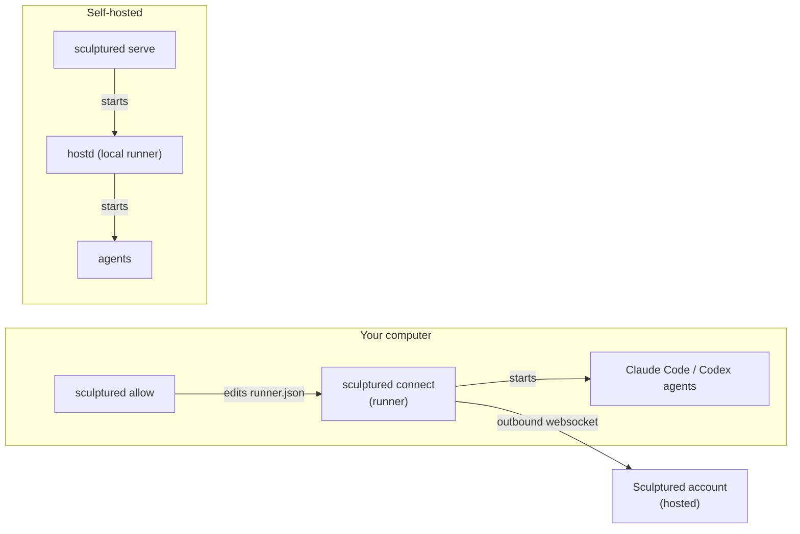

`sculptured` is one program with several commands. On a connected computer it runs as a background service, so you rarely type it yourself. Use these pages when you want to change what a computer allows, run Sculptured entirely on your own machine, or script a setup.

```bash
sculptured <command> [options]
```

| Command | What it does |
| --- | --- |
| [`connect`](#sculptured-connect) | Link this computer to a Sculptured account and run that account's agents here. |
| [`allow`](#sculptured-allow) | Let agents from your account work in one more folder on this computer. |
| [`serve`](#sculptured-serve) | Run a complete Sculptured on this computer: the app, its data and a local runner. |
| [`hostd`](#sculptured-hostd) | Run only the agent runner, dialling a Sculptured server. `serve` normally starts it for you. |

`sculptured --version` prints the version. `sculptured <command> --help` prints the flags of one command.



## `sculptured connect`

Links this computer to an account and keeps a runner connected, so the account's agents start here. The connect command you copy from the **Computers** page calls this for you, with a one-time key and `--install-service`.

```bash
sculptured connect <origin> [options]
```

| Argument or flag | Default | Meaning |
| --- | --- | --- |
| `<origin>` | required | The account's address, for example `https://app.example.com`. A trailing `/` is ignored. |
| `--key <KEY>` | none | A one-time connect key from the Computers page. With a key, the computer connects with no code to approve. A key works once, for 30 minutes. |
| `--name <NAME>` | the computer's hostname | How this computer appears in your account. |
| `--allow <FOLDER>` | your home folder | A folder agents may work in. Repeat it for more folders. When no folder has ever been allowed, your home folder is allowed. Add more later with `sculptured allow`. |
| `--install-service` | off | Install a login service, so the runner starts again whenever you log in, and return. Without it, `connect` stays in the foreground until you stop it. |
| `--sandboxed` | off | Limit agents: Claude Code asks before risky actions, and Codex writes only inside its folder. Cannot be combined with `--full-access`. |
| `--full-access` | on | Let agents act as you do on this computer. This is the default. |
| `--enable <CAPABILITY>` | see below | Turn on something the account may do here. Repeatable. |
| `--disable <CAPABILITY>` | see below | Turn off something the account may do here. Repeatable. |
| `--data-dir <DIR>` | `~/.sculptured/runner` | Where the runner keeps its settings, its saved pairing and its agents' records. Created readable by you only. |
| `--claude-program <PATH>` | found on `PATH` | The Claude Code program to run. |
| `--codex-program <PATH>` | found on `PATH` | The Codex program to run. |

### Capabilities

Beyond starting agents, an account may ask a computer to do a few other things. Each one can be switched off. The names below are what `--enable` and `--disable` accept.

| Capability | Default | What it allows |
| --- | --- | --- |
| `git` | on | Git status, diffs, staging, commits and branches in an allowed folder. |
| `copies` | on | Each agent working in its own Git copy of the project. |
| `checks` | on with full access, off when sandboxed | Running a team's check commands (tests and similar) in its folder. |
| `cli-sign-in` | on | Starting Claude Code's or Codex's own sign-in from the browser. |
| `plan-usage` | on | Reading your Claude or Codex plan usage. |
| `generate` | on | One tool-less Claude Code or Codex call that drafts a team for you. |

A capability you never set follows the access level. For example, switching to `--sandboxed` turns checks off unless you turned them on by name.

### Without a key

If you run `connect` with no key and this computer is not yet linked to that address, it prints a link and a code:

```text
To connect this computer, open:
  <link>
and confirm the code <code>
```

It also opens the link in your browser. Sign in, check that the code matches, and approve. The pairing is saved, so later runs reconnect without asking.

### Login services

`--install-service` writes and starts one service for your user. It never needs administrator rights.

<Tabs>
  <Tab title="macOS">
    A LaunchAgent at `~/Library/LaunchAgents/dev.sculptured.runner.plist`, loaded with `launchctl`. It starts at login and restarts if it stops.
  </Tab>
  <Tab title="Linux">
    A systemd user service at `~/.config/systemd/user/sculptured-runner.service`, enabled and restarted with `systemctl --user`.
  </Tab>
  <Tab title="Windows">
    A Scheduled Task named **Sculptured runner**, which runs when you log on. Its definition is kept at `%USERPROFILE%\.sculptured\runner\sculptured-runner.xml`.
  </Tab>
</Tabs>

The service records the full paths of Claude Code and Codex, because a login service starts with a shorter `PATH` than your terminal. Running `connect --install-service` again replaces the old service, so a newly installed runner takes over.

### Examples

```bash
# What the Computers page's command does on macOS and Linux
curl -fsSL https://app.example.com/install.sh | sh -s -- --key <KEY>

# Connect, allow two project folders, keep it running after login
sculptured connect https://app.example.com --allow ~/code/site --allow ~/code/api --install-service

# Sandboxed agents, and no Git operations from the browser
sculptured connect https://app.example.com --sandboxed --disable git
```

### Exit codes

| Code | Meaning |
| --- | --- |
| `0` | Finished: the service was installed, or the runner stopped normally. |
| `75` | A runner is already running with this data folder. |
| `1` | Any other error. The message is printed after `sculptured:`. |

## `sculptured allow`

Adds a folder agents may work in. Agents and every file operation stay inside allowed folders, after `..` and symbolic links are resolved.

```bash
sculptured allow <folder> [--data-dir <DIR>]
```

| Argument or flag | Default | Meaning |
| --- | --- | --- |
| `<folder>` | required | The folder to allow. |
| `--data-dir <DIR>` | `~/.sculptured/runner` | The runner's data folder, if you connected with a different one. |

It prints the full list of allowed folders. Restart `sculptured connect`, or its login service, so running agents see the change.

```bash
sculptured allow ~/code/new-project
```

## `sculptured approve-component`

```bash
sculptured approve-component <digest> [--data-dir <DIR>]
```

Lets agents on this computer use a component that is not built in. The digest is in the note on the agent that went without it, next to what the component runs or connects to. Approve only what you would run yourself. Agents given the component start it at their next launch; nothing is restarted. A changed manifest has a new digest and needs approving again.

## `sculptured set-secret`

```bash
sculptured set-secret <NAME> [--remove] [--data-dir <DIR>]
```

Keeps a secret that a component names as `${NAME}` (such as a remote MCP server's key) on this computer, for every runner here, or only the one in `--data-dir`. You type the value; it is not shown. You can also pipe it in. The value is never given on the command line, and never leaves this computer: the runner fills it in when it starts an agent. Agents pick it up at their next start. `--remove` forgets it.

## `sculptured serve`

Runs a complete Sculptured on your own computer: the web app, its database and a local runner that starts your agents. See [Run it yourself](/operations).

```bash
sculptured serve [options]
```

| Flag | Default | Meaning |
| --- | --- | --- |
| `--port <PORT>` | `4410` | The port to listen on. Sculptured listens on `127.0.0.1` only. |
| `--data-dir <DIR>` | `~/.sculptured` | Where projects, transcripts and settings are kept. Also read from `SCULPTURED_DATA_DIR`. |
| `--web-dir <DIR>` | `web/dist` | The built web app to serve. An installed copy uses `~/.sculptured/web`. |
| `--claude-program <PATH>` | found on `PATH` | The Claude Code program to run. |
| `--codex-program <PATH>` | found on `PATH` | The Codex program to run. |
| `--hosted` | off | Used by the hosted service only: serve one user behind the gateway, with no local runner. Needs `SCULPTURED_GATEWAY_SECRET`. |

```bash
~/.sculptured/bin/sculptured serve --port 4410 --web-dir ~/.sculptured/web
```

Then open `http://127.0.0.1:4410`. The runner is started in its own session, so pressing Ctrl+C in the terminal does not stop your agents.

<Warning>Do not expose the `serve` port to the Internet. It controls agents that act as you.</Warning>

`serve` runs on macOS and Linux. On Windows, connect the computer to an account with `sculptured connect` instead.

## `sculptured hostd`

Runs only the agent runner and dials a Sculptured server. `serve` starts one for you; run it yourself only when you know you need a separate runner.

| Flag | Default | Meaning |
| --- | --- | --- |
| `--controld <URL>` | required | The server's runner address. |
| `--host-id <ID>` | `local` | The id this runner reports. |
| `--data-dir <DIR>` | required | Where the runner keeps its records. |
| `--token <TOKEN>` | required | The runner's token. Read from `SCULPTURED_HOST_TOKEN` when not given; it is removed from the environment before any agent starts. |
| `--claude-program <PATH>` | found on `PATH` | The Claude Code program to run. |
| `--codex-program <PATH>` | found on `PATH` | The Codex program to run. |

## Environment variables

| Variable | Used by | Meaning |
| --- | --- | --- |
| `SCULPTURED_DATA_DIR` | `serve` | Same as `--data-dir`. |
| `SCULPTURED_HOST_TOKEN` | `hostd` | Same as `--token`. |
| `SCULPTURED_KEY` | the Windows installer | The one-time connect key the PowerShell command passes to `connect --key`. |
| `RUST_LOG` | every command | How much the program logs to standard error, for example `RUST_LOG=debug`. The default is `info`. |

## Next steps

<CardGroup cols={2}>
  <Card title="Connect a computer" icon="plug" href="/connect-a-computer">Copy the connect command and run it on macOS, Windows or Linux.</Card>
  <Card title="Run it yourself" icon="server" href="/operations">Run Sculptured with `serve`, back it up and upgrade it.</Card>
  <Card title="Security boundaries" icon="shield" href="/security">What a connected computer allows, and what it never exposes.</Card>
  <Card title="Troubleshooting" icon="wrench" href="/troubleshooting">Fix a computer that does not connect or an agent that does not start.</Card>
</CardGroup>
