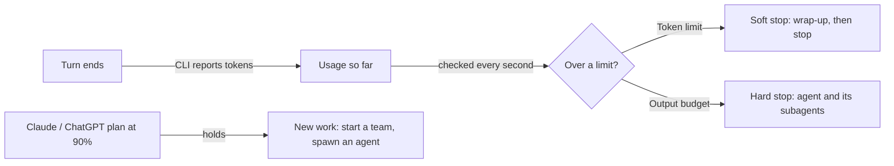

Use token limits and output budgets to control usage, and team limits to bound the number and depth of managed subagents. Subagent counts have no default cap; set one if your team can create helpers. Token enforcement depends on CLI usage reports, so an agent can exceed a limit by up to one turn.

## Limits you set

| Limit | Where | What it counts | When it is reached |
| --- | --- | --- | --- |
| **Token limit** | An agent's settings on the Design board | One of: all tokens, new tokens (all but cache reads), or output tokens, since the run started. By default its subagents count too. | The agent is soft-stopped: it is asked for a wrap-up, then stopped. |
| **Output budget** | A team's budget, set while the team is stopped | Each agent's output tokens since the run started, from 1 to 1,000,000 per agent, subagents included. | The agent and its subagents are hard-stopped. It cannot launch again until a new run starts. |
| **Check timeout** | A check command on a workflow stage | Wall-clock time of the command. Default 600 seconds. | The check fails. |

Run budgets, and each agent's turn and working-time limits, are in [Run budgets](/guides/budgets).

## Protections

On by default; change them in the team's **Settings** → **More settings** → **Protections** ([details](/guides/budgets#protections-keep-each-agents-context-small)).

| Limit | Default |
| --- | --- |
| A whole read of a file is refused above | 100 KB (images, PDFs and notebooks are never refused) |
| Shell output an agent sees | 8,000 characters |
| Context before an agent writes its notes and continues fresh | 60,000 tokens, and only once its conversation has doubled from where it started |

## What agents know

| Limit | Value |
| --- | --- |
| Files a project map looks at | 20,000 (a larger folder is mapped from its first files) |
| Areas in the full map / in an agent's briefing | 80 / 25 |
| Time a start waits for each folder's map | 20 seconds; then agents start without it |
| Lessons in an agent's briefing | The 8 newest |
| One lesson | 400 characters |
| Matches one history search returns | 8 |
| Lessons kept with a project that a briefing lists | 30 |
| A skill's name / description / instructions | 64 characters / 1,024 characters / 100 KB |

## Soft and hard stops

| Stop | What happens |
| --- | --- |
| **Soft stop** | Sculptured interrupts the current turn if there is one, then asks the agent for a summary "within approximately 5,000 additional output tokens". The agent stops when that wrap-up turn ends, after about 5,000 more output tokens, or after 5 minutes, whichever comes first. |
| **Hard stop** | The process is stopped with no further turn, along with every subagent it started. |

Usage reports can arrive late, so a soft stop can overshoot its 5,000-token estimate. See [Control live agents](/guides/control).

## Subagents

An agent can start tracked helpers with the `spawn_agent` tool ([agent tools](/reference/agent-tools)). Sculptured sets no limits on them. A team can set its own in its **Settings**, under **More settings**; blank means no limit:

| Team setting | Refusal the agent gets |
| --- | --- |
| **Most agents, children included** (the team's own agents plus every child) | "Team limit you set: 20 agents, children included" |
| **Most levels of children** (1 = children cannot start their own) | "Team limit you set: 3 levels of children" |

The parent's card on the Run board shows the refusal. The settings are saved in the team file as `limits.max_agents` and `limits.max_child_levels`.

A spawn is also refused when the parent's budget is used up, the parent is stopping, the team is not running, or the plan is held (below). Claude Code's and Codex's own built-in delegation is turned off, so every helper is an agent you can see on the board.

## Plan usage holds

Claude Code and Codex report how much of your Claude or ChatGPT plan is used. When the fullest window that has not reset yet is at **90% or more**, Sculptured holds **new** work:

- **Start team** is held. The Design page explains why and offers **Start anyway**.
- `spawn_agent` is refused. The agent is told to finish with the agents it has, or ask you.
- Work already running is **not** stopped.

These readings are for your whole account, so they include use outside Sculptured. Claude Code reports usage only after a Claude agent has run, so before that there is no reading and no hold.

When a turn hits the provider's own limit, Sculptured shows the CLI's message and the reset time if the CLI gave one. Nothing retries it for you; send "continue" after the reset.

## Questions and messages

| Limit | Value |
| --- | --- |
| Time a question waits for your answer | 10 minutes by default. Afterwards the agent decides for itself and says what it decided. |
| Question text | 4,096 bytes; longer text is cut and marked. |
| Answer options in one question | 20, each label up to 200 bytes |
| A result handed to the next agent | 8 KB; longer results are cut and marked "…(truncated)". |
| One agent report | 50 findings, each up to 1,024 bytes |
| Captured text, tool output and errors | 64 KB per item |
| Decision log entry | 4,096 bytes |

## Starting and stopping

| Limit | Value |
| --- | --- |
| Time for an agent to be ready after launch | 60 seconds; otherwise it needs attention. |
| Grace before a stopped agent's process is ended | 5 seconds |
| Workflow items' own copies of a repository made at once, per team | 2 |

## Connected computers

| Limit | Value |
| --- | --- |
| One-time connect key from the Computers page | Works once, for 30 minutes |
| Pairing code (when a computer connects without a key) | 10 minutes |
| Pairing attempts | 10 code lookups or approvals per user in 10 minutes; 20 pairing starts per address in 10 minutes |
| Runner keep-alive | A ping every 25 seconds. The link is dropped after 75 seconds with nothing back, and the runner reconnects on its own. |
| Reconnect backoff | From 0.5 to 5 seconds between tries |
| How long an action waits for a computer that just dropped off | 45 seconds, then it is reported as not connected |
| How long an agent's tool answer is kept for a computer that dropped off | 6 hours |

See [When a computer drops off](/guides/offline) for what these mean in practice.

## Hosted sign-in sessions

| Limit | Value |
| --- | --- |
| Session ends after no use | 30 days (each use renews it) |

## Usage history

The usage chart for a team keeps up to 240 points per agent; older points are thinned, not lost from the totals. Costs are estimates at API prices and name their source. Claude or ChatGPT plan subscribers are not billed those amounts. See [Context and communication](/guides/context).

## Next steps

<CardGroup cols={2}>
  <Card title="States and evidence" icon="list-check" href="/reference/states">What each state means and what to do.</Card>
  <Card title="Agent tools" icon="wrench" href="/reference/agent-tools">The tools agents use to spawn helpers and ask questions.</Card>
  <Card title="Control live agents" icon="sliders" href="/guides/control">Soft stop, hard stop and restart.</Card>
  <Card title="Troubleshooting" icon="life-ring" href="/troubleshooting">When a limit stops work you expected to run.</Card>
</CardGroup>
