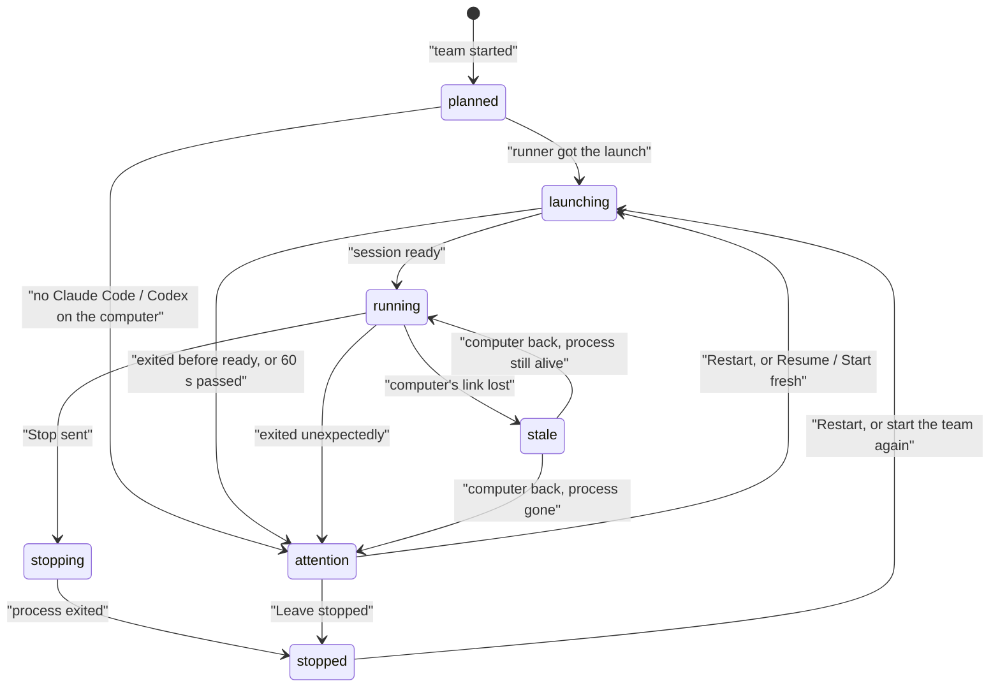

Sculptured shows three separate things about an agent: whether its **process** is running (its lifecycle), what it is **doing** right now (its activity), and how much you can **trust its result** (its evidence). Each state has a shape and a word as well as a colour, so it reads the same without colour.

<CardGroup cols={3}>
  <Card title="Agent lifecycle" icon="circle-play" href="#agent-lifecycle">Planned, launching, running, stopping, stopped, stale, needs attention.</Card>
  <Card title="Board states" icon="table-cells" href="#what-the-board-shows">Needs you, stuck, working, done, idle, unknown.</Card>
  <Card title="Evidence" icon="shield-check" href="#evidence-reported-observed-verified">Reported, observed, verified, heuristic, unknown.</Card>
</CardGroup>

## Agent lifecycle

An agent's lifecycle says whether a process exists for it. Your agent runner reports most changes as it sees them. A few are inferred by Sculptured, for example when the link to a computer is lost; those are labelled *heuristic* in the agent's history.

| State | Shown as | What it means | What you can do |
| --- | --- | --- | --- |
| Planned | ○ planned | On the design, not launched yet in this run. | Wait for its turn, or start the team. |
| Launching | ◌ launching | The runner is starting Claude Code or Codex. It must be ready within 60 seconds. | Wait. |
| Running | ● running | A process is running. Its activity says whether it is working. | Send guidance, interrupt, soft stop or hard stop. |
| Stopping | ◑ stopping | A stop was sent and Sculptured is waiting for the process to exit. If the computer is offline, the stop is carried out as soon as it reconnects. | Wait. |
| Stopped | ■ stopped | No process. Its history is kept. | Restart the agent, or start the team again. |
| Stale | ◇ stale | The computer's link was lost while the agent was running. What you see is the last known state, not the current one. | Wait for the computer to reconnect, or check the computer. |
| Needs attention | ▲ needs attention | The agent stopped when it should not have, could not start, or was lost in a restart. The agent's page says why. | Read the reason, then Restart, Resume, Start fresh or Leave stopped. |

<Note>A **Failed** state exists in the data model, but nothing sets it today. An agent that could not run shows **needs attention** with its reason.</Note>

### Activity

Activity is only current while the agent is running. While it is stale, the activity is the last known one. Otherwise it is not shown.

| Activity | Shown as | Meaning |
| --- | --- | --- |
| Working | ⚙ working | A turn is in progress. |
| Waiting for input | ? waiting for input | The agent asked a question and is waiting for an answer. |
| Idle | · idle | The session is open, but no turn runs. An idle agent is not doing anything. |
| Unknown | ∅ unknown | Sculptured cannot tell. |

## What the board shows

The board and the Run view combine lifecycle and activity into one word per agent. Blocked agents are sorted first.

| Board state | Shown when | What to do |
| --- | --- | --- |
| ◉ needs you | The agent waits for your answer, or needs attention. | Open it and answer, or read its reason. |
| ▲ stuck | The agent is idle and its handoffs cannot go on by themselves. The pane says why. | Use **Hand over again** or **Resend handoff**, or send guidance. |
| ⧗ waiting for a slot | Its next message waits until fewer of the run's agents work at once (the run budget's **Most agents working at once**). The agent's page says "waiting for a slot to run". It is not stuck. | Nothing: it starts when a slot frees. Raise the limit in [Run budgets](/guides/budgets) to run more at once. |
| ⣟ working | A turn is running. | Watch, or send guidance. |
| ✓ done | A turn ended since you last looked. It does not mean the work is right. | Read the result and its evidence. |
| ○ idle | Running, with nothing to do. | Nothing, or send new work. |
| ∅ unknown | The computer is unreachable, or no state is known. | Check the computer. |

Launching, stopping, stopped and planned agents show their lifecycle word.

## Questions

A question comes from an agent's `request_input` tool, from the CLI's own question prompt, or (for a restricted agent) from a permission prompt. See [Questions and approvals](/guides/questions).

| State | Meaning |
| --- | --- |
| Open | Waiting for your answer. It shows in **Needs you**. |
| Answered | You answered before the timeout. |
| Expired | The timeout (10 minutes by default) passed first. The agent decides for itself and says what it decided. A late answer is sent as an overriding instruction. |
| Withdrawn | The question can no longer reach the agent, for example because the agent stopped. The reason is shown. |

An open question stays open while a computer is briefly offline. You can answer it, and the answer reaches the agent when the computer reconnects. See [When a computer drops off](/guides/offline).

## Evidence: reported, observed, verified

Every claim on the board carries where it came from. Sculptured never upgrades an agent's words to a fact.

| Label | Shown as | Where it comes from |
| --- | --- | --- |
| Verified | ◆ verified | An independent check, such as a test command Sculptured ran itself, and its exit status. |
| Observed | ◆ observed | Something Sculptured saw: the runner's protocol, a file on disk, a captured tool call and result, or your own action. |
| Reported | ◇ reported | The agent's own words, such as its report or "done". |
| Heuristic | ≈ heuristic | Sculptured's own reading, for example how it classified a tool call. It never blocks an agent. |
| Unknown | ∅ unknown | No source is recorded. It stays unknown; nothing is invented. |

### Outcome of a piece of work

A finished assignment shows one of these outcomes:

| Outcome | Meaning |
| --- | --- |
| Reported complete | The agent said it finished. Nothing checked it. |
| Captured tool result | A tool call's result was captured as evidence. |
| Verified | A check ran and passed. |
| Settled, unverified | The work ended, but no check ran. |
| Check failed | A check ran and failed. |

Work items in a workflow also show progress words: pending, in progress, waiting for you, blocked, reported complete, failed, canceled and handed off.

<Warning>A tool succeeding, a file existing or an agent saying "done" does not prove the result is correct. End a team with a step that runs your tests. See [Workflows](/guides/workflows).</Warning>

## Next steps

<CardGroup cols={2}>
  <Card title="Run a team" icon="play" href="/guides/running">Start, watch and stop a team.</Card>
  <Card title="Control live agents" icon="sliders" href="/guides/control">Interrupt, soft stop, hard stop and restart.</Card>
  <Card title="When a computer drops off" icon="wifi" href="/guides/offline">What waits, what continues, and what happens on reconnect.</Card>
  <Card title="Limits" icon="gauge" href="/reference/limits">Timeouts, caps and budgets.</Card>
</CardGroup>
