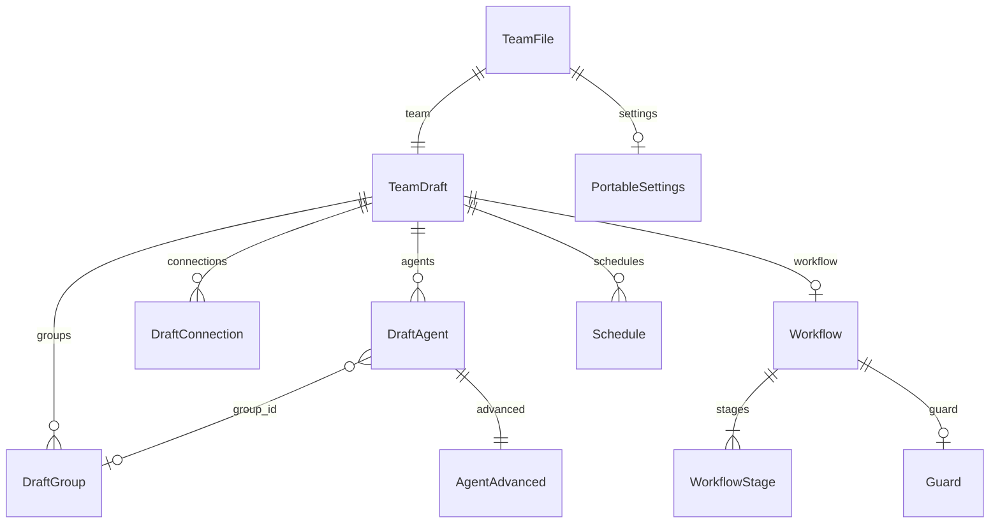

A team file holds every structural detail of a team: its agents, groups, arrows, workflow and settings. It is what **Export team file** writes, what import reads, and what Sculptured's examples are stored as. For how to export, import and share one, see [Team files](/guides/team-files).

| | |
| --- | --- |
| Format string | `sculptured.team/v1` |
| File name | `<team>.sculptured-team.json` |
| JSON Schema | [`https://docs.usesculptured.com/schema/team-v1.json`](/schema/team-v1.json) (JSON Schema 2020-12) |
| Run files | `sculptured.session/v1`, schema at [`/schema/session-v1.json`](/schema/session-v1.json) |

The schema is generated from the same types Sculptured reads and writes, so it matches what import accepts. Unknown top-level fields are refused.



## A minimal file

```json
{
  "$schema": "https://docs.usesculptured.com/schema/team-v1.json",
  "format": "sculptured.team/v1",
  "team": {
    "id": "review-loop",
    "name": "Review loop",
    "revision": 0,
    "agents": [
      { "id": "builder", "name": "Builder", "kind": "claude", "job": "Build the feature", "x": 40, "y": 40,
        "advanced": { "check": "npm test" } },
      { "id": "reviewer", "name": "Reviewer", "kind": "codex", "job": "Review each change", "x": 300, "y": 40 }
    ],
    "connections": [{ "id": "c1", "from": "builder", "to": "reviewer", "kind": "hands-work-to" }]
  },
  "settings": { "posture": "restricted", "own_copies": true }
}
```

## Top level

| Field | Type | Required | Meaning |
| --- | --- | --- | --- |
| `$schema` | string or null | no | The file's JSON Schema, for editors that validate and complete it. Written on export; any value is accepted on import. |
| `format` | string | yes | Always `"sculptured.team/v1"`. A different version fails validation. |
| `team` | [TeamDraft](#teamdraft) | yes | The team itself. |
| `settings` | [PortableSettings](#portablesettings) | no | The settings that travel with the team. Default `{ "own_copies": false }`. |

## TeamDraft

| Field | Type | Required | Default | Meaning |
| --- | --- | --- | --- | --- |
| `id` | string | yes | | The team's id. On import a new id is made from the name, so ids never clash. |
| `name` | string | yes | | The team's name. |
| `revision` | integer ≥ 0 | yes | | A save counter. Always `0` in a file; the importing Sculptured assigns its own. |
| `agents` | [DraftAgent](#draftagent)[] | no | `[]` | The agents. |
| `groups` | [DraftGroup](#draftgroup)[] | no | `[]` | Boxes that group agents on the board. |
| `connections` | [DraftConnection](#draftconnection)[] | no | `[]` | The arrows between agents. A team with a workflow uses stage routes instead, and has none. |
| `folder` | string or null | no | | The default working folder for agents without their own. Kept only when exported with **Include folders**. |
| `models` | [ModelDefaults](#modeldefaults) | no | | The team's model per provider. Absent means each CLI's own default. |
| `workflow` | [Workflow](#workflow) or null | no | | Stages that items of work move through. |
| `input` | object or null | no | | The Input box: `text`, its board position `x` and `y`, and `to`, the agent ids that get it with their Job at start. |
| `schedules` | [Schedule](#schedule)[] | no | | Messages sent to an agent every N minutes while the team runs. At most 8. |
| `decision_log` | boolean | no | | People keep a decision log that agents read with [`read_decisions`](/reference/agent-tools#read_decisions). |
| `limits` | [TeamLimits](#teamlimits) | no | no limits | Limits on agents that agents spawn. |
| `budget` | [RunBudget](#runbudget) | no | no budget | What one run may use. |
| `protection` | [Protection](#protection) | no | on, with the defaults below | Rules that keep each agent's context small. |
| `claude_setup` | [ClaudeSetup](#claudesetup) | no | `{ "global": false, "project": true }` | Which of your own Claude Code setup Claude agents load. |
| `safety` | list of `{ name, tool_pattern, conditions, reason }` | no | | [Safety rules](/guides/budgets#safety-rules), in Signet-Eval's format. |
| `components` | list of component manifests | no | | The team's own [components](/guides/skills#writing-a-manifest), beside the built-in ones. |

## DraftAgent

| Field | Type | Required | Default | Meaning |
| --- | --- | --- | --- | --- |
| `id` | string | yes | | The agent's id, unique in the team. It never changes. |
| `name` | string | yes | | The name on its card. |
| `kind` | `claude`, `codex` or `practice` | yes | | Which CLI runs it. `practice` runs a scripted stand-in with no model calls; the app no longer offers it for new agents, but files that use it still load. |
| `x`, `y` | integer | yes | | Its position on the board. |
| `job` | string | no | `""` | Plain-language instructions, sent as the agent's first message when the team starts. |
| `group_id` | string or null | no | | The group it belongs to. Null means none. |
| `folder` | string or null | no | | Its own working folder, as an absolute path. Null means the team's folder. Practice agents may leave it empty. |
| `advanced` | [AgentAdvanced](#agentadvanced) | no | see below | Per-agent options. |

### AgentAdvanced

| Field | Type | Default | Meaning |
| --- | --- | --- | --- |
| `model` | string or null | `null` | This agent's own model, overriding its group's and team's default for its kind. |
| `permission` | `unrestricted` or `restricted` | `unrestricted` | Restricted Claude Code agents ask you before tools run; restricted Codex agents use Codex's approvals. |
| `resume` | `resume-if-possible`, `relaunch-fresh` or `checkpoint-only` | `resume-if-possible` | What happens to its session when the team starts again. |
| `token_limit` | [TokenLimit](#tokenlimit) or null | | Tokens it may use in one run. Reaching the limit soft-stops it. |
| `check` | string or null | | A shell command run in the agent's folder after each turn it finishes. Exit code 0 means passed. |
| `turn_limit` | [SoftHard](#softhard) of turns | | Turns it may take in one run, its children's included. |
| `minute_limit` | [SoftHard](#softhard) of minutes | | Minutes it may spend working in one run, its children's included. |
| `data_access` | [DataAccess](#dataaccess) | | What it reads, writes and changes beyond its files. |
| `authority` | [Authority](#authority) | | The decisions it owns. |
| `skills` | list of `{ name, description, body }` | | Its [skills](/guides/skills). `name`: lowercase letters, digits and hyphens, at most 64; `description`: when to use it, at most 1,024 characters. |
| `integrations` | list of component ids | | The [components](/guides/skills#components-tools-on-the-agents-computer) it is given: built in (`kindex`, `signet`) or the team's own (MCP servers on the computer or remote, skill packs, Claude plugins, tool hooks). |

### TokenLimit

| Field | Type | Required | Default | Meaning |
| --- | --- | --- | --- | --- |
| `tokens` | integer ≥ 0 | yes | | The limit, counted since the team started. |
| `counts` | `all`, `new` or `output` | no | `all` | Which reported tokens count. `all` is input, output, cache reads and cache writes; `new` is everything except cache reads. |
| `include_subagents` | boolean | no | `true` | Count the agents it spawns, and theirs, toward this limit. |

### SoftHard

A limit with a **soft** value (no new work; the agent wraps up with a summary) and a **hard** value (it is stopped at once).

| Field | Type | Required | Meaning |
| --- | --- | --- | --- |
| `hard` | integer > 0 | yes | Where it stops. |
| `soft` | integer | no | Where it wraps up. Absent: 85% of `hard`. Must not be above `hard`. |

### DataAccess

Paths are relative to the agent's folder; a trailing `/` covers a folder. See [Contracts](/guides/budgets#contracts-what-each-agent-reads-writes-and-decides).

| Field | Type | Meaning |
| --- | --- | --- |
| `reads` | string[] | Files and folders it reads. Empty: anything. |
| `writes` | string[] | Files and folders it changes. With protections on, Claude agents' reads and writes outside these are refused. |
| `side_effects` | string[] | Effects beyond its files, in plain words. |
| `shared` | list of `{ name, value, file }` | Values other agents rely on, checked in `file` at every start. |
| `rationale` | string | Why. |

### Authority

| Field | Type | Meaning |
| --- | --- | --- |
| `domains` | string[] | Decisions it owns. Every agent is told who decides what. |
| `scope` | string | How far its decisions reach: a group id, or `system` for the whole team. Absent: its own work. |
| `rationale` | string | Why. |

## Team settings

### TeamLimits

| Field | Type | Meaning |
| --- | --- | --- |
| `max_agents` | integer | Most agents in the team at once, its own and spawned children together. |
| `max_child_levels` | integer | Most levels of children. `1` lets agents spawn children that cannot spawn their own. |

### RunBudget

See [Run budgets](/guides/budgets).

| Field | Type | Meaning |
| --- | --- | --- |
| `plan` | list of `{ provider, window, soft?, hard, pause? }` | A share of a plan window the run may add, in percent. `provider` is `claude` or `codex`; `window` is `five_hour` or `seven_day`. With `pause` (`{ continue_with: notes \| resume, max_windows: 3 }`), the run pauses at `hard` and continues after the window resets instead of stopping. |
| `tokens` | [SoftHard](#softhard) | Tokens of every kind the run may use. |
| `minutes` | [SoftHard](#softhard) | Wall-clock minutes from Start. |
| `max_working` | integer | Most agents working at once; the rest wait for a slot. |

### Protection

| Field | Type | Default | Meaning |
| --- | --- | --- | --- |
| `on` | boolean | `true` | Off turns every protection off. |
| `read_kb` | integer | `100` | A whole read of a larger file is refused. |
| `shell_chars` | integer | `8000` | The most shell output an agent sees. |
| `context_tokens` | integer | `60000` | Past this, an agent writes its notes and continues fresh. |

### ClaudeSetup

| Field | Type | Default | Meaning |
| --- | --- | --- | --- |
| `global` | boolean | `false` | Load `~/.claude`: your plugins, skills, hooks, settings and MCP servers. |
| `project` | boolean | `true` | Load the agent folder's `.claude/` and local settings. |

## DraftGroup

| Field | Type | Required | Meaning |
| --- | --- | --- | --- |
| `id` | string | yes | The group's id. It never changes. |
| `label` | string | yes | The name shown on the group. |
| `x`, `y`, `w`, `h` | integer | yes | Its box on the board. |
| `models` | [ModelDefaults](#modeldefaults) | no | The group's model per provider. Absent means the team's. |

## DraftConnection

| Field | Type | Required | Meaning |
| --- | --- | --- | --- |
| `id` | string | yes | The arrow's id. |
| `from`, `to` | agent id | yes | The two ends. |
| `kind` | see below | yes | What the arrow means. |

| `kind` | Meaning |
| --- | --- |
| `hands-work-to` | The giver starts before the receiver, and hands its work on. |
| `reports-to` | Design intent: who reports to whom. Not enforced. |
| `watches` | Design intent: who keeps an eye on whom. Not enforced. |

## ModelDefaults

| Field | Type | Default | Meaning |
| --- | --- | --- | --- |
| `claude` | string or null | `null` | For Claude agents: an alias such as `opus` or `sonnet`, or a full model id. |
| `codex` | string or null | `null` | For Codex agents: a model slug. |

Each level inherits from the next: agent, then group, then team, then the CLI's own default.

## PortableSettings

The team settings that are part of its design. Which computer runs the team is not part of the file.

| Field | Type | Default | Meaning |
| --- | --- | --- | --- |
| `posture` | `unrestricted`, `restricted` or null | | The team's permission default. Null means your global setting. |
| `own_copies` | boolean | `false` | Each Claude Code and Codex agent works in its own Git copy. |
| `question_timeout_min` | integer or null | | How long agents' questions wait for you, in minutes (1 to 1440). Null means the global setting, 10 minutes by default. |

## Workflow

A workflow moves a batch of items through stages. The dispatcher agent creates the batch, each stage settles an item with an outcome, and the collector assembles the result once every item is complete. See [Workflows](/guides/workflows).

| Field | Type | Required | Meaning |
| --- | --- | --- | --- |
| `dispatcher` | agent id | yes | The only agent that may call `dispatch_work`. When the team starts, only it gets a start message. |
| `entry` | stage id | yes | The first stage of every item. |
| `collector` | agent id | yes | The assembly agent. It must differ from the dispatcher. |
| `max_tasks` | integer | yes | Items per batch, 1 to 64. |
| `max_steps` | integer | yes | Stage entries per item, 1 to 32: a backstop on every loop. |
| `stages` | [WorkflowStage](#workflowstage)[] | yes | 1 to 16 stages with unique ids. |
| `input` | string | no | The Input block: links, notes and goals sent to the dispatcher, under 64 KB. |
| `input_position` | `{x, y}` or null | no | Where the Input block sits on the board. |
| `guard` | [Guard](#guard) or null | no | A project check that pauses new work while it fails. |
| `copies` | `shared` or `per-item` | no | `per-item` gives each item its own Git branch and folder. Default `shared`. |

### WorkflowStage

| Field | Type | Required | Meaning |
| --- | --- | --- | --- |
| `id` | string | yes | The stage's id. `assembly` is reserved. |
| `name` | string | yes | Its name. |
| `routes` | object | yes | Outcome name → next stage id, or `null` to complete the item. 1 to 8 routes. `blocked` is reserved and always available. |
| `kind` | `agent`, `check`, `human` or `merge` | no | Who settles the stage. Default `agent`. |
| `agent` | agent id | no | The agent for an `agent` stage. Empty for the other kinds. |
| `workers` | agent ids | no | More interchangeable agents for items at this stage, up to 8 in all. |
| `reviewers` | agent ids | no | A review panel of 2 to 6 agents who all take the same item, instead of `agent`. |
| `personas` | map of agent id to `red-team`, `adversarial`, `simplifier`, `user`, `expert`, `good-friend` or `ownership` | no | The angle each panel reviewer takes. |
| `join` | `all` or `any` | no | How a panel decides: every reviewer, or the first approval. |
| `priority` | outcome names | no | Which panel outcome wins, worst first. Default: `blocked`, then any outcome other than `approved`, then `approved`. |
| `max_rounds` | integer or null | no | How often one item may enter this stage, 1 to 20. |
| `on_limit` | stage id or null | no | Where an item goes when `max_rounds` is reached. Without one, the item is blocked. |
| `escalate` | `{after_rounds, agent}` or null | no | After `after_rounds` rounds (1 to 20, fewer than `max_rounds`), hand the item to another agent. Single-agent stages only. |
| `command` | string or null | no | `check` stages: the shell command, run in the team's folder. |
| `timeout_s` | integer or null | no | `check` stages: seconds before the command is stopped. Default 600, at most 3600. |
| `prompt` | string or null | no | `human` stages: what the person decides, up to 2 KB. |
| `into` | string or null | no | `merge` stages: the branch to merge into. Default: the project's current branch. |
| `position` | `{x, y}` or null | no | Where the stage's own box sits on the board. |

Each kind has fixed rules:

| `kind` | Settled by | Routes |
| --- | --- | --- |
| `agent` | the stage's agent, workers or review panel, with [`complete_work`](/reference/agent-tools#complete_work) | any 1 to 8 names |
| `check` | Sculptured running `command` | exactly `passed` and `failed` |
| `human` | you, choosing an outcome | 2 to 6 names |
| `merge` | Sculptured merging the item's branch | exactly `merged` and `conflict`; needs `copies: per-item` |

Every stage must have a route to completion.

### Guard

| Field | Type | Required | Meaning |
| --- | --- | --- | --- |
| `command` | string | yes | The check to run in the team's folder, 1 to 2000 bytes. |
| `every_minutes` | integer | yes | How often, 5 to 1440 minutes. |
| `timeout_s` | integer or null | no | Seconds before the command is stopped. Default 600, at most 3600. |

## Schedule

| Field | Type | Required | Meaning |
| --- | --- | --- | --- |
| `id` | string | yes | The schedule's id. |
| `agent` | agent id | yes | Who receives the message. |
| `every_minutes` | integer | yes | How often, 5 to 1440 minutes. |
| `message` | string | yes | The message, up to 4 KB. It is skipped when the agent is busy. |

## What import refuses and what it warns about

A file is **refused** only when it does not hold together: the wrong `format`, a field of the wrong type, duplicate or dangling ids and arrows, an unknown group, or an invalid workflow. The error names the field and the reason, and nothing is created.

Anything else is imported, and listed as a **warning** to fix before starting, as the board shows for any team: a Claude agent without a folder, an empty team, a missing name.

## Next steps

<CardGroup cols={2}>
  <Card title="Team files" icon="file-json" href="/guides/team-files">Export, import and share team and group files.</Card>
  <Card title="Workflows" icon="route" href="/guides/workflows">How stages, outcomes and review loops run.</Card>
</CardGroup>
