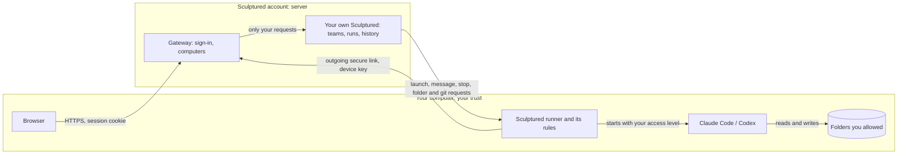

Your agents run on **your own computers**, never on a Sculptured server. Each computer keeps its own rules: which folders agents may start in, and how much they may do. The server can ask for less than a computer allows, never more.

<CardGroup cols={3}>
  <Card title="Your computer decides" icon="laptop" href="#what-your-computer-refuses">Allowed folders and access level are set only on the computer.</Card>
  <Card title="Keys, not passwords" icon="key" href="#connecting-a-computer">One-time connect keys and revocable device keys.</Card>
  <Card title="Accounts" icon="user-shield" href="#accounts-and-sessions">Invite-only, CSRF-protected sessions.</Card>
</CardGroup>

## Where things live

| What | Where it lives |
| --- | --- |
| Your code and files | In the folders you allowed, on your computer. They reach the server only as results you ask for, such as a folder listing, Git status or a diff. |
| Claude Code and Codex sign-in | In the CLIs' own settings on your computer. Sculptured never reads or stores them. **Sign in** only starts the CLI's own sign-in. |
| Teams, runs, messages and transcripts | In your own Sculptured. With an account, that is one private instance per user on the server. Running it yourself, it is `~/.sculptured/` on your computer. |
| Your computer's key | `~/.sculptured/runner/device.json` on that computer, readable only by your user. The server keeps only a hash. |
| Your account password | Stored as an argon2id hash. Google and GitHub sign-in store no password. |

See [Privacy](/privacy) for what is recorded about how you use Sculptured.

## Running it yourself

`sculptured serve` listens only on `127.0.0.1` and accepts only requests addressed to `127.0.0.1` or `localhost`, with a matching origin. That stops other websites from driving it through your browser. The runner connects to it with a private token that agents never see.

<Warning>Do not reverse-proxy port 4410 onto the Internet. Anyone who reaches it can control your agents.</Warning>

## Connecting a computer

<Steps>
  <Step title="A one-time connect key">The Computers page copies a command that carries a connect key. It works **once**, for **30 minutes**, and only a signed-in browser can create one.</Step>
  <Step title="Traded for a device key">The installer trades it for this computer's own device key. The server stores only a hash of it.</Step>
  <Step title="An outgoing link">The runner opens a secure link (`wss://`) out to your account. Nothing connects in to your computer, so no port is opened.</Step>
  <Step title="Revocable">**Disconnect** on the Computers page drops the live link at once and refuses that key from then on. The runner stops and says to run `sculptured connect` again.</Step>
</Steps>

A computer can only connect as itself. It cannot pretend to be another of your computers.

If a computer connects with a pairing code instead of a key, the approval page warns: only approve a code you just saw on your own computer. It shows when and from which address the code was requested.

## What your computer refuses

The runner checks every launch, restart and local request against its own rules, whatever the server asks.

| The server asks to… | Your computer… |
| --- | --- |
| Start an agent in a folder you did not allow | Refuses: "… is not in a folder this computer allows." |
| Start an agent in a folder that doesn't exist | Refuses: "… does not exist on this computer." |
| Reach outside a folder with `..` or a symbolic link | Resolves the real path first, then refuses. A sibling folder such as `/home/you/proj2` is not inside `/home/you/proj`. |
| Run a different program, add environment variables or extra arguments | Refuses. A computer only runs its own Claude Code and Codex. |
| Give an agent more access than the computer allows | Lowers it to the computer's level. |
| Run a check command when checks are turned off | Refuses, and the check is recorded as failed with the reason. |

A refused launch shows on the agent: it needs attention, with the reason.

### Allowed folders

Allowed folders decide **where an agent may start**, not what it can do once running. The installer allows your home folder. Add more with `sculptured allow <folder>`, or choose them when you connect with `--allow`.

### Access level

| Access | Claude Code | Codex | Set with |
| --- | --- | --- | --- |
| **Full** (default) | Runs as the team asks. An unrestricted agent skips permission prompts. | Full access | `sculptured connect … --full-access` |
| **Sandboxed** | Always restricted: risky actions need your approval in the browser. | Writes only inside its folder | `sculptured connect … --sandboxed` |

<Warning>With full access, an agent, or anyone who can instruct it, can act as you do on that computer. Prompt injection is real: a file or web page an agent reads can contain instructions. Use **Sandboxed**, or set reviewers to **Restricted**, when agents read untrusted material.</Warning>

### What the account may do on a computer

Each computer turns these on or off with `--enable` and `--disable` on `sculptured connect`:

| Capability | What it allows | Full access | Sandboxed |
| --- | --- | --- | --- |
| `git` | Git status, diffs and commits from the Git panel | on | on |
| `copies` | Agents' own copies of a repository | on | on |
| `checks` | Running a team's check commands, such as tests | on | **off** |
| `cli-sign-in` | Starting Claude Code's or Codex's own sign-in | on | on |
| `plan-usage` | Reading how much of your Claude or ChatGPT plan is used | on | on |

Checks are off when sandboxed because a check runs a command from the team's design outside the agent's sandbox.

The Computers page shows each computer's folders, access and capabilities as the computer reports them. The computer enforces its own copy either way.

## Agents and their tools

- Each agent gets its own token for Sculptured's tools. It works only while that agent's process runs, so one agent cannot use another's tools.
- The runner's own secret is removed from every agent's environment.
- An invalid tool call is recorded as evidence and answered with an error. It never interrupts the agent.
- A restricted agent is never launched unrestricted. If a runner cannot honour restricted, the launch is refused.
- [Safety rules](/guides/budgets#safety-rules) refuse the tool calls you name, for Claude agents, with no model call. They are a speed bump, not a sandbox: an agent can still reach the same result another way, so they add to the computer's own limits rather than replace them.
- The integrations an agent is given (Kindex, Signet-Eval) are programs the runner finds on its own computer; the server never sends a program to run.
- Sculptured's own files in a project folder are under `.sculptured/`: the project map, agents' notes, and lessons you confirmed. When agents work in their own copies, Git also records those copies in the project's `.git` folder. Skills and Signet-Eval rules are written in the runner's own data folder, never in the project.

## Accounts and sessions

- **Invite-only.** Joining needs an invite. Invites are single use, expire and can be revoked.
- **Sessions** end after 3 days without use, and 14 days after sign-in at the latest. Sign out from the Account page.
- **Every change** from the browser must come from the Sculptured site itself and carry a CSRF token tied to your session.
- **Password sign-in** is rate-limited, and unknown emails get the same answer as wrong passwords.
- **Google and GitHub sign-in** are bound to the browser that started them and cannot be replayed.
- **Your Sculptured** accepts only requests the gateway signed for you. You reach only your own teams and computers.
- **Admins** manage invites, users and computers. They cannot open your teams or your files.

## Community

Community holds published team blocks and your saved copies. It has no access to your runner, transcripts, files or Git. Publishing strips machine-specific folders, model overrides and workflow input, but a job's text can still contain private details. Review it before you publish. See [Your community account](/guides/community).

## Not covered

- The device key is kept in a file readable only by your user. Keeping it in the system keychain is planned.
- A hostile server could ask your computer for anything its rules allow: starting Claude Code or Codex in an allowed folder, with your access level. Allowed folders and **Sandboxed** are how you limit that.

## Next steps

<CardGroup cols={2}>
  <Card title="Connect a computer" icon="plug" href="/connect-a-computer">Install the runner and choose its folders.</Card>
  <Card title="Privacy" icon="eye-slash" href="/privacy">What is recorded, and what never is.</Card>
  <Card title="CLI reference" icon="terminal" href="/reference/cli">`connect`, `allow` and their options.</Card>
  <Card title="Run it yourself" icon="server" href="/operations">Self-hosting on one computer.</Card>
</CardGroup>
