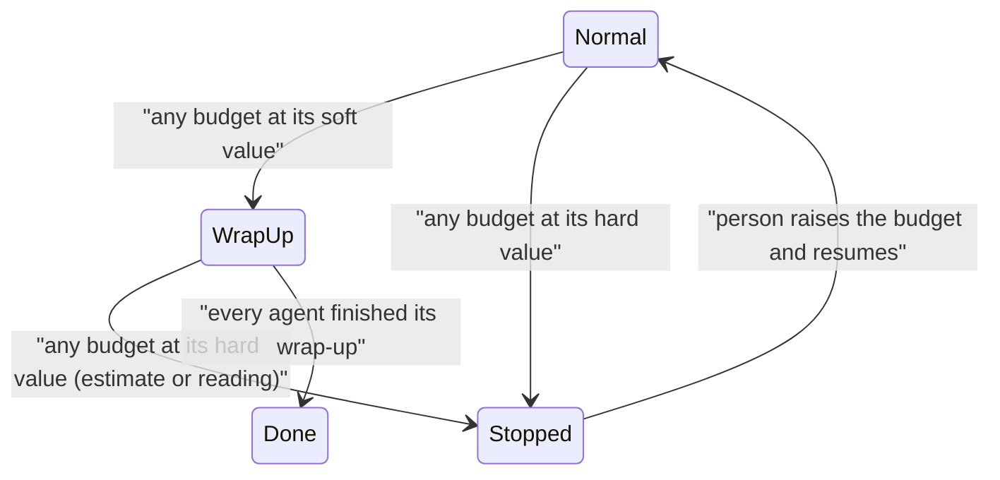

# Enforced budgets, agent skills and `sculptured run`

Status (17 October 2026): **A built** and deployed. **B partly built**: skills on each agent (editor, native loading for Claude Code, `read_skill` for Codex, embedded in MADL as MEP 0004); role, expected output, reasoning effort and allowed/banned tools are not built. **C not built.** Approved 15 October 2026.

Three changes, built in this order, each pushed and deployed when its tests pass:

- **A. Enforced budgets.** A run stays within a share of the person's Claude or Codex plan window (for example 30% of the 5-hour window), with system-wide and per-agent limits that every path to new work respects.
- **B. Agent design.** The agent's Job becomes Role, Skills (each a `SKILL.md`), Additional context and Expected output, alongside tools, model and limits.
- **C. `sculptured run`.** A system downloads as one `.madl` file that runs from a terminal like a program.

## Decisions already made

| Question | Decision |
|---|---|
| What happens at the budget | Every budget and limit has a **soft** value (no new work; agents wrap up with a summary) and a **hard** value (agents are stopped at once, like Ctrl+C in a terminal). Setting only the hard value puts the soft one at 85% of it. |
| Executable form | One `.madl` file (YAML) whose first line is a shebang, with skills and context embedded. Needs the `sculptured` runner installed. |
| Where skills live | On each agent. No shared library. |
| Scope | All three, budgets first. |

Sculptured still sets no limits of its own: every budget and limit here is off until the person sets it.

## A. Enforced budgets

### What can be promised

The CLIs report usage after each model call, and plan readings are account-wide, so they include the person's own use outside Sculptured. No system can promise "never past 30%" exactly. This design promises a **bounded overshoot**: once the estimate reaches the budget, at most one model call per agent that was working at that moment completes. The person controls that bound with "Most agents working at once", and the Start confirmation states it.

Counting the account-wide change means use outside the run counts against the run. That is the safe direction for "I can't use more than 30%".

### A1. Settings

Every setting below takes a soft and a hard value, e.g. Claude 5-hour soft 25%, hard 30%, or time soft 45 min, hard 60 min. Soft must be at or below hard; with only a hard value, soft is 85% of it.

On the team (team Advanced → **Budget**, and in the Start confirmation):

| Setting | Meaning |
|---|---|
| Plan budget, per provider | Percent of a plan window (`five_hour` or `seven_day`) this run may add, e.g. Claude 5-hour soft 25%, hard 30%. |
| Token budget | Tokens the whole run may use (all agents, children included), counted as in `TokenCount`. |
| Time budget (deadline) | Wall-clock minutes from Start. |
| Most agents working at once | New. Agents beyond it wait for a free slot; distinct from `max_agents` (total agents). |

On the agent (Advanced → **Limits**; each counts its spawned children too unless turned off, as `TokenLimit` does today):

| Limit | Exists? |
|---|---|
| Tokens | yes (`advanced.token_limit`) |
| Turns | new |
| Minutes working | new |

An agent's limits only tighten the team's: an agent can never be given more than the team budget.

### A2. Measuring

1. **In-turn usage.** The Claude driver counts usage on every model call: `assistant` lines carry `message.usage`, repeated on each line of one message, so it is counted once per `message.id`. These are recorded as provisional `usage-progress` events. At the turn's `result`, the turn's `modelUsage` delta replaces the provisional sum, so totals stay exact. Codex's `thread/tokenUsage/updated` arrives during the turn already; a fixture test confirms it arrives per model call.
2. **Plan baseline.** At Start, Sculptured records each budgeted window's reading (`used_percent`, `resets_at`). The run's share is `current − baseline`. If no reading exists yet (Claude keeps no usage file), the first reading during the run becomes the baseline. The Start confirmation then says "Claude's share is measured from its first report".
3. **Estimating between readings.** Readings arrive irregularly. Sculptured learns each provider's percent-per-token rate from consecutive readings and the tokens counted between them: within this run first, then the last run's stored rate. The estimate is `last reading + tokens since × rate`. Enforcement uses the higher of the estimate and the latest reading.
4. **Window reset.** When `resets_at` passes, the budget applies to the new window and counting restarts from its first reading. The Run board says so.

### A3. Enforcing

One gate, `budget::admit(team, provider, what)`, used everywhere work can start:

- Start (team), resume;
- `spawn_agent`;
- group copies and work dispatch (`copies.rs`, `workflow/tools.rs`);
- handoffs;
- **every message delivered to an agent**, since each one starts a turn.

It refuses when the run is past its soft value, or when the remaining budget is less than the **reserve**. The reserve is (agents working + 1) × the largest single-call share seen in this run, or a fixed floor of 1% of the window before any is seen. A refusal carries the reason, e.g. "Run budget: 24.1% of 30% of Claude's 5-hour window used; wrapping up", and is recorded on the agent like spawn refusals today.

Concurrency: when "Most agents working at once" is reached, a delivery waits in the agent's queue (state **Waiting for a slot** on its card) and goes out when a slot frees, oldest first.

The run's budget state, checked once a second by `controls::run` and after every usage or plan event:



- **WrapUp:** the gate admits nothing new; every running agent gets the existing soft stop (wrap-up instruction, summary). Waiting deliveries are dropped and listed.
- **Stopped:** every agent and child gets a hard stop (A3a), all at once rather than one after another.
- Per-agent limits work the same way on that agent and its children: soft value → wrap up, hard value → hard stop. Turns and minutes are added beside tokens.

### A3a. Hard stop: like Ctrl+C

Today a hard stop closes the agent's input, waits up to 5 s for the CLI to finish its turn (it may keep calling the model meanwhile), then force-kills. A hard stop becomes immediate:

1. **Interrupt at once.** Each agent's CLI already runs in a process group Sculptured created for that agent alone, with the CLI as its leader. That group holds the CLI and every command it started (builds, scripts, servers), and nothing else: not the runner, not the person's terminal or desktop session. A hard stop sends that group SIGINT, exactly what Ctrl+C in a terminal sends, so the CLI abandons the model call in flight and its commands stop too. On Windows, agents run without a console, so no Ctrl+C or Ctrl+Break can reach them; there a hard stop goes straight to step 2.
2. **Force after 2 s.** Whatever is still alive in that group gets SIGKILL. On Windows, `taskkill /T /F` ends the CLI's process tree at once.
3. **Report.** The agent is recorded as hard-stopped with the reason (which budget, or the person) and the time. A model call cut off mid-way may still be billed by the provider for what it had produced; the history notes that the stop interrupted a call.

The runner protocol's `Stop` gains `hard: bool` (default false), so older runners keep today's 5-second path until they are updated.

The person can do the same by hand: **Stop now** on any agent (with its children), and **Stop everything now** on the Run board, beside the existing wrap-up stop.

### A4. Showing it

- Run board header: one meter per budget, e.g. "Claude 5-hour: +12.4% of 30% · wrap-up at 25.5%". Each meter shows whether the number is a reading or an estimate, and its age.
- Start confirmation: the budgets, the overshoot bound in words ("up to one model call for each of the 6 agents working at once"), and how long the budget lasted for the last run of this team, when one exists.
- Run history: per budget, the peak share, whether wrap-up and stop fired, and the overshoot past 100% from the final readings. This is how the person checks the limit held.

### A5. MADL

MADL change: `restrictions.budget` gains `plan: [{provider, window, percent}]` and `turns`, and `restrictions` gains `concurrency: { max_working }`. Validation follows existing rules: restrictions only tighten, and reach applies to self, subagents and descendants. Sculptured's import and export map these, and the pinned MADL revision moves.

### A6. Tests (fixture CLIs only)

- The fake Claude reports per-message usage and rate-limit readings on a script. A run with a 30% budget and 6 agents working at once wraps up at 85% and stops by 100%; the overshoot stays within the stated bound.
- Every gate path is refused past wrap-up: spawn, copy, dispatch, handoff, message, resume.
- Concurrency: an agent waits for a slot, then runs.
- The estimate drives a stop before the next reading arrives.
- A window reset restarts the count.
- Soft and hard values: soft wraps up, hard stops; only-hard puts soft at 85%; soft above hard is refused.
- Hard stop: a fixture CLI that ignores interrupts for 10 s and has started a child `sleep` is gone, with its `sleep`, within 2.5 s; a well-behaved one exits on the interrupt alone. An older runner (no `hard`) still stops via the 5 s path.
- In-turn usage is deduplicated by message id and reconciled at `result`.

## B. Agent design

### B1. Fields

| Field | Replaces / source | Sent to the agent |
|---|---|---|
| Role | new; one line, shown on the card | first line of the first message |
| Skills | new; per agent: name, description, body | loaded natively by the CLI (B3) |
| Additional context | today's `job` text, moved unchanged | first message |
| Expected output | new; what it produces and where | first message; available to checks |
| Tools allowed / banned | MADL restrictions | Claude: `--allowedTools` / `--disallowedTools`. Codex: per-MCP-server tool settings; built-in Codex tools it cannot restrict are marked "not enforced" on the panel |
| Model and reasoning effort | model exists; effort new | CLI flags |
| Limits | A1 | enforced by Sculptured |
| Permissions, check, resume | unchanged | unchanged |

Migration: `job` becomes `context` on load; old team files keep importing, and MADL `instructions` maps to Additional context. The card shows the role and skill chips.

### B2. Skill editor

"Skills" on the agent panel lists the agent's skills. **Add skill** opens a separate window (a full-size dialog) with name, description and a Markdown body. **Load from file** reads a `SKILL.md`, splitting its frontmatter into name and description. Validation follows the Agent Skills format: name in lowercase letters, digits and hyphens (64 at most), description 1024 characters at most, body required. Skills belong to the agent: copying an agent copies them; the design assistant can propose them.

### B3. Delivering skills

Skills load natively, so only names and descriptions sit in the agent's context until a skill is used. That also saves tokens.

- **Claude Code:** a per-agent plugin folder in the runner's data dir (`skills/<name>/SKILL.md`), passed with `--plugin-dir` for that session only. Nothing is written into the person's project.
- **Codex** (skills are on in 0.162): the first build step confirms which folder Codex reads skills from for one session. If no per-session folder exists, skills are listed in the first message and their bodies placed in a Sculptured-owned folder the agent may read, never the person's project.

### B4. MADL

MADL change: `skills` entries may be embedded objects `{name, description, body}` as well as today's path or name strings, so a `.madl` file carries its skills (needed for C). Agents gain `role`, `expected_output` and `effort`.

### B5. Tests

- Old drafts migrate `job` to `context` without loss.
- The skill editor validates names and descriptions and loads `SKILL.md` frontmatter.
- Claude receives `--plugin-dir` with the skill files; the first message carries role, context and expected output.
- MADL round-trips embedded skills.

## C. `sculptured run`

### C1. Downloading

Team Advanced → **Download for terminal** saves `<team>.madl`:

```yaml
#!/usr/bin/env -S sculptured run
madl: draft
system: { id: c172, name: C172 Model }
...
```

The first line is a YAML comment, so the file is ordinary MADL to every other tool. Skills and context are embedded (B4); budgets are included.

### C2. Running

```
chmod +x c172.madl
./c172.madl --input ./manuals --out ./build --budget claude=25%
sculptured run c172.madl            # the same, and the form used on Windows
```

| Option | Meaning |
|---|---|
| `--folder DIR` | where the agents work (default: the current folder); relative agent folders resolve under it |
| `--input DIR` / `--input-text` | the system's Input, as on the board |
| `--budget P=N%`, `--tokens N`, `--minutes N` | budgets; may only lower what the file sets |
| `--max-working N` | most agents working at once |
| `--open` | also serve the live board on `127.0.0.1` and open it |
| `--json` | progress as JSON lines instead of text |

The command runs controld and hostd in one process with a data dir under `~/.sculptured/runs/<id>`, imports the file, starts the team and prints one line per meaningful event: agent started, handoff, question, finished, budget meters, wrap-up, stop. Questions are asked in the terminal when it is interactive; otherwise the run stops with code 3.

Ctrl+C follows the soft and hard pattern: the first Ctrl+C is a soft stop for the whole run ("Wrapping up; press Ctrl+C again to stop now"), and a second Ctrl+C is a hard stop (A3a) of every agent.

Exit codes: 0 every agent finished; 1 an agent failed; 2 stopped by a budget; 3 needs input; 4 the file is invalid (MADL error codes printed).

### C3. Tests

- `sculptured run` on a fixture team ends with code 0 and prints the event lines.
- A budget stop exits 2; an invalid file exits 4 with the MADL code.
- One Ctrl+C (SIGINT to the `sculptured run` process in the test) wraps up; a second stops every fixture agent within 2.5 s.
- A file starting with the shebang validates in MADL and imports in Sculptured.
- `--budget` above the file's value is refused.

## Documentation

New pages rather than edits to pages another editor has open: `guides/budgets.mdx`, `guides/skills.mdx`, `guides/run-from-terminal.mdx`, with `docs.json` lines added the same careful way as before. The internals page `limits-and-usage.md` gains the gate and budget state.

## Risks

- **Plan readings come irregularly.** The estimate (A2.3) covers the gaps; the Start confirmation names the provider whose reading is missing.
- **Codex per-session skills** may need the fallback in B3.
- **Hosted mode:** budgets live in controld, so they apply the same; `sculptured run` is local only.
