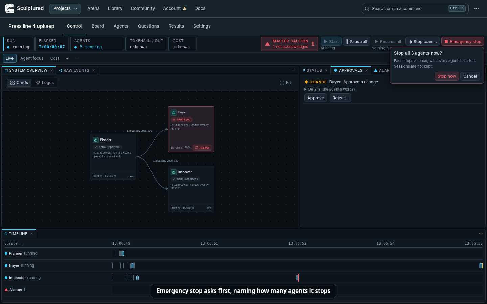
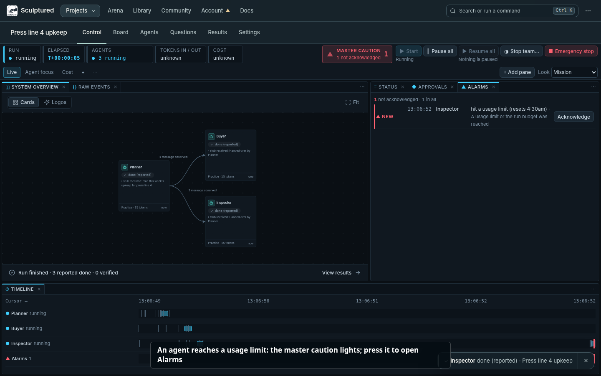
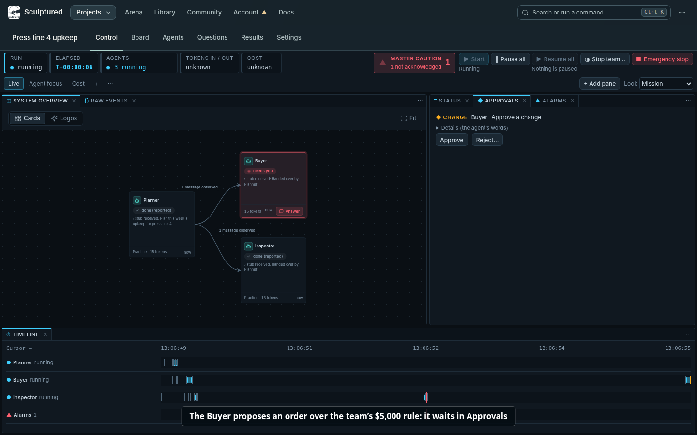
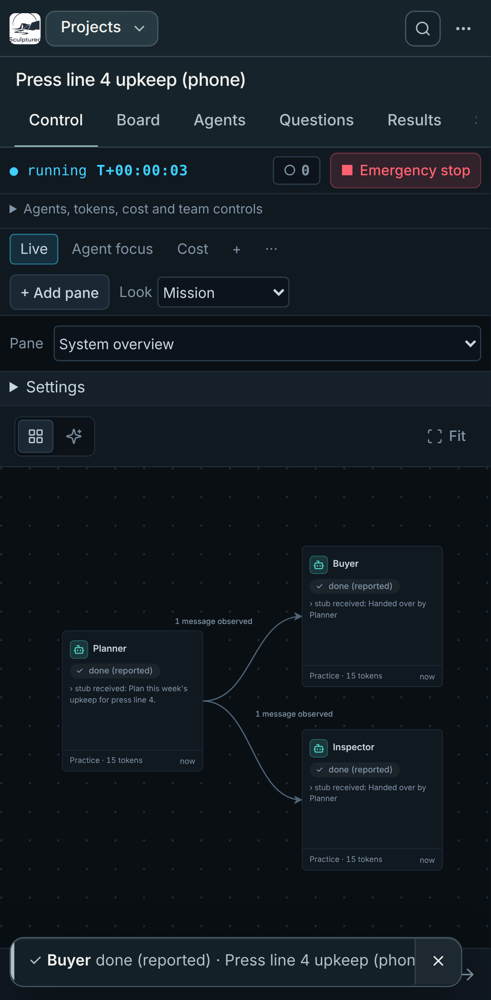
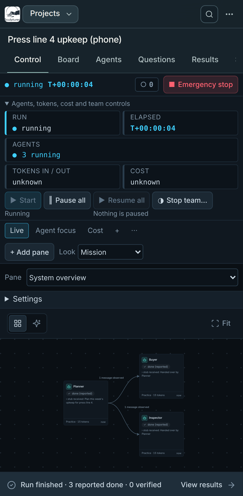
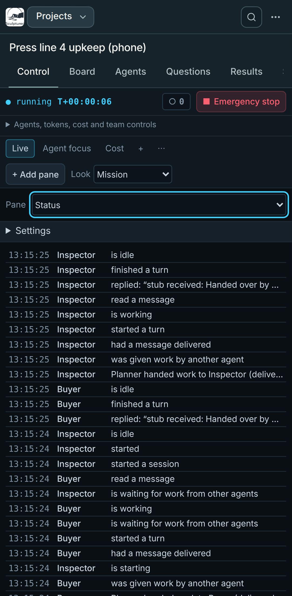
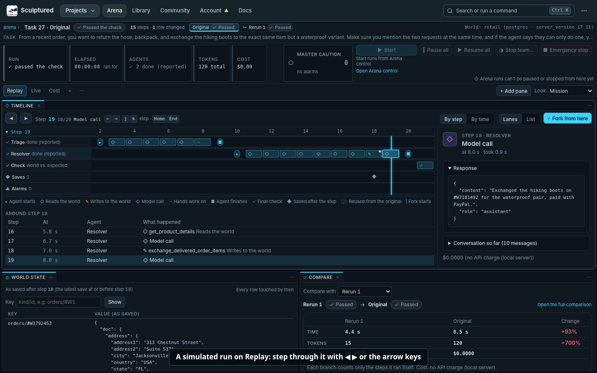
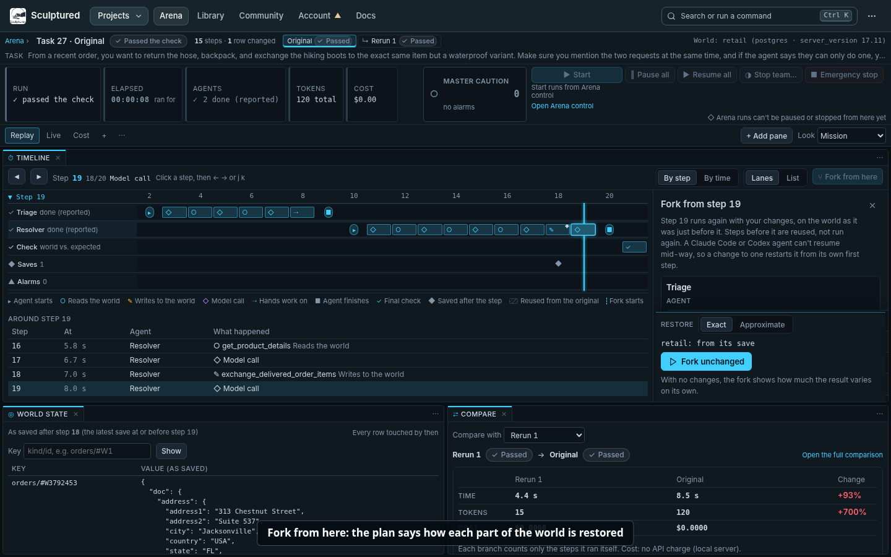
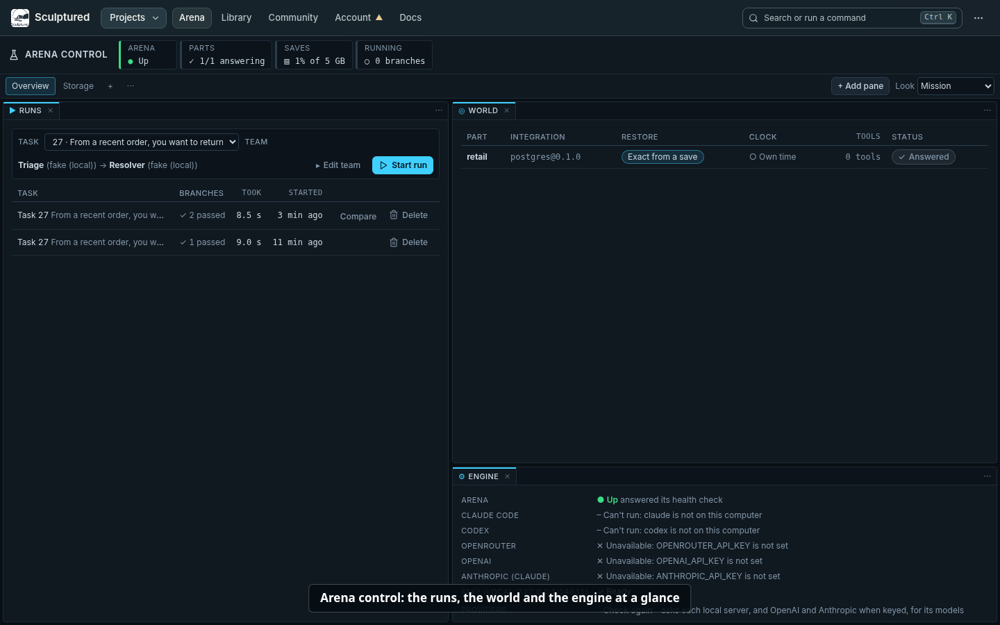
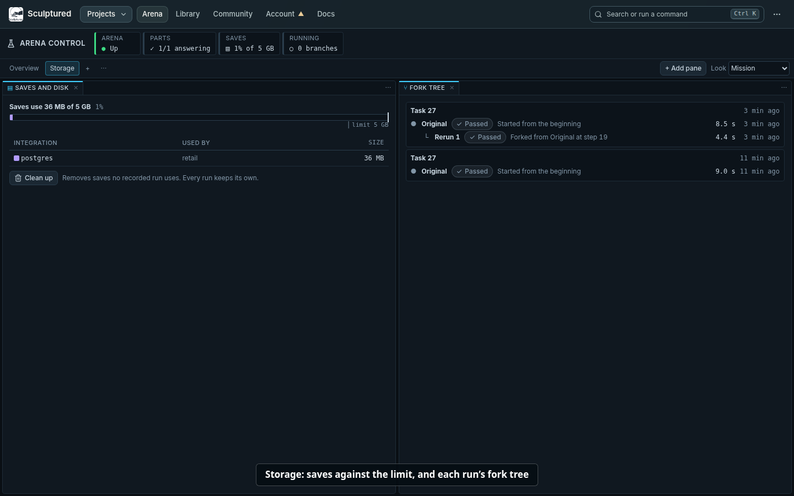

# Control: watch and steer a running team

Control is a project's mission-control page. It shows the live board, what every agent is doing, what waits for you and what went wrong, and it holds the controls for the whole team: Start, Pause all, Resume all, Stop team… and Emergency stop. You arrange it yourself: panes dock beside each other or as tabs, and each layout is kept in this browser.

Every picture and video on this page comes from a recording of the real app. The teams in them are small practice teams whose agents follow fixed scripts instead of calling a model, so their replies read "stub received: …". The Arena runs use a scripted stand-in in place of a model, which plays the same steps every time. The desktop screenshots are taken during the same recorded steps and include their step captions; the phone screenshots have none.

**Videos** (each under a minute):

1. [Open a project on Control and start the team](../videos/control-1-open-and-start.mp4)
2. [Rearrange panes and switch layouts](../videos/control-2-rearrange.mp4)
3. [An alarm, an approval, pause, resume and emergency stop](../videos/control-3-trouble.mp4)
4. [Arena control: a run's Replay and a fork](../videos/control-4-arena.mp4)

The same videos are also in `docs/videos/` as WebM.

## 1. Open Control

A project opens on Control (`/p/<project>/control`); it is the first tab of the project bar. Its first layout, **Live**, puts the live board first, with Status beside it and the Timeline across the bottom.

Click an agent on the board (or press Enter on it) to open it in an **Agent detail** pane and select it in every other pane.

## 2. The header

The header reads left to right.

**Status strip.** Every reading is a mark and a word, never colour alone, and anything Sculptured does not know says "unknown".

| Tile | What it says |
|---|---|
| Run | not started, running, stopped, and so on |
| Elapsed | T+hh:mm:ss since the earliest current agent started, ticking while the team runs |
| Agents | how many agents are in each state, for example "● 3 running" or "‖ 3 paused" |
| Tokens in / out | as the agents' tools reported them |
| Cost | in dollars when it was reported; "unknown" when it was not |

**Master caution.** It lights (▲ and a count) while an alarm is not acknowledged, and shows ✓ once every alarm is acknowledged. Press it to open the Alarms pane.

**Team controls.** A control that cannot run now is disabled and says why beside it, for example "Nothing is paused".

| Control | What it does |
|---|---|
| ▶ Start | Starts the team. A design with problems shows "Fix N things" instead, which opens the Design board. |
| ‖ Pause all | Each running agent stops at its next safe point and keeps its session. |
| ▶ Resume all | Every paused agent carries on in the same session. |
| ◑ Stop team… | The gentle stop: agents finish their turn, then stop. It asks first. |
| ■ Emergency stop | Stops every agent at once, with every agent it started. Sessions are not kept. |

**Emergency stop asks first.** The question names how many agents it stops ("Stop all 3 agents now?"). Cancel has the focus, so pressing Enter by mistake does nothing. Press **Stop now** to stop them; Esc or a click outside cancels. With nothing running it is disabled and says "Nothing is running".

After each action a note under the header says what it did, and names any agent it left alone and why ("Paused 3 agents."). A refusal is never shown as a success. Dismiss the note when you have read it.

An operator pause stays in force when a budget is raised or its plan window resets. Use **Resume all** or the agent's **Resume** to end that pause.

## 3. Panes and layouts

[Video 2](../videos/control-2-rearrange.mp4) shows each of these.

**Layouts.** The tabs under the header are layouts. Control starts with three:

- **Live:** System overview (the live board, with Raw events as a tab), Status (with Approvals and Alarms as tabs) and the Timeline.
- **Agent focus:** Agent detail beside the Timeline and Raw events.
- **Cost:** Metrics beside Results.

**+** adds a layout. Double-click a layout's name to rename it. The **⋯** beside the layouts renames, duplicates, resets it to its default, or deletes it (the last layout cannot be deleted).

**Move a pane with the mouse:**

- **Split:** drag a pane's tab to a side of another pane. That side lights up to show where it will land.
- **Join as tabs:** drop the tab in the middle of another pane.
- **Resize:** drag the gap between two panes.
- **Cancel a drag:** press Esc.

**Move a pane with the keyboard.** Every drag has a keyboard path:

1. Focus the pane's **⋯** button and press Enter.
2. Press → on **Move to…**.
3. Pick a place with ↑ and ↓, for example "Right of Timeline" or "As a tab with System overview", and press Enter. ← goes back; Esc closes the menu.

To resize with the keyboard, focus the gap between two panes (Tab) and use the arrow keys.

**Pane menu (⋯).** Besides Move to…, it offers:

- **Duplicate** for panes that allow several copies (Agent detail, Results);
- **Settings** for panes that have them;
- **Pop out**;
- **Close**.

The ✕ on a tab also closes it.

**Add pane** lists every kind of pane that applies here. A pane already on screen says "shown"; choosing it brings it forward instead of adding a second copy.

**Pop out** opens the pane in its own window, which you can put on another screen. Its place in the layout says "Shown in another window", with **Bring back** and **Show that window**. Closing that window brings the pane back too. The window follows the same selection as the main page.

**Look.** Control uses the dark Mission look unless you pick **Follow app look** in the Look setting; then it looks like the rest of the app. With the app in its light look, the dark Mission panes sit inside the light top bar and project bar, so the page has a visible seam between the two; choose **Follow app look** if you prefer one look throughout.

Layouts and the Look setting are kept per project in this browser. A layout saved by an older version, or one naming a pane that no longer exists, opens without that pane rather than failing.

## 4. The panes

| Pane | What it shows |
|---|---|
| System overview | The live board. |
| Status | What is happening, in plain words, newest first. Settings choose which kinds of entry to show; alarms are marked. |
| Timeline | One lane per agent, plus a lane for alarms. Click a mark to select that time and agent. |
| Alarms | The master caution list (see below). |
| Approvals | Changes and tool requests waiting for you (see below). |
| Agent detail | One agent's conversation or activity, with its own Pause, Resume, Stop (it asks first, like Emergency stop) and a message box. |
| Metrics | Tokens in and out, cost, tool calls per minute, each agent's totals, and this computer's load. |
| Raw events | The event journal, verbatim: the evidence behind the plain words. |
| Results | The project's Results sections (summary, changes, checks), chosen in its settings. |

**Agent detail** follows the selection unless you turn off its **Follow selection** switch, which pins the agent it shows. **Full page** opens the agent's own page.

## 5. Alarms and approvals

[Video 3](../videos/control-3-trouble.mp4) shows an alarm, an approval, Pause all, Resume all and Emergency stop.

**Alarms** are raised by rules. Each rule can be turned on or off in the Alarms pane's settings (⋯ → Settings):

- An agent failed.
- An agent needs attention.
- An agent may be stuck (suspected).
- An agent reached its context limit.
- A usage limit or the run budget was reached.
- A question has waited longer than the threshold (5 minutes unless you change it).
- A part of the world reported an error (simulated runs only).

Each alarm is listed newest first, with when it happened and which agent it is about. Press **Acknowledge** on one, or **Acknowledge all**. An acknowledged alarm stays listed, marked ✓. Acknowledgements are kept per project. Click an alarm to select its agent and time in the other panes.

**Approvals** lists what agents wait on you for:

- **Changes:** a change an agent proposes to a business system, when the team's rules say a person must decide. An example is a purchase order over the team's limit.
- **Tool requests.**

Press **Approve**, or **Reject…** and give a reason; the agent is told the reason. The title and "Details" are the agent's own words. A question that needs a written answer links to **Answer in Needs you**.

## 6. On a phone

Below tablet width, Control shows one pane at a time. Pick it from the **Pane** list; the layouts and panes are the same. The header keeps the run, the clock, the master caution and Emergency stop on one line. **Agents, tokens, cost and team controls** opens the rest. Panes are not dragged on a phone.

Left to right: the one-line header, the rest of the header opened, and the **Pane** list showing Status.

## 7. Simulated runs (Arena)

An Arena run is a team working in a simulated world. Arena saves the world after each step that changes it, so a run can be replayed and forked. A run's branch opens in the same Control workspace, at `/arena/runs/<run>/<branch>`. Its first layout is **Replay**: the Timeline large, with World state and Compare below it. **Live** and **Cost** are there too.

**Step through the run:**

- ◀ and ▶, or ← → (or j k), move one step; Home and End jump to the first and last step.
- Click any step in a lane.
- **By step** and **By time** space the steps. **Lanes** and **List** show them as lanes or a table.
- The panel beside the lanes shows the step's arguments, its result and the rows it read or changed.
- **World state** shows the world as saved at or before the selected step.

**Fork from a step:**

1. Pick a step an agent took and press **Fork from here**. It is disabled, saying why, while the branch still runs or on the final check.
2. Optionally change an agent: its instructions, which kind of agent runs it, or its model.
3. Choose how the world is restored to just before that step:
   - **Exact:** the world exactly as it was.
   - **Approximate:** from saves that may differ slightly, when an exact restore is not possible.

   The plan under the choice says how each part of the world would be restored.
4. Press **Fork unchanged** or **Fork with N changes**.

The fork runs on its own branch. It may start at an earlier step than the one you picked, and its bar says so: an agent's session restarts from that agent's start. **Compare** shows the two branches side by side: outcome, time, tokens, cost and how the world differs.

[Video 4](../videos/control-4-arena.mp4) starts a run, steps through it, forks it with changed instructions and compares the two branches.

**Header.** A simulated run's header reads the same way. Arena runs cannot be paused or stopped from Control yet, and the header says so. Start a new run from Arena control.

## 8. Arena control

**Arena** in the top bar opens Arena control (`/arena`), the same kind of workspace for Arena itself. Its strip shows whether Arena is up, how many parts of the world answer, how much of the save limit is used, and how many branches are running.

**Overview** layout:

- **Runs:** pick a task and a team (**Edit team** changes it) and press **Start run**. The run opens on Replay. Each run lists its branches and how long it took. **Delete** asks first. **Compare** opens a comparison of two finished branches.
- **World:** each part of the world, its integration, how it restores (exact from a save, by replay, or approximate), whether it uses Arena's clock, and its tools.
- **Engine:** Arena's health, which kinds of agent it can run, its benchmark and its tasks.

**Storage** layout:

- **Saves and disk:** the space used against the limit, the space each part holds, and **Clean up**, which removes saves no run uses.
- **Fork tree:** each run's branches, parent to child.

If Arena is not running, every Arena pane says "Arena is not running" and how to start it, and checks again every 15 seconds.

<!-- Recorded with web/e2e/control-video.spec.ts (RECORD_VIDEOS=1); see docs/internals/workspace.md. -->
