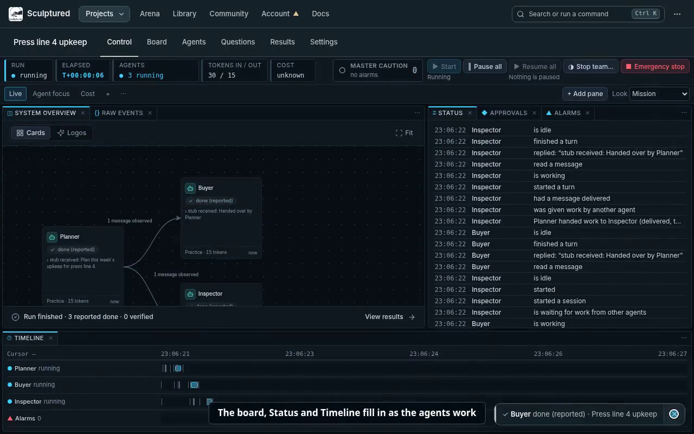
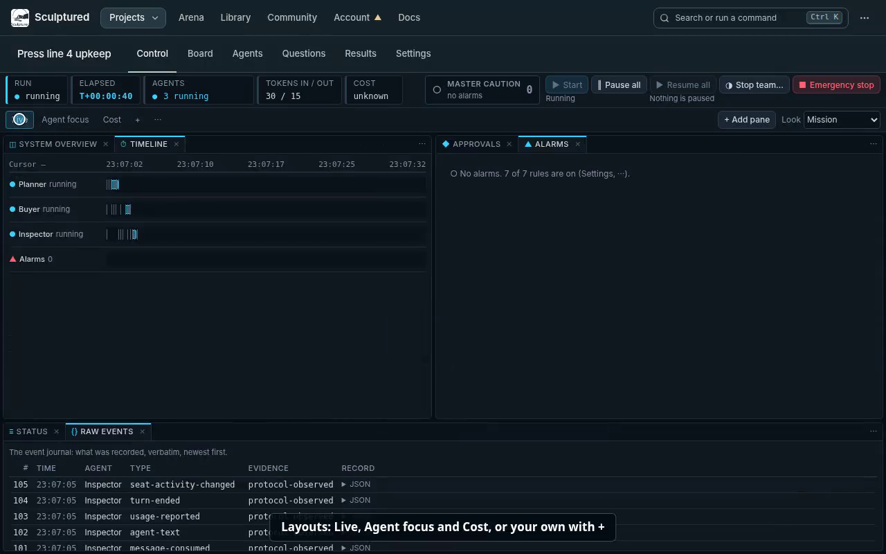

# Control: watch and steer a running team

Control is a project's mission-control page. It shows the live board, what every agent is doing, what waits for you and what went wrong, and it holds the controls for the whole team: Start, Pause all, Resume all, Stop team… and Emergency stop. You arrange it yourself: panes dock beside each other or as tabs, and each layout is kept in this browser.

Every picture and video on this page comes from a recording of the real app. The teams in them are small practice teams whose agents follow fixed scripts instead of calling a model, so their replies read "stub received: …". The screenshots are still frames from those recordings and include their step captions.

**Videos** (each under a minute):

1. [Open a project on Control and start the team](../videos/control-1-open-and-start.mp4)
2. [Rearrange panes and switch layouts](../videos/control-2-rearrange.mp4)

The same videos are also in `docs/videos/` as WebM.

The alarm/approval video, phone screenshots, Arena captures and captures of the control plane (Process layout, Control room, Run in Arena) are pending. On November 2, 2026, the recording environment denied local socket creation and Docker access, so the real test server and throwaway Arena could not start. No substitute screens are included. The recording spec contains the remaining capture flows for an environment with those permissions.

## 1. Open Control

A project opens on Control (`/p/<project>/control`); it is the first tab of the project bar. Its first layout, **Live**, puts the live board first, with Status beside it and the Timeline across the bottom.

Click an agent on the board (or press Enter on it) to open it in an **Agent detail** pane and select it in every other pane.

## 2. The header

The header reads left to right.

**Status strip.** Every reading is a mark and a word, never colour alone, and anything Sculptured does not know says "unknown".

| Tile | What it says |
|---|---|
| Run | not started, running, stopped, and so on |
| Elapsed | T+hh:mm:ss since the earliest current agent started, ticking while the team runs |
| Agents | how many agents are in each state, for example "● 3 running" or "‖ 3 paused" |
| Tokens in / out | as the agents' tools reported them |
| Cost | in dollars when it was reported; "unknown" when it was not |

**Master caution.** It lights (▲ and a count) while an alarm is not acknowledged, and shows ✓ once every alarm is acknowledged. Press it to open the Alarms pane.

**Team controls.** A control that cannot run now is disabled and says why beside it, for example "Nothing is paused".

| Control | What it does |
|---|---|
| ▶ Start | Starts the team. A design with problems shows "Fix N things" instead, which opens the Design board. |
| ‖ Pause all | Each running agent stops at its next safe point and keeps its session. |
| ▶ Resume all | Every paused agent carries on in the same session. |
| ◑ Stop team… | The gentle stop: agents finish their turn, then stop. It asks first. |
| ■ Emergency stop | Stops every agent at once, with every agent it started. Sessions are not kept. |

**Emergency stop asks first.** The question names how many agents it stops ("Stop all 3 agents now?"). Cancel has the focus, so pressing Enter by mistake does nothing. Press **Stop now** to stop them; Esc or a click outside cancels. With nothing running it is disabled and says "Nothing is running".

After each action a note under the header says what it did, and names any agent it left alone and why ("Paused 3 agents."). A refusal is never shown as a success. Dismiss the note when you have read it.

An operator pause stays in force when a budget is raised or its plan window resets. Use **Resume all** or the agent's **Resume** to end that pause.

## 3. Panes and layouts

[Video 2](../videos/control-2-rearrange.mp4) shows each of these.

**Layouts.** The tabs under the header are layouts. Control starts with four:

- **Live:** System overview (the live board, with Raw events as a tab), Status (with Approvals and Alarms as tabs) and the Timeline.
- **Process:** the control plane: Process view beside Alarms (with Trends and Approvals as tabs), and the Action timeline across the bottom (see [The control plane](#5-the-control-plane)).
- **Agent focus:** Agent detail beside the Timeline and Raw events.
- **Cost:** Metrics beside Results.

**+** adds a layout. Double-click a layout's name to rename it. The **⋯** beside the layouts renames, duplicates, resets it to its default, or deletes it (the last layout cannot be deleted).

**Move a pane with the mouse:**

- **Split:** drag a pane's tab to a side of another pane. That side lights up to show where it will land.
- **Join as tabs:** drop the tab in the middle of another pane.
- **Resize:** drag the gap between two panes.
- **Cancel a drag:** press Esc.

**Move a pane with the keyboard.** Every drag has a keyboard path:

1. Focus the pane's **⋯** button and press Enter.
2. Press → on **Move to…**.
3. Pick a place with ↑ and ↓, for example "Right of Timeline" or "As a tab with System overview", and press Enter. ← goes back; Esc closes the menu.

To resize with the keyboard, focus the gap between two panes (Tab) and use the arrow keys.

**Pane menu (⋯).** Besides Move to…, it offers:

- **Duplicate** for panes that allow several copies (Agent detail, Results);
- **Settings** for panes that have them;
- **Pop out**;
- **Close**.

The ✕ on a tab also closes it.

**Add pane** lists every kind of pane that applies here. A pane already on screen says "shown"; choosing it brings it forward instead of adding a second copy.

**Pop out** opens the pane in its own window, which you can put on another screen. Its place in the layout says "Shown in another window", with **Bring back** and **Show that window**. Closing that window brings the pane back too. The window follows the same selection as the main page.

**Look.** Control uses the **Plant** look unless you pick another in the Look setting: neutral greys in the manner of an industrial control system (ISA-101), where colour appears only for something abnormal (a failure, a refusal, an alarm), always with a mark and a word. **Mission** is the earlier near-black look with a cyan accent. **Follow app look** makes it look like the rest of the app. With the app in its light look, the dark panes sit inside the light top bar and project bar, so the page has a visible seam between the two; choose **Follow app look** if you prefer one look throughout.

Layouts and the Look setting are kept per project in this browser. A layout saved by an older version, or one naming a pane that no longer exists, opens without that pane rather than failing.

## 4. The panes

| Pane | What it shows |
|---|---|
| System overview | The live board. |
| Status | What is happening, in plain words, newest first. Settings choose which kinds of entry to show; alarms are marked. |
| Timeline | One lane per agent, plus a lane for alarms. Click a mark to select that time and agent. |
| Alarms | The master caution list (see below). |
| Approvals | Changes and tool requests waiting for you (see below). |
| Agent detail | One agent's conversation or activity, with its own Pause, Resume, Stop (it asks first, like Emergency stop) and a message box. |
| Metrics | Tokens in and out, cost, tool calls per minute, each agent's totals, and this computer's load. |
| Process view | The team's agents as units and the systems they act on as equipment, with the flows of actions between them (see below). |
| Action timeline | Every action an agent took, in lanes per agent, each marked with the system it touched and whether it read or wrote; pick one for its request and result. |
| Trends | Actions per minute for each system, context per call, tokens and cost, and how long actions took. |
| Raw events | The event journal, verbatim: the evidence behind the plain words. |
| Results | The project's Results sections (summary, changes, checks), chosen in its settings. |

**Agent detail** follows the selection unless you turn off its **Follow selection** switch, which pins the agent it shows. **Full page** opens the agent's own page.

## 5. The control plane

The **Process** layout watches a team the way an operator watches a plant: the agents are units, the systems they act on are equipment, and every action is recorded in order. It reads the same for a team running for real and for an Arena run (section 8).

**Which system an action touched.** Nothing is guessed:

- For a team running for real, Sculptured knows its own tools: the team tools (messages, handoffs, status) are **Team messages**; proposing a change, asking you for input or approving is **Approvals**; each component the team adds is an **MCP server** under its own name; Claude Code's file tools are **Agent folders**, its shell is **Shell**, and its web tools are **Web and HTTP APIs**. An MCP server Sculptured does not know is shown under its server name. Whether a call read or wrote is shown only where Sculptured knows it (file reads and edits, the team tools); otherwise it says "unknown".
- For an Arena run, each part of Arena's world says what kind of system it is, which product runs it, what an open-source stand-in stands in for and whether it is simulated, and each tool says whether it reads or writes. A run recorded before Arena kept these shows "kind unknown"; a call that wrote rows is shown as an observed write.

**Process view.** Agents on the left, each with its status (mark and word), its actions per minute over the last five minutes, the calls refused or failed, and its first decision right (hover for all). Systems on the right, each with its kind as a short code (ERP, DB, API, MCP, MSG, APR…), its name and what it is ("ERPNext · stands in for SAP S/4HANA · real"), its reads and writes. A line joins an agent to each system it acted on: heavy for writes, thin for reads, dotted where the effect is unknown, red with ⊘ where a call was refused or failed, moving while it was used in the last minute. Click a unit to dim everything else; **Flows as a list** gives the same as text. **Interlocks · permits** lists the changes and tool uses that waited on a decision: waiting, granted or refused, and by whom ("permit granted by you", "by the team's rules").

**Decision rights** come from the design: what an agent decides (its authority), whether it asks before using tools, and how many of the team's rules check the changes it proposes. In an Arena run, an agent Arena gives only read tools says "read only".

**Action timeline.** One lane per agent; each action is a mark labelled with the system's code and R or W (for example `ERP·W`). Writes are filled, reads are outlined, an unknown effect is dotted, and a refused (⊘) or failed (✕) call is the only coloured mark. Filter by system, **Writes only** or **Refused or failed only**; **List** shows every action as a row with its duration (for a team running for real, from the call to its result; Arena does not record one). Pick an action to see its trace: the system and where its kind is known from, the effect, the outcome in the system's own words, the permit that gated it, and the request and result exactly as recorded.

**Trends.** For each system: a sparkline of actions per minute over 15 minutes, this minute's count, its reads, writes and refused or failed calls. Then the context each model call carried (latest and peak), tokens and cost summed from the reports (marked "at least" when some report had no price), and the median and 90th-percentile time an action took.

## 6. Alarms and approvals

**Alarms** are raised by rules. Each rule can be turned on or off in the Alarms pane's settings (⋯ → Settings):

- An agent failed.
- An agent needs attention.
- An agent may be stuck (suspected).
- An agent reached its context limit.
- A usage limit or the run budget was reached.
- A question has waited longer than the threshold (5 minutes unless you change it).
- A part of the world reported an error (simulated runs only).
- A system or a gate refused an agent's call (its error says refused, denied, not allowed, read-only, blocked by a safety rule and the like).
- A hard safety check failed (Arena runs whose benchmark marks a check as a safety check).

Each alarm has a priority: **P1 high** (an agent failed, a part of the world failed, a hard safety check failed), **P2 medium** (attention, a question waiting, a refusal, a suspected stall, a limit) or **P3 low** (the context limit). The list shows the highest priority first, then the newest, with when it happened and which agent it is about. Press **Acknowledge** on one, or **Acknowledge all**. An acknowledged alarm stays listed, marked ✓. **Shelve 1 h** takes an alarm out of the master caution for an hour: it moves under **Shelved**, says until when, and **Unshelve** puts it back. Acknowledgements and shelving are kept per project in this browser. Click an alarm to select its agent and time in the other panes.

**Approvals** lists what agents wait on you for:

- **Changes:** a change an agent proposes to a business system, when the team's rules say a person must decide. An example is a purchase order over the team's limit.
- **Tool requests.**

Press **Approve**, or **Reject…** and give a reason; the agent is told the reason. The title and "Details" are the agent's own words. A question that needs a written answer links to **Answer in Needs you**.

## 7. On a phone

Below tablet width, Control shows one pane at a time. Pick it from the **Pane** list; the layouts and panes are the same. The header keeps the run, the clock, the master caution and Emergency stop on one line. **Agents, tokens, cost and team controls** opens the rest. Panes are not dragged on a phone.

## 8. Simulated runs (Arena)

An Arena run is a team working in a simulated world. Arena saves the world after each step that changes it, so a run can be replayed and forked. A run's branch opens in the same Control workspace, at `/arena/runs/<run>/<branch>`. Its first layout is **Replay**: the Timeline large, with World state and Compare below it. **Process**, **Live** and **Cost** are there too.

**Step through the run:**

- ◀ and ▶, or ← → (or j k), move one step; Home and End jump to the first and last step.
- Click any step in a lane.
- **By step** and **By time** space the steps. **Lanes** and **List** show them as lanes or a table.
- The panel beside the lanes shows the step's arguments, its result and the rows it read or changed.
- **World state** shows the world as saved at or before the selected step.

**Fork from a step:**

1. Pick a step an agent took and press **Fork from here**. It is disabled, saying why, while the branch still runs or on the final check.
2. Optionally change an agent: its instructions, which kind of agent runs it, or its model.
3. Choose how the world is restored to just before that step:
   - **Exact:** the world exactly as it was.
   - **Approximate:** from saves that may differ slightly, when an exact restore is not possible.

   The plan under the choice says how each part of the world would be restored.
4. Press **Fork unchanged** or **Fork with N changes**.

The fork runs on its own branch. It may start at an earlier step than the one you picked, and its bar says so: an agent's session restarts from that agent's start. **Compare** shows the two branches side by side: outcome, time, tokens, cost and how the world differs.

**Header.** A simulated run's header reads the same way. Arena runs cannot be paused or stopped from Control yet, and the header says so. Start a new run from Arena control.

## 9. Arena control

**Arena** in the top bar opens Arena control (`/arena`), the same kind of workspace for Arena itself. Its strip shows whether Arena is up, how many parts of the world answer, how much of the save limit is used, and how many branches are running.

**Overview** layout:

- **Runs:** pick a task and a team (**Edit team** changes it) and press **Start run**. The run opens on Replay. Each run lists its branches and how long it took. **Delete** asks first. **Compare** opens a comparison of two finished branches.
- **World:** each part of the world, its integration, how it restores (exact from a save, by replay, or approximate), whether it uses Arena's clock, and its tools.
- **Engine:** Arena's health, which kinds of agent it can run, its benchmark and its tasks.

**Storage** layout:

- **Saves and disk:** the space used against the limit, the space each part holds, and **Clean up**, which removes saves no run uses.
- **Fork tree:** each run's branches, parent to child.

If Arena is not running, every Arena pane says "Arena is not running" and how to start it, and checks again every 15 seconds.

## 10. Control room

**Control room** in the top bar (`/control`) is the overview of every project at once, the first level of the control plane. It is a workspace like Control.

- **Deployments:** each project as a unit: its state (running, needs attention, N failed, stopped, not started), its agents running out of all, its alarms (agents failed or needing attention, open questions, calls that failed in the last 15 minutes), a sparkline of tool calls per minute over 15 minutes, its latest action and the latest run's cost and tokens ("≥" when some report had no price; "unknown" when none did). Units with alarms come first. A unit's name opens its Control.
- **Arena runs:** Arena's recent runs, newest first, with their team and outcome; a run Sculptured drove from a board says "driven by its design". Each opens in Control.
- **Test suites:** Arena's test suites, once Arena has them. Until then the pane says they are not available in this Arena yet.

## 11. Run in Arena

On a project's Design board, **Run in Arena…** runs the team in Arena, the staging world, as an external run:

1. Pick a task and press **Start in Arena**. It is disabled, saying why, while the design has problems to fix or Arena is not answering.
2. Sculptured starts an Arena run with `runner: "external"`, registers each agent of the board with Arena, and starts the board's own copy of the team (a project named after the board, the task and the run). Each agent gets its Arena world as an MCP server; the agents nobody hands work to get Arena's task after their own job. The agents run on your Claude Code or Codex sign-in, as any team does, and may cost money.
3. While it runs, Sculptured passes each usage report its agents' CLIs make to Arena. Arena records every tool call its world sees.
4. The run finishes when every agent has finished its turns and nothing waits on it for 30 seconds, when you stop the copy (Stop team or Emergency stop), or when you press **Finish now**. Sculptured then records each agent's end with its tokens and cost, asks Arena to freeze and score the world, and stops the copy.

The panel lists the board's Arena runs with their state; each opens in Control (section 8). **Run a test suite** stays disabled with its reason: Arena has no suites yet, or, once it does, Sculptured does not drive suite runs yet.

What Arena records is what its own endpoints see: the world's tool calls, and the usage Sculptured reports. Handoffs and messages between the agents go through Sculptured's team tools, so Arena does not record them unless the agents use Arena's own talk tools.

<!-- Recorded with web/e2e/control-video.spec.ts (RECORD_VIDEOS=1); see docs/internals/workspace.md. -->
