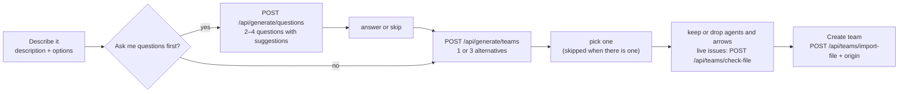
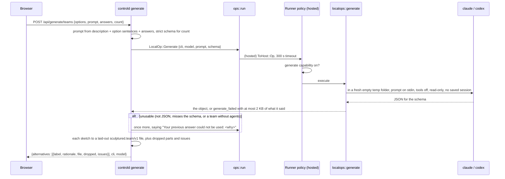
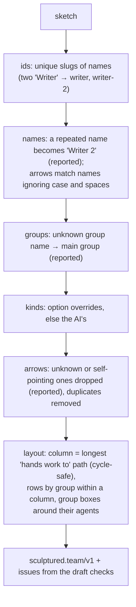

# AI team generator

A user describes a team in words. Their own Claude Code or Codex drafts it, and the user shapes the draft before anything is created. No server API key is involved, and the CLI runs on the user's computer, cut off from tools as far as each CLI allows (§5).

Sources:
- `crates/localops/src/generate.rs` (the CLI call)
- `crates/controld/src/generate/{mod,sketch}.rs` (prompts, schemas, retry, conversion and layout)
- `crates/controld/src/portable/team.rs` (`check-file`, origin on import)
- `crates/controld/src/store/origins.rs`
- `crates/hostd/src/policy.rs` (the `generate` capability)
- `web/src/structure/GenerateTeam.tsx`, `TemplateGallery.tsx` (*Describe it*), `Panels.tsx` (the origin line)

## 1. The flow



**Options:**
- CLI and model;
- team size (2–3, 4–6, 7–10);
- agent kinds (as the CLI, Claude, Codex, mixed);
- shape (chain, a lead with helpers, builders with reviewers, or the AI's choice);
- check commands;
- 1 or 3 alternatives;
- whether to ask questions first.

The options become plain sentences in the prompt (`Options::sentences`).

## 2. One call, end to end



**The two commands:**

| CLI | Command |
|---|---|
| Claude Code | `claude -p --output-format json --json-schema <schema> --tools "" --no-session-persistence --strict-mcp-config --setting-sources project,local --disable-slash-commands [--model M]`; the answer is `structured_output`, falling back to `result` parsed as JSON. `is_error: true` is an error (and "not signed in" when it says so) |
| Codex | `codex exec --output-schema <file> --sandbox read-only --ephemeral --skip-git-repo-check -c mcp_servers={} -o <file> [-m M] -`; the answer is the last message, parsed as JSON |

**Errors:**

| Code | Status | When |
|---|---|---|
| `generate_invalid` | 400 | an unknown CLI, a model name that isn't one, a description over 32 KB |
| `cli_missing` | 409 | the CLI can't be started on that computer |
| `cli_not_signed_in` | 409 | the CLI exits saying it needs a login |
| `generate_timeout` | 504 | the CLI didn't answer in 5 minutes; it is stopped (also in local mode) |
| `generate_unusable` | 502 | still unusable after the retry; `error.raw` holds the answer (at most 4 KB), shown as "What Claude Code answered" |
| `not_allowed_here` | 403 | the computer turned `generate` off |
| `needs_computer` / `computer_timeout` | 409 / 504 | as for every local operation ([Local operations](local-ops.md)) |

## 3. The sketch: what the AI fills in

The AI never writes ids or board coordinates. It fills a small sketch, and Sculptured turns it into a team file:

```json
{ "name": "Docs site", "groups": [{ "name": "Writers" }],
  "agents": [{ "name": "Planner", "kind": "claude", "group": null, "job": "…", "check": null }],
  "arrows": [{ "from": "Planner", "to": "Writer", "kind": "hands-work-to" }] }
```

- **Strict schemas** (`sketch::questions_schema`, `sketch::teams_schema(count)`): every property is required, nullable values are `["string","null"]`, and `additionalProperties: false`. That is the form both CLIs' structured-output modes accept reliably. Kinds and arrow kinds are enums.
- **Counts:** the schemas carry no item limits, because structured-output modes may refuse them. The prompt asks for 2–4 questions and 1 or 3 teams; the server keeps at most 4 questions (each with at most 4 suggestions) and at most the requested number of teams. Fewer teams than asked are shown as they are.
- **Why a sketch:** a model is good at names, jobs and who hands work to whom, and poor at unique ids and non-overlapping coordinates. Doing those in code makes every draft valid and tidy.

## 4. Conversion and layout



- **Spacing:** 260 px between columns and 240 px between rows, matching the built-in templates.
- **Arrow ids:** `c-<from>-<to>` ("hands work to") or `c-<from>-<kind>-<to>`, made unique, so two arrows between the same agents stay apart.
- **Dropped parts:** everything left out or renamed is returned in `dropped`, in plain words, and shown on the accept/reject screen.

## 5. Safety

- **Nothing to inject:**
  - the description goes on stdin, never as an argument;
  - the model must match `^[A-Za-z0-9._:/-]{1,80}$` and can't start with `-`;
  - only the two configured CLI programs run, and the server can't name a program or arguments.
- **What each CLI can see:**
  - **Claude Code** runs with no built-in tools (`--tools ""`), no MCP servers (`--strict-mcp-config`), no user settings or hooks (`--setting-sources project,local`, both empty in the empty folder) and no skills. It sees only the description, plus the user's own `~/.claude/CLAUDE.md` instructions. The screen says "no tools or MCP servers: it sees only this description".
  - **Codex** has no MCP servers (`-c mcp_servers={}`) and a read-only sandbox, but that sandbox can still *read* files on the computer. The screen says so: "Codex runs read-only: it can read files on this computer but not change them".
  - **Both** save no session and run in a fresh, empty temporary folder that is removed afterwards.
- **The computer decides:** the `generate` capability is on by default, sandboxed computers included, because no tools run. The owner turns it off with `sculptured connect … --disable generate`.
- **Bounded:**
  - 300 s per call, enforced where the CLI runs (local mode included);
  - one retry, and a description of at most 32 KB;
  - the gateway waits 640 s for `/api/generate/*` instead of 30 s, so a slow generation isn't taken for a hung workspace.
- **Which computer:** with two or more computers connected, *Options* has a **Computer** choice. The CLI status and every call go to that computer.
- **Cost:** the user's own plan pays. The screen says which CLI and model will be used before anything runs.

## 6. Provenance and the dry-run check

- **Origin:** *Create team* sends `origin: {kind: "generated", cli, model, at_ms, prompt}` with the import. It is kept in `team_origins` and returned as `TeamRecord.origin`. Design's Team panel shows "Generated by Claude Code from a description · <date>", plus "· not run yet" until the first start, and the description itself on request.
- **`POST /api/teams/check-file`:** runs the import's checks without creating anything. The accept/reject screen uses it for live issues as agents and arrows are dropped.

## 7. Properties and their tests

| Property | Test |
|---|---|
| One structured call, tools off, prompt on stdin, temporary folder | `localops` `generate::tests::claude_runs_one_structured_call_with_tools_off_and_the_prompt_on_stdin` |
| Codex answers through its last-message file, read-only | `generate::tests::codex_answers_through_its_last_message_file` |
| Models and prompts can't become flags; size limit | `generate::tests::models_and_prompts_cannot_become_flags` |
| Unusable answers and signed-out CLIs are said plainly | `generate::tests::{an_unusable_answer_is_an_error_with_the_raw_text, signed_out_is_said_plainly}` |
| Allowed by default, sandboxed included; can be turned off | `crates/hostd/tests/policy.rs` `generation_is_allowed_by_default_and_can_be_turned_off` |
| Questions, three laid-out alternatives, dropped arrows, kinds and folder options, unique ids | `crates/controld/tests/generate.rs` |
| One retry, then the raw answer | `generate.rs` `a_bad_answer_is_retried_once_then_reported_with_the_raw_text` |
| Checking without creating; origin kept | `portable_team.rs` `a_file_can_be_checked_without_creating_a_team`, `an_imported_team_keeps_where_it_came_from` |
| Questions → choose → drop an agent (its arrow goes) → create with origin; skipping questions; the raw answer shown | `web/src/structure/GenerateTeam.test.tsx` |
| *Describe it* in the gallery; the origin line in Design | `TeamFlow.test.tsx`, `TeamAdvanced.test.tsx` |
