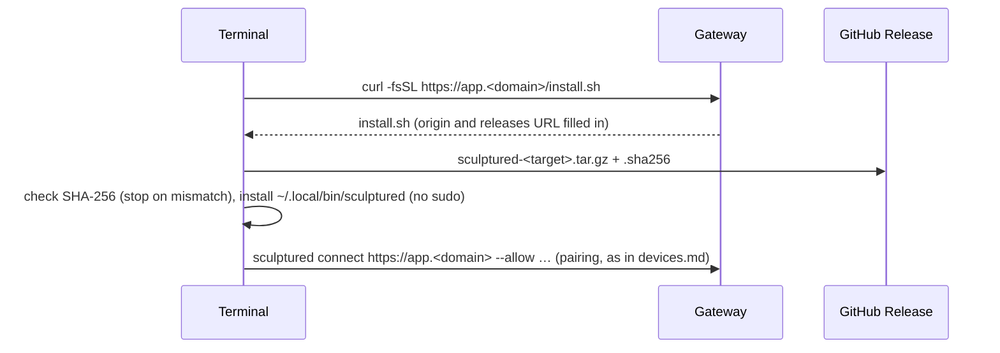
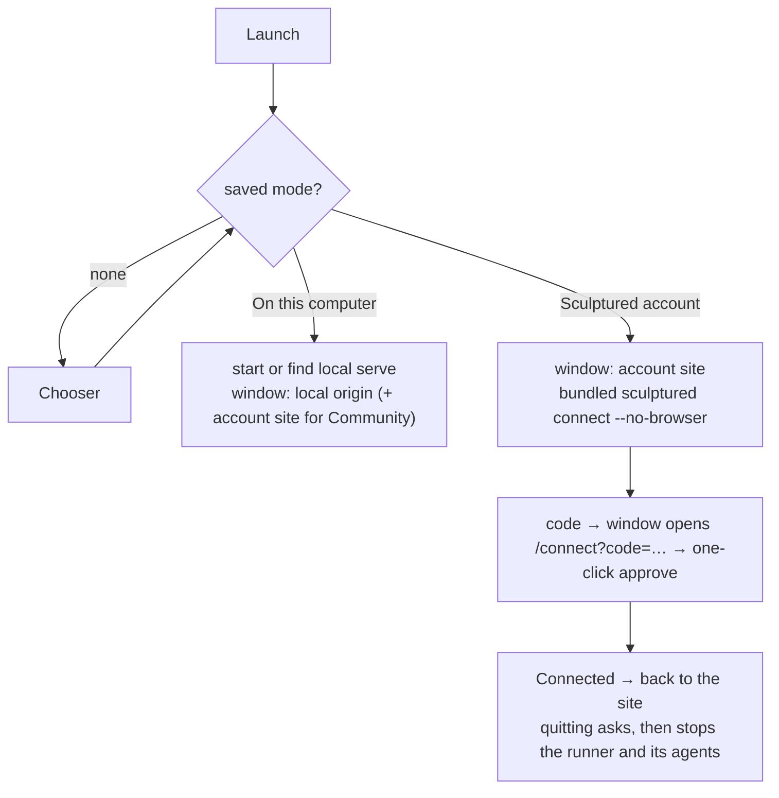

# Desktop and installers (M5, sparse)

Sources: `deploy/install/install.sh`, `deploy/release/package.sh`, `crates/gateway/src/lib.rs` (`/install.sh`), `.github/workflows/release.yml`, `desktop/{main.mjs,src/*}`.

## Connecting a computer with one command

- **A partial download runs nothing:** the script's body is one `main` function called on its last line.
- **Targets:** Linux x86_64 and arm64, Apple silicon Macs (a Rosetta shell, `sysctl.proc_translated`, gets the native build) and Intel Macs. Anything else stops with "unsupported". Windows uses `install.ps1`. No arm64 Linux build is made yet, so the gateway answers that there is none.
- **Builds:** Linux x86_64 and Windows come from the gateway image at each deploy, macOS from `mac.yml` on each push to `main` ([Releasing](../RELEASING.md)). `GATEWAY_RELEASES_URL` can point elsewhere.

## Desktop modes

- **Allowed origins:** the window shows only the allowed origins (`allowedOrigins`), plus Google's and GitHub's sign-in pages while signing in (`mayStay`). Both navigations and server redirects are checked; other links open in the system browser. Google may refuse sign-in inside an embedded browser; email and password always work in the app. Account addresses must be `https://`, host only (`validOrigin`); `http://127.0.0.1` is allowed only with `SCULPTURED_DEV=1`.
- **Community in local mode** is the account's Community. Signing in is required, and *Add to project* downloads the block into the local Library through the existing block transfer.

- **Stopping:** on SIGTERM or SIGINT the runner stops every agent (3 s grace, then the process group is killed) before exiting, so nothing keeps working unwatched (`Supervisor::stop_all`, `run_hostd`). The same applies to `systemctl --user stop` and Ctrl+C on `sculptured connect`. A local `serve`'s runner is detached, so agents still outlive the window there.

## Deferred

These are listed in `docs/RELEASING.md` and the backlog:
- Linux arm64 and Windows on Arm builds;
- the desktop installers for Linux and Windows in CI;
- the OS keychain for the device key;
- code signing;
- tests on every push;
- sync between local and account;
- full desktop testing.

## Tests

| Property | Test |
|---|---|
| The gateway serves the installer for its origin; the last line is `main "$@"` | `crates/gateway/tests/install.rs` |
| Checksum checked, installed, connected; a bad checksum, an unknown arch or an Intel Mac stops it; a Rosetta shell gets the Apple-silicon build | `deploy/install/test-install.sh` (run by `tests/install.rs`) |
| Account address rules, the remembered mode, allowed origins | `desktop/test/mode.test.mjs` |
| Pairing code and "connected" read from the runner; the runner stops | `desktop/test/runner.test.mjs` |
| The window stays on allowed origins and sign-in pages, redirects included | `desktop/test/mode.test.mjs` |
| A runner told to stop stops its agents | `crates/sculptured/tests/process_smoke.rs` `a_runner_told_to_stop_stops_its_agents` |
| The Computers page shows the command | `web/src/hosted/computers.test.tsx` |
