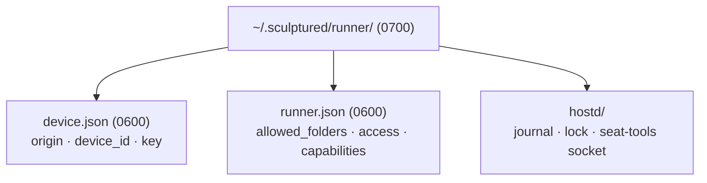
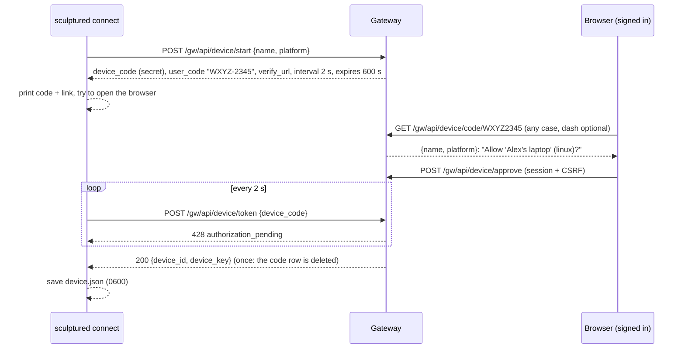
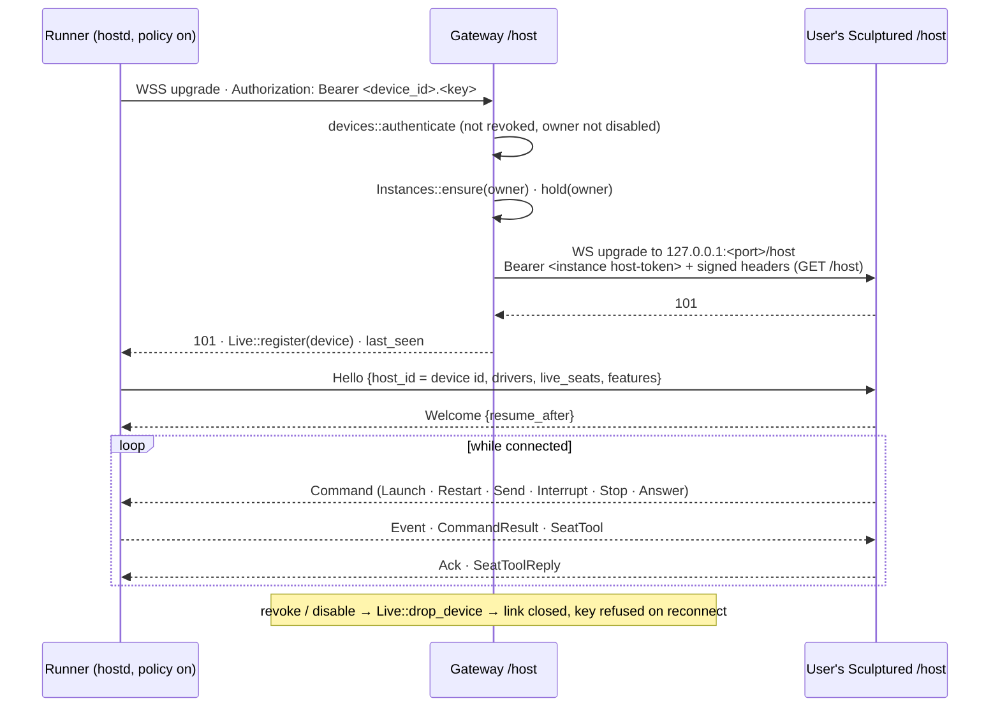
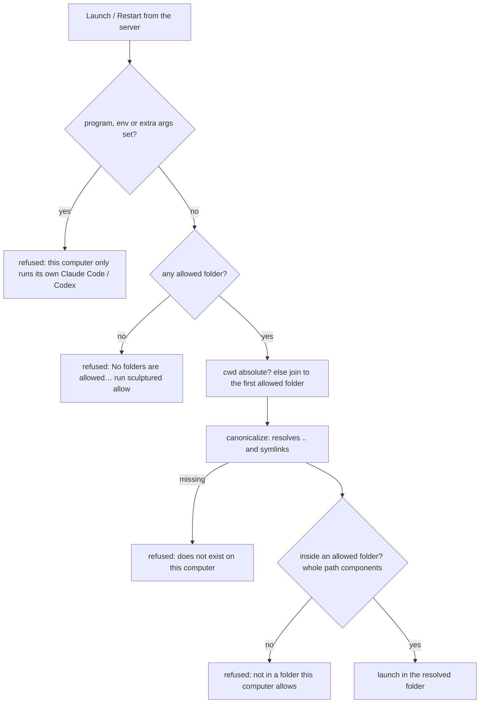
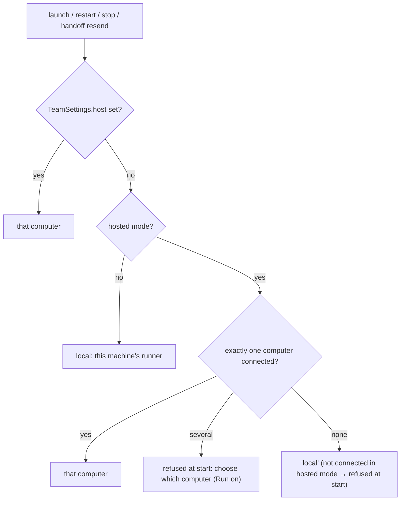

# Connected computers

In the hosted beta, agents never run on the server. They run on the user's own computers, through the existing agent runner (`hostd`), which connects *out* to the account. This page covers:
- how a computer is paired;
- how its link reaches the user's Sculptured;
- what the computer refuses no matter what the server asks;
- how a team picks a computer.

Sources:
- `crates/gateway/src/{devices.rs,host_proxy.rs,instances.rs}`
- `crates/hostd/src/{policy.rs,run.rs,link.rs,supervisor/lifecycle.rs}`
- `crates/sculptured/src/connect.rs`
- `crates/controld/src/{launch.rs,teams/run.rs,api.rs}`
- `web/src/hosted/{ConnectPage,ComputersPage,RunOn}.tsx`

## 1. What a connected computer is

`sculptured connect https://app.<domain>` keeps everything in one private folder (mode 0700), by default `~/.sculptured/runner/`:

- **`device.json`** holds this computer's identity for one account: its id and its key. The key is shown to the computer once and stored on the server only as a hash. It is kept in this file, readable only by the user; keeping it in the OS keychain is not built yet.
- **`runner.json`** is the owner's own rules: which folders agents may start in, how much they may do (`access`: `full`, the default, or `sandboxed`), and which local operations the server may ask for (`capabilities`: git, copies, checks, CLI sign-in, plan usage). Only the owner changes it (`--allow`, `sculptured allow`, `--sandboxed` / `--full-access`, `--enable` / `--disable <capability>`).
- **`hostd/`** is the ordinary runner state, the same as a local `serve`'s.

## 2. Pairing

| Answer | Meaning |
|---|---|
| `428 authorization_pending` | Not approved yet; poll again |
| `410 expired_token` | Expired, already used, or unknown: pair again |
| `404 code_unknown` | The code typed in the browser is wrong or expired |
| `429 too_many_attempts` | More than 10 lookups or approvals in 10 minutes for this user, or more than 20 starts in 10 minutes from one address |

- **Phishing guard:** the approval page warns "Only approve a code you just saw on your own computer" and shows when and from which address the code was requested. Without it, someone could send a victim a link to approve the attacker's machine.
- **Codes:** user codes use `BCDFGHJKLMNPQRSTVWXZ23456789`, with no vowels and no look-alikes. There are 28⁸ ≈ 3.8·10¹¹ codes, and with the rate limit guessing a live code is impractical.
- **Single approval:** approval is one `UPDATE … WHERE approved_by IS NULL`, so two people entering the same code get exactly one approval.
- **Single key:** the key is created at the first successful poll and the code is deleted in the same transaction, so a key is handed out exactly once.

## 3. The runner link

- **Frames:** the gateway forwards text, binary, ping and pong frames unchanged. It does not interpret the host protocol (`crates/host-proto/src/lib.rs`).
- **Reconnecting:** the runner reconnects on its own (`hostd::run::run_hostd`, backoff from 500 ms to 5 s), with the same key. A reconnect replaces the older link. `Live` keys each link by a generation, so the old link's cleanup cannot remove the new one.
- **Workspace kept running:** while any of a user's computers is connected, `Instances::hold` keeps their Sculptured running. The idle reaper skips held users.
- **No URL override:** a connected computer never follows `controld.url`, the file a local `serve` uses to hand over its port.
- **Identity:** the gateway forwards the authenticated device id in the signed path (`/host?device=<id>`). The user's Sculptured closes any Hello whose `host_id` differs, so a computer can only connect as itself and never as another of the user's computers, or as `local`.
- **Keep-alive:** the runner pings every 25 s and gives the link up after 75 s with nothing back, then reconnects. The gateway drops a computer that sent nothing for `GATEWAY_HOST_IDLE_SECS` (75 s), which also releases the instance hold.
- **Revocation during setup:** a link is registered before the slow setup (starting the instance) and re-authenticated after it, so a revoke or disable in between is not missed.
- **Stopping after disconnect:** a runner whose key is refused (401) stops with "This computer was disconnected… run `sculptured connect` again" instead of retrying forever.

## 4. Permissions on the computer

`hostd::policy::RunnerPolicy` is checked in `launch_spec`, so it covers Launch and every Restart (fresh, resume, fork). It is set only for connected computers; a local `serve`'s runner has none.

**Allowed folders decide where an agent starts, not what it can do.** What a running agent may do is the computer's `access` level:

| Access | Claude Code | Codex | Who chooses |
|---|---|---|---|
| `full` (default) | the posture controld asks for: unrestricted means `--dangerously-skip-permissions` | `danger-full-access` sandbox | owner, at `sculptured connect` (`--full-access`) |
| `sandboxed` | always restricted: risky actions need approval, shown in the browser | `workspace-write`: writes only inside its folder | owner (`--sandboxed`) |

The server can ask for less than the computer allows, never more (`RunnerPolicy::posture`). With full access, an agent, or whoever can instruct it, can act as the user does on that computer. The pairing page says so.

- **Comparisons are whole path components:** `/home/a/proj2` is *not* inside `/home/a/proj`.
- **Symlinks resolve first:** a link inside an allowed folder that points outside is refused.
- **Relative paths:** a relative folder, including an empty one, means "the first allowed folder". That is what a Practice team with no folder uses.
- **Program, environment and arguments:** `LaunchParams.program`, `.env` and `.extra_args` are refused outright. controld never sets them, so only a compromised or hostile server would. (A *check* does run a command from the team's design; that is a separate capability, off by default when sandboxed. See [Local operations §5](local-ops.md#5-checks-run-as-events).)
- **Visible refusal:** the runner journals an Attention event "launch failed: <reason>" and answers `CommandResult {ok: false}`, so the agent shows why it didn't start.
- **The same rules cover local operations:** browsing folders, git, copies and checks resolve their paths the same way and also need their capability turned on (`RunnerPolicy::check_op`). See [Local operations](local-ops.md).
- **Reported, not trusted:** the runner sends its folders, access, capabilities and platform in `Hello.policy` (`HostPolicyInfo`), for display on the Computers page. It enforces its own copy of the rules either way.

## 5. Which computer runs a team

- **Spawned subagents** run where their parent runs, since the folder is there.
- **`launch::team_host`** implements the choice. It is used by `launch_one` (boot, restart, spawned subagents), `seat_host`, abandoned-boot stops and handoff resends. A seat records the host it launched on.
- **Start refusals:** starting a team in hosted mode, or with a chosen computer, refuses with `409 needs_computer` when that computer is not connected:
  - "<id> is not connected. Open Computers to connect it."
  - "Connect a computer first: Computers → Connect a computer."
- **Folders:** in hosted mode controld passes the team's folder through unresolved (`launch::cwd_for`), because the server's paths mean nothing on the user's computer. The runner resolves it under its policy.
- **`GET /api/hosts`** lists connected computers with their drivers and reported policy.
- **Web:** *Computers* lists the user's computers: connected, last seen, Disconnect. *Run on* in the Design project panel sets `TeamSettings.host` ("Automatic" = the only connected computer). In hosted mode the project folder is a path on that computer: type it, or *Browse…* the computer's allowed folders. *Computers* also shows each connected computer's folders, access, capabilities and Claude Code / Codex sign-in, with *Sign in* run on that computer.

**Installing:** the Computers page detects the visitor's system and copies one command with a one-time connect key (`POST /gw/api/device/connect-key`: single use, 30 minutes, needs CSRF). The runner trades it for its own device key at `POST /gw/api/device/redeem`, so there is no code to approve. The page offers only systems the gateway has a build for (`GET /gw/api/releases`).
- **macOS / Linux:** `curl -fsSL https://app.<domain>/install.sh | sh -s -- --key <key>`.
- **Windows (PowerShell):** `$env:SCULPTURED_KEY="<key>"; irm https://app.<domain>/install.ps1 | iex`. It installs to `%LOCALAPPDATA%\Programs\Sculptured`.

Both run `sculptured connect <origin> --install-service`. A computer with no folders allowed lets agents work in its home folder. ([Desktop and installers](desktop-and-installers.md))

## 6. Runs on login

`sculptured connect <origin> --install-service` writes a service that runs `sculptured connect <origin> --data-dir <dir> --claude-program <path> --codex-program <path>` at login and restarts it if it stops. It never pairs again, because `device.json` already holds the key. Running it again restarts the service, so a new runner takes over.
- **Linux:** a systemd user service.
- **macOS:** a LaunchAgent.
- **Windows:** a Scheduled Task, "Sculptured runner", run at logon as the user (no admin rights). It starts `sculptured-background.exe`, which runs `sculptured.exe` without a console window.

Only the runner runs on Windows (hostd, the drivers, local operations, `connect`). `sculptured serve` and every server never do. Windows differences:
- the agents' tool channel is a loopback TCP port, whose address is written to the socket path (calls still need each agent's token);
- stop uses `taskkill /T`;
- checks run through `cmd /C`.

Login services start with a minimal PATH, so the CLIs' full paths are found at install time (`--claude-program` / `--codex-program`, else PATH), and the current PATH is written into the service. Arguments are quoted for systemd and XML-escaped for launchd.

| OS | File | Started with |
|---|---|---|
| Linux | `~/.config/systemd/user/sculptured-runner.service` (`Restart=always`, `RestartSec=5`, `RestartPreventExitStatus=78`) | `systemctl --user enable --now sculptured-runner` |
| macOS | `~/Library/LaunchAgents/dev.sculptured.runner.plist` (`RunAtLoad`, `KeepAlive`) | `launchctl load -w <plist>` |
| Windows | Scheduled Task "Sculptured runner" (task XML) | `schtasks /Create /TN … /XML <file> /F`, then `schtasks /Run` |

**When the account disconnects the computer.** The server then refuses the device key. The runner stops retrying (`hostd::run::keep_linked` returns `DISCONNECTED`) and exits with code 78 (`connect::DISCONNECTED_EXIT`). Before exiting it turns its own login service off (`service_off_commands`): systemd `disable --now --no-block`, launchd `unload -w`, and Task Scheduler `/DISABLE`. Without that it would be started again every few seconds and refused each time. systemd also skips the restart because of `RestartPreventExitStatus=78`; launchd and Task Scheduler cannot tell exit codes apart. Running `sculptured connect` again turns the service back on. Agents already running keep running when the link is only down, not refused.

## 7. TLS

- **The runner's link** (`wss://`) uses `tokio-tungstenite` with rustls and WebPKI roots.
- **The pairing client** uses reqwest with `rustls-no-provider`.
- **One crypto provider:** both use `ring`, installed once (`connect::tls_provider`), because two providers in one process would stop rustls choosing one automatically.
- **Plain `ws://`/`http://`** is allowed only to `127.0.0.1`/`localhost`, for local testing (`connect::host_url`).

## 8. Security properties and their tests

| Property | Test |
|---|---|
| Code approved once; key handed out once and stored hashed; codes expire; guessing rate-limited; only the owner revokes | `crates/gateway/tests/devices.rs` |
| Link works only with a valid, unrevoked key; revoking drops a live link and blocks reconnect; workspace held while connected | `crates/gateway/tests/host_proxy.rs` |
| A reconnect's old link cannot unregister the new one | `gateway` lib `devices::tests` |
| Allowed folders: siblings, `..`, symlink escapes and missing paths refused; relative paths resolve inside; program, env and args refused; policy file private | `crates/hostd/tests/policy.rs` |
| `wss://` is supported | `crates/hostd/tests/link.rs` `the_runner_can_dial_secure_websocket_urls` |
| A team runs on its chosen computer; offline computer refused by name; hosted single-computer default; folders passed through in hosted mode | `crates/controld/tests/hosts_choice.rs` |
| Pairing client shows the code, waits for approval, saves private credentials; `wss` except on localhost; login service contents | `crates/sculptured/src/connect.rs` tests |
| Approve, list and disconnect in the browser | `web/src/hosted/computers.test.tsx` |
| A disconnected runner turns its own login service off; systemd does not restart exit 78 | `crates/sculptured/src/connect.rs` `a_disconnected_runner_turns_its_own_service_off` |
