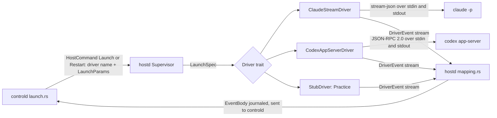
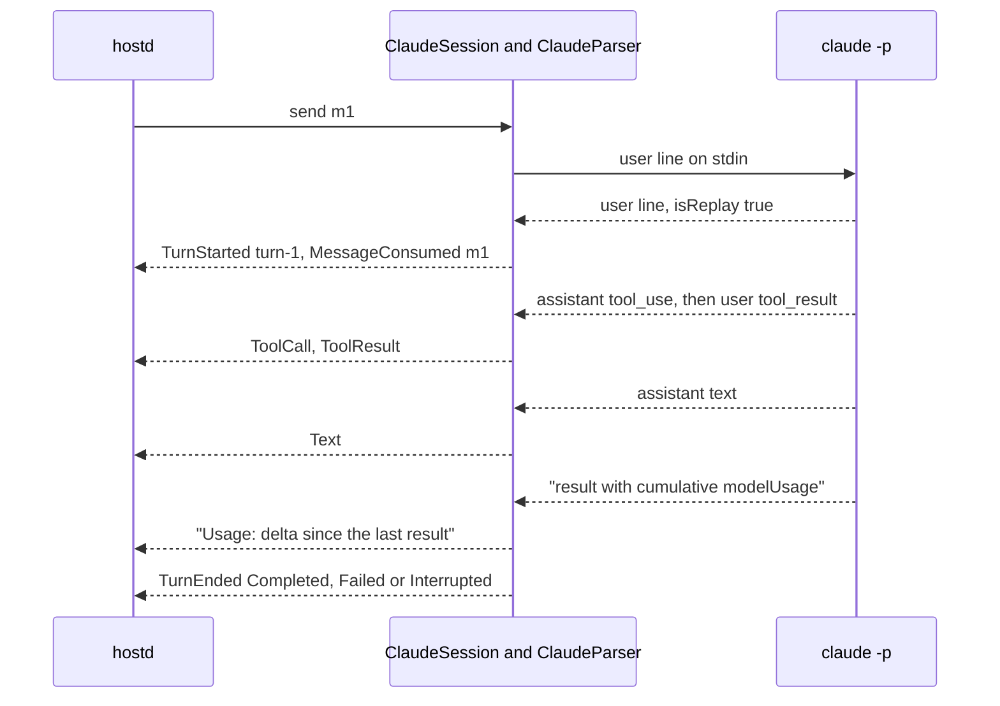
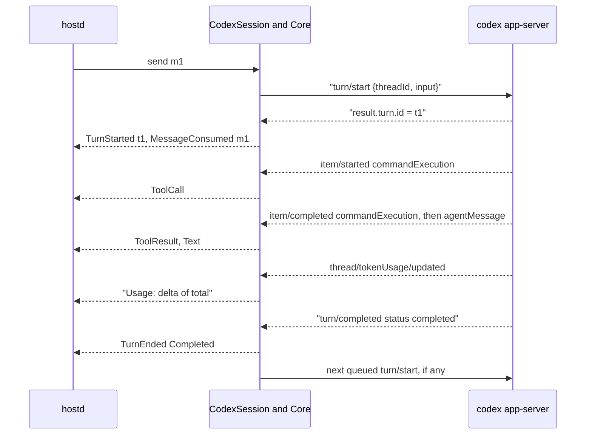
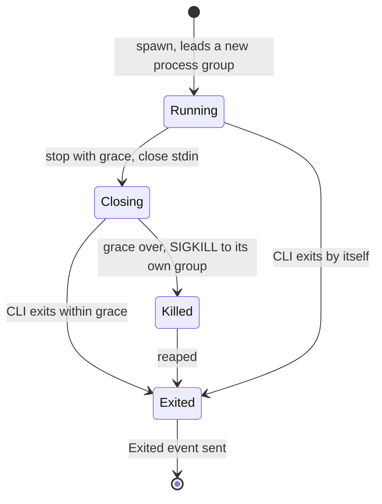

# Agent drivers: Claude Code, Codex and OpenCode

A driver starts one coding CLI for one agent, sends it the operator's messages and turns everything the CLI prints into one shared list of events (`DriverEvent`). Sculptured has four drivers: Claude Code (`claude-stream`), Codex (`codex-app-server`), OpenCode (`opencode-acp`, open models) and the Practice driver (`stub`), which calls no model. The runner on each computer (`hostd`) owns the drivers. controld only names a driver and sends launch parameters.

Sources:
- `crates/drivers/src/{lib,process,stub}.rs`
- `crates/drivers/src/claude/{mod,parser,limits}.rs`
- `crates/drivers/src/codex/{mod,session,core}.rs`, `crates/drivers/src/codex/parser/{mod,turns,items,requests}.rs`
- `crates/drivers/src/opencode/{mod,config,core,parser,session}.rs`
- `crates/model/src/{caps,limit,pricing}.rs`
- `crates/controld/src/launch.rs`, `crates/hostd/src/run.rs`, `crates/hostd/src/supervisor/{mod,lifecycle}.rs`, `crates/hostd/src/mapping.rs`
- `crates/fixtures/src/bin/{fake-claude,fake-codex,codex-probe,mcp-ping-stub}.rs`, `crates/fixtures/recordings/`
- `docs/spikes/m0-driver-capabilities.md`, `docs/spikes/codex-app-server-schema-0.160.0/`

## 1. Parts

- **Choosing a driver.** `launch::driver_for` maps an agent type to a driver name: Claude Code → `claude-stream`, Codex → `codex-app-server`, OpenCode → `opencode-acp`, Practice (`Runtime::Stub`) → `stub`. hostd registers all four in `run.rs::drivers`; `opencode` is looked up on `PATH` and in `~/.opencode/bin` when each agent starts. The `claude` and `codex` programs default to the names on `PATH`; `--claude-program` and `--codex-program` override them.
- **The trait.** `Driver` has `launch`, `resume`, `fork` (Codex and stub only) and `capabilities`. A `Session` has `send`, `interrupt`, `stop(grace)`, `answer` and `take_events`. The event stream always ends with `Exited`.
- **Capabilities** (`model::Caps`) tell the UI which controls to disable:

| Capability | Claude Code | Codex | OpenCode | Practice |
|---|---|---|---|---|
| `interrupt` | yes | yes | yes (`session/cancel`) | yes |
| `resume` | yes | yes | yes (`session/resume`) | yes |
| `fork` | no (not probed) | yes | no (unstable in ACP v1) | yes |
| `usage` | yes | yes | yes, partial tokens (§3a) | yes |
| `questions` | no | only with `native_questions` (off in `run.rs`) | no | yes |
| `mid_turn_input` | no: messages queue | no: the driver queues | no: the driver queues | no |
| `subagent_events` | yes | no (not observed) | no | no |

## 2. How Claude Code is driven

`ClaudeStreamDriver::args` builds the command line:

| Flag | When |
|---|---|
| `-p --input-format stream-json --output-format stream-json --verbose --replay-user-messages` | always |
| `--dangerously-skip-permissions` | unrestricted posture (the default) |
| `--session-id <uuid>` | a new session; the id is ours (`LaunchSpec.native_session_id` or a new UUID) |
| `--resume <id>` | resuming; never combined with `--session-id` |
| `--model <m>` | the agent has a model set |
| `--mcp-config <file or JSON>` and `--disallowedTools Agent,Task` | seat tools are on (the `rig` MCP server) |
| `--allowedTools mcp__rig__…` | restricted posture with seat tools: Sculptured's own tools never ask permission |
| `--permission-prompt-tool mcp__rig__approve` | restricted posture and the `approve` tool is offered |
| `--add-dir <dir>` | each extra folder (a team's items folder) |
| `--setting-sources <list>`, and `--strict-mcp-config` without `user` | the team leaves out part of the person's own Claude Code setup (`ClaudeSetup::claude_args`) |
| `--settings <hook JSON> --autocompact 100000` | protections are on ([Protections](protections.md)); the agent's environment also gets `SCULPTURED_PROTECTION` |
| `--plugin-dir <dir>` | the agent has skills: the runner's per-agent plugin folder ([Skills](skills-and-integrations.md)) |
| a second `--mcp-config <JSON>` | the agent has integrations (Kindex's `kin-mcp`) |

- The seat-tools config is written to a 0600 file when hostd names one, so the seat token never appears in `/proc/<pid>/cmdline`. `MCP_TOOL_TIMEOUT` is set to 86 700 000 ms so Sculptured's own question timeout always fires first.
- A message is one stdin line: `{"type":"user","message":{"role":"user","content":[{"type":"text","text":…}]}}`.
- `SessionReady` is sent at spawn. Claude's `system/init` arrives only after the first message and repeats every turn, so it is ignored.
- A turn starts at the first replayed operator message (`isReplay: true` and `parent_tool_use_id: null`) or assistant line. It ends at the `result` line.

- **Interrupt** writes `{"type":"control_request","request_id":"interrupt-N","request":{"subtype":"interrupt"}}`. The turn ends `Interrupted` when an interrupt was requested or `result.terminal_reason == "aborted_tools"`.
- **Stop** closes stdin; `claude -p` then finishes and exits.
- **Subagents.** Child lines carry `parent_tool_use_id`, which becomes `ToolCall.parent_call_id`. `system/task_*` lines are ignored on purpose. With seat tools on, Claude's own `Agent` and `Task` tools are disallowed, so delegation goes through `spawn_agent` (see [Limits and usage](limits-and-usage.md)).

## 3. How Codex is driven

`codex app-server` speaks JSON-RPC 2.0 over stdio, one process per session (recorded against Codex 0.160.0 and 0.160.1).

1. The driver sends `initialize` (id 1) with `clientInfo {name: "sculptured"}`, then the `initialized` notification.
2. It sends `thread/start`, `thread/resume` or `thread/fork` (id 2) with `cwd`, `approvalPolicy` (`never` unrestricted, `untrusted` restricted), `sandbox` (`danger-full-access`, or `workspace-write` on a sandboxed computer), `model` if set, and `threadId` for resume or fork. The handshake has 30 s.
3. Seat tools go in the thread `config` as dotted keys (`mcp_servers.rig.command`, `.args`, `.env`, `.tool_timeout_sec`), over stdin. `features.multi_agent` and `features.multi_agent_v2` are set to false.
4. The answer's `result.thread.id` becomes the native session id.

- **Queueing** (`codex::core::Core`). One message per turn. A message sent while a turn runs waits for `turn/completed`; `turn/start` is never sent mid-turn and `turn/steer` is unused. A refused start goes back to the front after a pause of 0.5 s × tries, three tries in all (`MAX_START_ATTEMPTS`), then `MessageFailed` with the server's words.
- **Interrupt** sends `turn/interrupt {threadId, turnId}`. Before the turn id is known it is held and sent when the id arrives. An interrupt that stops nothing adds an "interrupt not applied: …" note. An interrupt ends the turn but not the command Codex was running.
- **Questions and approvals.** `item/tool/requestUserInput`, `item/fileChange/requestApproval` and `item/commandExecution/requestApproval` become `QuestionRaised`; any other server request is refused with JSON-RPC error -32601 so the turn cannot hang.
- **Stop** closes stdin.

## 3a. How OpenCode is driven

`opencode acp` speaks the Agent Client Protocol, version 1: JSON-RPC 2.0 lines over stdin and stdout. The recordings `crates/fixtures/recordings/opencode-*.jsonl` were made with OpenCode 1.19.4 against a local stand-in for OpenRouter's chat API (no real model calls); `crates/drivers/tests/opencode_recordings.rs` replays them, and `opencode_live.rs` runs a real `opencode` against a stand-in when `OPENCODE_LIVE_PROGRAM` and `OPENCODE_LIVE_BASE_URL` are set.

- **Launch.** `initialize` (no file system or terminal offered), then `session/new {cwd, mcpServers}` or `session/resume {sessionId, cwd, mcpServers}`, then `session/set_config_option {configId: "model"}` when the agent has a model. A model OpenCode does not know fails the launch in plain words.
- **Config** (`config.rs`) goes in `OPENCODE_CONFIG_CONTENT`, merged over the person's own OpenCode setup: `permission` from the posture (unrestricted: everything allowed; restricted: edit, bash, webfetch, websearch and outside folders ask; a sandboxed computer denies outside folders), `small_model` set to the agent's own model (otherwise OpenCode titles sessions with another model on the person's key), `experimental.mcp_timeout` long enough for a question to wait for the operator (the MCP SDK's default is 60 seconds), no automatic updates, no sharing.
- **Seat tools and integrations** are `mcpServers` entries, sent over stdin. OpenCode shows them to the model as `rig_<tool>`.
- **A turn** is one `session/prompt`. Text and thoughts arrive as chunks under one `messageId` per model call; the parser keeps them until the message ends and emits one `Text` or `Thinking`. A tool is announced at its first update that runs or finishes (the first `tool_call` carries only `{cwd}`), and its result is `rawOutput.output`. `session/request_permission` becomes a `NativePermission` question; Allow and Expired pick `allow_once`, Deny picks `reject_once`. The prompt's answer ends the turn: `end_turn` completed, `cancelled` interrupted, anything else failed. An error answer is kept as evidence; OpenRouter's "Insufficient credits" is `LimitReached { Usage }`, a rate limit `LimitReached { Rate }`.
- **Usage.** `usage_update.cost` is OpenCode's estimate of the session's total; a turn's cost (`CostSource::Opencode`) is how much it rose. It is unknown for the first turn of a resumed session, and a total that falls (0 after a cancel) is ignored. The prompt's `usage` holds only the turn's last model call, so token counts understate a turn with several calls. `usage_update.used` and `size` become `Context`.
- **Connections.** On the hosted service an OpenCode agent's OpenRouter connection arrives from the gateway in Claude Code's shape; `launch::for_opencode` turns it into `OPENROUTER_API_KEY` and the model `openrouter/<model>`. An Anthropic-key connection is refused for OpenCode agents.

## 4. Normalized events (`DriverEvent`)

hostd's `mapping::map_event` turns each event into a journaled `EventBody` (see [Events and storage](events-and-storage.md)).

| Variant | Claude Code source | Codex source | Journaled as |
|---|---|---|---|
| `SessionReady` | at spawn, with our session id | after the thread request | `TenureStarted`, lifecycle Running |
| `TurnStarted` | first replay or assistant line of a turn | `turn/start` answer or `turn/started` | `TurnStarted` |
| `MessageConsumed` | replayed operator message | `turn/start` answer | `MessageConsumed` |
| `Text` | assistant `text` block | `agentMessage` item | `AgentText` |
| `ToolCall` / `ToolResult` | `tool_use` / `tool_result` blocks | command, file change, MCP, web search and `sleep` items | `ToolCalled` / `ToolResulted` |
| `Usage` | `result.modelUsage` delta | `tokenUsage.total` delta | `UsageReported` |
| `TurnEnded` | `result` | `turn/completed` | `TurnEnded` |
| `QuestionRaised` / `QuestionResolved` | not used | server requests, `serverRequest/resolved` | same names |
| `LimitReached` | the CLI's limit words on a failed turn | `codexErrorInfo` on a failed turn | `LimitReached` |
| `MessageFailed` | not used | start refused three times | `MessageFailed` |
| `PlanUsage` | `rate_limit_event` | `account/rateLimits/updated` | `PlanUsageReported` |
| `Unrecognized` | unknown lines | unknown items, errors, driver notes | `Unrecognized`, kept as evidence |
| `Exited` | process end | process end | `TenureEnded`, lifecycle Stopped or Attention |
| `ModelObserved`, `Thinking`, `Context` | defined and mapped by hostd; no driver in `crates/drivers` sends them yet | same | `ModelObserved`, `ThinkingRecorded`, `ContextReported` |

How usage and cost are counted is on [Limits and usage](limits-and-usage.md).

## 5. Resuming a session

- Claude Code: a new `claude -p --resume <id>` process. `modelUsage` carries over a resume, so controld passes a usage baseline (`LaunchSpec.usage_baseline`, summed by `restore::decide::usage_baseline`) and the parser subtracts it.
- Codex: a new app-server process with `thread/resume {threadId}`. The full history is replayed, including old `tokenUsage`. The parser counts usage only for turns it started, so the replay seeds its totals without being reported.
- An older runner without the `usage-baseline` feature gets the launch without a baseline, with a note (`hosts::fit_params`).

## 6. Stopping and process groups

- `process::command` starts every CLI with `process_group(0)` and `kill_on_drop(true)`, so the CLI leads a process group of its own.
- `process::kill_group` sends `SIGKILL` with `killpg` to that group, only while the leader is not yet reaped, so the group id cannot have been reused.
- Codex: whenever the app-server's output ends, the rest of its group (a command an interrupt left running, MCP servers) is killed before reaping. A failed handshake kills the group too.
- Interrupt sends no signal. It is a protocol message on stdin.
- hostd itself runs in its own session (`setsid` in `sculptured/src/main.rs`), so Ctrl-C at `serve` does not reach agents. On SIGTERM or SIGINT, hostd stops every agent with a 3 s grace.
- The supervisor bounds Stop at grace + 5 s and records Attention ("stop timed out") if it is exceeded.

## 7. Practice agents and fixture CLIs

**Practice agents** (`AgentKind::Practice`, `StubDriver`) call no model and cost nothing. The message text is a script:

| Script | Effect |
|---|---|
| `hang` | the turn stays open until interrupted or stopped |
| `crash` | exits with code 3 |
| `fail` | the turn ends Failed |
| `limit` | `LimitReached` (usage) with the Claude CLI's words, then Failed |
| `tool:<cmd>` | a `Bash` call and its result; nothing runs |
| `ask:`, `ask-only:`, `ask-silent:` | raises a question |
| `perm:<cmd>` | asks permission when restricted |
| `request:`, `report:` | calls the seat tools through the socket |
| anything else | replies `stub received: <text>` |

Each turn reports 10 input and 5 output tokens with no cost.

**Fixture CLIs** stand in for the real ones in tests. They replay shapes from the scrubbed recordings in `crates/fixtures/recordings/`:
- `fake-claude`: scripts such as `hang`, `crash`, `subagent`, `limit`, `unknown`, `big`, `env:`, `tool:`.
- `fake-codex`: scripts such as `hang`, `hang-child`, `crash`, `fail`, `tool:`, `edit:`, `run:`, `ask:`. One deliberate difference: a mid-turn `turn/start` gets error -32600, so a driver bug shows up.
- `codex-probe` and `mcp-ping-stub` drive the real `codex app-server` to make new recordings. They spend model calls, so they are run by hand only.

## Architecture invariants

- A driver signals only the process group it created for its own child, and only while that child is unreaped.
- No driver signals any other process, group or PID; interrupt is always a protocol message, never a signal.
- The seat token never appears on a CLI's command line.
- Codex never gets `turn/start` while a turn runs.
- A server request nobody handles is refused, never left unanswered.
- Unknown CLI output is kept as `Unrecognized` evidence, never dropped and never fatal.
- `Exited` is always the last event of a session.
- A limit is read only from a failed turn, so an agent writing about limits is never taken for one.

## Properties and their tests

| Property | Test |
|---|---|
| Claude flags per posture and seat tools | `crates/drivers/tests/claude_args.rs` (`unrestricted_by_default_skips_permissions`, `restricted_routes_permission_prompts_to_the_approve_tool`, `a_config_file_keeps_the_token_off_the_command_line`) |
| Real Claude recordings parse; interrupt orders result before turn end | `crates/drivers/tests/claude_recordings.rs` (`every_claude_recording_parses_without_unrecognized`, `interrupt_recording_orders_tool_result_before_turn_end`) |
| Subagent lines link to their parent and count | `claude_recordings.rs::subagent_recording_links_children_and_counts_their_usage` |
| Stop kills a CLI that ignores EOF | `crates/fixtures/tests/claude_contract.rs::stop_kills_a_child_that_ignores_eof_and_a_grandchild_holding_stderr` |
| Stop ends a command an interrupt left running | `crates/fixtures/tests/codex_contract.rs::stop_ends_a_command_the_interrupt_left_running` |
| One message per Codex turn; refused starts retried three times | `codex_contract.rs::a_message_sent_during_a_turn_waits_for_turn_completed`; `codex/core.rs::a_refused_start_is_resent_after_a_pause_three_times_in_all_then_fails` |
| Unknown server requests are refused | `crates/drivers/tests/codex_recordings.rs::unknown_server_requests_are_refused_not_ignored` |
| Codex resume counts only new usage | `codex_contract.rs::resume_counts_only_new_usage_and_fork_gets_a_new_thread` |
| Seat tools reach Codex as thread config | `codex_contract.rs::seat_tools_reach_codex_as_thread_config` |
| Practice `limit` and `fail` scripts | `crates/drivers/tests/stub_m2.rs` (`limit_ends_the_turn_on_a_usage_limit_with_the_clis_words`, `fail_ends_the_turn_failed`) |

## Not built yet / deferred

- Claude `fork`, Claude native questions and Codex `turn/steer` are not used.
- `ModelObserved`, `Thinking` and `Context` have no driver that sends them.
- The real-CLI probe (`codex_contract.rs::real_codex_probe`) is `#[ignore]` and run by hand only.
