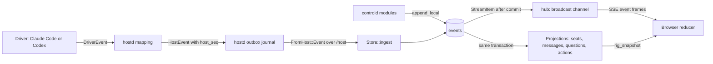
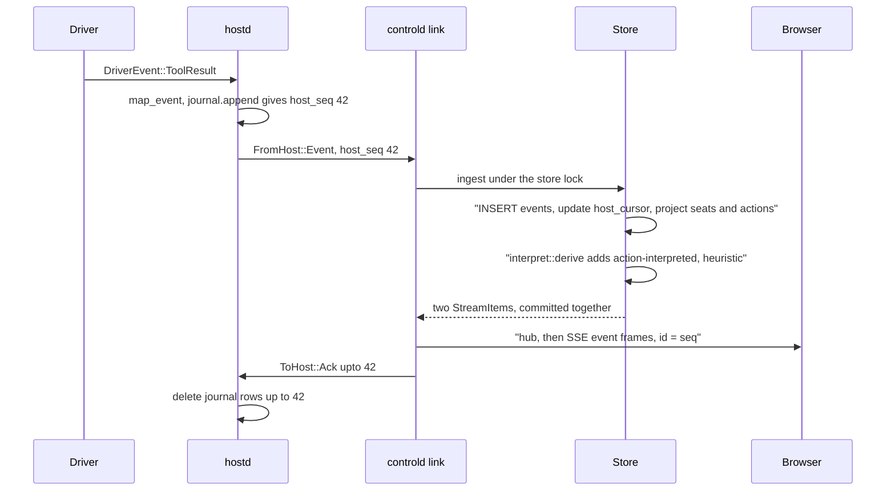
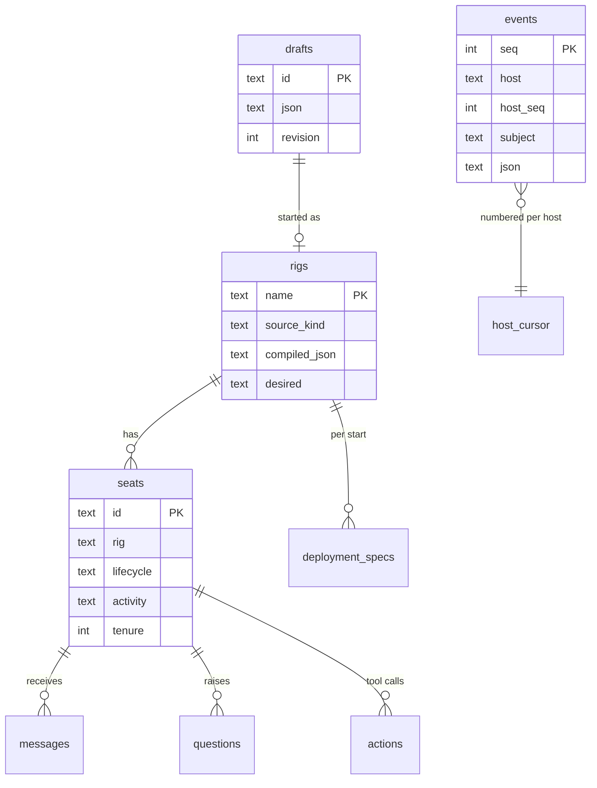

# Event journal, projections and the SQLite schema

Everything an agent does, and everything the operator or Sculptured decides, is appended to one event journal (the `events` table). The tables the boards read, such as seats, messages, questions and interpreted actions, are projections of that journal, written in the same transaction as the event. The browser loads a snapshot, then follows new events over server-sent events (SSE).

Sources:
- `crates/model/src/{event,status}.rs` (`EventRecord`, `EventBody`, `Actor`, `Subject`, `Provenance`)
- `crates/drivers/src/lib.rs` (`DriverEvent`), `crates/hostd/src/{mapping,journal}.rs`, `crates/host-proto/src/lib.rs` (`HostEvent`, `Welcome`, `Ack`)
- `crates/controld/src/store/` (`mod`, `schema`, `project`, `rows` and the per-feature files)
- `crates/controld/src/projections/{mod,questions,actions}.rs`, `crates/controld/src/interpret.rs`
- `crates/controld/src/{state,stream,idempotent,background,restore}.rs`, `crates/controld/src/restore/decide.rs`, `crates/controld/src/reconciler/mod.rs`, `crates/controld/src/hosts/{mod,session}.rs`
- `web/src/useRigStream.ts`

## 1. Parts

## 2. Why an append-only journal

- **One history, many views.** The seat board, transcripts, the question inbox, usage charts, run export and handoff planning all read the same events. A view can be rebuilt or added later from the journal (`usage.rs` and `handoffs/work.rs` read events directly).
- **Evidence stays verbatim.** A tool call (`ToolCalled`) and its result (`ToolResulted`) stay as captured. The interpreter adds its reading as a separate `ActionInterpreted` event with `Provenance::Heuristic`; it never edits the call.
- **Provenance travels with every fact.** Each event carries a `Provenance`, so the UI can label agent-reported, observed, heuristic and verified facts (see §3).
- **Lost history is visible.** A gap in a host's numbering is recorded as `EventsLost`, never silently skipped.

Events are never updated or deleted after their transaction. The single `UPDATE events` in production code (`store/project.rs::insert_event`) writes the row's own JSON with its newly assigned `seq`, inside the insert's transaction.

## 3. The event envelope (`EventRecord`)

| Field | Meaning |
|---|---|
| `seq` | controld's global order (`INTEGER PRIMARY KEY AUTOINCREMENT`). SSE frame ids are this number. |
| `host`, `host_seq` | The producer and its own counter. `UNIQUE (host, host_seq)` makes ingest idempotent. controld's own events use host `controld` (`LOCAL_EVENT_HOST`), which a runner may not claim. |
| `at_ms` | Milliseconds since the Unix epoch, set by the producer. |
| `actor` | `human:<id>`, `seat:<id>` or `system:<id>` (for example `system:hostd`, `system:interpreter`, `system:controld`). |
| `subject` | `rig:<team>`, `seat:<member@team>` or `host:<id>`. Stored in its own column for indexed reads. |
| `provenance` | `protocol-observed`, `agent-reported`, `filesystem-observed`, `captured-tool`, `verified`, `heuristic` or `operator`. |
| `body` | The `EventBody`, tagged by `type` in kebab-case (for example `turn-ended`). |

The web app maps provenance to four tiers (`web/src/herdr.ts::tierOf`): observed (protocol, filesystem, captured tool, operator), verified, reported, heuristic. An agent's claim is shown as reported even when its event was observed on the wire.

## 4. Event kinds (reference)

| Area | Events | Usually written by |
|---|---|---|
| Team | `rig-booted`, `rig-desired-changed`, `team-topology-changed` (a spawned child joined) | controld |
| Session | `seat-lifecycle-changed`, `seat-activity-changed`, `tenure-started`, `tenure-ended`, `model-observed`, `features-dropped` | hostd (from the driver), controld |
| Turn | `turn-started`, `agent-text`, `thinking-recorded`, `tool-called`, `tool-resulted`, `usage-reported`, `context-reported`, `turn-ended`, `limit-reached`, `plan-usage-reported`, `unrecognized` | hostd, mapped from `DriverEvent` |
| Messages | `message-queued`, `message-delivered`, `message-consumed`, `message-failed` | controld queues; hostd delivers; the driver reports consumption |
| Handoffs | `handoff-waiting`, `handed-over`, `handover-requested` | controld ([Teams](team-lifecycle.md#6-handoffs)) |
| Questions | `question-raised`, `-answered`, `-expired`, `-decided`, `-withdrawn`, `-acknowledged`, `-answer-failed`, `-resolved`, `-answer-unconfirmed`, `-answer-confirmed` | the CLI via hostd, seat tools, controld |
| Evidence | `findings-reported` (agent-reported), `report-rejected`, `action-interpreted` (heuristic), `check-started`, `check-ran` | seat tools, the interpreter, checks |
| Restore | `new-session-requested`, `restore-needed`, `restore-decided` | controld, the operator |
| Journal | `events-lost` | controld, on a gap |

`new-session-requested` is defined in the model but nothing in controld or hostd writes it yet.

hostd records driver events with `Provenance::ProtocolObserved` (`hostd/src/mapping.rs`). A driver's `SessionReady` becomes `tenure-started`, `seat-lifecycle-changed {running}` and an activity change. `Exited` becomes `tenure-ended` and `stopped` (when a stop was asked for) or `attention` with the exit reason.

## 5. An agent turn, end to end

- **The hostd outbox** (`hostd/src/journal.rs`) keeps unacknowledged events in its own SQLite file. It is bounded: beyond `max_unacked` it drops the oldest, and controld then sees the gap.
- **On reconnect** controld answers the Hello with `Welcome {resume_after}` (its `host_cursor` for that host). hostd sends what it still has after that and fast-forwards its counter if it is behind.
- **Ingest** (`Store::ingest`) ignores a `host_seq` at or below the cursor, records `events-lost {count}` first for a gap, then the event, then any derived event. All commit in one transaction.
- **Publishing.** Items are sent on the hub while the store lock is still held (`AppState::publish`, `AppState::local_event`), so the hub carries events in `seq` order.

## 6. Projections and views

There are two kinds:

**Written with the event** (`store/project.rs::project`, then `projections::project`). These run inside the event's transaction:

| Event | Projection |
|---|---|
| Any seat event | `seats.last_event_ms` |
| `seat-lifecycle-changed` | `seats.lifecycle`, `lifecycle_reason`, `lifecycle_provenance`. Leaving running, launching, stale or stopping clears the turn, tool and activity. `stopped` or `failed` fails unread messages and clears the restore offer. |
| `message-*` | `messages` row. State only moves forward: queued, delivered, consumed. `failed` is terminal. |
| `tenure-started` / `tenure-ended` | session columns reset. An ended process fails unread messages ("the agent stopped before reading this message"). |
| `turn-*`, `tool-called`, `usage-reported`, `limit-reached` | `current_turn`, `current_tool` (top-level calls only), token totals, `limit_hit` |
| `tool-resulted` | the `stalled` flag (`store/stall.rs`, heuristic), `actions.ok` |
| `stall-suspected` | the `stalled` flag with `silent: true`, raised by `collaboration/silence.rs` for a running agent in a turn with no event for 30 minutes (not in `request_input` or `approve`); cleared by its next output event |
| `check-started` / `check-ran` | `seats.last_check` |
| `restore-needed`, `handoff-waiting`, `model-observed` | `restore_offer`, `waiting_for` and `handoff_stuck`, model columns |
| `question-*` | `questions` rows and `seats.open_questions` (`projections/questions.rs`) |
| `tool-called`, `action-interpreted` | `actions` rows and `seats.risk_count` (`projections/actions.rs`) |
| `plan-usage-reported` | `plan_usage` |
| `rig-booted`, `team-topology-changed` | `deployment_specs`. `rig-booted` also keeps `deployment_drafts`, the team as it was at start. |

**Read from the journal on request.** Handoff planning (`handoffs/work.rs`), token use over time (`usage.rs`), deployment history (`collaboration/history.rs`) and run export (`store/runs.rs`) query `events`, usually through the `events_by_subject_type` index. They write nothing.

## 7. Live updates in the browser

`GET /api/stream` (`stream.rs`) has two forms:

| Query | Frames |
|---|---|
| `?rig=NAME` | one `snapshot` (`RigSnapshot` with `last_seq`), then `event` frames for that rig's seats, the rig and hosts |
| `?all=true` | one `snapshot` per rig, then `ready`, then `event` frames tagged with their rig. A rig that appears later or boots again gets a fresh `snapshot` first. |

- The server subscribes to the hub **before** reading the snapshot. It then skips events with `seq <= last_seq`, so nothing is lost or doubled between the two.
- A receiver that falls behind the 1024-item hub gets `resync`. A `team-topology-changed` on a one-rig stream also sends `resync`.
- The client (`web/src/useRigStream.ts`) reopens after `resync` or an `events-lost` event (at least 250 ms) or an error (1 s, doubling to 30 s). Every reopen starts from fresh snapshots. It keeps at most 500 events per seat and ignores an event older than the last one it holds for that seat.

## 8. Idempotent requests

Every mutating API call carries a `request_id` (`idempotent.rs`). A missing one is `400 request_id_required`.
- A per-id async lock makes concurrent duplicates wait for the first.
- The outcome, success or error, is saved in `receipts` as `(fingerprint, status, body)`. A retry replays it.
- The same id with a different request (route plus JSON body) is `409 request_id_reused`.
- The action runs in a spawned task, so a client that disconnects mid-request still gets its receipt saved.

Agents' own tool requests have their own receipts (`agent_tool_receipts`), and spawn requests are keyed by `agent_children.request_key`.

## 9. After a restart

- **controld restarts.** The store reopens from disk (WAL mode) and migrates (§11). Each runner reconnects with a Hello that lists `live_seats` and `launching_seats`.
- **A runner disconnects.** Its running, launching and stopping seats become `stale` (heuristic, "Lost contact…").
- **On every Hello** (`restore::on_hello`), for each seat on that host:
  - a stale or attention seat still alive goes back to `running`, or to `launching` if still starting (protocol-observed);
  - a stale, running or launching seat that is gone becomes `attention` (heuristic), with a reason naming how to start it again.
- **Restore offers.** If the team is still set to run, a lost seat also gets `restore-needed {reason, can_resume}`. `can_resume` is true when its session id is known and its driver can resume.
- **The operator decides** with `POST /api/seats/{id}/restore` or `/api/teams/{id}/restore`, choosing `resume`, `fresh` or `leave` (`restore/decide.rs`). Nothing relaunches without that answer.
  - A failed resume never falls back to a fresh start. It records a new offer with `can_resume: false`.
  - A resume seeds the usage baseline from earlier reports, so the session's tokens are not counted twice.

No boot-time task relaunches anything: agents come back only through the operator's restore decision. Team-level detail is in [Teams §10](team-lifecycle.md#10-after-a-server-restart).

## 10. The SQLite schema

The local file is `controld.sqlite` in the data folder (`~/.sculptured/` for a local `serve`, see Deployment (in the private sculptured-cloud repo)). The main tables:

Foreign keys are not declared in SQL. The links are by id: `seats.rig = rigs.name`, `events.subject = 'seat:' || seats.id`, `rigs.source_ref = drafts.id` for a team.

| Table | Purpose |
|---|---|
| `events` | The append-only journal (§3). Indexed by `(subject, seq)` and `(subject, body type, seq)`. |
| `host_cursor` | The last `host_seq` ingested per host, including `controld` |
| `rigs` | Each started team or spec file: source, revision, compiled `RigSpec` JSON, desired state |
| `seats` | One row per agent: lifecycle, activity, session, current turn and tool, tokens, folder, flags |
| `messages` | Messages to agents and their delivery state |
| `receipts` | Stored responses of idempotent API calls (§8) |
| `drafts` | Team designs (`TeamDraft` JSON) with their save `revision` |
| `handoff_cutoff` | The journal seq before handoffs existed. Starts at or below it are never planned. |
| `questions` | Questions to the operator: state, prompt, answer, decision, delivery doubt |
| `actions` | Tool calls per `(seat, tenure, call_id)`, their result and heuristic class, paths and risks |
| `settings` | Global and per-team settings as key to JSON |
| `workflow_runs` | Workflow state per team start |
| `group_blocks` | Reusable groups saved in the library. They never start agents. |
| `archived_projects` | Teams the user archived |
| `agent_children` | Agents spawned by other agents: parent, task, request key |
| `agent_controls` | Soft stops and budget stops in progress |
| `agent_tool_receipts` | Stored answers to agents' tool requests, so a retry acts once |
| `team_output_budgets` | A team's output-token limit |
| `agent_budget_baselines` | An agent's output tokens when its budget started counting |
| `deployment_specs` | The compiled team at each start, so history survives later changes |
| `deployment_drafts` | The team file at each start |
| `project_visibility` | Hidden or trashed teams (reversible) |
| `plan_usage` | The latest plan-usage reading per provider ([Limits and usage](limits-and-usage.md)) |
| `imported_runs`, `imported_events` | Run files imported for History. They never enter `events` ([Portable formats](portable-formats.md)). |
| `team_origins` | Where a team came from, for its provenance label ([AI team generator](ai-team-generator.md)) |
| `schedule_runs` | Each time a team's schedule came due, and its outcome |
| `team_decisions` | A team's decision log: people's decisions and agents' lessons (source `lesson`), with `hidden_ms` and `confirmed_ms` ([Knowledge](knowledge.md)) |
| `run_budgets` | Each run's budget state per start ([Limits and usage](limits-and-usage.md)) |
| `budget_queue` | Messages waiting for a slot when a team's most-working-at-once limit is reached |
| `run_reports` | Where a run's tokens went, per start (the `analyze-run` op, [Local operations](local-ops.md)) |
| `project_maps` | The latest generated project map per team and folder ([Knowledge](knowledge.md)) |

## 11. Migrations

- `store/schema.rs` holds `MIGRATIONS`, applied in order inside one immediate transaction. `PRAGMA user_version` counts those already applied.
- **The current schema version is 26** (`SCHEMA_VERSION = MIGRATIONS.len()`). `tests/migrations.rs::an_m1_store_gains_the_m2_tables_and_columns` pins it.
- A store from a newer build, or with a negative version, is refused with a message, not opened.
- `already_applied` recognises migrations an older build left in place after a downgrade, so a store whose `user_version` was set back still opens.
- Append new migrations. Never edit one that has shipped.

## 12. Where SQL lives

The rule for new work is that SQL lives in `crates/controld/src/store/`, behind `Store` methods (stated in the pipeline P4 plan). The code does not fully follow it yet. These modules still run their own SQL on the store's connection or inside the projection transaction:
- `projections/`, `interpret.rs`, `settings.rs`, `plan_usage.rs`, `group_blocks.rs`, `project_visibility.rs`
- `collaboration/{mod,budgets,history,token_limits}.rs`, `questions/{inbox,watch}.rs`, `workflow/scheduler.rs`, `usage.rs`, `copies.rs`

Move a query into `store/` when you touch it. Don't add new ones elsewhere.

## Architecture invariants

- An event and every projection it causes commit in one transaction.
- Events are never edited or deleted after their transaction commits.
- `(host, host_seq)` is unique, and re-sent events are ignored.
- A gap in a host's numbering is recorded as `events-lost` before the next event.
- Items are published to the hub under the store lock, so subscribers see `seq` order.
- A stream subscribes before it snapshots and skips what the snapshot covers.
- A mutating API call acts at most once per `request_id`.
- Message state never moves backwards, and `failed` is terminal.
- The interpreter only adds heuristic events. It never blocks a call or claims verification.
- Imported runs never enter `events`.
- Nothing is relaunched after a restart without the operator's restore answer.

## Properties and their tests

| Property | Test |
|---|---|
| Duplicate ingest is ignored | `crates/controld/tests/store.rs::duplicate_ingest_is_ignored` |
| A gap records `events-lost` first | `store.rs::gap_records_events_lost_first` |
| controld's events have their own sequence | `store.rs::local_events_get_their_own_sequence` |
| Message state only moves forward | `store.rs::message_state_only_moves_forward` |
| An ended process fails unread messages | `store.rs::tenure_end_fails_unread_messages_with_a_reason` |
| The store survives reopening | `store.rs::store_survives_reopen` |
| Schema version and old stores migrate | `tests/migrations.rs::an_m1_store_gains_the_m2_tables_and_columns`, `a_store_downgraded_to_m1_and_upgraded_again_still_opens_with_its_teams` |
| A newer store is refused | `migrations.rs::a_store_from_a_newer_build_is_refused` |
| A stream starts with a snapshot, filters by rig, resyncs on lag | `tests/api.rs::stream_starts_with_a_snapshot`, `stream_delivers_this_rigs_events_with_seq_ids_and_filters_the_rest`, `stream_sends_resync_when_the_client_lags` |
| The every-team stream snapshots each rig, then tags events | `api.rs::one_stream_for_every_team_sends_a_snapshot_per_rig_then_ready`, `one_stream_for_every_team_tags_each_event_with_its_rig_and_skips_covered_ones` |
| `request_id` is required and replays | `api.rs::missing_request_id_is_400`, `boot_replays_same_request_and_conflicts_while_running` |
| A dropped client's action still completes | `api.rs::dropped_client_still_completes_action_and_saves_receipt` |
| The hostd outbox is bounded and replays after reconnect | `crates/hostd/tests/journal.rs::bounded_journal_keeps_only_the_newest`, `crates/hostd/tests/link.rs::link_runs_commands_and_replays_after_reconnect` |
| A hostd restart puts dead seats in attention | `crates/controld/tests/host_link.rs::hostd_restart_puts_dead_seats_in_attention` |
| A restore offer is projected and cleared | `tests/m2_contracts.rs::restore_offer_is_projected_and_cleared_by_a_new_tenure` |
| A team resumes each agent's own session | `tests/teams_run.rs::after_a_host_restart_the_team_resumes_each_agents_own_session` |

## Not built yet

- **Work ledger, session list and new-session routes.** Not served. The ledger view types exist (`views/ledger.rs`), and `new-session-requested` is defined but never written.
