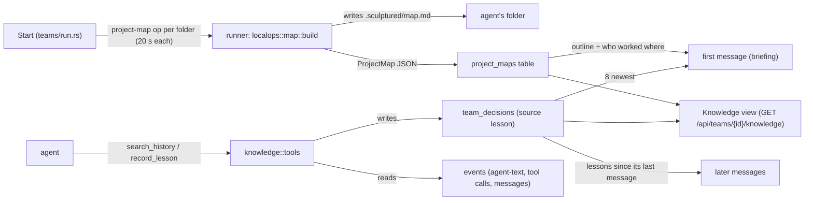

# Knowledge: project map, lessons and history search

Knowledge is what a team's agents know about their project and each other, with nobody maintaining it. At every start the runner generates a project map of each folder the team works in. Agents get its outline, the team's lessons and who has worked where in their briefing. They look up the rest with two tools that cost no model calls: `search_history` and `record_lesson`. People see the same things in the Knowledge view, which never interrupts a run.

Sources: `crates/localops/src/map.rs`, `crates/localops/src/lib.rs` (`LocalOp::ProjectMap`), `crates/hostd/src/policy.rs`, `crates/controld/src/knowledge/mod.rs`, `crates/controld/src/knowledge/tools.rs`, `crates/controld/src/team_context.rs` (`with_context`), `crates/controld/src/teams/run.rs`, `crates/controld/src/store/decisions.rs`, `crates/hostd/src/seat_tools/collaboration.rs`, `web/src/collaboration/KnowledgeView.tsx`, `web/src/knowledge.ts`, `web/src/shell/TeamLive.tsx`.

## 1. Why it is generated, not written

A hand-written project map goes stale as soon as agents change the project, and keeping it current is work nobody does. Rebuilding the map at every start from the files themselves costs a few milliseconds (272 files: 4 ms) and is always current. Agents most often waste work by rebuilding what exists or repeating a teammate's wrong turn, so the briefing points them at the map first, then at the team's history.

## 2. The project map

`localops::map::build(root)` runs on the computer that runs the agents, as the `project-map` op (30 s timeout, path checked by the runner's folder policy).

- **Files.** `git ls-files --cached --others --exclude-standard` in a repository, else a walk that skips hidden files. Noise folders are skipped either way (`node_modules`, `target`, `dist`, `build`, `.venv`, `__pycache__`, `.sculptured` and others). At most 20,000 files; a larger folder is marked `truncated`.
- **Areas.** Folders up to two levels deep, at most 80. Each area gives its file count, its four commonest file kinds (by extension), and what its notes say it is (`about`): the title or first line of its README, else of its first Markdown file.
- **Sections.** For up to 150 Markdown files of at most 512 KB, the level 1–3 headings outside code fences, with line ranges (at most 12 per file). Agents can then open exactly the section they need with `Read`'s `offset` and `limit`.
- **Output.** The full map goes to `<folder>/.sculptured/map.md`. Nothing else in the folder changes. The JSON (`ProjectMap`) returns to controld and is kept in `project_maps` (team, folder).

At a start, `teams/run.rs` runs `knowledge::refresh` before sending the agents their jobs, so first messages carry the new map. A folder that fails or takes over 20 s is skipped and the agents start without its map. A start never fails because of the map.

## 3. What agents are told

`team_context::with_context` adds knowledge to messages. `briefed` decides which form a message gets:

| Message | Gets |
|---|---|
| First message of a conversation (`briefing_lines`) | The map outline for the agent's folder (at most 25 areas, those someone worked on first, then by size, each with "worked on by …"), the 8 newest lessons (`[confirmed]` marks those a person confirmed), and a line saying to check the map, then `search_history`, before building, and to `record_lesson` after a wrong turn |
| First message of an agent with the minimal briefing (`lesson_lines`) | Only the constraints and the 8 newest lessons; no map outline and no "check the map" line |
| Later messages (`new_lessons`) | Lessons and constraints teammates recorded since the agent's previous message, if any. Its own are not repeated back to it |

**Who worked where** (`workers`) comes from the team's recorded `Write`, `Edit`, `MultiEdit` and `NotebookEdit` calls (last 5,000), mapped to areas. It is observed tool input, not a claim by the agent.

## 4. The two tools

Both are seat tools, served by controld through the runner's seat-tools socket (see [Host protocol §8](host-protocol.md#8-the-seat-tools-socket)).

| Tool | Input | Does |
|---|---|---|
| `search_history` | `query` (3+ characters), `agent?` | Searches the team's `agent-text`, `tool-called`, `tool-resulted` and `message-queued` events, newest first, case-insensitive (SQL `LIKE`, at most 200 candidate rows). Returns at most 8 hits: agent, time, what it was (wrote, ran, got back, was told) and about 160 characters either side of the match. It leaves out the asking agent's current turn and any `search_history` calls |
| `record_lesson` | `lesson` (at most 400 characters kept), `kind?` (`lesson` or `constraint`) | Adds a `team_decisions` entry with source `lesson` or `constraint` and the agent's name as author |

## 4a. Constraints and lessons kept with the project

- **Constraints** (source `constraint`) are rules; `briefing_lines` lists them first, as "follow them", then lessons.
- **Kept with the project.** `POST …/confirm` on a lesson or constraint runs `keep_in_project`: a `keep-lesson` op per team folder appends `- <text>` (constraints prefixed `[constraint]`) to `<folder>/.sculptured/lessons.md`, once. `localops::map::build` reads that file back into `ProjectMap.kept` (at most 30 lines), and the briefing lists kept lines this team does not already have under "Kept with this project from earlier work". The file is plain text the person can edit. A runner without `keep-lesson` answers `unknown_op` and the lesson stays with the team.

## 4b. Shared values and claim checks

- **Shared values** (`DataAccess.shared`, from Constrain's boundary register): `knowledge::refresh` sends the shared values of the agents in each folder with its `project-map` op; `localops::map::build_checked` looks each one up in its file (paths that leave the folder are not read) and returns `ProjectMap.shared` with `found` and the first line, `missing`, or `no-file`. `briefing_lines` lists them as values to use exactly, with NOT FOUND ones flagged. They are observed, not reported.
- **Claim checks** (`claims.rs`, from Arbiter): on each completed turn, the turn's last text is compared with its captured `Write`/`Edit` paths and shell commands. "Changed `<file>`" with no edit to it and no command naming it, or "tests pass" with no command run, becomes a `team_decisions` entry with source `claim-check`, shown in Knowledge as a heuristic. Agents are not told and never interrupted.

## 5. The Knowledge view

On the Run board, **More → Knowledge** opens `KnowledgeView`. It shows "Lessons and decisions" (with **Confirm** and **Hide**) and "Project map" (each folder's areas, sections and workers).

- `GET /api/teams/{id}/knowledge` returns `{ maps: [{ folder, at_ms, map, workers }], entries }`.
- `POST /api/teams/{id}/decisions/{entry}/confirm` sets `confirmed_ms`. Hiding uses the decision log's existing hide route, and hidden entries are never told to agents.
- **Isolation.** The view is a panel the person opens when they choose. TeamLive polls the decision log every 2 minutes. New lessons since the person last looked (`knowledge.ts`, `localStorage sculptured.knowledge-seen.<team>`) only raise a quiet count on **More** and on the Knowledge button.

## 6. Storage

| Table or column | Holds |
|---|---|
| `project_maps (team, folder, json, at_ms)` | The latest map per team and folder. Hidden and trashed with the team (`project_visibility`) |
| `team_decisions.confirmed_ms` | When a person confirmed an entry; null until then |

Both were added in schema version 26.

## Architecture invariants

- The map is rebuilt from the files at every start; nothing reads a hand-maintained map.
- The map writes only `.sculptured/map.md` in the agent's folder.
- A failed or slow map never fails or blocks a start beyond 20 s per folder.
- Knowledge never interrupts an agent: new lessons ride on the next message it gets anyway.
- `search_history` and `record_lesson` make no model calls.
- Hidden entries are never told to agents.

## Properties and their tests

| Property | Test |
|---|---|
| A folder maps to areas with kinds, notes and sections; noise folders are left out | `localops/src/map.rs::a_folder_maps_to_areas_with_their_kinds_notes_and_sections` |
| A start maps the folder; the first message carries the map, lessons and the tool hint; the view and Confirm work | `controld/tests/knowledge.rs::a_start_maps_the_folder_and_agents_get_the_map_lessons_and_a_history_search` |
| A lesson recorded mid-run reaches running teammates with their next message, not its author; a search leaves out the asker's current turn | `controld/tests/knowledge.rs::a_lesson_recorded_mid_run_reaches_running_teammates_with_their_next_message` |
| A search's own calls are not searchable | `controld/src/knowledge/tools.rs::the_history_tools_own_calls_are_not_searchable` |
| Snippets are the text around the match | `controld/src/knowledge/tools.rs::a_snippet_is_the_text_around_the_match` |
| The view shows lessons and the map, and Confirm works | `web/src/collaboration/KnowledgeView.test.tsx` ("shows what agents learned and the project map, and lets you confirm a lesson") |
| The new tables and column migrate | `controld/tests/migrations.rs::an_m1_store_gains_the_m2_tables_and_columns` |

## Not built yet

- A runner from before `project-map` answers `unknown_op`; its teams start without a map until it is reinstalled.
- The map does not look inside source files (no symbols or signatures); only Markdown headings are listed.
