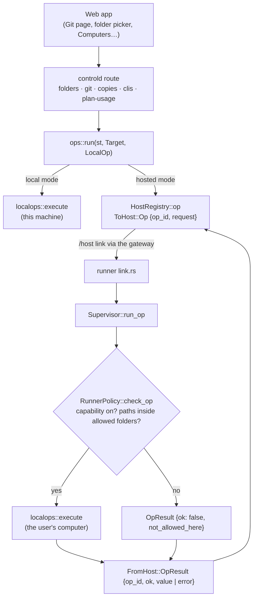
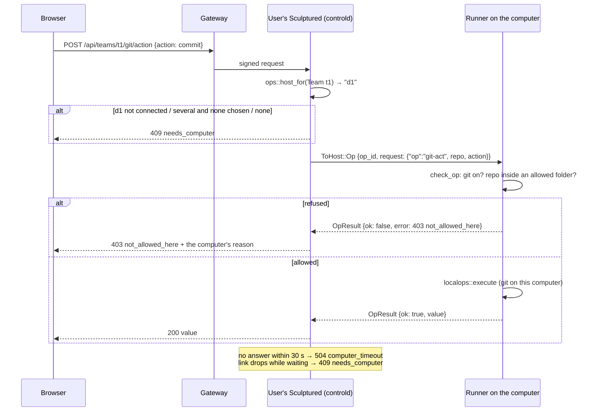
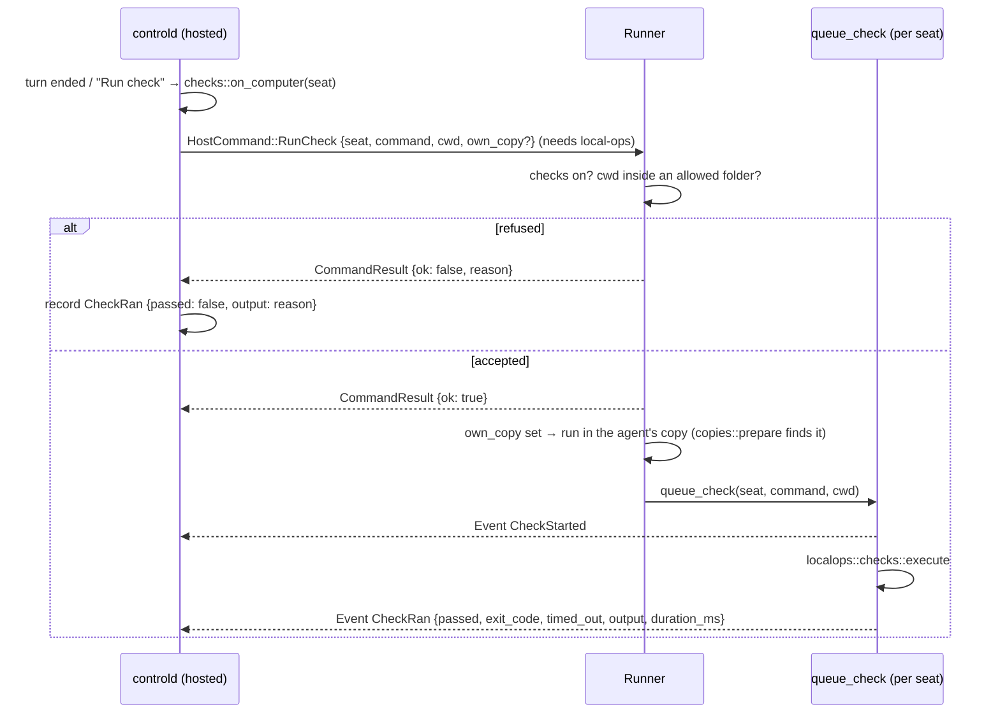
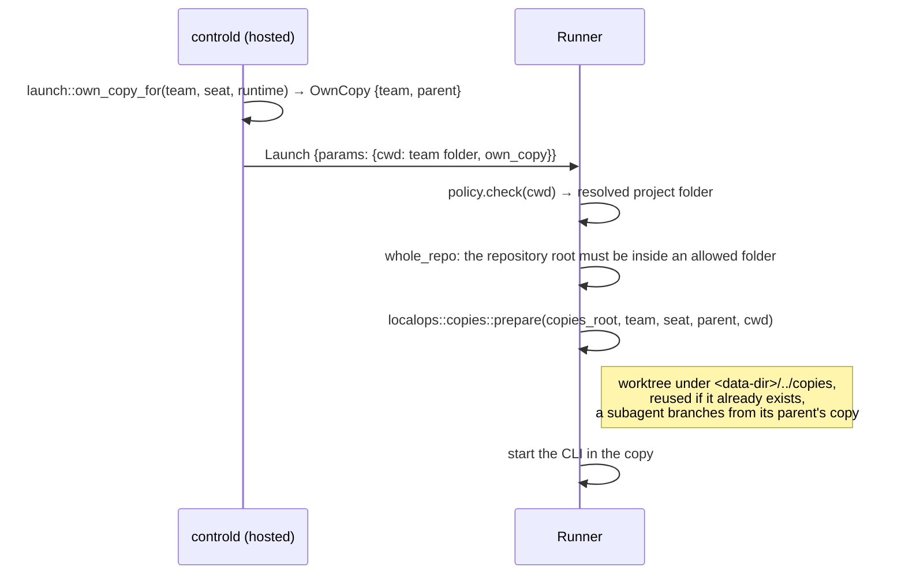

# Local operations on the user's computer

Folders, git, agents' own copies, checks, CLI sign-in and plan usage all touch files or run programs. On a local `serve`, they run on this machine. In the hosted beta, the user's Sculptured runs on the server, where those files don't exist, so the same operations run on the user's connected computer instead.

Sources:
- `crates/localops/src/{lib,folders,git,copies,checks,clis,plan}.rs`
- `crates/controld/src/{ops,folders,git,copies,checks,clis,plan_usage,launch}.rs`
- `crates/controld/src/hosts/{registry,session}.rs`
- `crates/hostd/src/{ops,policy}.rs`, `crates/hostd/src/supervisor/{mod,lifecycle}.rs`
- `crates/host-proto/src/lib.rs` (`ToHost::Op`, `FromHost::OpResult`, `HostCommand::RunCheck`, `LaunchParams.own_copy`, `HostPolicyInfo`)
- `web/src/hosted/ComputersPage.tsx`, `web/src/structure/FolderPicker.tsx`

## 1. Why `localops` exists

There is one implementation, run in two places. The `localops` crate holds the code that lists folders, runs git, manages copies, runs checks and reads CLI state. It knows nothing about HTTP, controld or the host link:
- **Local mode:** controld calls it in-process.
- **Hosted mode:** the runner on the user's computer calls it, after its owner's policy has checked the request.

Each operation is one `LocalOp` value, serialized as JSON with a kebab-case `"op"` tag (for example `{"op":"git-status","repo":"/home/a/proj"}`). `localops::execute(&Context, LocalOp)` returns plain JSON or a `LocalError {status, code, message}`. The `Context` says where this machine keeps things: home, copies folder, the `claude`/`codex` programs and the Codex home.

Because both modes run the same function on the same JSON, a hosted answer is identical to a local one, and the web app doesn't know which mode produced it.

## 2. Components

- **`Target`** names which computer an op goes to:
  - `Team(id)`: the computer that runs that team (`launch::team_host`);
  - `Host(id)`: a computer chosen by id (`?host=`);
  - `Default`: the only connected computer.
- **`ops::run`** chooses local or hosted with `ops::hosted(st)`. In local mode it never touches the host registry.
- **Older runners:** a computer whose Hello lacks the `local-ops` feature gets `409 older_runner` without anything being sent.

## 3. A hosted git action, end to end

| Failure | Status, code | The user sees |
|---|---|---|
| No computer, several and none chosen, or the team's computer offline | `409 needs_computer` | "Connect a computer first…", "Choose which computer…", "<id> is not connected…" |
| Link dropped while waiting | `409 needs_computer` | "<id> disconnected. Open Computers to reconnect it." |
| Runner without `local-ops` | `409 older_runner` | "<id>'s Sculptured is too old for this…" |
| No answer in time | `504 computer_timeout` | "<id> did not answer in N s." |
| Policy refused | `403 not_allowed_here` | the runner's reason, for example "Git is turned off on this computer (sculptured connect … --enable git)" |
| The operation itself failed | the runner's status and code | unchanged from local mode |

A pending op is keyed by `op_id` in the registry. A disconnect fails every op waiting on that computer at once (`OpFailure::NotConnected`) rather than letting them run out their timeouts.

## 4. Every `LocalOp`

Path fields are resolved by the runner, as described in [Connected computers §4](devices.md#4-permissions-on-the-computer): absolute, or under the first allowed folder, then canonicalized, and they must lie inside an allowed folder.

| Op | Fields | Sent by | Capability | Paths checked | Timeout |
|---|---|---|---|---|---|
| `describe` | – | (reserved: the policy arrives in the Hello) | – | – | 15 s |
| `list-folder` | `path?` | `GET /api/folders` | – | `path` (none: the allowed folders themselves) | 15 s |
| `create-folder` | `parent, name` | `POST /api/folders` | – | `parent` | 15 s |
| `git-status` | `repo` | `GET /api/teams/{id}/git` | `git` | `repo` | 30 s |
| `git-diff` | `repo, path, staged` | `GET /api/teams/{id}/git/diff` | `git` | `repo` (`path` is checked by git.rs to stay inside it) | 30 s |
| `git-act` | `repo, action` | `POST /api/teams/{id}/git/action` | `git` | `repo` | 30 s |
| `copy-prepare` | `team, seat, parent?, cwd` | `copies.rs` (local launches; hosted launches use `own_copy`, §6) | `copies` | `cwd` | 120 s |
| `copies-read` | `project?, team, seats, enabled` | `GET /api/teams/{id}/copies` | `copies` | `project` | 120 s |
| `copy-merge` | `project, team, seat` | `POST /api/teams/{id}/copies/merge` | `copies` | `project` | 120 s |
| `copy-remove` | `project, team, seat` | `POST /api/teams/{id}/copies/remove` | `copies` | `project` | 120 s |
| `clis` | – | `GET /api/clis[?host=]` | – | – | 40 s |
| `cli-login` | `name` | `POST /api/clis/{name}/login[?host=]` | `cli_sign_in` | – | 20 s |
| `plan-usage` | – | `GET /api/plan-usage` | `plan_usage` | – | 15 s |
| `generate` | `cli, model?, prompt, schema` | `POST /api/generate/{questions,teams}` ([AI team generator](ai-team-generator.md)) | `generate` | – (runs in an empty temporary folder) | 310 s |
| `analyze-run` | `sessions` (runtime, CLI session id), `export` (the run's `sculptured.session/v1` with only `tenure-started`, `handed-over`, `plan-usage-reported` and `budget-state-changed`) | `GET /api/teams/{id}/report` and the minute refresh (`run_reports.rs`) | `usage_reports` | – (session files are found by id under `~/.claude/projects` or `$CLAUDE_CONFIG_DIR/projects`, and `$CODEX_HOME/sessions` around the run's day; ids are plain names, never paths) | 60 s |

| `item-copy-prepare` | `project, team, task` | Workflow items with `copies: per-item` ([Workflows](workflows.md)) | `copies` | `project` (whole repository) | 120 s |
| `item-merge` | `project, team, task, into?` | A workflow merge stage (`workflow/stage_merge.rs`) | `copies` | `project` (whole repository) | 120 s |
| `run-check` | `cwd, item?, command, timeout_s` | Workflow check stages and guards (`workflow/stage_checks.rs`, `workflow/guard.rs`) | `checks` | `cwd` | the check's timeout + 30 s |
| `project-map` | `path` | Every team start (`knowledge::refresh`, [Knowledge](knowledge.md)) | – | `path` | 30 s (controld waits 20 s) |
| `keep-lesson` | `path, text` | Confirming a lesson (`knowledge::keep_in_project`) | – | `path` | 15 s |

Timeouts are set in `ops::timeout_for`. A runner from before `analyze-run` answers `unknown_op`; controld turns that into `runner_without_reports` (reinstall the runner). Copies get 120 s because creating or merging a worktree in a large repository can take that long.

**Browsing a connected computer** (`Supervisor::run_op`):
- `list-folder` with no path answers with the allowed folders as entries and `path: ""`. The folder picker shows this level as "Folders this computer allows" and disables *Choose* and *New folder* there.
- Inside an allowed folder, that folder acts as home for the listing, so the picker never offers to go above it.

**Capabilities** come from the owner's `runner.json`, set with `sculptured connect … --enable <cap>` / `--disable <cap>`. Only the owner's explicit choices are stored; any capability left unset follows the access level, so switching to sandboxed later turns checks off unless the owner enabled them by name:

| Capability | Default (full access) | Default (sandboxed) |
|---|---|---|
| `git` | on | on |
| `copies` | on | on |
| `checks` | on | **off** (a check runs an arbitrary command outside the agent's sandbox) |
| `cli_sign_in` | on | on |
| `plan_usage` | on | on |
| `generate` | on | on (no tools run) |
| `usage_reports` | on | on (reads the CLIs' own session files; answers sizes, causes, command lines with common secrets masked, and file names; not contents) |

The runner reports its folders, access, capabilities and platform in `Hello.policy` (`HostPolicyInfo`). `GET /api/hosts` returns it, and the Computers page shows it for each connected computer. This report is for display only; the runner enforces its own copy of the rules on every op.

## 5. Checks run as events

A check runs a command (the team's configured check) after an agent's turn, or on demand. Its result is verified evidence, so it is recorded as `CheckStarted` / `CheckRan` events with `Provenance::Verified` and actor `System("check")`.

- **Where it runs:** where the agent works. With own copies on, controld sends the same `own_copy` as at launch and the runner runs the check in that copy, not in the shared project folder.
- **A server-supplied command, on purpose:** unlike a launch, where the program, environment and arguments are refused, a check *is* a command from the team's design. That is why `checks` is a capability, off by default on sandboxed computers.
- **Fire and forget:** `RunCheck` returns as soon as the check is queued. The result arrives later through the ordinary journaled event stream, so it survives a reconnect like any other event.
- **Per-seat coalescing:** while a seat's check runs, further requests set an "again" flag instead of starting another one, and exactly one more run follows. A burst of turns therefore never runs checks in parallel on the same folder, and the last state is always checked.
- **Refusals stay visible:** any refusal (checks turned off, folder not allowed, computer offline, older runner) becomes a failed `CheckRan` whose output is the reason. A check never fails silently, and it is never shown as passing.
- **Local mode** uses the same coalescing in controld (`checks::check_once`) and the same `localops::checks::execute`.

## 6. Agents' own copies on the computer

When a team turns on *own copies*, each Claude Code or Codex agent works in its own git worktree, so agents don't overwrite each other.

- **Whole repository:** a copy, and merging it back, covers the whole git repository, not just the project folder. So the repository root must itself be inside an allowed folder (`RunnerPolicy::whole_repo`, applied to launches, checks and every copy op). Allowing only `~/mono/pkg-a` of the repository `~/mono` refuses copies with "allow it with `sculptured allow ~/mono`, or switch off own copies".
- **Where copies are made:** on the computer, at launch, after the policy check. The server never sends a copy path, so a hostile server cannot point an agent at an arbitrary folder.
- **Copies folder:** `copies_root` is `<data dir>/../copies` (by default `~/.sculptured/runner/copies`), separate from the project folders.
- **Copy-on-write** (`localops::clone`): when one real file of the project can be cloned into the copies folder (`reflink_copy`: FICLONE on btrfs/XFS, `clonefile` on APFS, block cloning on ReFS), `prepare` adds the worktree with `--no-checkout`, clones the project's files into it (every `.git` and the copies folder left out; a file that cannot be cloned is skipped, never copied in full), then `read-tree HEAD`, `update-index --refresh`, `reset --hard` (rewriting only files that differ) and `clean -fd` (removing the project's untracked work; ignored build output stays). Otherwise, or if that fails, it is an ordinary checkout. Item copies use the same path. Tests: `copies.rs::a_cloned_copy_is_exactly_its_branch_plus_the_projects_build_output` (with a plain copy standing in for cloning); real cloning is not exercised on the test machine's ext4.
- **Listing, merging and removing** use `copies-read`, `copy-merge` and `copy-remove` through `ops::run` like any other op.
- **Local mode:** controld prepares the copy itself before launching, as before.

## 7. What stays refused in hosted mode

`hosted::LOCAL_ONLY` now holds only the routes that have no meaning on a user's computer, or that would read or measure the server itself:

| Route | Why it stays refused |
|---|---|
| `POST /api/rigs` | Reads a spec file by a path on the server |
| `/api/teams/*/textbook/prepare` | Prepares files in a server-side folder |
| `/api/system/metrics` | Whole-machine load; on the server it would describe the shared host, not the user's computer |

They answer `409 needs_computer`. Everything else that used to be on the list now goes through `ops::run` to the user's computer.

**Adding a route that reads or writes paths, or runs a program?**
1. Add a `LocalOp` variant and implement it in `localops`.
2. Give it a capability and path checks in `RunnerPolicy::check_op`, and a timeout in `ops::timeout_for`.
3. Call it through `ops::run`.

If it cannot run on a computer, add it to `LOCAL_ONLY` and to `crates/controld/tests/hosted.rs`.

## 8. Properties and their tests

| Property | Test |
|---|---|
| One executor serves every op with plain JSON | `localops` `lib::tests::one_executor_serves_every_op_with_plain_json` |
| Folder listing stays inside home; escapes refused | `localops` `folders::tests::listing_shows_subfolders_inside_home_and_refuses_escapes` |
| Git refuses option-like and outside paths | `localops` `git::tests::snapshot_stage_commit_and_refuse_option_like_or_outside_paths` |
| Copies are made, reused, merged and removed; running agents left alone | `localops` `copies::tests::a_copy_is_made_reused_listed_merged_and_removed_and_running_agents_are_left_alone` |
| An op runs on the computer and returns its value; a slow one times out | `crates/controld/tests/ops.rs` |
| Hosted folders, git and CLIs run on the team's computer | `crates/controld/tests/hosted_ops.rs` `hosted_folders_git_and_clis_run_on_the_teams_computer` |
| A hosted check runs on the computer and reports pass or fail | `hosted_ops.rs` `a_hosted_check_runs_on_the_computer_and_reports_pass_or_fail` |
| Own copies are made on the computer, not on the server | `hosted_ops.rs` `hosted_teams_with_own_copies_ask_the_computer_for_one_instead_of_making_it_here` |
| With no computer connected, nothing touches the server's own files | `crates/controld/tests/hosted.rs` `with_no_computer_connected_nothing_touches_the_servers_own_files` |
| Ops stay inside allowed folders and respect capabilities | `crates/hostd/tests/policy.rs` `ops_stay_inside_allowed_folders_and_respect_capabilities` |
| A sandboxed computer refuses checks and says how to allow them | `policy.rs` `a_sandboxed_computer_refuses_checks_and_says_how_to_allow_them` |
| A launch asking for its own copy runs in a worktree on the computer | `policy.rs` `a_launch_asking_for_its_own_copy_runs_in_a_worktree_on_this_computer` |
| Copies refused when the repository reaches outside the allowed folder | `policy.rs` `copies_are_refused_when_the_repository_reaches_outside_the_allowed_folder` |
| A check for an agent with its own copy runs in that copy | `policy.rs` `a_check_for_an_agent_with_its_own_copy_runs_in_that_copy` |
| Switching to sandboxed later turns checks off unless enabled by name | `crates/sculptured/src/connect.rs` `switching_to_sandboxed_later_turns_checks_off_unless_enabled_by_name` |
| Up from an allowed folder returns to the list of allowed folders | `FolderPicker.test.tsx` |
| The Computers page shows folders, access and CLIs, with sign-in on that computer | `web/src/hosted/computers.test.tsx` |
| The folder picker browses the team's computer | `web/src/structure/FolderPicker.test.tsx` |
