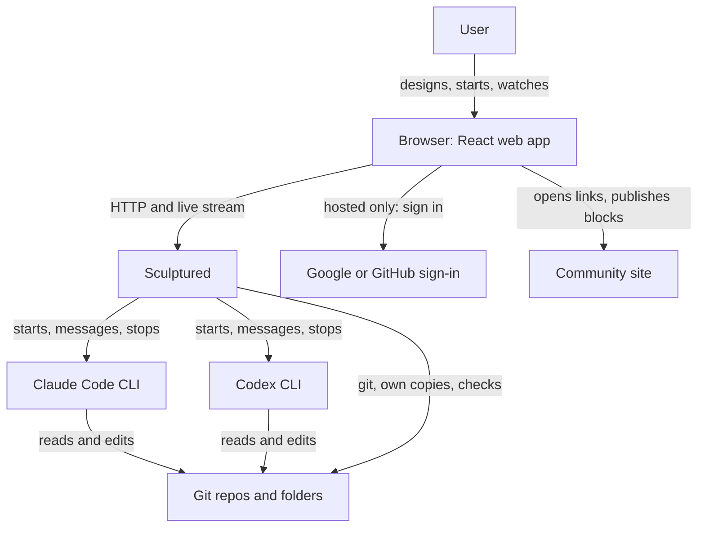
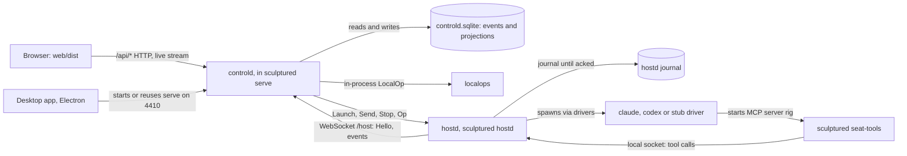
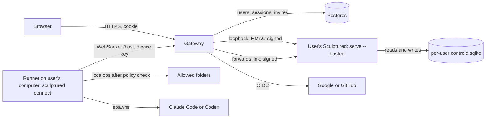

# Overview and component map

Sculptured is a web control plane for teams of local coding agents. A user designs a team on a board, starts it, and watches and talks to its Claude Code and Codex agents live. It runs either on the user's own machine (`sculptured serve`) or as a hosted beta, where the server holds the user's teams and the agents still run on the user's own computer.

Sources:
- `Cargo.toml` (workspace), `crates/*/Cargo.toml`, the top doc comment of each crate's `lib.rs` or `main.rs`
- `crates/sculptured/src/main.rs` (subcommands `serve`, `hostd`, `seat-tools`, `connect`, `allow`)
- `crates/controld/src/store/{mod,project,runs}.rs`, `crates/drivers/src/{lib,process}.rs`
- `web/src/`, `web/src/vocab.ts`, `desktop/README.md`, `docs-site/README.md`

## 1. Bird's-eye view

There are two ways to run Sculptured:

| Mode | What runs where |
|---|---|
| **Local** | `sculptured serve` binds `127.0.0.1:4410` (default `--port 4410`). It runs controld (API, web UI, SQLite store) and starts a local agent runner, `sculptured hostd`, which dials back to `ws://127.0.0.1:<port>/host`. |
| **Hosted beta** | The gateway (`sculptured-gateway`) signs users in and starts one `sculptured serve --hosted` per user on loopback. That instance has no local runner. The user's computer runs `sculptured connect <address>`, whose runner links out through the gateway's `/host` route. See Gateway (in the private sculptured-cloud repo) and [Connected computers](devices.md). |

In both modes the same controld code serves the same `/api/*`, and the same hostd code runs the agents.

The diagram is C4 level 1 (context). Sculptured never calls a model itself; the CLIs do, on the user's own sign-in.

## 2. Containers in local mode

- controld depends on `host-proto` but not on `hostd` or `drivers` (they are dev-dependencies only). It never spawns an agent CLI; hostd does.
- hostd keeps agents running when controld is unreachable. Events wait in its journal until controld acknowledges them (`crates/hostd/src/lib.rs`).
- The desktop app uses a Sculptured already answering on `127.0.0.1:4410`, or starts the bundled `serve` ([Desktop and installers](desktop-and-installers.md)).

## 3. Containers in hosted mode

- The gateway links only the `signing` crate from this repository. It runs the `sculptured` binary as a child process for each user (`instances.rs`: `serve --hosted --port 0`).
- Local operations (folders, git, copies, checks) run on the user's computer, not the server. See [Local operations](local-ops.md).
- Deployment topology: Deployment (in the private sculptured-cloud repo). Security model: Security (in the private sculptured-cloud repo).

## 4. Code map

The Cargo workspace is `crates/*` (`spikes/` is excluded). The hosted gateway and the Community server live in private repositories and depend on `signing`, `host-proto`, `model` and `rigspec` from here. "API boundary" marks code whose shape other processes or files depend on.

| Path | Responsibility | API boundary |
|---|---|---|
| `crates/model` | Shared types: events, provenance, seat ids (`pod.member@rig`), team drafts, workflow, limits, pricing. No I/O. Exported to TypeScript with ts-rs. | Yes: event and draft JSON |
| `crates/rigspec` | Parses, validates and compiles RigSpec YAML and team drafts into a `CompiledRig`; templates and team exchange formats. No file I/O. | Yes: `sculptured.team/v1` ([Portable formats](portable-formats.md)) |
| `crates/host-proto` | Messages between controld and a runner, as JSON frames over a WebSocket (`ToHost`, `FromHost`, Hello, Welcome, acks). | Yes: [Host protocol](host-protocol.md) |
| `crates/controld` | The product server: HTTP API, guard and hosted auth, SQLite event store and projections, launches, handoffs, questions, workflow engine, checks, usage, analytics, the context ceiling ([Protections](protections.md)) knowledge ([Knowledge](knowledge.md)) the team's status page ([Status page](status-page.md)) and proposed changes with rule checks ([Proposed changes](changes.md)). | Yes: `/api/*`, `/host` |
| `crates/hostd` | The agent runner: supervises agent processes, journals their events, serves seat tools on a local socket, enforces the computer owner's policy. | Client of `/host` |
| `crates/drivers` | One driver per CLI: `claude` (stream-json), `codex` (app-server JSON-RPC), `stub` (Practice agents, no model). | Internal trait `Driver` ([Drivers](drivers.md)) |
| `crates/localops` | Folders, git, own copies, checks, CLI sign-in, plan usage, generation, project maps. Called in-process or by a runner. | Yes: `LocalOp` JSON |
| `crates/interpreter` | Heuristic reading of tool calls into plain-language actions and risk flags. Pure; never reads the filesystem, never blocks. | No |
| `crates/signing` | HMAC `sign` and `verify` for gateway-to-instance requests. | Yes: request signature |
| `crates/sculptured` | The one binary: `serve`, `hostd`, `seat-tools`, `connect`, `allow`, `stop`, and `guard` (Claude Code's hook for [protections](protections.md)). | CLI |
| `crates/fixtures` | Fake CLIs (`fake-claude`, `fake-codex`), scrubbed recordings, manual probes. Test-only. | No |
| `crates/e2e-server` | The Playwright web server: real binary, throwaway data dir and `HOME`. Test-only. | No |
| `web/src/generated` | TypeScript types generated from Rust. Never hand-edited. | Mirror of Rust types |
| `web/src/structure` | Structure board: designing a team, folder picker, start confirmation, team generator UI. | No |
| `web/src/shell` | App shell, agent pane, controls, chat, connection labels. | No |
| `web/src/collaboration` | Conversation, communication map, usage and budget views, the Knowledge view. | No |
| `web/src/workflow` | Workflow board, stage editor, item board, run view, decision log. | No |
| `web/src/visual` | Visual progress, context overview, phase brief, tool views. | No |
| `web/src/progress` | Activity and summary sentences from events. | No |
| `web/src/groups` | Group library, palette, block details and transfer. | No |
| `web/src/release` | Community pages, sharing, git page, agent copies list, design guide. | No |
| `web/src/hosted` | Hosted pages: login, join, reset, connect, computers, admin analytics. | No |
| `web/src/draft` | Pure edit, history and geometry functions for team drafts. | No |
| `web/src/api.ts`, `useTeamEvents.ts`, `useRigStream.ts` | The browser's client for `/api/*` and the shared live stream. | Client |
| `desktop/` | Electron window around a local `serve`. | No |
| `docs-site/` | The user-facing Mintlify documentation site. | No |

## 5. Architecture invariants

- `sculptured serve` binds only `127.0.0.1` (`main.rs`: `TcpListener::bind(("127.0.0.1", port))`).
- controld never starts an agent process. Only hostd does, through `drivers`; `drivers` and `hostd` are dev-dependencies of controld.
- Each event and its projection onto the seat and message tables commit in one SQLite transaction (`store/project.rs`).
- Ingesting a runner event is idempotent per `(host, host_seq)`. A gap is recorded first as `EventsLost`, so lost history is never silent (`Store::ingest`).
- Imported runs live in their own tables and never enter `events`, so nothing that drives agents sees them (`store/runs.rs`).
- `localops` depends on no web framework, no `controld` and no host link. Its errors carry a status number that controld answers with.
- `model`, `rigspec` and `interpreter` do no file or process I/O.
- The interpreter is observe-only and heuristic. An empty result means nothing stood out, never that a call was safe.
- Agent processes never inherit the runner's token: the process builder removes `SCULPTURED_HOST_TOKEN` (`drivers/src/process.rs`).
- The gateway does not link controld. It reaches each user's instance over loopback with an HMAC signature (`signing`).
- TypeScript API types come only from Rust (`cargo test --workspace export_bindings`).
- OpenRig words (rig, pod, seat, edge, runtime…) appear in the UI only inside `data-advanced` or raw evidence (`web/src/vocab.ts`, `web/src/test-vocab.ts`).
- Deliberately absent: no routine test calls a model or a third party ([Testing](testing.md)); Sculptured itself makes no model calls.

## 6. Where to read next

1. This page, then [Testing](testing.md).
2. [Team lifecycle](team-lifecycle.md): from a draft to running agents.
3. [Host protocol](host-protocol.md) and [Drivers](drivers.md): how controld, the runner and the CLIs talk.
4. [Events and storage](events-and-storage.md): the journal, projections and provenance.
5. [Workflows](workflows.md), [Limits and usage](limits-and-usage.md), [AI team generator](ai-team-generator.md), [Portable formats](portable-formats.md).
6. Hosted beta: Gateway (in the private sculptured-cloud repo), [Connected computers](devices.md), [Local operations](local-ops.md), Analytics (in the private sculptured-cloud repo).
7. Security (in the private sculptured-cloud repo), Deployment (in the private sculptured-cloud repo), [Desktop and installers](desktop-and-installers.md).

## 7. Glossary

The user-facing word comes first, the code name second.

| Term | Meaning |
|---|---|
| **Team** (`rig`, `TeamDraft`, `CompiledRig`) | A set of agents and their connections, designed on the board and started together. |
| **Group** (`pod`, `DraftGroup`) | A box of agents inside a team. Its id becomes the RigSpec pod id. |
| **Agent** (`DraftAgent`, `member`) | One Claude Code, Codex or Practice worker with a name, a **Job** and a **Folder**. |
| **Seat** (`SeatId`) | An agent's stable internal address, `pod.member@rig`. Process ids and CLI session ids are never part of it. |
| **Practice agent** (`AgentKind::Practice`, runtime `stub`) | Runs the stub driver inside the runner. Calls no model and costs nothing. |
| **Connection** (`ConnectionKind`, edge) | "hands work to" (`delegates_to`, orders launch), "reports to" and "watches" (design intent, not enforced). |
| **Handoff** | Work passed along a "hands work to" connection, recorded with its message ([Team lifecycle](team-lifecycle.md)). |
| **Workflow** (`model::Workflow`) | Bounded task dispatch through reusable stages; routes may branch and loop. |
| **Stage** (`WorkflowStage`, `StageKind`) | One step of a workflow, run by an agent, a check, a person or a merge. |
| **Item** (`WorkflowTask`, `TaskStatus`) | One piece of work moving through stages: queued, assigned, waiting, complete or blocked. Agent-stage completion is agent-reported. |
| **Own copy** (`localops::copies`, `CopiesMode`) | An agent's own git worktree, so agents don't overwrite each other. |
| **Check** | A configured command Sculptured runs; its result is `Verified` evidence. |
| **Runner** (`hostd`) | The process that runs agents on one machine and streams their events. |
| **Computer** (device) | A user's machine linked to a hosted account with `sculptured connect`. |
| **Gateway** | The hosted beta's multi-user front door. |
| **Instance** | One user's own `sculptured serve --hosted`, started by the gateway. |
| **Seat tools** (MCP server `rig`) | The MCP server a CLI starts for its agent (`sculptured seat-tools`), talking to the runner over a local socket. |
| **Block** | A published, inert group definition on the community site. |
