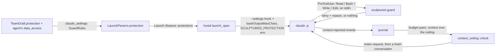
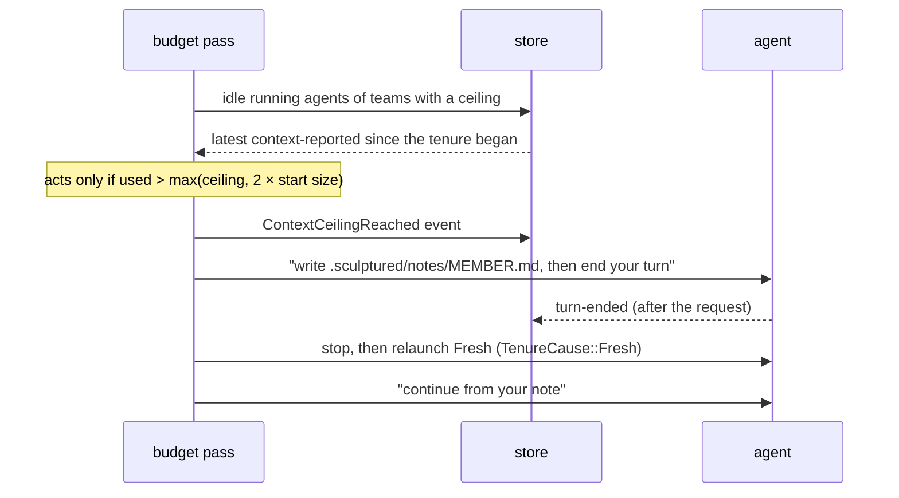

# Protections and contracts

Protections are rules Sculptured applies between an agent and its tools, so an agent's context stays small. They refuse reading a large file whole, cap shell output, and move an agent whose context has grown past a ceiling into a fresh conversation built from its own notes. An agent's contract (MADL `data_access` and `authority`) says what it reads, writes and decides. Teammates are told the contract, and protections refuse file reads and writes outside it.

Sources: `crates/model/src/protection.rs`, `crates/model/src/contract.rs`, `crates/sculptured/src/guard.rs`, `crates/drivers/src/claude/mod.rs` (`protection_args`, `protection_env`), `crates/hostd/src/supervisor/lifecycle.rs` (`launch_spec`), `crates/controld/src/launch.rs` (`claude_settings`, `with_contract`), `crates/controld/src/collaboration/context_ceiling.rs`, `crates/controld/src/team_context.rs` (`contract_lines`), `crates/controld/src/hosts/mod.rs` (`drop_features`), `web/src/structure/ProtectionFields.tsx`, `web/src/structure/ContractFields.tsx`.

## 1. Why a guard between the agent and its tools

Every token an agent reads stays in its context and is read again at every later step. One whole read of a large log or data file can cost more than the rest of a task. The CLIs do not stop this themselves, so Sculptured adds a hook that refuses the expensive form of a call and says how to make the cheap one ("read it with `offset` and `limit`").

The layer is meant to grow: the same hook and the same `GuardRules` will carry safety rules. None exist yet (§6).

## 2. Settings (reference)

A team's protections are `TeamDraft.protection` (`model::Protection`), shown under the team's **Advanced** settings. They are on by default.

| Field | Default | Effect |
|---|---|---|
| `on` | `true` | Off: no guard, no output cap, no ceiling |
| `read_kb` | `100` | A `Read` with no `limit` of a file larger than this is refused. So is a shell command that prints such a file whole (`cat f`, `sed -n '1,$p' f`) without piping it into a filter |
| `shell_chars` | `8000` | Claude Code's `bashOutputMaxChars`: shell output beyond this never reaches the context |
| `context_tokens` | `60000` | The context ceiling (§4) |

`Protection::guard_rules()` turns these into `GuardRules`, the per-agent rules sent with a launch. `with_contract` then adds the agent's contract (`reads`, `writes`).

## 3. The guard hook

- **Delivery.** `ClaudeStreamDriver::protection_args` passes `--settings` with a `PreToolUse` hook on `Read|Bash` that runs `"<sculptured>" guard` (5 s timeout). The same settings set `bashOutputMaxChars`. It also passes `--autocompact 100000`, Claude Code's lowest compaction threshold, as a backstop inside long turns. Because the rules go in through `--settings`, they apply whatever setting sources the team loads. The rules travel in the agent's environment as `SCULPTURED_PROTECTION` (`protection_env`), so the hook inherits them.
- **Which binary.** `Supervisor::guard_program` names the seat-tools shim (the `sculptured` binary), or the running binary when it is `sculptured`. With neither, the launch goes without protections.
- **Speed.** `main.rs` checks for `guard` before anything else starts. The guard reads at most a bounded amount of stdin, reads file sizes but never file contents, and exits. `tests/guard.rs` pins it below a time limit.
- **Deciding.** `model::protection::decide` returns a reason or `None`. Files read whole by nature (images, PDFs, notebooks) are never refused. Anything it cannot parse passes: a protection never stalls an agent.
- **Refusing.** A refusal prints `permissionDecision: "deny"` with a reason that starts with `MARK` ("Sculptured protection:"). hostd's mapping recognizes `MARK` in the tool error and records the call as refused by a protection, not as a failure.

## 4. The context ceiling

`context_ceiling::check` runs in the budget pass (every second, and within 100 ms of a usage or turn-end event). It never interrupts a turn.

- **Start size.** The first context reading of a conversation is its instructions, tools and briefing. The ceiling acts only above twice that, so a fresh conversation that starts large cannot trip it straight away and restart in a loop.
- **Pending requests** live in `AppState.context_asked` (seat → seq of the request). Only a turn that ends after the request counts as the note's turn.
- An agent with a control in progress (a stop, a budget wrap-up) is left to that control.
- **Within a turn**, Claude's own compaction (`--autocompact`) can summarize the briefing away. `launch_params` sends the briefing (`team_context::briefing`) as `LaunchParams.briefing` for Claude agents with protections; the runner writes it privately to `<runner data>/hostd/briefings/<seat>.md` (`ProtectionLaunch.briefing_file`), and the driver adds a `SessionStart` hook with matcher `compact` running `sculptured rebrief <file>`, which prints it as `additionalContext`. An older runner ignores the field.

## 5. Contracts

`AgentAdvanced.data_access` (`reads`, `writes`, `side_effects`, `rationale`) and `AgentAdvanced.authority` (`domains`, `scope`, `rationale`) are optional and set in the agent's **Advanced → Contract**.

| Where | What happens |
|---|---|
| Briefing (`team_context::contract_lines`) | Every agent is told who decides what, which agents own decisions that cross group lines (`scope`), and its own reads and writes |
| Guard (`decide`) | `Write`/`Edit` outside `writes`, and `Read` outside `reads` and `writes`, are refused. An empty list allows everything. The agent's own `.sculptured/` folder (its notes) always passes. Paths stay relative and are read against the folder the agent actually works in |
| MADL (`portable/madl`) | Round-trips as `data_access` and `authority`. MADL warns on `write-overlap` and `authority-overlap` |
| Design assistant (`generate`) | Its rules ask for contracts when agents share files or decisions |

Shell commands are not checked against the contract.

## 6. Older runners and other CLIs

- A runner without the `protection` feature gets the launch without `protection`. `drop_features` records a `FeaturesDropped` event telling the person to reinstall the runner.
- **Codex agents get the context ceiling only.** The ceiling works from `context-reported` events, which Codex sends too. The guard and the output cap are not sent: `claude_settings` returns none for Codex. `decide` already understands Codex's tool names (`shell`, `exec_command`), but Codex runs hooks only after the person trusts them on each computer. *Deferred.*
- **Safety rules** (`model::safety`): the team's `TeamDraft.safety`, sent in `GuardRules.safety` and checked first in `decide`. The format is Signet-Eval's (`name`, `tool_pattern` regex, `conditions` all holding, `reason`); the guard evaluates `contains`, `any_of`, `matches`, `param_contains`, `param_eq`, `param_ne`, `not`, `or`, `true`, `false`. A condition that does not parse makes its rule never match, and `SafetyRule::problems` reports it as `safety-rule-invalid`. Presets live in `web/src/structure/safety-presets.json`, read by both sides.
- **Hook matcher** (`GuardRules::hook_matcher`): `Read|Bash`; plus the edit tools when the contract limits writes; every tool (`""`) when there are safety rules.
- **Signet-Eval** (integration `signet`, Claude only): the runner finds `signet-eval`, writes the team's safety rules as its user rules (`<runner data>/signet/<seat>/rules.yaml`, JSON, which YAML reads) and the driver adds `"signet-eval" --rules-path …` as a second PreToolUse hook (`LaunchSpec.tool_hooks`), even with protections off. Its built-in locked rules always apply (Signet overlays them on any policy file), including refusing edits until Kindex was used and refusing Claude's task tools, so `agent_extras` adds `kindex` with it.

## Architecture invariants

- A protection never blocks a call it cannot judge; unparsable input and unreadable safety rules pass.
- The guard reads file sizes, never file contents.
- The ceiling acts only between turns and only above twice the conversation's starting size.
- The guard and output cap apply to Claude agents only, and only on a runner that advertises `protection`. The ceiling applies to every agent that reports its context.
- An agent's own notes folder is never outside its contract.

## Properties and their tests

| Property | Test |
|---|---|
| A large whole read is refused; ranged or small reads pass | `model/src/protection.rs::a_large_file_read_whole_is_refused_and_a_ranged_or_small_read_is_not` |
| Images, PDFs and notebooks are never refused | `model/src/protection.rs::images_pdfs_and_notebooks_are_never_refused` |
| Printing a large file whole in the shell is refused; filtering it is not | `model/src/protection.rs::printing_a_large_file_whole_in_the_shell_is_refused_but_filtering_it_is_not` |
| Writes outside the contract are refused; notes pass | `model/src/protection.rs::writes_outside_the_agents_contract_are_refused_and_its_notes_always_pass` |
| Reads outside the contract are refused; the agent's own writes can be read | `model/src/protection.rs::reads_outside_the_agents_contract_are_refused_but_its_own_writes_can_be_read` |
| The guard answers quickly and passes anything else | `sculptured/tests/guard.rs::a_whole_read_of_a_large_file_is_refused_quickly_and_anything_else_passes` |
| After a compaction, a protected Claude agent gets its briefing back | `drivers/tests/claude_args.rs::after_compaction_a_protected_claude_agent_gets_its_briefing_back`, `sculptured/src/guard.rs::the_briefing_comes_back_as_context_for_the_session`, `controld/tests/skills.rs` |
| Claude gets the hook, the output cap and the compaction backstop | `drivers/tests/claude_args.rs::protections_add_the_guard_hook_the_output_cap_and_a_compaction_backstop` |
| A refusal is recorded as a protection, other errors are not | `hostd/tests/mapping.rs::a_protection_refusal_is_recorded_as_such_and_other_errors_are_not` |
| Past the ceiling, an agent continues fresh from its notes | `controld/tests/run_budget.rs::an_agent_past_the_context_ceiling_continues_fresh_from_its_notes` |
| A conversation that starts above the ceiling but does not grow is left alone | `controld/tests/run_budget.rs::a_conversation_that_starts_above_the_ceiling_but_does_not_grow_is_left_alone` |
| Agents learn who decides what and their own contract | `controld/src/team_context.rs::agents_learn_who_decides_what_and_their_own_data_contract` |
| Contracts and protections round-trip through MADL | `controld/tests/madl.rs::contracts_and_protections_round_trip_through_madl` |
| Safety presets refuse what they name and pass the rest; broken rules never block | `model/src/safety.rs` tests |
| A safety rule refuses first, with the protection mark | `model/src/protection.rs::a_safety_rule_refuses_first_with_the_protection_mark` |
| The hook sees edits with a write contract and every tool with safety rules; Signet runs after the guard | `drivers/tests/claude_args.rs::safety_rules_widen_the_hook_to_every_tool_and_signet_runs_after_the_guard` |
