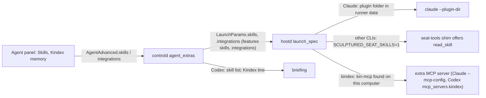

# Skills and integrations

An agent's skills are instructions it loads only when it needs them (the Agent Skills format: name, description, body). Integrations are tools installed on the agent's computer that it is also given, such as Kindex. Both are set per agent and travel in team and MADL files. The runner decides how each CLI gets them, and finds integration programs on its own computer.

Sources: `crates/model/src/skill.rs`, `crates/model/src/draft.rs` (`AgentAdvanced.skills`, `integrations`, `Integration`), `crates/rigspec/src/draft/check.rs`, `crates/controld/src/launch.rs` (`agent_extras`), `crates/controld/src/skills.rs`, `crates/controld/src/hosts/mod.rs` (`drop_features`), `crates/hostd/src/supervisor/extras.rs`, `crates/hostd/src/supervisor/lifecycle.rs` (`launch_spec`), `crates/hostd/src/seat_tools/mod.rs` (`read_skill`), `crates/drivers/src/claude/mod.rs`, `crates/drivers/src/codex/mod.rs`, `crates/controld/src/portable/madl/`, `web/src/structure/SkillFields.tsx`, `web/src/structure/skills.ts`.

## 1. Skills

- **Model.** `model::Skill { name, description, body }`. `Skill::problems` and `skills_problems` check the format (name: lowercase letters, digits and single hyphens, at most 64; description 1–1,024 characters; body required, at most 100 KB; no duplicates). Draft checks report them as `skill-invalid`; the web editor applies the same rules (`skills.ts`).
- **Claude Code.** `Supervisor::skills_plugin` writes `<runner data>/skills/<seat>/` with `.claude-plugin/plugin.json` (plugin `sculptured`) and `skills/<name>/SKILL.md`, replacing any earlier folder. The driver passes `--plugin-dir`. Claude keeps only names and descriptions in context until a skill applies, and names them `sculptured:<name>`. Nothing is written into the person's project.
- **Other CLIs.** The briefing lists each skill's name and description (`skills::briefing_lines`, Codex agents). The runner sets `SCULPTURED_SEAT_SKILLS=1` so the shim offers `read_skill { name }`, which controld answers from the draft (`skills::read_skill`).
- **Older runners.** Without the `skills` feature (or without a seat-tools socket, which supplies the data folder), `drop_features` clears them and records `FeaturesDropped`.

## 2. Components

- **Manifests, not code.** `model::Component` (`component.rs`): `id`, `name`, `description`, `kind` (`mcp` | `tool-hook`), a bare `program` name and `args`, `briefing`, `install`, `claude_only`, `requires`, `homepage`. `Component::problems` checks it (the web app's `structure/components.ts` applies the same rules); `digest()` is the SHA-256 of its JSON. Kindex and Signet-Eval are the built-in examples (`crates/model/src/components/*.json`, copied to `web/src/structure/components/` with a test keeping them equal).
- **Where they come from.** Built-in ones, and `TeamDraft.components` (pasted or loaded in the team's Advanced settings, or added from Community). `AgentAdvanced.integrations` lists the ids an agent is given; `TeamDraft::agent_components` adds what each `requires`, first. Draft checks: `component-invalid` (a bad manifest, or a built-in id reused) and `component-unknown` (an agent names one the team lacks).
- **Launch.** `launch::agent_extras` sends the manifests as `LaunchParams.components` (Claude-only ones only to Claude agents) and the built-in ones' ids as `integrations` for runners from before `components`; `drop_features` notes custom components an older runner cannot run.
- **On the runner** (`Supervisor::components`): each manifest is checked again; on a connected computer one that is not built in runs only when its digest is in `<runner data>/hostd/approved-components.json` (`sculptured approve-component <digest>`, read at each launch, so nothing restarts); the program is found on PATH, `~/.local/bin` or `~/.cargo/bin`; `{safety_rules}` in a tool hook's arguments becomes a file of the team's safety rules in Signet-Eval's format. `mcp` → `drivers::McpServer`; `tool-hook` → a quoted command in `LaunchSpec.tool_hooks`. Anything that cannot run is a `FeaturesDropped` note with the command, the digest or the install step.
- **Briefing.** `skills::briefing_lines` adds each component's `briefing`.
- **Community.** A block's content is a group or `{"kind":"component","component":…}` (`package::Content`, checked with `Component::problems`; built-in ids refused); listings carry `kind`; the built-in components are published as official examples. The app shows a component block with its command and install step (`release/ComponentBlockCard.tsx`) and adds it to a chosen team.
- **On the board** components are chips on agent cards (`ComponentChips`), not cards or arrows of their own.

## 3. Files

- Team files carry `skills` and `integrations` in `AgentAdvanced`.
- MADL embeds skills as `skills: [{ name, description, body }]` (MEP 0004). A skill named only by path or name is listed under Not imported. Integrations travel in the `com.usesculptured` extension.

## Architecture invariants

- Skills are written only in the runner's own data folder, never in the project.
- The runner, not the server, decides which program an integration runs.
- A missing integration or an older runner never fails a launch; it is told on the agent.
- Only the agent's own skills are offered to it.

## Properties and their tests

| Property | Test |
|---|---|
| A `SKILL.md` round-trips; bad names and duplicates are named | `model/src/skill.rs::a_skill_md_round_trips_and_bad_names_are_named` |
| Skills become a plugin folder; an unsafe name is skipped; a later launch replaces it | `hostd/src/supervisor/extras.rs::an_agents_skills_become_a_plugin_folder_and_an_unsafe_name_is_skipped` |
| Claude gets `--plugin-dir` and the integration's MCP config | `drivers/tests/claude_args.rs::skills_load_as_a_plugin_folder_and_integrations_as_an_mcp_server` |
| Codex gets the integration as an MCP server | `drivers/src/codex/mod.rs::an_integration_is_started_as_a_codex_mcp_server` |
| Each agent gets skills the way its CLI can use them; `read_skill` answers from the draft; Kindex is named only for its agent | `controld/tests/skills.rs::skills_and_kindex_reach_each_agent_the_way_its_cli_can_use_them` |
| Skills embed in MADL and integrations round-trip | `controld/tests/madl.rs::skills_travel_embedded_and_integrations_round_trip_through_madl` |
| Built-in manifests are valid; a changed one is not built in | `model/src/component.rs::the_builtins_are_valid_and_a_bad_manifest_is_named` |
| A connected computer runs only built-in or approved components | `hostd/src/supervisor/extras.rs::a_connected_computer_runs_only_built_in_or_approved_components` |
| Unknown or clashing components are named | `rigspec/tests/draft.rs::an_unknown_or_clashing_component_is_named` |
| A team's own component reaches the agent, and a missing program is told | `controld/tests/skills.rs::skills_and_kindex_reach_each_agent_the_way_its_cli_can_use_them` |
| Community checks and lists component blocks | `sculptured-community/src/package.rs::a_component_is_checked_and_listed_as_one` |
| Components are added, refused, given to an agent as a chip, and added from Community | `web/src/structure/ComponentsSection.test.tsx` |
| The editor checks names, loads a `SKILL.md`, and Kindex toggles | `web/src/structure/SkillFields.test.tsx` |

## Not built yet

- The design assistant does not propose skills yet.
- Codex native per-session skills: not used, because Codex 0.162 has no per-session skill folder Sculptured could confirm; Codex agents use `read_skill`.
- Role, expected output, reasoning effort and allowed/banned tools from the same design (part B) are not built.
