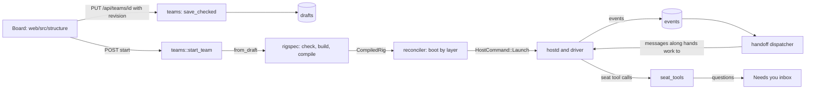
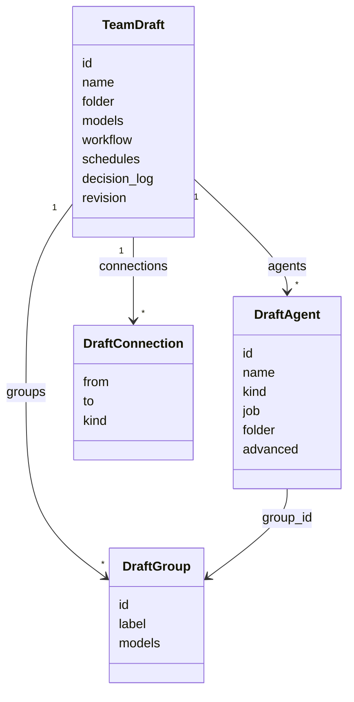
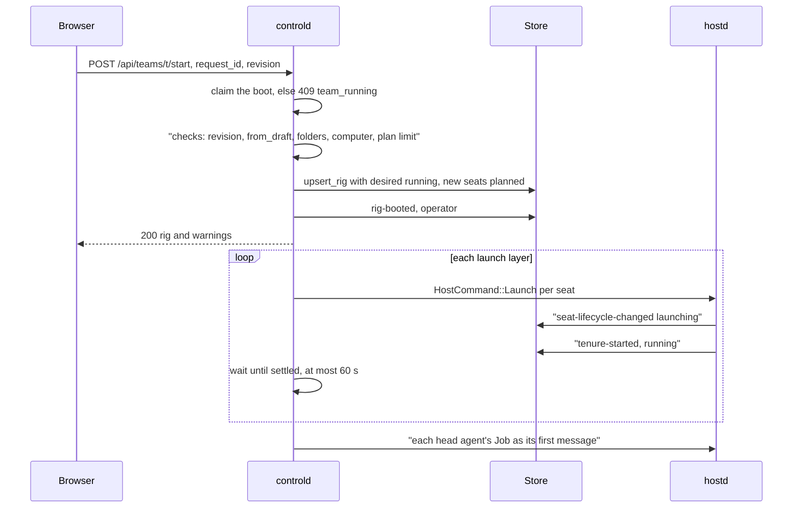
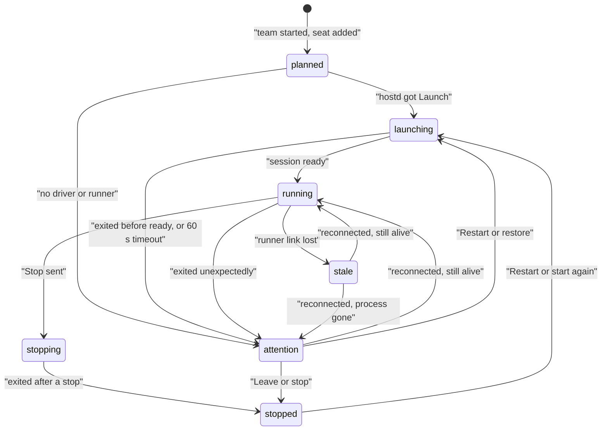

# Teams: design → compile → boot → handoffs → stop

A team starts as a design the user edits on the board (a `TeamDraft`). Pressing **Start team** checks the design, compiles it to a `RigSpec`, and launches one agent process per agent (a "seat"), layer by layer. While it runs, Sculptured passes finished work along "hands work to" connections, asks the user the agents' questions, and records everything as events ([Event journal](events-and-storage.md)).

Sources:
- `crates/model/src/{draft,status,question}.rs` (`TeamDraft`, `DraftIssue`, `SeatLifecycle`, `QuestionSource`)
- `crates/rigspec/src/draft/{mod,check,build,names}.rs`, `crates/rigspec/src/{compile,compiled}.rs`
- `crates/interpreter/src/lib.rs`, `crates/controld/src/interpret.rs`
- `crates/controld/src/teams/{mod,run}.rs`, `crates/controld/src/reconciler/{mod,seats,jobs}.rs`, `crates/controld/src/{launch,posture,settings,seat_ids,team_context,restore}.rs`
- `crates/controld/src/handoffs/`, `crates/controld/src/seat_tools/`, `crates/controld/src/questions/`
- `crates/hostd/src/{mapping.rs,supervisor/lifecycle.rs,seat_tools/mod.rs}`
- `web/src/useTeamDraft.ts`, `web/src/draft/`, `web/src/structure/`

## 1. Parts

## 2. The design (`TeamDraft`)

| Field | Meaning |
|---|---|
| `id` | Immutable. It becomes the rig name and the end of every seat id. |
| `agents[].kind` | `claude`, `codex` or `practice` (the stub driver: no model calls, no cost) |
| `agents[].job` | The agent's standing work. A head agent's Job is its first message at Start. |
| `folder`, `agents[].folder` | Working folder. An agent's own folder wins over the team's (`effective_folder`). |
| `models`, `groups[].models`, `advanced.model` | Model per provider. The agent's own model wins, then its group's, then the team's. None means the CLI's default. |
| `advanced` | `permission` (`unrestricted` or `restricted`), `resume`, `token_limit`, `check` (a command Sculptured runs, see [Workflows](workflows.md)) |
| `connections[].kind` | `hands-work-to`, `reports-to` or `watches` (§6) |
| `workflow` | Optional dynamic workflow ([Workflows](workflows.md)) |
| `schedules` | Messages sent to an agent every N minutes while the team runs (Advanced) |
| `decision_log` | People keep a log that agents read with `read_decisions` (Advanced) |
| `revision` | Save counter, assigned by the server, for conflict detection |

The `x`, `y`, `w` and `h` fields are board positions only.

## 3. Saving and validation

**Saving** (`web/src/useTeamDraft.ts`, `teams/mod.rs::put_team`):
- Every edit goes through the undo history (`web/src/draft/history.ts`). Saves run 500 ms after the last edit and are serialised.
- Each save is `PUT /api/teams/{id}` with `{request_id, revision, draft}`. The server saves only if the stored revision still equals `revision`, and then stores `revision + 1`.
- A stale revision is `409 draft_conflict`. The client stops autosaving and keeps the local draft on screen until the user picks Reload or Keep mine.
- While the team runs, a change to its structure is `409 team_running` (`teams/mod.rs::structure`). Structure means the workflow, the team folder, each agent's id, group, kind, folder and advanced settings, the connections, and which groups exist. Names, jobs, positions, labels, models, schedules and the decision-log switch may change.
- The revision check, the running check and the write happen under one store lock, so a start cannot slip between them.

**Validation** produces `DraftIssue {element, severity, code, message}`. `element` points at the team, a group, an agent or a connection, so the board can pin the issue there. An `error` blocks Start team; a `warning` does not.

| Source | Codes |
|---|---|
| `rigspec::check_draft` | `team-empty`, `team-name-missing`, `team-id-invalid`, `group-name-missing`, `group-id-invalid`, `agent-name-missing`, `agent-name-duplicate`, `agent-id-invalid`, `agent-group-missing`, `connection-self`, `connection-dangling`, `connection-duplicate`, `connection-loop` (hands-work-to only), `folder-missing`, `folder-not-absolute` |
| Workflow and schedule checks | from `draft/workflow.rs` |
| Compiler diagnostics | mapped back to the draft element (`map_diagnostic`), with a plain message such as "This agent has a configuration problem (details under Advanced)" |
| Folders on the computer | `teams::folder_issues` |

`POST /api/teams/{id}/validate` returns the issues for the stored or a given draft.

## 4. Compile to RigSpec

`rigspec::from_draft` runs the draft checks, builds a `RigSpec` (spec version `0.2`) and compiles its canonical YAML with the same compiler a spec file uses. If any error is found, it stops before compiling. `GET /api/teams/{id}/spec` shows the YAML.

| Draft | RigSpec |
|---|---|
| group | pod (agents without a group join the default group) |
| agent | seat `{group}.{agent}@{team}` (`seat_ids.rs`). Names become labels, so renaming keeps seat ids. |
| hands work to / reports to / watches | `delegates_to` / `escalates_to` / `can_observe` edges |
| restricted posture | permission policy `builtin:standard` |
| `advanced.resume` | `restore_policy` (`resume_if_possible`, `relaunch_fresh`, `checkpoint_only`). Shapes the team's Resume answer after a restart: `relaunch_fresh` starts that agent fresh; `checkpoint_only` (shown as "wait for me to choose": Sculptured keeps no checkpoints) leaves it waiting for its own decision. |

The compiler orders launches into `launch_layers`. Only `delegates_to` and `spawned_by` edges order them (`EdgeKind::orders_launch`): a giver starts before its receiver.

## 5. Start team

- **Checks, in order** (`teams/run.rs::start_team`):
  - the boot claim;
  - the team is not trashed or archived;
  - `revision` matches the stored draft (`409 draft_conflict`);
  - no blocking issue (`invalid_team` with the issues);
  - a computer is chosen and connected when needed (`409 needs_computer`);
  - no plan this team uses is held near its limit (`409 plan_limit`, unless `over_plan_limit`). See [Limits and usage](limits-and-usage.md).
- **Where seats run** (`launch::team_host`): the team's chosen computer, else the only connected computer when hosted, else this machine. A spawned child runs where its parent runs. See [Connected computers](devices.md) and [Host protocol](host-protocol.md).
- **Before each layer** the boot re-reads the desired state. A stop issued mid-boot prevents later layers from launching and stops the seats this boot launched.
- **Missing driver or runner.** If a seat's driver is missing, or its runner cannot run it, the seat goes to `attention` with a reason. If an older runner cannot honour a restricted posture, the launch is refused; it is never run unrestricted. See [Drivers](drivers.md) and Security (in the private sculptured-cloud repo).
- **Jobs.** `reconciler::deliver_jobs` sends each head agent's Job (an agent with a Job and nobody handing it work) once that agent runs. The sender is `system:team-start`. An agent that settles without running gets its Job recorded as a failed message that says why.
- **Context.** Every message to an agent is wrapped by `team_context::with_context`. It adds:
  - the team briefing (roles, folders, every agent's job, the rule that a reported result is not independently verified). An agent with `advanced.briefing: minimal` gets `team_context/minimal.rs` instead: its role line, its own job (left out when the message already carries it), its own data contract, its own skills and one line on how to finish (`complete_work` for a workflow worker, else reply). Its managed children get a minimal line too;
  - the budget note;
  - the own-copy branch note;
  - the decision-log note.

## 6. Handoffs

| Connection | Runtime effect |
|---|---|
| **hands work to** (`delegates_to`) | The giver launches first. Its finished work is delivered to the receiver as a message. |
| **reports to** (`escalates_to`) | None. Design intent, shown on the board and in the briefing as descriptive only. |
| **watches** (`can_observe`) | None. Design intent. |

The dispatcher (`handoffs/`) works like this:
- **Work turns.** An agent's work is the Job or handoff message it read. A turn that ends `completed` after reading it is a work turn, and its last reply is the result passed on. An interrupted or failed turn, or a dead process, leaves the work unfinished, and the agent is shown as stuck.
- **Result checks.** An agent with `result_checks` finishes its work only with a completed turn whose result passes them (`handoffs/result_checks.rs`). A failing turn is recorded (`ResultChecked`), leaves the work unfinished ("its result did not pass its checks"), and the failures go back to the agent up to 3 times. A later passing turn finishes the work. **Hand over again** still passes any turn on.
- **First handoff.** A downstream agent waits until every upstream agent has a result (`handoff-waiting` lists whom it waits for). Its first message then carries its Job and each upstream's latest result.
- **Waves.** After that, "More work" moves in waves from one origin agent. Each downstream agent gets one message per wave once its upstreams in that wave have finished.
- **Recording.** Each message is recorded as `message-queued` plus a `handed-over` record (start, sources, wave) in one transaction (`Store::record_handoff`). A turn is never handed to the same seat twice in one start. The dispatcher recomputes what is due from the store alone, so a controld restart, a lagged hub or a replayed event sends nothing twice.
- **Operator actions.** "Hand over again" (`POST /api/seats/{id}/handover`, records `handover-requested`) and "Resend" (`POST /api/seats/{id}/resend`) re-send recorded work. A stuck reason (`handoff_stuck`) says in plain words why nothing moves.

**Messages** (`reconciler::send_message_as`):
1. controld records `message-queued`. The provenance is `operator` for a person and `agent-reported` for an agent sender.
2. controld sends `HostCommand::Send`.
3. hostd records `message-delivered` once the driver accepts it.
4. The driver reports `message-consumed` when a turn reads it.

A send that fails is recorded as `message-failed` with the host's reason. Agents can also message each other with `send_agent_message` (§8). The communication view shows only captured messages; planned arrows do not count.

## 7. Seats and their status

`seats.lifecycle` holds a `SeatLifecycle` value, and `lifecycle_provenance` records who said so.

- Some transitions are observed: hostd reports launching, running, stopping, stopped and the exit reasons (`protocol-observed`).
- Some are inferred by controld and recorded as `heuristic`:
  - `stale` after a lost link;
  - a 60 s ready timeout;
  - a missing driver;
  - a process found gone after a reconnect.
- The operator's Leave is recorded as `operator`.
- `failed` exists in the enum and is handled when read, but nothing writes it today.

**Activity** is separate. It is `working`, `waiting-input`, `idle` or `unknown`, and is cleared to `unknown` whenever no process can be running.

**Provenance on the board.** The board keeps provenance separate (`web/src/herdr.ts::tierOf`):
- An agent's `report` is `agent-reported`. Its words are shown as reported, never as observed or verified.
- Tool calls and results are captured verbatim.
- The interpreter's reading of a call (`interpreter::classify`, `risks`) is a `heuristic` `action-interpreted` event. It never blocks a call.
- A `check-ran` event is the command's own exit status as Sculptured observed it, not the agent's word.

## 8. Seat tools

hostd offers these tools to every Claude, Codex and Practice agent as an MCP server (`hostd/src/seat_tools/mod.rs::tool_list`). It forwards each call as `FromHost::SeatTool`, and controld answers it (`controld/src/seat_tools/mod.rs::dispatch`). An invalid call is recorded as `report-rejected` evidence and answered with a tool error. It never interrupts the agent.

| Tool | What it does |
|---|---|
| `request_input` | Ask the person a question and wait (§9) |
| `record_decision` | After a question timed out, say what was decided and why (`question-decided`, agent-reported) |
| `report` | Findings about the work (`findings-reported`, agent-reported) |
| `approve` | Claude's permission-prompt tool. Only a restricted Claude agent gets it. |
| `spawn_agent` | Create a managed child agent that inherits model, folder and permissions. No limits unless the team sets them (`TeamDraft.limits`: most agents, most levels of children). |
| `send_agent_message` | Message another agent in the team. It is queued, not an interrupt. |
| `team_status` | Read the team's agents, parents, activity and lifecycle |
| `dispatch_work`, `complete_work`, `workflow_status` | Dynamic workflow tools ([Workflows](workflows.md)) |
| `read_decisions` | Read the team's decision log |

## 9. Questions to the user

- **Sources** (`QuestionSource`):
  - `request-input`: the tool;
  - `native-question`: the CLI's own prompt, for example Codex `requestUserInput`;
  - `native-permission`: only in a restricted posture.
- **States** (`QuestionState`): `open`, `answered`, `expired` and `withdrawn`. They are projected into `questions`, and the open count goes to `seats.open_questions`.
- **Answer or timeout.** The first of the answer and the timeout wins. The timeout defaults to 10 minutes and can be set per team.
  - After an expiry, the agent decides for itself. Its `record_decision` call or its next message is recorded as `question-decided`. If it says nothing, the source is `unknown`.
  - A late answer becomes an overriding instruction.
  - An unanswered permission prompt is allowed on timeout and recorded.
- **Delivery doubt.**
  - An answer is recorded before the agent hears it.
  - An answer that did not reach the agent reopens the question while the agent can still take it. Otherwise the question is withdrawn with the reason.
  - A sent answer with no confirmation stays `unconfirmed` until "Send again" or the program confirms it.
- **The Needs you inbox** (`GET /api/inbox`) lists open questions, plus agents that need attention or are stuck.

## 10. After a server restart

What survives is what is in the store: drafts, rigs with their desired state, seats, messages, questions and the journal. In memory, controld keeps only boot claims, the request locks, the handoff sends in flight and the waiting tool calls.
- When a runner reconnects, its Hello names the seats still alive. Those return to `running` or `launching`. Seats whose process is gone go to `attention` (heuristic), with a reason such as "This agent's process ended when Sculptured restarted. Start the team again to relaunch it."
- If the team is still set to run, each lost seat gets a restore offer (`restore-needed`). The user answers once per team or per agent: Resume (the agent's own session, when its session id is known and its driver can resume), Start fresh, or Leave stopped. Nothing relaunches without that answer, and a failed resume never falls back to fresh.
- After a resume or a fresh start, `handoffs::deliver_owed` sends the work the agent is still owed in the current start, once.
- Waiting `request_input` and `approve` calls live in memory (`AppState::seat_waits`). Their questions are withdrawn when controld starts again. Native questions of agents that are still running are kept.

Journal-level detail is in [Event journal §9](events-and-storage.md#9-after-a-restart).

## 11. Stop and restart

- **Stop team** (`POST /api/teams/{id}/stop`):
  - It takes the boot claim, so it is refused while a start runs (`409 team_starting`).
  - It records `rig-desired-changed {stopped}` (operator), then stops live seats in reverse launch order with a 5 s grace.
  - A seat that cannot be stopped does not block the others. It is returned in `failed` with the host's reason.
  - Unread messages fail ("the agent stopped before reading this message").
- **Restart one agent** (`POST /api/seats/{id}/restart`): only for an agent in `attention`, `stopped` or `failed` in a team still set to run. It relaunches that agent alone, then sends what it is owed.
- **Start again.** A new `rig-booted` begins a new start. Handoff records of earlier starts never count in the new one, and a Job of an older start still waiting is recorded as not sent.

## Architecture invariants

- A draft is saved only at the revision the client last saw.
- While a team runs, its structure (agents' settings, connections, groups, folders, workflow) changes only after Stop team.
- A start and a stop of the same team never interleave, because both hold the boot claim.
- Draft errors block Start team. Warnings never do.
- Seat ids come from immutable draft ids, so renaming never changes them.
- Only "hands work to" routes work. "Reports to" and "watches" are descriptive.
- A turn is handed to a seat at most once per start, and handoff state is recomputed from the store alone.
- A restricted agent is never launched unrestricted.
- Nothing relaunches after a restart without the user's restore answer.
- Agent reports stay labelled agent-reported. Interpretations stay heuristic.
- An invalid tool call is recorded as evidence and never interrupts the agent.

## Properties and their tests

| Property | Test |
|---|---|
| A stale revision is a conflict | `crates/controld/tests/teams.rs::put_saves_with_a_revision_and_a_stale_revision_is_409` |
| A structural save on a live team is refused | `tests/teams_run.rs::a_stale_structural_save_on_a_live_team_is_a_draft_conflict` |
| Start refuses invalid teams and stale revisions | `teams_run.rs::start_refuses_invalid_teams_stale_revisions_and_stop_needs_a_start` |
| Jobs go out as first messages at start, and again after a restart | `teams_run.rs::start_delivers_each_job_as_a_first_message_sent_at_start`, `restarting_a_stopped_team_delivers_jobs_again` |
| An agent that cannot start gets its Job marked not sent | `teams_run.rs::an_agent_that_cannot_start_gets_its_job_recorded_as_not_sent` |
| Draft ids become seat ids, and renaming keeps them | `crates/rigspec/tests/draft.rs::a_pair_compiles_with_ids_from_draft_ids_and_names_as_labels`, `renaming_keeps_seat_ids` |
| Loops and missing folders are pinned issues | `draft.rs::a_loop_flags_every_connection_on_it`, `a_missing_folder_is_pinned_to_the_agent_in_plain_words` |
| A chain runs in order, and fan-in waits for every upstream | `tests/handoffs.rs::a_chain_runs_in_order_and_only_work_turns_hand_over`, `fan_in_waits_for_every_upstream_and_a_jobless_heads_first_message_is_its_work` |
| Handoffs survive a controld restart without duplicates | `handoffs.rs::handoffs_survive_a_controld_restart_without_duplicates` |
| Earlier starts don't count | `handoffs.rs::records_of_a_previous_start_do_not_count_in_the_next` |
| `approve` goes only to a restricted Claude agent | `tests/seat_tools.rs::launch_params_offer_approve_only_to_a_restricted_claude_agent` |
| A report becomes findings, and an oversized one is refused | `seat_tools.rs::a_report_becomes_findings_on_the_running_turn`, `an_oversized_report_is_refused_and_the_link_keeps_working` |
| An answer and a timeout race with one winner, and a late answer overrides | `tests/questions.rs::answer_racing_the_timeout_has_one_winner`, `a_late_answer_is_an_overriding_instruction` |
| An expired question records the agent's own decision | `questions.rs::an_expired_question_records_the_agents_own_decision` |
| After a host restart, agents say why, and the team resumes their own sessions | `teams_run.rs::after_a_host_restart_agents_say_why_and_start_runs_the_team_again`, `after_a_host_restart_the_team_resumes_each_agents_own_session` |

## Not built yet

- `SeatLifecycle::Failed` is never written.
- The work ledger, session list and new-session routes are not served ([Event journal, Not built yet](events-and-storage.md#not-built-yet)).
- `GET /api/system/metrics` (`monitor.rs`) samples the machine, not the seats.
