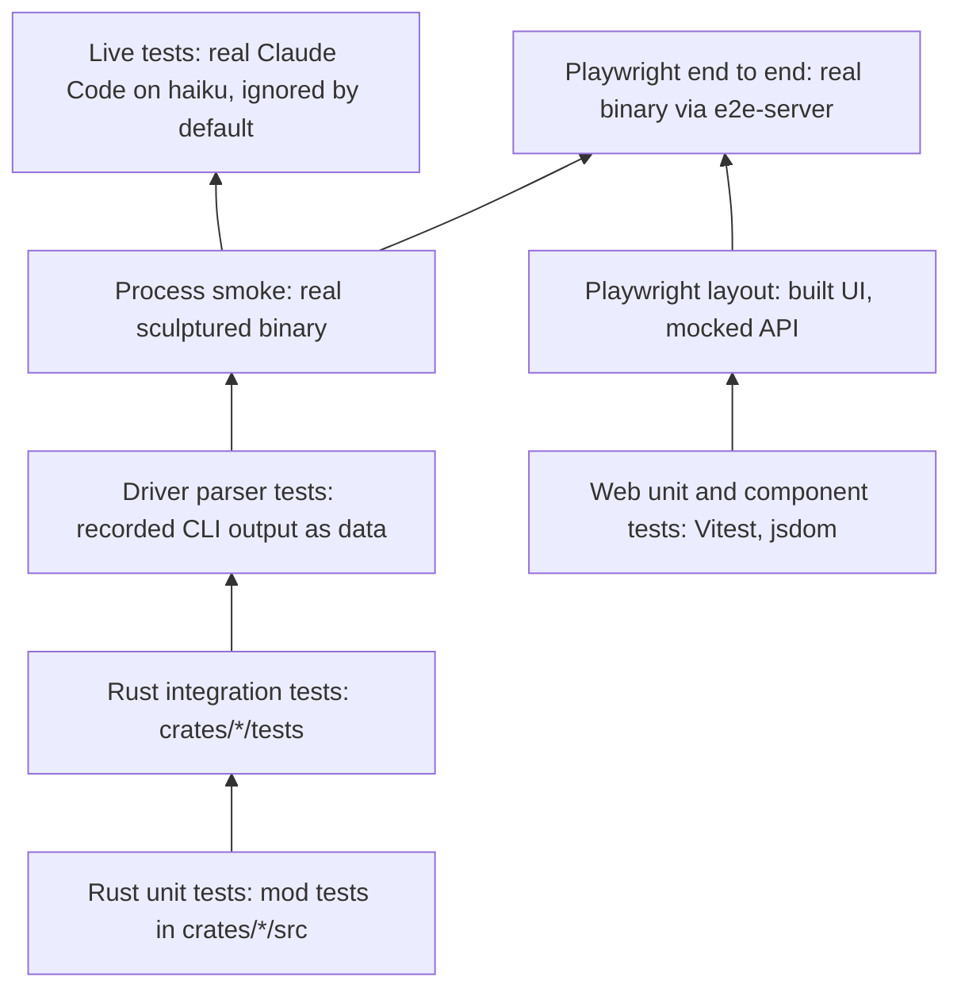

# Testing strategy and how to run each suite

Sculptured is tested from pure Rust unit tests up to Playwright flows against the real binary. Every agent runs a real model, in tests too: there is no scripted or fake agent. Logic that needs no agent is a plain test with no agent and no model. Behaviour that needs an agent is a **live test** on the real Claude Code CLI with haiku (or Codex), skipped unless asked for, because it costs credits. Driver parser tests replay recorded CLI output. This page says what each suite covers and the exact command to run it.

Sources:
- `Cargo.toml` (workspace members and `[profile.dev]`), `crates/*/tests/`, `#[cfg(test)] mod tests` in `crates/*/src`
- `crates/fixtures/src/bin/{codex-probe,mcp-ping-stub}.rs`, `crates/fixtures/recordings/`
- `crates/e2e-server/src/{lib,main}.rs`
- `crates/controld/tests/common/` (live helpers in `common/live.rs`), `crates/hostd/tests/common/mod.rs`
- `web/package.json`, `web/vite.config.ts`, `web/playwright{,.layout,.hosted}.config.ts`, `web/e2e/`, `web/src/test-*.ts`
- `desktop/package.json`, `docs-site/package.json`, `docs/HOSTED-DEV.md`, `.github/workflows/release.yml`, `AGENTS.md`

## 1. The test pyramid as it exists



| Layer | Where | Runs a real process? | Calls a model? |
|---|---|---|---|
| Rust unit | `mod tests` in `crates/*/src` | No | No |
| Rust integration | `crates/*/tests/*.rs` | In-process controld router and hostd supervisor; no agent | No |
| Driver parsers | `crates/drivers/tests/*_recordings.rs` and other recorded-data tests | No: recordings are read as data | No |
| Process smoke | `crates/sculptured/tests/process_smoke.rs` | The `sculptured` binary | No |
| Live | `live_…` tests in `crates/*/tests/*.rs`, `#[ignore]`d | Real `claude` (or `codex`) CLI | Yes: haiku, costs credits |
| Web component | `web/src/**/*.test.{ts,tsx}` | No (jsdom, mocked `api`) | No |
| Playwright layout | `web/e2e/layout.spec.ts` | `vite preview` only; every `/api/*` answered by route fixtures | No |
| Playwright e2e | `web/e2e/*.spec.ts` | Real binary from `crates/e2e-server` | No, except specs that start agents: those run only with `RIG_E2E_LIVE=1` and use real Claude Code |
| Desktop | `desktop/test/*.test.mjs` | Node test runner | No |

There is no CI test job. The only workflow, `.github/workflows/release.yml`, builds release binaries and runs only when started by hand. Every suite on this page is run locally.

## 2. Recorded CLI output for driver tests

The drivers' parsers are tested by feeding them scrubbed recordings of the real CLIs, line by line, as data: `crates/fixtures/recordings/claude-*.jsonl` (Claude Code 2.1.289), `codex-*.jsonl` / `codex-m2-*.jsonl` and `opencode-*.jsonl`, read by `crates/drivers/tests/*_recordings.rs`, `claude_recorded_lines.rs`, `claude_limits.rs` and `claude_usage.rs`. No process stands in for a CLI: there is no fake `claude` or `codex` binary or script. What a driver does with a real CLI process (spawn, turns, interrupts, resume, permissions, stop, crashes) is tested live in `crates/drivers/tests/claude_live.rs` and `codex_live.rs`.

- `codex-probe` and `mcp-ping-stub` drive the **real** `codex app-server` to make new recordings. They spend real model calls on the user's login, so they are run by hand, with approval, and never by a routine test.
- In e2e, `crates/e2e-server` gives `serve` the real `claude` and `codex` (`$RIG_E2E_CLAUDE` / `$RIG_E2E_CODEX`, else on `PATH`) with the user's `CLAUDE_CONFIG_DIR` and `CODEX_HOME`. Specs that only design teams, read pages or check API contracts start no agent. Specs that start agents are skipped unless `RIG_E2E_LIVE=1` is set; then they run real agents and cost credits.

## 3. Live tests

Behaviour that only a running agent shows (turns, tool calls, questions, permissions, handoffs, stops, limits Sculptured enforces) is tested on the real Claude Code CLI with its cheapest model, haiku, or on Codex where the test is about Codex. The variance of a real model is part of what is tested.

- Each live test is named `live_…` and marked `#[ignore = "live: …"]`, so a normal `cargo test` skips it.
- Run them with `cargo test -p <crate> --test <file> -- --ignored live_`. They need `claude` (or `codex`) installed and signed in, and they spend credits on that login.
- controld's helpers are in `crates/controld/tests/common/live.rs`: `require()` (skips with a printed reason when `claude` is missing), `require_codex()`, `connect(s)` (a runner with the real CLIs), `work_folder(s)`, `make_live`, `team(s, template)`, and waits of 240 s (`wait_for`, `wait_event`, `wait_turns`). `CLAUDE_MODEL` is `haiku`.
- Prompts are tiny and explicit ("Reply with the single word OK and nothing else.") and agents work only inside the test's temporary folder.
- A live test asserts on what Sculptured records and enforces (sessions launched, turns, tool calls captured, questions, permissions, statuses, handoffs, limits), never on the model's exact words, counts it chooses, or paths.

## 4. Running each suite

**Disk first.** The root disk on the development machine is nearly full. `[profile.dev] debug = "line-tables-only"` in `Cargo.toml` exists because full debug info made test builds about 15 GB. Build with `CARGO_INCREMENTAL=0`, and remove `target/debug` afterwards.

| Suite | Command (from the repository root) |
|---|---|
| All Rust in the workspace | `CARGO_INCREMENTAL=0 cargo test --workspace`, then `rm -rf target/debug` |
| One crate | `CARGO_INCREMENTAL=0 cargo test -p controld` |
| One integration file | `CARGO_INCREMENTAL=0 cargo test -p controld --test hosted_ops` |
| One test by name | `CARGO_INCREMENTAL=0 cargo test -p hostd --test policy ops_stay_inside_allowed_folders` |
| Live tests in one file (costs credits) | `CARGO_INCREMENTAL=0 cargo test -p controld --test <file> -- --ignored live_` |
| Regenerate TypeScript types | `npm --prefix web run gen` (runs `cargo test --workspace export_bindings`) |
| Web unit and component | `npm --prefix web test` |
| One web file | `npm --prefix web test -- src/structure/StructureBoard.test.tsx` |
| Web types and build | `npm --prefix web run build` (`tsc --noEmit` then `vite build`) |
| Web lint | `npm --prefix web run lint` (ESLint, zero warnings; functions at most 30 lines, files at most 300) |
| Playwright e2e | `npm --prefix web run e2e` (desktop and Pixel 7 projects; specs that start agents are skipped) |
| Playwright e2e with live agents (costs credits) | `RIG_E2E_LIVE=1 npm --prefix web run e2e` |
| One e2e spec | `cd web && npx playwright test e2e/team.spec.ts` |
| Playwright layout | `npm --prefix web run e2e:layout` (needs a built `web/dist`) |
| Desktop | `npm --prefix desktop test` |
| Docs site | `npm --prefix docs-site run validate`, `npm --prefix docs-site run links` |

Notes:
- `playwright.config.ts` sets `testDir: './e2e'` with no `testMatch`, so the default run also collects `layout.spec.ts`. Name the real-binary specs when you want only those.
- e2e builds the UI and the binary unless `SCULPTURED_BIN` points at a prebuilt one. `RIG_E2E_PORT` moves it off port 14410.
- clippy settings live in `clippy.toml` (`too-many-lines-threshold = 30`) and `[workspace.lints.clippy]`.

## 5. Test helpers

| Helper | What it gives a test |
|---|---|
| `crates/controld/tests/common/m2.rs` | `serve()`, `serve_hosted()`, `signed(...)`, `connect(...)`, `chain(...)` (a team of Claude agents on haiku that is never started), `start_team`, `say`, `wait_event`, `events` |
| `crates/controld/tests/common/live.rs` | Live-test helpers: `require()`, `require_codex()`, `drivers()`, `connect(s)`, `work_folder`, `make_live`, `team`, 240 s waits |
| `crates/controld/tests/common/mod.rs` | `wait_for` (10 s deadline), `lifecycle`, `work_message` |
| `crates/controld/tests/common/{knobbed,seat_tools}.rs` | Servers with chosen limits; seat-tool calls end to end |
| `controld` feature `test-seams` | Test-only hooks (`seams` module), enabled only by controld's own dev-dependency on itself, so release builds carry none |
| `crates/hostd/tests/common/mod.rs` | A fake controld socket (`accept`, `recv`, `send`, `linked`), `Capture` of launch specs, seat-tool socket calls |
| `crates/e2e-server` `Session` | Throwaway data dir and `HOME` holding only `projects/alpha` and `projects/beta`; stops serve, then hostd by recorded pid, and removes the directory |
| `web/src/test-setup.ts` | jest-dom matchers; `cleanup()` after each test |
| `web/src/test-fixtures.ts` | `FakeEventSource`, `openFake`, builders such as `teamDraft`, `draftAgent`, `seatView`, `ev` |
| `web/src/structure/harness.tsx` | `mockApi` for `vi.mock('../api', mockApi)`, `fakeTeam`, `renderAt`, `sizeViewport`, `card` |
| `web/src/test-vocab.ts` | `openRigWords(root)`: OpenRig words visible outside `data-advanced` or raw evidence |
| `web/e2e/fixtures/{layout-api,progress-api}.ts` | Route fixtures for the layout spec |

## 6. Visual checks

`AGENTS.md` asks that visual changes be checked with real captures of the running app, and that any check not run be reported. What the repository contains:

- `codex.spec.ts` and `handoff.spec.ts` save screenshots of the real app into `web/test-results/screens/`.
- `layout.spec.ts` checks at widths 1440, 900 and 390 and text sizes 12 and 16 px that long text never overflows a panel. `LAYOUT_SHOTS=<dir>` saves a screenshot of each view; `LAYOUT_DIST=<dir>` serves another build for before-and-after shots. It uses a mocked API, so it proves layout only.
- Playwright keeps a trace on failure (`trace: 'retain-on-failure'`).

Other capture tools (for example Puppeteer scripts) are not in the repository. User guides and videos must be recordings of the real application, never mocked screens.

## 7. Known flaky test

`web/src/structure/StructureBoard.test.tsx` › *keeps the board mounted while editing workflow input, review routes and dispatch settings* fails under full-suite load and passes alone. Rerun it by itself before treating a failure as real:

```
npm --prefix web test -- src/structure/StructureBoard.test.tsx -t "keeps the board mounted"
```

## 8. Architecture invariants

- Every agent runs a real model. There is no scripted or fake agent, in the product or in tests.
- No routine test makes a real model call or a third-party request. Tests that need an agent are `#[ignore]`d `live_…` tests on haiku; Playwright specs that start agents need `RIG_E2E_LIVE=1`.
- Browser end-to-end tests run against the real binary with a throwaway data dir and `HOME`.
- Recording tools that call real models (`codex-probe`) are manual only.
- The `test-seams` hooks never reach a normal or release build.
- The layout spec never starts a server; the real-binary specs never mock the API.

## 9. Properties and their tests

| Property | Test |
|---|---|
| The Claude driver handles turns, tools, interrupts, crashes and unknown lines | `crates/drivers/tests/claude_live.rs` (`live_a_turn_answers_reports_usage_and_stop_exits_cleanly`, `live_interrupt_ends_the_turn_and_a_queued_message_runs_next`, `live_a_killed_cli_ends_the_session_with_exited`); `claude_recorded_lines.rs::an_unknown_line_is_kept_and_the_turn_goes_on` |
| The Codex driver handles queued turns, interrupts, resume, permissions and crashes | `crates/drivers/tests/codex_live.rs` (`live_a_message_sent_during_a_turn_waits_for_the_interrupted_turn`, `live_resume_keeps_the_thread_and_fork_gets_a_new_one`, `live_a_killed_app_server_ends_the_session_with_exited`) |
| Stop ends a CLI and the command it is running | `claude_live.rs` `live_stop_during_a_command_ends_the_cli_and_the_command` |
| Agent processes do not inherit the runner's token | `crates/sculptured/tests/process_smoke.rs` `live_agent_processes_do_not_inherit_the_host_token` |
| Duplicate events are ignored; a gap records `EventsLost` first | `crates/controld/tests/store.rs` `duplicate_ingest_is_ignored`, `gap_records_events_lost_first` |
| Runner journal replays after reconnect | `crates/hostd/tests/link.rs` `link_runs_commands_and_replays_after_reconnect` |
| controld refuses a foreign Host or Origin | `crates/controld/tests/api.rs` `foreign_host_or_origin_is_403` |
| Hosted mode accepts only fresh gateway-signed requests | `crates/controld/tests/hosted.rs` `hosted_mode_accepts_only_fresh_gateway_signed_requests` |
| A signature verifies only for the same request, user and time window | `crates/signing/src/lib.rs` `a_signature_verifies_only_for_the_same_request_user_and_time_window` |
| Hosted mode never runs check commands on the server | `hosted.rs` `hosted_mode_never_runs_check_commands_on_the_server` |
| Runner ops stay inside allowed folders | `crates/hostd/tests/policy.rs` `ops_stay_inside_allowed_folders_and_respect_capabilities` ([more](local-ops.md#8-properties-and-their-tests)) |
| Tool calls are read heuristically and flag risks in plain words | `crates/interpreter/tests/interpret.rs` `risky_commands_are_flagged_in_plain_words` |
| A spec file that is really a secret is not echoed | `crates/rigspec/tests/compile.rs` `env_file_is_not_a_spec_and_is_not_echoed` |
| e2e cleanup stops serve, then hostd, and removes the directory | `crates/e2e-server/tests/cleanup.rs` `shutdown_stops_serve_then_hostd_and_removes_the_directory` |
| e2e never stops a process that is not its own | `cleanup.rs` `a_recorded_pid_that_is_not_this_sessions_sculptured_is_left_alone` |
| An exported run imports and exports identically | `crates/controld/tests/portable_session.rs` `an_exported_run_imports_as_a_past_run_and_exports_identically` |
| UI names follow the vocabulary; OpenRig words stay under Advanced | `web/src/vocab.test.ts`; component tests that call `openRigWords` |
| Seven running teams share one live connection | `web/e2e/many-teams.spec.ts` |
| Long text never overflows a panel at phone width | `web/e2e/layout.spec.ts` |
