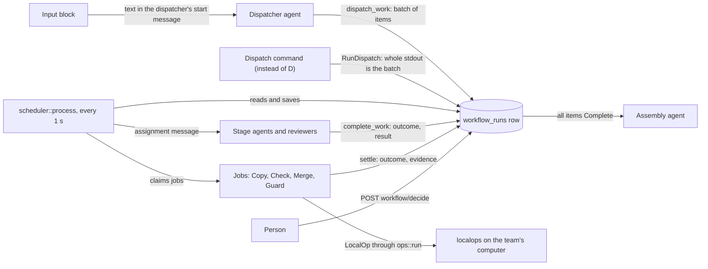
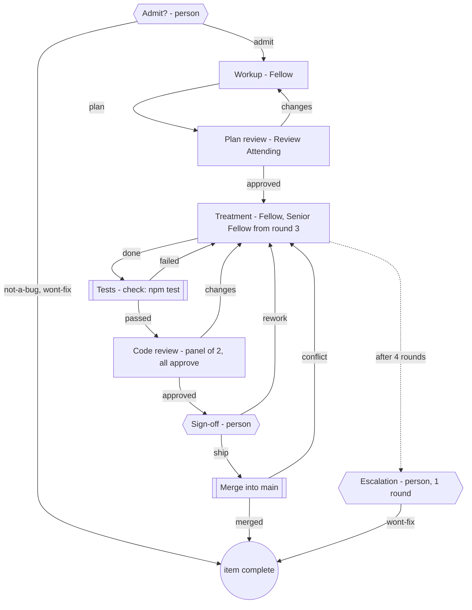
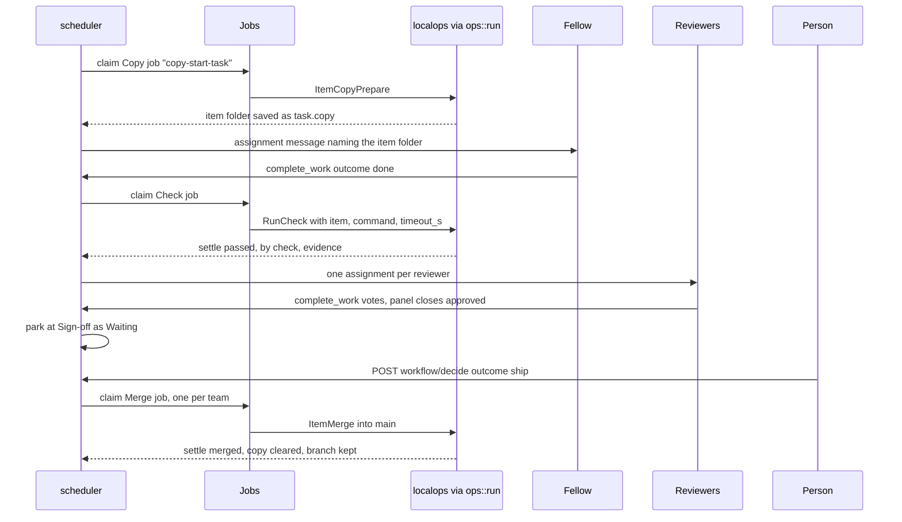

# Workflows: stages, items, own copies, checks, merges and long-running teams

A workflow (`model::Workflow`, run by `controld::workflow`) moves a batch of work items through stages. A dispatcher agent creates the batch, or Sculptured runs the workflow's dispatch command and its output is the batch. Agents, checks, people and merges each settle one stage, and an assembly agent finishes once every item is done. Everything here is durable: the run is one JSON row saved with each change, so a restart picks up where it stopped.

Sources:
- `crates/model/src/workflow.rs` (`Workflow`, `WorkflowStage`, `StageKind`, `TaskStatus`, `StepBy`, `Guard`, `Escalation`), `crates/model/src/dispatch.rs` (`WorkflowDispatch`, `DispatchRecord`), `crates/model/src/draft.rs` (`Schedule`, `decision_log`)
- `crates/rigspec/src/draft/workflow.rs` (validation)
- `crates/controld/src/workflow/{mod,engine,scheduler,routes,assignment,jobs,dispatch,stage_checks,stage_merge,stage_copies,guard,tools,topics,tests,dispatch_tests}.rs`
- `crates/controld/src/{schedules,decisions,checks,copies,launch,team_context}.rs`, `crates/controld/src/store/{workflow,schedules,decisions,schema}.rs`
- `crates/localops/src/{lib,copies,command}.rs` (`ItemCopyPrepare`, `ItemMerge`, `RunCheck`, `RunDispatch`, `merge_item`, `merge_branch`)
- `crates/hostd/src/seat_tools/workflow.rs` (tool schemas), `crates/hostd/src/policy.rs`
- `web/src/workflow/{DispatchCommand.tsx,stageKinds.ts,StageAdvanced.tsx,StageEditor.tsx,WorkflowBoard.tsx,WorkflowGraph.tsx,itemBoard.ts,ItemBoard.tsx,DecisionCard.tsx,DecisionLog.tsx,SchedulesEditor.tsx,WorkflowRunView.tsx}`
- Example: `docs/showcase/coding-hospital.team.json`. (where the spec and code differ, this page follows the code).

Related pages: [overview](overview.md), [team lifecycle](team-lifecycle.md), [events and storage](events-and-storage.md), [limits and usage](limits-and-usage.md), security (in the private sculptured-cloud repo), [testing](testing.md), [local operations](local-ops.md).

## 1. The parts

**A workflow replaces ordinary connections.** A team with `workflow` set may not have any `connections`: validation answers "Dynamic workflows use stage routes instead of ordinary connections. Remove ordinary connections first." Items move only along stage routes, never on turn-end handoffs. (`examples/teams/gstack-roles.sculptured-team.json` is an ordinary-connections team with no workflow.)

**Roles** (`Workflow`):
- `dispatcher`: the only agent that may call `dispatch_work`. When the team starts, only the dispatcher gets a start message (`teams/run.rs`), and that message includes the **Input block** (`Workflow.input`, at most 64 KB of links, notes and goals). The board draws Input as its own box feeding the dispatcher.
- `dispatch` (optional, instead of `dispatcher`): `{command, timeout_s?}`, a command Sculptured runs to make the batch (§1.1). With it, `dispatcher` is empty and no agent gets a start message.
- `entry`: the first stage of every item. `collector`: the assembly agent.
- `max_tasks` (1–64 items per batch) and `max_steps` (1–32 steps per item, a backstop on every loop).

**Seat tools** (schemas in `hostd/src/seat_tools/workflow.rs`, handled by `workflow::tools::call`):

| Tool | Who | What it does |
|---|---|---|
| `dispatch_work {batch_id, summary, tasks}` | the dispatcher only | Creates one batch per team start. Each task has `id`, `title`, `context`, optional `mode` (`independent`/`dependent`) and `depends_on`. Prerequisites must exist, be unique and form no cycle (`topics::validate`). Repeating the identical batch is a no-op. A different batch is refused until the team is stopped and started. |
| `complete_work {assignment, outcome, result}` | the assigned agent or reviewer | Reports one of the stage's route keys, or `blocked`. The result is 1–12000 bytes. Repeating the identical report is a no-op, and a different second report is refused. |
| `workflow_status {}` | any agent | Returns the batch as JSON. |
| `read_decisions {query?}` | any agent | Reads the decision log (§7). |

### 1.1 The dispatch command

A planner agent that only splits work and hands it out is deterministic work; `Workflow.dispatch` makes it a command. Validation (`rigspec/src/draft/workflow.rs::dispatch_errors`) requires a dispatcher agent **or** a dispatch command, never both: the command is 1–2000 bytes, `timeout_s` is 1–3600 (default 600), the team needs a project folder, and the assembly agent must exist. Dispatcher-based workflows validate exactly as before.

- **When it runs.** `scheduler::process` finds a running team with no batch for this start; `dispatch::due` claims one `Kind::Dispatch` job unless a result for this start is already recorded. It runs once per start; a job lost to a restart runs again, and stopping the team aborts it with nothing recorded.
- **Where.** On the team's computer, in the project folder, through `ops::run` with `LocalOp::RunDispatch {cwd, command, timeout_s}` (`localops/src/command.rs`). Unlike `RunCheck`, which keeps only the end of the output, it answers `CommandOutput {exit_code, timed_out, stdout, stderr, too_large}` with **the whole stdout** (up to 4 MB; more is reported as too large, never cut) and the last 4 KB of stderr. A connected computer's policy treats it like a check (`--enable checks`, allowed folders).
- **Older connected computers.** `RunDispatch` is a new op, so a runner from before it refuses it as `unknown_op` instead of answering with a check's 8 KB tail. `dispatch::unrunnable` turns that into "This computer's Sculptured is too old to run a dispatch command. Update Sculptured on that computer and run `sculptured connect` again."
- **What it prints.** JSON in `dispatch_work`'s shape: `{"batch_id"?, "summary", "tasks": [{id, title, context, mode?, depends_on?}]}` (unknown keys are refused). `batch_id` defaults to `batch-<start_seq>`. The batch goes through `tools::batch`, the same checks and constructor `dispatch_work` uses (summary 1–12000 bytes, 1–`max_tasks` tasks, `engine::new_run`, `topics::validate`).
- **The record.** `DispatchRecord {command, at_ms, dispatched, evidence, problem?}` is saved per start in `workflow_dispatches`, in the same transaction as the batch when there is one. `evidence` is the command, exit status, time, output size and stderr tail. That Sculptured ran the command is observed; the items are the command's output, not an agent's report. `GET …/workflow` returns it as `dispatch`, with `dispatching` while the job runs and `start_seq`.
- **Failure.** A non-zero exit, a time-out, too much output, output that is not the JSON above, or a batch the checks refuse dispatches **nothing**: the record has `dispatched: false` and a `problem` that names the exit code or the parse or validation error, and the Workflow view shows "Blocked: the dispatch command made no work". It does not run again by itself. `POST …/workflow/dispatch/retry {start_seq}` (the "Run the dispatch command again" button) clears a failed record so the scheduler runs it again; starting the team again does too.
- `dispatch_work` from any agent is refused while a dispatch command is set. The workflow briefing says Sculptured makes the batch.
- The board draws a "Dispatch command" box where the dispatcher agent would be, with the Dispatch route from it; the Input box is not drawn, since no agent reads it. The command and its time limit are under Workflow settings › Advanced.

An **item** (`WorkflowTask`) keeps its input, current `stage`, `status`, current `assignment`, `history` of steps, `problem`, `waiting`, `copy`, `reviews` and `escalated`. The **assembly** is one extra item with the reserved id `assembly`. It is assigned to the collector only once every item is `Complete`, and its only outcomes are `done` and `blocked`. A dependent item is not scheduled until every item it `depends_on` is `Complete` (`topics::waiting`).

## 2. Stage kinds

| Kind (`StageKind`) | Who settles it | Outcomes (route keys) | Step `by` |
|---|---|---|---|
| `agent` | `agent`, or any idle one of `workers` (1–8 in all) | any 1–8 names the design gives | `agent` (agent-reported) |
| review panel: `agent` with `reviewers` | 2–6 reviewers, all on the same item | the stage's routes. With `join: all` (the default), the worst vote once all have voted, ranked by `priority`, else `blocked`, then the first vote that is not `approved`. With `join: any`, the first `approved` | `agent`, agent `panel`, with `votes` |
| `check` | Sculptured runs `command` (timeout `timeout_s`, default 600, at most 3600) | exactly `passed`, `failed` | `check` (verified) |
| `human` | a person, through `POST …/workflow/decide` | 2–6 names | `person` |
| `merge` | Sculptured merges the item's branch (needs `copies: per-item`) | exactly `merged`, `conflict` | `sculptured` |

- A route value of `null` completes the item. `blocked` is reserved and always allowed.
- Validation (`rigspec/src/draft/workflow.rs`) requires each kind's own fields and rejects other kinds' fields. It allows 1–16 stages and checks that every route and `on_limit` names an existing stage. It also requires that every stage can still reach completion.
- A reviewer who votes after the panel has decided is recorded on that step as `"<agent> (late)"` and changes nothing.
- The web editor never routes a way back to completion. When `asKind` (`stageKinds.ts`) turns a stage into a check, person, merge or panel stage, its `failed`, `rework`, `conflict` or `changes` route goes to the previous stage in route order, or to the stage itself, and never to `null` ("Never null, which would accept the item"). The server does not enforce this; it is an editor default.

### Worked example: the coding hospital

`docs/showcase/coding-hospital.team.json`: dispatcher Triage Nurse, assembly Discharge Nurse, `copies: per-item`, guard `npm test` every 15 minutes, decision log on, and one schedule (§7).

Escalation's `retry` route points back at Treatment. Every item is admitted at a human stage, because `entry` is `admit`. Once every item is complete, the Discharge Nurse gets the assembly.

## 3. An item's status

```mermaid
stateDiagram-v2
  [*] --> Queued: dispatch_work
  Queued --> Assigned: "agent idle, panel opened, or check or merge job claimed"
  Queued --> Waiting: "human stage, prerequisites done"
  Queued --> Blocked: "its own copy could not be made"
  Assigned --> Queued: "outcome routes to a stage, or job lost to a restart"
  Waiting --> Queued: "person picks an outcome that routes to a stage"
  Assigned --> Complete: "route is null"
  Waiting --> Complete: "route is null"
  Assigned --> Blocked: "blocked, a limit, a silent turn, or the team stopped"
  Waiting --> Blocked: "round limit with no way on"
  Blocked --> Queued: "POST workflow/retry"
  Complete --> [*]
```

Every outcome goes through `engine::advance`:
1. **Route.** The outcome selects `routes[outcome]`. `blocked` ends at Blocked, with the result as `problem`.
2. **Round limit.** A stage with `max_rounds` is spent when the item's steps at it, counting this one, reach the limit. Routing into a spent stage takes its `on_limit` stage instead, and the limit note is added to the step's `evidence`.
3. **Spent with no way on.** If there is no `on_limit`, or the `on_limit` stage is itself spent, the item is Blocked at the refused stage with "Round limit (N) reached for … Retry to allow one more round." When both are spent, the item still parks at the stage it was sent to, not the `on_limit` stage. A retry re-queues it there for one more round. In the hospital, *retry* at Escalation therefore parks the item at Treatment, and its **Retry** grants Treatment another round.
4. **Step limit.** Entering a stage once `history.len() >= max_steps` blocks the item with "Step limit reached; needs operator review." A retry is refused at that point.
5. A `null` route marks the item Complete.

**Escalation** (`escalate: {after_rounds, agent}`) applies only to single-agent stages. `after_rounds` must be 1–20 and below `max_rounds`, and `agent` must be another existing agent. Once an item has `after_rounds` steps at the stage, the only candidate is the escalation agent, and the item waits for it (`available_worker`). The assignment message says "Escalated…", and the step's evidence records it.

**Silent agents** (`scheduler::reconcile`): an assigned item whose delivery `Failed`, or whose agent's turn ended without `complete_work`, is Blocked. The same applies to a panel reviewer who never voted. Consuming the message alone does not block it.

**Retry** (`routes::retry_task`) needs the item to be Blocked and the run to be the current one (`start_seq`). An agent stage's agent must be running and idle, and its last delivery must be settled (Consumed or Failed). A retried panel keeps the votes already given and asks only the reviewers who never voted.

## 4. The scheduler and background jobs

`workflow::run` ticks every second. For every team it calls `scheduler::process` and then `schedules::tick` (§7).

`process` runs under the store lock:
1. `Jobs::stop_stale` aborts this team's jobs that belong to no running batch. A stopped check or merge blocks its item with "This was stopped with the team before it finished."
2. `reconcile` handles silent agents (§3). Queued items at human stages are parked as Waiting.
3. If the guard is failing, nothing new is started (§7).
4. `start_jobs` claims Copy jobs (at most `COPIES_AT_ONCE` = 2 per team), Check jobs, and at most one Merge per team. A job is claimed in `Jobs` before it is spawned, so the next tick does not start it twice. An item that is Assigned to a job this process does not hold (lost to a restart) is re-queued and runs again.
5. `open_panels`, then assignments: each idle agent gets at most one item. An agent is idle when it is running, not in a turn, has no pending message and is not under manual control. The assignment message is saved in the same transaction as the run (`save_workflow`).
6. After unlocking, the jobs are spawned and the messages are sent once each. An unconfirmed delivery is logged and never resent automatically.

A job records its result with `jobs::record` → `engine::settle`, under the store lock. If `Jobs::finish` says the job was stopped meanwhile, nothing is recorded, so a result and a stop never both land.

One item through the hospital's later stages:

Every assignment message (`assignment::text`) lists the last six steps, newest first, each labelled by who settled it: "agent-reported", "verified: Sculptured ran the check", "a person's decision" or "Sculptured". An agent's report is therefore never presented as verification. Up to 1500 bytes of each step's evidence are repeated.

## 5. Per-item copies and merges

With `copies: per-item`, each item gets its own git worktree and branch. The rules for copies on a connected computer are in [local operations §6](local-ops.md#6-agents-own-copies-on-the-computer).

- **Name:** the item key is `<start_seq>-<task>` (`scheduler::item_key`), unique per batch because a later batch may reuse task ids. `localops::copies::item_seat` makes it `item-<key>`, so the folder is `<copies root>/<team>/item-<key>` (`item_dir`) and the branch is `sculptured/<team>/item-<key>`. The copies root is the `copies_folder` setting, else `~/.sculptured/copies`.
- **When:** in the background, before the item's first agent or check stage, two at a time per team. Panels also wait for the copy. A copy that cannot be made blocks the item with the reason (`engine::block`).
- **Access:** with per-item copies, agents launch without their own per-agent copies. Locally they get the team's items folder as an extra directory (`add_dirs`). Hosted, `item_copies` names the team, and the computer resolves the folder itself (`launch.rs`).
- **Lock:** `repo_writes` lets only one git write per repository run at a time, because git refuses concurrent writers. Reusing an existing copy takes no lock, and different repositories never wait for each other.
- **Merge** (`merge_item`): first, if `into` is set it must be the project's current branch, else `wrong_branch`. Next, the copy's uncommitted work is committed (signed "Sculptured" if git has no user). Then `merge_branch` runs `git merge --no-ff`:
  - **The user's own merge is never undone.** If the project is mid-merge, rebase, cherry-pick or revert, the answer is `project_busy` and nothing is merged.
  - **Conflict:** only a merge Sculptured started and that stopped on unmerged files is aborted. It routes `conflict`, and the item keeps its copy.
  - **Any other git refusal** is `merge_failed` ("nothing was changed"), which blocks the item. It is not called a conflict.
  - **Nothing to merge** routes `merged` with "Nothing to merge: … is already in this branch."
  - **Success:** the evidence is `git diff --stat`. The copy is removed, the branch is kept, and `task.copy` is cleared, so later stages, including checks, work in the project folder.
  - **A copy already gone** whose branch is an ancestor of HEAD answers "already merged". This covers a merge whose result was lost in a restart.

## 6. Checks

A check stage sends `LocalOp::RunCheck {cwd, item, command, timeout_s}` through `ops::run`, so it runs on the team's computer, locally or connected. The op's timeout is `timeout_s + 30` seconds. When the item has a copy, `item` names it and the computer resolves the folder. Otherwise the check runs in the project folder. A missing folder answers `no_folder`.

- A check that ran routes `passed` or `failed` with `by: check`. Its evidence is `$ command`, the exit code, the duration, "timed out" when it was stopped, and the last 4 KB of output.
- A check that **could not run** (refused, offline, unreadable result) blocks the item with `by: sculptured`. It is never recorded as a verified failure.
- On a connected computer, `RunCheck` needs the `checks` capability, and copies and merges need `copies` (`hostd/src/policy.rs`, and see security (in the private sculptured-cloud repo)).

These stage checks are separate from an agent's own after-turn check (`controld/src/checks.rs`, [local operations §5](local-ops.md#5-checks-run-as-events)).

## 7. Long-running teams

**Guard** (`Workflow.guard: {command, every_minutes 5–1440, timeout_s?}`, `workflow/guard.rs`):
- It runs `RunCheck` in the project folder every `every_minutes` while the team runs, and stops once the assembly is complete.
- While its last result failed (`GuardState.passed == false` and not `resumed_by_person`), `schedule` starts nothing new: no assignments, checks, copies or merges. Work under way finishes.
- A passing run lifts the pause. So does a person's *Resume anyway* (`POST …/workflow/guard/resume`), which holds until the guard's next result.

**Schedules** (`TeamDraft.schedules`, at most 8, each `{id, agent, every_minutes 5–1440, message ≤ 4 KB}`, `controld/src/schedules.rs`):
- The first message comes one interval after `rig-booted`. Each later one comes an interval after the schedule's last row in `schedule_runs (team, schedule, at_ms, outcome)`.
- Before sending, a row `sending` is written. If that write fails, nothing is sent. The message goes out as actor `System("schedule:<id>")` with intent Inform, and the row becomes `sent` or `not delivered: <why>`.
- A skip is recorded and never queued: `skipped: agent not running`, `skipped: agent is being stopped`, or `skipped: busy` (in a turn, with a pending message, or already sent to by another schedule this tick).
- Schedules work for any running team, but the editor is only in the workflow settings' Advanced section.

**Decision log** (`TeamDraft.decision_log`, `controld/src/decisions.rs`):
- Entries live in `team_decisions (team, id, at_ms, author, text, source, hidden_ms)`. People write them; agents cannot.
- `source` is `person` for a direct entry, or `decision` for a note from a decision card sent with `decide {…, log: true}`. A logged decision is written as "title · stage → outcome: note", capped at 4096 bytes, and only when the log is on and the note is not empty.
- Entries are never edited. Hiding one sets `hidden_ms`.
- `read_decisions` returns the latest 50 visible entries, or those whose text matches `query`. When the log is off it says so.
- Assignment messages start with a one-line note that the log exists, with its entry count (`team_context::decision_log_note`).

**People's queue:** items Waiting at human stages of running teams appear in `GET /api/inbox` as `decisions` (`workflow::decisions`), with the stage prompt, the outcomes and the last three steps.

## 8. Usage per assignment

An assignment's id is its message id. `Store::assignment_usage` sums the `usage-reported` events of the turn that took each message, from the run's start onwards. An assignment with no report is absent, never shown as zero. `GET …/workflow` returns this as `usage`. The item board shows it per item and per step as CLI-reported tokens and an *estimated* cost with its source. See [limits and usage](limits-and-usage.md).

## 9. In the UI: under Advanced, off the main path

- **Stage editor** (`StageEditor.tsx`): shows a name, an agent, workers and routes, as before. Stage type, check command, prompt, branch, reviewers, join, escalation and round limits sit in `StageAdvanced`, a closed `
`.
- **Workflow settings:** per-item copies, the guard, the decision log and schedules sit in a closed `
` (`WorkflowBoard.tsx`).
- **Board** (`WorkflowGraph.tsx`): a check, person, merge or panel stage gets its own box. Round-limit routes are dashed and labelled "after N rounds".
- **Run view** (`WorkflowRunView.tsx`):
  - The item board appears only when `usesPipeline` holds: per-item copies, a non-agent kind, a panel or a round limit.
  - Decision cards appear only for Waiting items, the guard notice only after a failed guard, and the decision log only when it is on.
  - Each step is labelled "agent-reported", "verified check", "person's decision" or "Sculptured".

## 10. HTTP routes

| Route | Body | Answers |
|---|---|---|
| `GET /api/teams/{id}/workflow` | – | `{config, run, active, usage}` for the latest run |
| `POST /api/teams/{id}/workflow/retry` | `{task, start_seq}` | `{retried}`, or `409 workflow_retry` |
| `POST /api/teams/{id}/workflow/topic` | `{task, start_seq, mode, depends_on, previous_mode, previous_depends_on}` | the run. `409 workflow_topic` once the item was ever assigned, on a stale edit or on a cycle |
| `POST /api/teams/{id}/workflow/decide` | `{task, outcome, note?, start_seq, log?}` | `{decided}`, or `409 workflow_decide` |
| `POST /api/teams/{id}/workflow/guard/resume` | `{start_seq}` | `{resumed: true}`, or `409 workflow_guard` |
| `GET /api/teams/{id}/schedules` | – | the latest 50 `ScheduleRun {schedule, at_ms, outcome}` |
| `GET /api/teams/{id}/decisions` | – | up to 200 visible `DecisionEntry` |
| `POST /api/teams/{id}/decisions` | `{text}` (1–4096 bytes) | `{id}`, or `400 decision_invalid` |
| `POST /api/teams/{id}/decisions/{entry}/hide` | – | `{hidden}`, or 404 |

Every workflow `POST` checks `start_seq` against the running batch. A request from an earlier run gets "This is an earlier run. Reload the workflow."

## Review angles and split votes

`WorkflowStage.personas` maps panel reviewers to a `ReviewPersona` (ideas from Advocate). `assignment::panel_note` adds that persona's brief to the reviewer's assignment. When the votes differ, `engine::split_note` starts the panel's result with who voted what, derived from the votes alone. Test: `workflow/tests.rs::a_panel_reviewer_is_told_its_angle_and_a_split_vote_is_named`.

## Architecture invariants

- A team has either a workflow or ordinary connections, never both.
- Only the configured dispatcher, or the dispatch command, creates a batch, and there is at most one batch per team start.
- A dispatch command's output is the batch only when it exited 0 in time and passed `dispatch_work`'s checks; otherwise nothing is dispatched and the reason is recorded.
- The run and its assignment message are saved in one transaction, and an assignment is sent once and never resent automatically.
- An agent holds at most one workflow assignment at a time.
- Only `complete_work` advances an agent stage, and a plain reply never does.
- A check's pass or fail is verified only when Sculptured ran the command. A check that could not run blocks the item and is not a failure.
- Every outcome goes through `engine::advance`, so round, step and on_limit limits apply to agents, checks, panels and people alike.
- A round limit never completes an item. It takes `on_limit` or blocks.
- A merge never touches a project that is mid-merge, rebase or cherry-pick, and undoes only a merge it started.
- At most one merge per team runs at a time, and at most one git write per repository.
- A failing guard holds new work but never interrupts work under way.
- Agents read the decision log but cannot write it, and no entry is ever edited.
- Workflow jobs and file operations go through `ops::run`, so the same code serves local and hosted teams.

## Properties and their tests

Rust tests are in `crates/controld/src/workflow/tests.rs` unless another file is named.

| Property | Test |
|---|---|
| Dispatch is bounded, idempotent and limited to the dispatcher | `dispatch_is_bounded_idempotent_and_scoped_to_the_configured_agent` |
| A dispatch command's output becomes the batch, once per start, and dispatch_work is refused | `dispatch_tests.rs` `the_dispatch_commands_output_becomes_the_batch_with_sculptured_as_its_source` |
| A failing, hung or invalid dispatch command dispatches nothing and says why; it reruns only on request | `dispatch_tests.rs` `a_failing_dispatch_command_dispatches_nothing_and_says_why`, `a_failed_dispatch_command_runs_again_only_when_a_person_asks`, `a_dispatch_command_where_the_project_folder_is_missing_says_so` |
| An older connected computer is told to update | `dispatch.rs` `a_computer_whose_sculptured_predates_dispatch_commands_is_told_to_update`; `hostd/tests/policy.rs` (folders and `--enable checks`) |
| A dispatcher agent or a dispatch command, never both | `crates/rigspec/tests/workflow_dispatch.rs` |
| Topic prerequisites are validated, and dependents wait | `topic_dependencies_reject_unknown_self_duplicate_cycles_and_inconsistent_modes`, `independent_topics_use_separate_workers_and_dependents_wait_for_acceptance` |
| Wrong agents and conflicting second reports are refused | `completions_reject_wrong_agents_and_conflicting_retries` |
| A restart never resends an assignment | `a_replayed_scheduler_does_not_resend_an_unconfirmed_assignment` |
| A turn ending without `complete_work` blocks | `turn_end_without_a_report_blocks_but_consumption_alone_does_not` |
| A stopped team dispatches nothing and refuses late reports | `stopped_projects_do_not_dispatch_or_accept_late_completions`, `crates/controld/tests/workflow.rs` `host_delivery_plain_reply_blocking_retry_and_stop_are_observed` |
| Each kind's fields are validated | `check_and_human_stages_validate_their_own_fields`, `panels_merges_and_per_item_copies_validate`, `escalation_guard_and_schedules_validate` |
| Older runs and team files still load | `runs_and_team_files_written_before_stage_kinds_still_load`, `runs_and_teams_written_before_p4_still_load` |
| Round limits take `on_limit` or block, and a retry grants one more round | `a_round_limit_takes_the_on_limit_route_or_blocks`, `retrying_a_round_limit_block_grants_one_more_round_at_the_limited_stage`, `an_on_limit_stage_over_its_own_limit_blocks_instead_of_bouncing` |
| Checks are verified, and a check that cannot run blocks instead | `a_passing_check_routes_passed_with_verified_evidence`, `a_failing_or_hung_check_routes_failed`, `a_check_that_cannot_run_blocks_instead_of_reporting_a_verified_failure` |
| A check lost to a restart or stopped with the team is handled | `a_check_lost_to_a_restart_runs_again`, `stopping_the_team_stops_a_running_check_and_says_so` |
| A human stage waits for exactly one decision | `an_item_waits_at_a_human_stage_until_a_person_decides_once`, `deciding_is_refused_once_the_team_stops` |
| Panels follow their join rules | `a_panel_assigns_every_reviewer_and_all_must_approve`, `an_any_panel_completes_on_the_first_approval_and_records_late_votes`, `retrying_a_blocked_panel_keeps_the_votes_already_given` |
| Per-item copies are made first, named by batch, and used by checks | `an_item_gets_its_own_copy_before_its_first_assignment_and_the_message_names_it`, `an_items_copy_and_branch_belong_to_its_batch`, `a_check_stage_runs_in_the_items_copy_when_items_have_copies`, `copies_are_made_in_the_background_a_few_at_a_time` |
| Merges report changes, conflicts leave the project as it was, one merge at a time | `a_merge_stage_merges_the_items_branch_and_reports_what_changed`, `a_conflicting_merge_routes_conflict_and_leaves_the_project_untouched`, `merges_of_one_team_run_one_at_a_time` |
| A merge never undoes the user's merge, and says "nothing to merge" | `localops` `copies::tests::a_merge_never_undoes_the_users_own_merge_in_progress`, `a_merge_git_refuses_for_another_reason_is_not_called_a_conflict`, `a_merge_with_nothing_to_merge_says_so` |
| Escalation hands over and waits for the stronger agent | `an_item_goes_to_the_stronger_agent_after_the_configured_rounds`, `an_escalated_item_waits_for_its_stronger_agent` |
| The guard pauses and resumes | `a_failing_guard_pauses_new_work_until_it_passes`, `a_person_can_resume_past_a_failing_guard_until_its_next_result`, `a_merge_in_flight_finishes_while_the_guard_fails` |
| Schedules wait, skip busy agents and are recorded as the schedule's | `a_schedule_waits_one_interval_after_the_team_starts`, `a_schedule_sends_when_due_and_skips_a_busy_agent`, `two_schedules_for_one_agent_never_queue_two_messages`, `a_scheduled_message_is_recorded_as_the_schedules_not_a_persons` |
| The decision log is written by people and read by agents | `people_write_the_decision_log_and_agents_read_it`, `a_persons_decision_can_become_a_precedent`, `a_turned_off_log_keeps_its_entries_but_agents_are_told_it_is_off` |
| Tokens and cost come from the turn that took each assignment | `a_steps_tokens_come_from_the_turn_that_took_its_assignment`, `a_panels_assignments_count_every_reviewer`, `a_steps_cost_sums_the_reported_estimates_and_says_where_they_came_from` |
| The hospital team file passes the draft checks | `crates/controld/tests/showcase_hospital.rs` `the_hospital_team_file_matches_the_schema_and_passes_the_draft_checks` |
| The editor never routes a failure to completion | `web/src/workflow/stageKinds.test.ts` "never lets a failure, conflict, rework or change request accept the item" |
| Pipeline options stay under Advanced | `web/src/workflow/StageEditor.test.tsx` "keeps the stage editor as before until Advanced is opened" |
| The item board appears only for pipeline workflows | `web/src/workflow/WorkflowRunView.test.tsx` "keeps the plain run view for workflows without pipeline features", `itemBoard.test.ts` "is only for workflows that use a pipeline feature" |

No test pins the rule that a workflow and ordinary connections cannot be combined. That rule is enforced only by `rigspec` validation.

## Not built yet / deferred

From the spec, *not built*:
- GitHub intake, PRs and label mirroring (spec §4.10). There is no `github` local op.
- Wall-clock cron, and starting a stopped team on a schedule.
- Editing a workflow while it runs. Topic prerequisites of items never yet assigned are the only exception.
- Removing merged or closed item copies when the team stops. Only a successful merge removes a copy.
