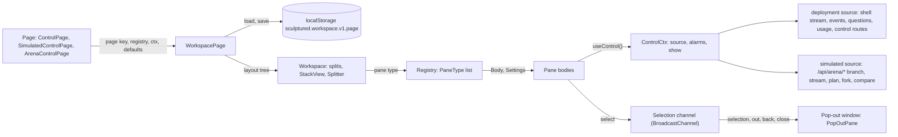

# The Control workspace

Control (`/p/:team/control`), a simulated Arena run (`/arena/runs/:run/:branch`) and Arena control (`/arena`) are one dockable workspace with different panes. The workspace is a tree of splits and tabbed stacks, saved per page in localStorage. Panes come from a registry, share a selection over a `BroadcastChannel`, and can pop out into their own windows. Panes never call the server: they read a **source**, a deployment (a Sculptured team) or a simulated run (an Arena branch). The user guide is [docs/guide/control.md](../guide/control.md).

Sources:
- `web/src/workspace/`: `model.ts`, `store.ts`, `layouts.ts`, `registry.ts`, `slots.tsx`, `selection.tsx`, `usePopOut.ts`, `PopOutPane.tsx`, `WorkspacePage.tsx`, `Workspace.tsx`, `StackView.tsx`, `PaneMenu.tsx`, `AddPane.tsx`, `LayoutTabs.tsx`, `Splitter.tsx`, `useDrag.ts`, `DropOverlay.tsx`, `MobileWorkspace.tsx`
- `web/src/control/`: `ControlPage.tsx`, `ControlHeader.tsx`, `EmergencyStop.tsx`, `ActionButton.tsx`, `registry.ts`, `defaults.ts`, `context.ts`, `source.ts`, `deploymentSource.ts`, `deploymentData.ts`, `deploymentFeed.ts`, `deploymentAgents.ts`, `simulatedSource.ts`, `simulatedFeed.ts`, `SimulatedControlPage.tsx`, `SimGate.tsx`, `alarms.ts`, `useAlarms.ts`, `panes/`
- `web/src/arena/`: `ArenaControlPage.tsx`, `registry.ts`, `defaults.ts`, `data.ts`, `gate.tsx`, `panes/`
- `crates/controld/src/collaboration/{pausing,team_pausing,controls}.rs` (pause, resume, stop-now), `crates/controld/src/arena.rs` (the `/api/arena/*` proxy)
- `web/e2e/control.spec.ts`, `web/e2e/control-video.spec.ts`, `web/e2e/fixtures/{control-team,recording}.ts`



## 1. The layout model

`model.ts` is pure: every function returns a new tree and never mutates its input.

| Type | Shape |
|---|---|
| `PaneRef` | `{ id, type, settings? }`: one pane instance. `id` is unique across the page's layouts. |
| `Stack` | `{ kind: 'stack', id, panes, active }`: tabs, one active. |
| `Split` | `{ kind: 'split', id, dir: 'row' \| 'col', kids, sizes }`: sizes are relative shares. |
| `Layout` | `{ id, name, root, popped }`: `popped` holds panes shown in other windows. |
| `PageLayouts` | `{ version: 1, active, layouts, look?, channel? }`: one page's layout tabs. |

- **Edits:** `movePane` (to a stack's `left`, `right`, `top`, `bottom` or `center`), `closePane`, `addPane`, `duplicatePane`, `resize` (each side keeps at least `MIN_SIZE`, 0.15), `setActive` and `setPaneSettings`.
- **Tidying:** `tidy` drops empty stacks and one-child splits, and merges a split into a parent of the same direction. An empty tree becomes one empty stack.
- **No-op move:** moving a stack's only pane onto that stack does nothing.
- **Layout tabs:** `layouts.ts` adds, duplicates (fresh ids), renames, deletes (never the last), resets to the default of the same id, and pops panes out and back.

## 2. Persistence (`store.ts`)

`loadLayouts(page, defaults, known)` reads `sculptured.workspace.v1.<page>`.

- **Validation.** Every node, pane and layout is checked, with nesting at most 32 deep. Anything unreadable, of another version or malformed gives the page's defaults. Other pages' layouts are untouched.
- **Clean-up.** Duplicate pane ids keep their first occurrence, and unknown pane types are dropped (`dropUnknown`). A layout left with no known pane becomes the default of the same id.
- **Saving.** `saveLayouts` writes on every change. A failed write (storage full, private mode) is ignored; the page keeps working.

Page keys: `control.<team>` for a project's Control, `arena-run` shared by every Arena run, and `arena` for Arena control. Each Arena branch talks over a channel of its own (`arena-run.<branch>`), so two branches open in two tabs never steer each other.

## 3. The registry and the shell

A `PaneType` (`registry.ts`) declares:

| Field | Meaning |
|---|---|
| `type`, `title`, `glyph` | The id, the tab's title and its mark |
| `multi` | Several copies may be open (Duplicate, Add pane again) |
| `selection` | Reads the shared selection; the shell adds a "Follow selection" setting, on by default |
| `appliesTo(ctx)` | Where it applies, for example a deployment only (`kind === 'deployment'`) |
| `defaultSettings`, `Settings` | Its settings and the form shown under ⋯ → Settings |
| `Body` | The pane, given `{ instance, settings, setSettings }` |

- **One registry per page, made once.** `controlRegistry` in `web/src/control/registry.ts` and the Arena registry are module-level. `shellRegistry` wraps each type once, so components keep their identity across renders.
- **Bodies are never remounted.** `Workspace.tsx` renders each body once per pane id and moves its DOM node into the stack's body slot (`place`). Moving a pane, a live update or a re-render never resets its scroll or state.
- **Drag.** `useDrag.ts` starts past a 4 px threshold and finds the stack under the pointer by bounding box. The outer 25% of a stack (`EDGE`) drops beside it; the centre drops as a tab; Esc cancels. Callbacks are read when used, so a stream update mid-drag never interrupts it.
- **Keyboard paths.** The ⋯ menu's **Move to…** (`PaneMenu.tsx`) is the keyboard path for every drag. Splitters move by 5% per arrow key.
- **Mobile.** Below 720 px, `MobileWorkspace` shows one pane at a time from a **Pane** list, with the same panes and settings.

## 4. Selection, channel and pop-out

- **Selection.** `selection.tsx` holds the selection (an agent, a time, a world key) and shares it over a `BroadcastChannel` named after the page's channel. A pane with Follow selection off keeps what it showed.
- **Popping out.** `usePopOut.ts` opens a pane at the page's pane route, for example `/p/:team/control/pane/:instance`, rendered by `PopOutPane` without the app's bars. The pane moves to `layout.popped`. A placeholder pane (`popped:<type>`, `slots.tsx`) stays in its slot with **Bring back** and **Show that window**.
- **Who shows a pane is decided over the channel, never by window handles,** since a reload loses them:
  - the pop-out says `out` when it shows the pane and `back` when it goes away;
  - the main window says `close` when it takes the pane back, or drops it (Reset, Delete).
- **Settings and orphans.** Settings changed in a pop-out are sent to the main window to keep. Closing a placeholder tab brings its pane back into the layout and closes its window.

## 5. Sources

`source.ts` is the one interface panes read, as `ControlCtx.source` (`useControl()`).

| Member | Meaning |
|---|---|
| `kind` | `deployment` or `simulated` |
| `agents` | Each with a status glyph and word, and tokens when reported |
| `feed` | Merged events, oldest first. Each has plain text, the raw record as evidence, and the alarm rule it raises. |
| `approvals`, `decide` | What waits for the operator, and approve or reject |
| `team` | `start`, `pauseAll`, `resumeAll`, `stop`, `emergencyStop`, each an `Action` with `can`: ok, or not ok with a plain `why` |
| `agentControl`, `message` | Per-agent pause, resume, stop and message |
| `metrics` | Tokens, cost, tool calls per minute; `undefined` means unknown, never 0 |
| `timeline`, `run` (simulated) | Steps, saves, cursor, restore plan, fork, compare, world rows |

**The deployment source** (`deploymentSource.ts`) reads:

- the shell's live stream for the team (`shell.teams`);
- recent events per agent (`useTeamEvents`);
- questions, usage, the budget and control modes (`deploymentData.ts`);
- the routes `POST /api/teams/{id}/pause`, `/resume` and `/stop-now`, and the per-agent controls.

Start and Stop team… go through the project bar's own handle (`shell.refs.run`), with its confirmations. Until the stream has answered, every team action says "Connecting…". A design that has never started has no stream, so it is not waiting for one: Start is offered at once.

**The simulated source** (`simulatedSource.ts`) reads the branch, its stream, rows, the restore plan, fork and compare through `/api/arena/*`. Arena runs cannot be paused or stopped from Control yet; those actions say so. While Arena does not answer, `SimGate` shows "Arena is not running" in each pane, with how to start it.

**Alarms.** `alarms.ts` is pure. A feed entry tagged with a rule raises an alarm when that rule is on, and a threshold rule only after its wait. The alarm's id is the rule plus the condition's key (a question, an agent's session), so an acknowledgement (`useAlarms`, kept per team) stays valid however the condition is seen again.

## 6. How to add a pane

1. Write the body in `web/src/control/panes/<Name>.tsx` (or `web/src/arena/panes/`).
   - It reads `useControl()` for the source and `useSelection()` for the selection.
   - It calls no API itself; add what it needs to `ControlSource` and both sources instead.
   - Unknown values say "unknown", status is a mark plus a word, and raw records carry `data-raw-evidence`.
2. Add a `PaneType` to the list in `web/src/control/registry.ts`. Give it `appliesTo` if it only makes sense for one kind of source, `multi` if copies make sense, and `selection: true` if it follows the selection.
3. Optionally put it in a default layout (`defaults.ts`). Pane ids must be unique across the page's layouts. Saved layouts without it keep working, and a saved layout naming a type you later remove drops that pane.
4. Test it with `web/src/control/testHarness.tsx` (deployment) or `simHarness.ts` (simulated), and check `openRigWords` (`web/src/test-vocab.ts`) finds no OpenRig words outside `data-advanced`.

## 7. End-to-end tests and recordings

`web/e2e/control.spec.ts` runs against the real binary (`crates/e2e-server`) with Practice agents:

- `/p/<team>` opens Control;
- Start;
- drag Status beside the Timeline, reload and see it kept;
- **Move to…** by keyboard;
- Pause all, then Resume all;
- Emergency stop with its confirm;
- on Pixel 7, the pane switcher.

The team is made by `web/e2e/fixtures/control-team.ts`: a Planner who hands work to a Buyer and an Inspector, and a rule that an order over $5,000 needs a person. Messages that are stub scripts make things happen: `limit` reaches a usage limit, and `propose_change:{…}` proposes an order.

`web/e2e/control-video.spec.ts` records the guide's screenshots (`docs/images/control/`) and videos (`docs/videos/`). It runs only with `RECORD_VIDEOS=1`:

```bash
cd web && RECORD_VIDEOS=1 npx playwright test control-video.spec.ts
```

- **Videos.** Each is recorded at 1280×800. `fixtures/recording.ts` draws only a pointer and a step caption over the real app (both marked `data-recording-overlay`), and encodes WebM (VP9) and MP4 (H.264) with ffmpeg when it is installed.
- **Arena captures** need serve to reach an arenad (`SCULPTURED_ARENA_URL`) with the retail example. Without one they are skipped, saying why.
  - Arena captures are pending: the November 2 recording environment denied Docker access and local socket creation. No Arena media is committed by this task.
  - Use a throwaway Postgres and save folder, and a scripted stand-in model; never call a real model for recordings.

The two committed videos were recorded before that restriction. The two committed PNGs are still frames extracted from those real recordings. The alarm/approval recording and phone captures remain pending; the partial alarm video was discarded.

## Architecture invariants

- Panes read a source; they never call the server.
- Model functions never mutate their input; a no-op move returns the same tree.
- A saved layout never crashes or blanks the page: bad values give the defaults, and unknown panes are dropped.
- Each pane body is mounted once per pane id; moves and updates never remount it.
- Every drag has a keyboard path (Move to…, splitter arrow keys).
- A disabled control says why in visible text; an action that did nothing is never reported as done.
- Who shows a popped pane is decided over the channel, not by window handles.

## Properties and their tests

| Property | Test |
|---|---|
| A saved layout naming an unknown pane drops it; a corrupt one gives the defaults | `web/src/workspace/store.test.ts` (`loads_with_unknown_pane_dropped`, `corrupt_value_falls_back`) |
| Dropping a stack's only pane on itself does nothing | `web/src/workspace/model.test.ts` (`move_onto_itself_is_noop`) |
| A stream update mid-drag or mid-scroll moves nothing | `web/src/workspace/Workspace.test.tsx` (`stream_update_keeps_drag_and_scroll`) |
| Emergency stop with nothing running, or pressed twice, never errors | `web/src/control/ControlPage.test.tsx` (`emergency_stop_confirm_and_idle`) |
| Arena not answering is said plainly in every pane | `web/src/arena/ArenaControlPage.test.tsx`, `web/src/control/SimulatedControl.test.tsx`, `web/src/control/simulatedSource.test.tsx` (`arena_down_is_plain`) |
| A design that never started can Start at once | `web/src/control/deploymentSource.controls.test.tsx` |
| Control opens first, starts, keeps a dragged layout, moves by keyboard, pauses, resumes, stops; phone pane switcher | `web/e2e/control.spec.ts` |
